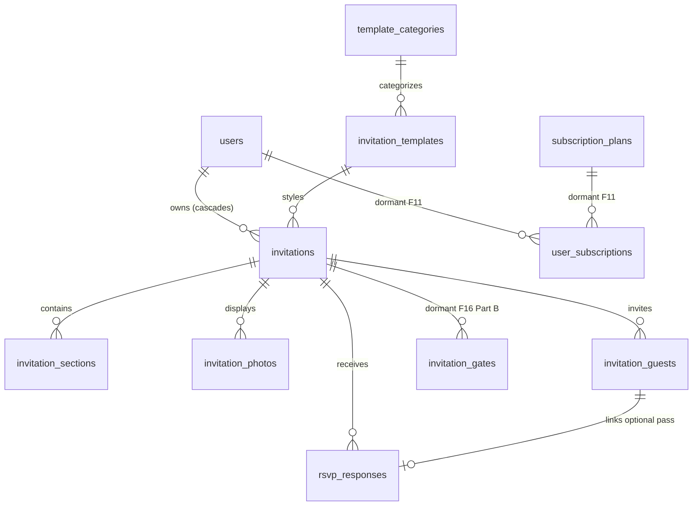

# Zaffe (زفّــة) — Interactive Digital Wedding Invitations & Smart Guest RSVP SaaS

> **Single-Entry Source of Truth for Product Business, Domain Logic, Architecture, and AI/MCP Integrations**  
> **Primary Market:** Saudi Arabia (KSA) First, Egypt Second (MENA) | **Default Language:** Arabic (`ar`, RTL) with English (`en`, LTR) support  
> **Release Stage:** Release 1 Candidate (`F01`–`F10`, `F12`–`F14`, `ZAFFE-016`, `ZAFFE-017`, `F16` Part A active in `dev`; `F16` Part B QR Scanning isolated on `feature/ZAFFE-018-smart-guests-and-qr-checkin`)

---

## 1. Executive Summary & Value Proposition

**Zaffe (زفّــة)** is a Software-as-a-Service (SaaS) platform designed for engaged couples and families in **Saudi Arabia** and **Egypt** to create, customize, publish, and share luxury interactive digital wedding invitations without coding or design experience.

### Problems Solved
1. **High Cost & Rigidity of Physical Cards:** Printed wedding cards are expensive, slow to deliver, and impossible to edit if the venue, date, or time changes. Zaffe invitations update in real time.
2. **Chaotic RSVP & Headcount Tracking:** Families traditionally manage attendance through scattered phone calls, paper notebooks, and WhatsApp chats. Zaffe centralizes confirmed adult and child headcounts, dietary notes, and guest wishes into searchable dashboards and Excel-ready CSV exports.
3. **Static Digital Flyers Lack Utility:** PDFs and static images cannot run a timezone-aware countdown, play a user-initiated audio track, launch Google Maps directions, enforce per-invitee quotas, or generate personal QR passes.

### Core Value Proposition
- **Culturally Authentic Arabic-First Luxury:** **14 curated wedding themes** (8 Saudi Signature Collection — Vol. 1 + 6 baseline templates) built around Arabic typography (`Amiri`, `Cairo`, `Tajawal`, `Playfair Display`), formal-simple Arabic (`الفصحى البسيطة`), SVG iconography (`<x-app-icon>`), and optional photo-free layouts (note: family/optional bride-name display is a target KSA privacy policy currently supported safely by the 8 Saudi Signature templates while DB/validation still require `bride_name` on `dev`).
- **Zero-Code Visual Studio Editor:** Real-time Livewire editor (`InvitationEditor`) with live device preview, instant autosave, custom palette/font overrides, and draft/publish lifecycle control.
- **1-Click WhatsApp Distribution & Mobile WebView Speed:** Built for guests opening invitations inside WhatsApp's in-app browser over 4G mobile connections, with personalized `?g=` invite links and self-hosted WebP assets.
- **Smart Guest Roster, RSVP Engine & Personal QR Passes:** Structured pre-invited guest lists with adult/child quotas, bulk CSV import, E.164 phone normalization (`+966` / `+20`), deduplicated RSVPs, and pure-PHP ISO/IEC 18004 SVG QR passes (`/pass/{qrToken}`).

---

## 2. AI, Tool & MCP Integration Context

If you are an AI coding agent, MCP tool, automation client, or external integration reading this repository, treat these facts as authoritative:

| Dimension | Current Authoritative State |
| :--- | :--- |
| **Domain** | B2C Wedding SaaS (Digital Invitations, Visual Studio Editor, Guest Roster, RSVP & QR Passes) |
| **Stack** | PHP `>= 8.4.1` runtime (`composer.lock` Symfony 8.1; `composer.json` declares `^8.3`; `ext-intl` mandatory), Laravel `^13.17`, Livewire `^4.4`, Alpine.js, Tailwind CSS `^4.0`, Filament `^5.11`, Vite `^8.0` |
| **Commercial Model (Release 1)** | **100% Free Launch** — zero paywalls, zero tier caps, all 14 templates and editor features unlocked. `/admin/subscription-plans` returns `403` (`SubscriptionPlanResource::canAccess(): false`). |
| **Monetization Direction (`F11`)** | **Deferred Post-Release 1** (feature-flagged when enabled). Future model is **one-time pay-per-invitation** via **Paymob** (SAR for KSA, EGP for Egypt dynamically via `PlatformSetting`), **not** recurring subscriptions. |
| **Active Capabilities (`dev`)** | `F01`–`F10`, `F12`–`F14`, `ZAFFE-016`, `ZAFFE-017` Admin Coverage, and **`F16` Part A** (Smart Guest Roster, 4 Invitation Modes, `?g=` personalized links, pure-PHP QR Pass Generation `/pass/{qrToken}`). |
| **Isolated Capability (NOT in `dev`)** | **`F16` Part B (QR Scanning & Gatekeeper Check-In `/gate/{gateToken}`)** is isolated on `feature/ZAFFE-018-smart-guests-and-qr-checkin` pending explicit Product Owner manual merge. Never promise live venue door scanning or gatekeeper check-in in `dev` UI/copy. |
| **Market Priority** | **Saudi Arabia (KSA) First** (`+966`, `Asia/Riyadh`, Umm al-Qura Hijri date, formal-simple Arabic), **Egypt Second** (`+20`, `Africa/Cairo`). |

---

## 3. User Roles & Permissions

| Role | System Identification | Capabilities & Boundaries |
| :--- | :--- | :--- |
| **Invited Guest (Public Visitor)** | Unauthenticated visitor (or identified via `?g={inviteToken}`) | Views published `/invitation/{slug}` cards, opens the mobile audio gate, checks venue map/agenda, submits/updates RSVPs within deadlines and quotas, and views/downloads personal QR passes at `/pass/{qrToken}`. Blocked from drafts (`HTTP 403`). |
| **Engaged Couple / Customer** | `User` with `role = 'user'` | Registers/logs in, creates invitations via wizard, customizes content/design/media/sections in Livewire `InvitationEditor`, manages pre-invited guest rosters (`GuestRosterManager`) and RSVP responses, shares via WhatsApp, and exports UTF-8 BOM CSV files. All mutations are strictly scoped to `Auth::user()->invitations()`. |
| **Platform Super Admin** | `User` with `role = 'admin'` (`canAccessPanel()`) | Accesses Filament v5 Admin Panel (`/admin`) and `OperationsMonitor` (`/admin/operations-monitor`) to manage users, invitations, templates, categories, guest passes, cached `PlatformSetting` entries, and funnel KPIs. Can preview any draft invitation. |

---

## 4. Product Features & Capabilities

### 4.1 Public Discovery & Luxury Themes (`F02`, `ZAFFE-023`, `ZAFFE-024`)
- **Public Pages:** Marketing homepage (`/`), searchable/filterable template catalog (`/templates`), full interactive mock previews with bilingual sample data (`/templates/{slug}/preview`), 100% Free Release 1 pricing page (`/pricing`), plus `/about`, `/contact` (note: public `/contact` form is currently UI-only client feedback), and `/faq`.
- **14 Curated Wedding Themes (`resources/views/templates/`):**
  - **Saudi Signature Collection — Vol. 1 (`sort_order 1–8` via `ZAFFE-024`):** `diriyah_heritage`, `rawashin_elegance`, `sadu_signature`, `taif_rose`, `palm_oasis`, `red_sea_pearl`, `desert_dusk`, `modern_monogram`.
  - **Baseline Collection (`sort_order 9–14`):** `royal_gold`, `floral_romance`, `minimal_chic`, `islamic_elegance`, `emerald_night`, `classic_aristocrat`.

### 4.2 Customer Studio & Visual Editor (`F03`, `F04`, `F08`)
- **Dashboard & KPIs (`/dashboard`):** Displays total invitations, total views, confirmed attendee metrics, and quick actions.
- **Creation Wizard (`/dashboard/invitations/create`):** Captures template choice, couple names, wedding date/time, timezone (`Asia/Riyadh` or `Africa/Cairo`), and venue, generating a unique URL slug (`{groom}-and-{bride}` with incremental collision suffix or `wedding-{random}` fallback).
- **Livewire Visual Studio Editor (`InvitationEditor` at `/dashboard/invitations/{id}/editor`):**
  - Six-tab workspace (`basics`, `content`, `design`, `media`, `templates`, `rsvp`) plus a Publish Share Modal, responsive device preview, and real-time autosave.
  - Custom style overrides (`custom_styles` JSON for primary, secondary, background, card, accent colors, and font family) and instant on-the-fly template switching without losing wedding data.
  - Storage-backed cover photo and photo gallery uploads (`5MB` max, MIME-validated, automatic local file cleanup on customer photo/invitation deletion).
  - Modular `InvitationSection` toggles (`countdown`, `timeline`, `gallery`, `dress_code`; note `timeline` and `dress_code` currently act as visibility toggles without custom content editors).
  - Status toggling (`draft` ↔ `published`; `archived` status is supported via Filament Admin or `POST /archive`, with no couple-facing archive button) and 1-click WhatsApp share URL generation (`Invitation::getWhatsAppShareUrl()`).

### 4.3 Four Invitation Access Modes (`F16` Part A)
Configured per invitation via `Invitation::$invitation_mode` (kept synchronized with `is_rsvp_enabled` in `Invitation::booted()`):

| Mode Constant | Value | Behavior on Public Invitation |
| :--- | :--- | :--- |
| `MODE_RSVP_QR` | `rsvp_qr` | Interactive RSVP form + automatic personal QR Pass issuance upon confirmation (or immediately via `?g=` link). |
| `MODE_RSVP_ONLY` | `rsvp_only` | Interactive RSVP form without generating or showing a QR Pass. |
| `MODE_QR_ONLY` | `qr_only` | Direct personal QR Pass card display (`?g=` invitees) without requiring an RSVP form submission. |
| `MODE_ANNOUNCEMENT` | `announcement` | View-only digital wedding card (no RSVP form and no QR pass). |

### 4.4 Smart Guest Roster & Pure-PHP QR Passes (`F16` Part A)
- **Guest Roster Manager (`App\Livewire\GuestRosterManager`):**
  - Pre-register named guests with categories (`general`, `vip`, `family_groom`, `family_bride`, `kids`), phone numbers (normalized to E.164), adult quota (`max_adults`), and child quota (`max_children`).
  - Bulk CSV upload or pasted text import with import summary reporting.
  - Formula-safe roster CSV export (`/dashboard/invitations/{id}/guests/roster-export`).
  - Per-guest personalized invite links (`/invitation/{slug}?g={inviteToken}`) and tracked WhatsApp invite (`invited_at`) and reminder (`reminded_at`) timestamps.
- **Pure-PHP ISO/IEC 18004 QR Pass (`QrCodeService` & `GuestPassController`):**
  - Generates self-contained vector SVG QR codes (Versions 1–10, ECC Level M, 4-module quiet zone) with zero external image libraries or external API calls.
  - Serves high-contrast personal passes at `/pass/{qrToken}` (`throttle:60,1`) featuring event details, guest name, confirmed adult/child headcount, and a readable 6-character `pass_code`.
- **Scope Boundary Note:** Live venue gatekeeper scanning (`/gate/{gateToken}`, `GateScanner`, `InvitationGate`) is **isolated** on `feature/ZAFFE-018-smart-guests-and-qr-checkin` and is inactive in `dev` (`invitation_gates` table and `checked_in_*` columns remain dormant in migrations).

### 4.5 Public Card Experience, Saudi Localization & RSVP Engine (`F05`, `F06`, `F07`, `F10`)
- **Dual Calendar & Configurable Digits (`InvitationDateFormatter`):**
  - Supports **Umm al-Qura Hijri** dates alongside Gregorian dates for KSA invitations (`Asia/Riyadh` or Hijri-enabled configuration).
  - Supports configurable numeral rendering: `latin` (`0-9`) vs. `arabic_indic` (`٠-٩`) across dates, times, countdowns, and counts.
  - Timezone-aware ISO countdown targets and session-deduplicated `view_count` increments.
- **Mobile User-Tap Audio Gate:** When background music is configured, renders an interactive open-gate screen (`شاشة فتح الدعوة`) so the guest's tap triggers playback reliably inside mobile Safari, Android Chrome, and WhatsApp's in-app WebView. Only licensed/royalty-free platform tracks, user-uploaded audio, or disabled (`None`) modes are permitted.
- **Interactive RSVP Engine (`App\Livewire\RsvpForm`):**
  - Captures attendance status (`attending`, `declined`, `tentative`), adult count (`guest_count`), child count (`children_count`), dietary checkboxes/notes, and wishes.
  - Supports Egypt (`+20`) and Saudi Arabia (`+966`) phone validation/normalization via `PhoneService`.
  - Prevents duplicate RSVP entries via in-place phone updates and enforces personalized `?g=` quota caps.
- **Queued Transactional Emails (Resend + `database` queue):**
  - `ResetPasswordNotification`: Password reset flow via Laravel Password Broker.
  - `NewRsvpNotification`: Real-time alert to the invitation owner on new RSVP submissions.
  - `RsvpConfirmationNotification`: Confirmation email to guests who provide an email address.
- **Super Admin Panel (`app/Filament/`, `/admin`):**
  - Resources for `User`, `Invitation`, `InvitationTemplate`, `TemplateCategory`, `RsvpResponse` (read-only monitoring, CSV export, spam deletion), `InvitationGuest`, and `PlatformSetting` (`PlatformSettingCatalog`).
  - `PlatformStatsOverview` widget and `OperationsMonitor` page (`/admin/operations-monitor`) tracking funnel KPIs and mail/queue health.
  - `SubscriptionPlanResource` locked (`canAccess(): false`, returning `403`) during Release 1.

---

## 5. Core Domain Entities & Database Schema

### 5.1 Entity Directory
- **`User` (`users`):** Account credentials, `role` (`user` | `admin`), normalized `phone`, `avatar_url`.
- **`TemplateCategory` (`template_categories`):** Aesthetic collections (`luxury`, `floral`, `minimal`, `islamic`, `classic`, `romantic`).
- **`InvitationTemplate` (`invitation_templates`):** Visual templates (`view_name`, `default_styles` JSON, `is_active`, `is_premium`).
- **`Invitation` (`invitations`):** Core wedding record (`user_id`, `template_id`, `slug`, `groom_name`, `bride_name`, `wedding_date`, `wedding_time`, `timezone`, venue fields, `custom_styles`, `status`, `invitation_mode`, `is_rsvp_enabled`, `rsvp_deadline`, `max_guests_per_rsvp`, `view_count`).
- **`InvitationSection` (`invitation_sections`):** Modular blocks (`countdown`, `timeline`, `gallery`, `dress_code`) with JSON `content` and `is_enabled`.
- **`InvitationPhoto` (`invitation_photos`):** Gallery photo paths, captions, cover flag, and sort order.
- **`InvitationGuest` (`invitation_guests`):** Pre-invited guest roster entries (`category`, `max_adults`, `max_children`, unique `invite_token` & `qr_token`, 6-char `pass_code`, `rsvp_status`, `confirmed_adults`, `confirmed_children`, `is_self_registered`, `invited_at`, `reminded_at`).
- **`RsvpResponse` (`rsvp_responses`):** Guest RSVP records (`invitation_guest_id`, `guest_name`, `phone`, `email`, `attendance_status`, `guest_count`, `children_count`, `message`, `dietary_notes`, `ip_address`).
- **`PlatformSetting` (`platform_settings`):** Key-value global settings (`site_name_ar`, `site_name_en`, `contact_email`, `contact_phone`, `whatsapp_support`, etc.).
- **Dormant Schema:** `subscription_plans` & `user_subscriptions` (for Post-Release 1 `F11`) and `invitation_gates` + `checked_in_*` columns on `invitation_guests` (for isolated `F16` Part B).

### 5.2 Relational Diagram



---

## 6. Critical Business Rules, Security & Cultural Guardrails

All changes, integrations, and AI-assisted edits **must preserve** these non-negotiable invariants:

### Security & Access Control
1. **Draft Privacy (`InvitationController::show()`):** Invitations with `status === 'draft'` return **HTTP 403 Forbidden** (`pages.unpublished`) unless requested by the owning couple or an authenticated admin.
2. **Ownership Isolation (IDOR Defense):** Every customer dashboard query and mutation must scope through `Auth::user()->invitations()` or `InvitationEditor::getAuthorizedInvitation()`. Never query `Invitation::find($id)` unscoped for customer actions.
3. **Livewire State Locks:** Sensitive/identifying properties on Livewire components (`$invitationId`, `$guestId`, `$maxGuests`, `$maxChildren`, issued pass properties) must declare `#[Locked]` to prevent client tampering.
4. **Explicit Model Policies:** `InvitationPolicy`, `InvitationTemplatePolicy`, `UserPolicy` (prevents self-deletion and last-admin deletion), `TemplateCategoryPolicy`, `RsvpResponsePolicy`, `InvitationGuestPolicy`, `PlatformSettingPolicy`, and `SubscriptionPlanPolicy` enforce domain authorization across Laravel and Filament.
5. **HTTP Hardening (`SecurityHeaders` middleware):** Attaches `X-Content-Type-Options: nosniff`, `X-Frame-Options: SAMEORIGIN`, `Referrer-Policy`, and `X-XSS-Protection` across web routes, and enforces `Referrer-Policy: no-referrer`, `X-Robots-Tag: noindex, nofollow`, and `Cache-Control: no-store, no-cache, must-revalidate, private` on `/pass/*` and personalized `/invitation/*?g=*` links (note: Filament `/admin/*` does not currently register `SecurityHeaders`).

### RSVP & Data Integrity
1. **Deadline & Toggle Enforcement:** Rejects RSVP submissions when `is_rsvp_enabled` is false (or mode does not accept RSVPs) or when `now()->startOfDay()->gt($invitation->rsvp_deadline)`.
2. **Quota & Headcount Coherence:** Enforces `max_guests_per_rsvp` (or pre-invited `InvitationGuest` `max_adults` / `max_children` quotas). When `attendance_status !== 'attending'` (including `declined`), `guest_count` and `children_count` are forcibly stored as `0`.
3. **E.164 Deduplication & Roster Protection:** Phone numbers are validated and normalized to E.164 (`+20` / `+966`) via `PhoneService`. Resubmissions matching an existing `RsvpResponse` phone on that invitation update the record in place. Unauthenticated public submissions cannot hijack a pre-invited (`is_self_registered = false`) roster entry without its personal `?g=` link.
4. **Rate Limiting:** RSVP submissions are capped at **10 attempts per minute per IP per invitation**; authentication and password-reset endpoints use `throttle:6,1`; personal QR passes (`/pass/{qrToken}`) use `throttle:60,1`.
5. **CSV Formula Injection Defense & Arabic Excel Support:** All CSV exports (`DashboardController::exportGuestsCsv()`, `exportRosterCsv()`, and Filament exports) sanitize strings starting with `=`, `+`, `-`, `@`, `\t`, or `\r` (after `ltrim`) via `App\Support\CsvSanitizer::cell()` (prefixing `'`) and prepend UTF-8 BOM (`0xEF, 0xBB, 0xBF`).

### Saudi-First Cultural, Privacy & Performance Rules
1. **Privacy by Default:** Displaying the bride's full name and uploading couple/bride photos are target KSA privacy principles (`docs/product/SAUDI_MARKET_DECISIONS.md`). Photo-free luxury rendering works across all 14 templates and the 8 Saudi Signature templates guard empty `bride_name`, while current DB schema (`NOT NULL`) and form validation on `dev` still require `bride_name` pending schema remediation.
2. **PDPL-Minded Minimal PII:** Collect only minimal attendance/coordination fields; deleting an invitation or photo via customer flows removes associated local storage assets (`public` disk).
3. **Religious Text Integrity:** **Never** generate, paraphrase, autocomplete, or type Quranic verses (`آيات قرآنية`) from memory or AI output. Only exact Product-Owner-verified strings may appear.
4. **No Unicode Emojis in Luxury Templates:** Luxury invitation template Blade views must use crisp `<x-app-icon>` inline SVGs — never Unicode emojis.
5. **Zero External Hotlinked Images & Mobile LCP:** Never hotlink external third-party CDNs (such as Unsplash) in templates or seeders. Serve self-hosted WebP assets optimized for **LCP < 2.5s** in WhatsApp's mobile WebView over 4G.
6. **Formal-Simple Arabic (`الفصحى البسيطة`):** KSA-facing copy and shared templates must avoid Egyptian colloquial slang.

---

## 7. Architecture & Key Routes

### 7.1 Technology Stack
| Layer | Technology |
| :--- | :--- |
| **Backend & Framework** | PHP `>= 8.4.1` runtime (`composer.lock` Symfony 8.1; `composer.json` declares `^8.3`; `ext-intl` mandatory), Laravel `^13.17` |
| **Reactive UI** | Livewire `^4.4`, Alpine.js (bundled with Livewire) |
| **Styling & Build** | Tailwind CSS `^4.0` (`@tailwindcss/vite`), Vite `^8.0` |
| **Super Admin Panel** | Filament `^5.11` (`/admin`) |
| **Database** | SQLite 3 (local dev & PHPUnit tests), **MySQL 8.4** (production/staging target) |
| **Mail & Queues** | **Resend** via Laravel Mail & Notifications (`ShouldQueue` + `database` queue driver) |
| **Testing & Lint** | PHPUnit `^12.5` (`22` test files / `196` tests), Laravel Pint `^1.27` |

### 7.2 HTTP Route Directory (`routes/web.php` & Filament)

| URI | Method(s) | Handler / Middleware | Purpose |
| :--- | :--- | :--- | :--- |
| `/` | `GET` | `HomeController::index` | Public landing page |
| `/templates`, `/templates/{slug}/preview` | `GET` | `HomeController` | Template catalog & live interactive mock preview |
| `/pricing`, `/about`, `/contact`, `/faq` | `GET` | `HomeController` | Free Release 1 pricing & informational pages |
| `/lang/{locale}` | `GET` | Closure (`ar` / `en`) | Bilingual RTL/LTR session locale switcher |
| `/login`, `/register`, `/forgot-password`, `/reset-password/{token}` | `GET`, `POST` | `AuthController` (`guest`, `throttle:6,1`) | Couple authentication & Resend password reset |
| `/logout` | `POST` | `AuthController::logout` (`auth`) | Session logout |
| `/dashboard` | `GET` | `DashboardController::index` (`auth`) | Couple studio KPIs & overview |
| `/dashboard/invitations` | `GET`, `POST` | `DashboardController` (`auth`) | List & store invitations |
| `/dashboard/invitations/create` | `GET` | `DashboardController::create` (`auth`) | Invitation creation wizard |
| `/dashboard/invitations/{id}/editor` | `GET` | `InvitationEditor` (`auth`, Livewire) | Real-time visual studio editor |
| `/dashboard/invitations/{id}/toggle-publish`, `archive`, `DELETE` | `POST`, `DELETE` | `DashboardController` (`auth`) | Publish/draft toggle, archive, and deletion |
| `/dashboard/invitations/{id}/guests` | `GET` | `DashboardController::guests` (`auth`) | RSVP response manager & `GuestRosterManager` |
| `/dashboard/invitations/{id}/guests/export` | `GET` | `DashboardController::exportGuestsCsv` (`auth`) | Formula-safe UTF-8 BOM CSV export of RSVPs |
| `/dashboard/invitations/{id}/guests/roster-export` | `GET` | `DashboardController::exportRosterCsv` (`auth`) | Formula-safe UTF-8 BOM CSV export of guest roster |
| `/dashboard/profile` | `GET`, `PUT` | `DashboardController` (`auth`) | Couple profile & password management |
| `/invitation/{slug}` | `GET` | `InvitationController::show` | Public wedding card (supports `?g={inviteToken}`; enforces draft privacy) |
| `/pass/{qrToken}` | `GET` | `GuestPassController::show` (`throttle:60,1`) | High-contrast personal QR pass view |
| `/admin/*` | Multi | Filament Panel (`auth`, `canAccessPanel`) | Super Admin resources & `/admin/operations-monitor` |

---

## 8. Local Setup, Credentials & Testing

### 8.1 Quick Start
```bash
cp .env.example .env
composer install
php artisan key:generate

# Create local SQLite database if needed (PowerShell: New-Item database/database.sqlite -ItemType File)
touch database/database.sqlite

php artisan migrate:fresh --seed
php artisan storage:link
npm install && npm run build
composer run dev
```

> [!NOTE]
> **Windows PHP & Composer Note:** `composer.lock` resolves Symfony 8.1 packages requiring **PHP `>= 8.4.1`** with **`ext-intl`** enabled (required by Filament `Number::format()` and `IntlDateFormatter` Umm al-Qura dates). `herd-lite` PHP lacks `ext-intl`, and the Winget PHP Composer wrapper may hit `PharException: manifest cannot be larger than 100 MB` — use standalone `php composer.phar` and WinGet PHP 8.5 (`ext-intl` enabled) or MySQL 8.4 + `ext-intl` staging.

### 8.2 Seeded Local Accounts
| Role | Email | Password | Entry Point |
| :--- | :--- | :--- | :--- |
| **Super Admin** | `admin@zaffe.app` | `password123` | `/admin` |
| **Demo Couple** | `couple@zaffe.app` | `password123` | `/dashboard` |
| **Demo Public Card** | — | — | `/invitation/ahmed-and-sarah` |

### 8.3 Verification & Code Quality
```bash
# Run full automated PHPUnit feature/unit suite (requires PHP >= 8.4.1 + ext-intl)
php artisan test

# Check Laravel Pint code formatting
./vendor/bin/pint --test

# Build production frontend assets
npm run build
```

---

## 9. Canonical Documentation Index

Consult [docs/README.md](docs/README.md) for the full categorized index, or jump directly to core specifications:

| Document | Purpose |
| :--- | :--- |
| **[docs/README.md](docs/README.md)** | Complete categorized index of all architecture, business, product, engineering, UI, and QA documentation |
| **[docs/DOCUMENTATION_GUIDELINES.md](docs/DOCUMENTATION_GUIDELINES.md)** | Documentation governance, living-vs-historical policy, Markdown conventions, and anti-duplication rules |
| **[docs/PROJECT_CONTEXT.md](docs/PROJECT_CONTEXT.md)** | Technical & product architecture overview and current status |
| **[docs/business/project-discovery.md](docs/business/project-discovery.md)** | Phase 1 reverse-engineering discovery report verified against `dev` source code |
| **[docs/business/DOCUMENTATION_AUDIT_SUMMARY.md](docs/business/DOCUMENTATION_AUDIT_SUMMARY.md)** | Phase 2 documentation audit inventory, resolved conflicts, and open clarification gaps |
| **[AGENTS.md](AGENTS.md)** | Mandatory operating protocol for AI coding agents |
| **[docs/product/PRODUCT.md](docs/product/PRODUCT.md)** | Product identity, users, positioning, capabilities, and accessibility commitments |
| **[docs/product/BUSINESS_OVERVIEW.md](docs/product/BUSINESS_OVERVIEW.md)** | Business domain analysis, personas, journeys, and feature inventory |
| **[docs/architecture/ARCHITECTURE.md](docs/architecture/ARCHITECTURE.md)** | System architecture, schema, layers, routes, and security design |
| **[docs/engineering/DEVELOPMENT_GUIDE.md](docs/engineering/DEVELOPMENT_GUIDE.md)** | Environment setup, template authoring conventions, and pitfalls |
| **[docs/product/SAUDI_MARKET_DECISIONS.md](docs/product/SAUDI_MARKET_DECISIONS.md)** | KSA-first cultural, Hijri, privacy, WebP, audio, and KPI directives |
| **[docs/product/RELEASE_1_PRODUCT_DECISIONS.md](docs/product/RELEASE_1_PRODUCT_DECISIONS.md)** | Free launch policy, Resend, Paymob direction, and feature roadmap |
| **[docs/architecture/QR_FEATURE_ISOLATION_POLICY.md](docs/architecture/QR_FEATURE_ISOLATION_POLICY.md)** | Governance separating QR Pass Generation (`dev`) from QR Scanning (isolated branch) |
| **[docs/architecture/TECHNICAL_AUDIT.md](docs/architecture/TECHNICAL_AUDIT.md)** | Security audit, performance findings, and technical debt register |
| **[docs/engineering/DEPLOYMENT_CHECKLIST.md](docs/engineering/DEPLOYMENT_CHECKLIST.md)** | Staging/production deployment and MySQL 8.4 + `ext-intl` verification checklist |
| **[docs/ui/DESIGN.md](docs/ui/DESIGN.md)** | Canonical design system tokens, typography, components, and RTL/a11y rules |
| **[docs/ui/ZAFFE_DESIGN_SYSTEM.md](docs/ui/ZAFFE_DESIGN_SYSTEM.md)** | Implementation guide for CSS tokens, layouts, SVG iconography, and themes |
| **[docs/qa/ZAFFE_FEATURE_TEST_MATRIX.md](docs/qa/ZAFFE_FEATURE_TEST_MATRIX.md)** | Living test execution matrix covering customer workflows, negative paths, and security gates |
