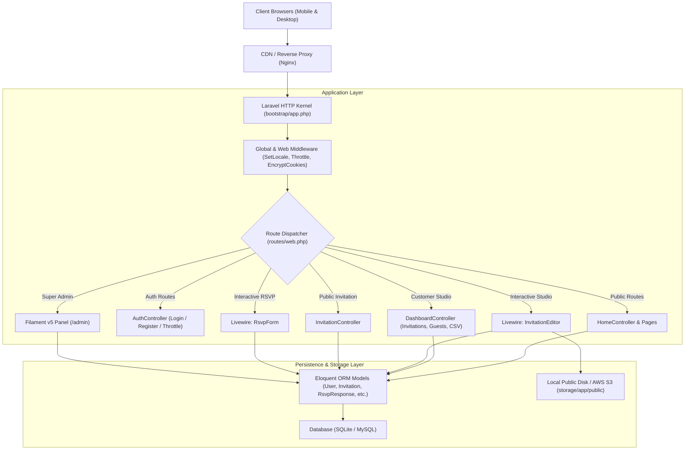
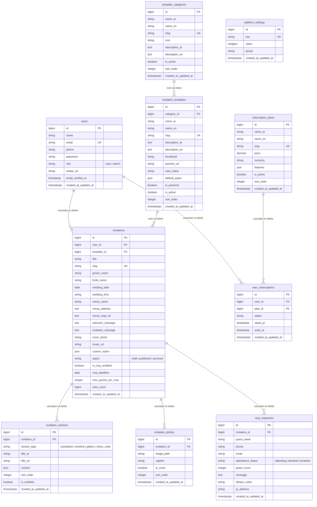

# Zaffe (زفّــة) — Technical Architecture & System Design

> **Single Source of Truth for System Architecture, Component Relationships, and Data Flow**  
> **Status:** Officially Documented | **Last Updated:** 2026-11-12  
> **Classification Legend:**
> - `[VERIFIED]`: Directly confirmed from codebase, configuration files, and database migrations.
> - `[INFERRED]`: Architectural deduction based on patterns in the codebase.
> - `[UNKNOWN]`: Architectural decision not yet finalized or explicitly documented.

---

## 1. High-Level System Architecture

Zaffe is structured as a modern full-stack web application built on **Laravel 13** with **Livewire 4**, **Tailwind CSS v4**, and **Filament v5** for administration. It follows an MVC-extended pattern incorporating component-driven reactive interfaces for complex user interactions without requiring a separate single-page application (SPA) frontend.



---

## 2. Technology Stack Breakdown `[VERIFIED]`

| Layer / Concern | Technology | Version | Location / Evidence | Purpose & Architectural Rationale |
| :--- | :--- | :--- | :--- | :--- |
| **Backend Language** | PHP | `^8.3` (running 8.3.31) | `composer.json:9` | Modern PHP with strict types, arrow functions, and constructor promotion. |
| **Core Framework** | Laravel Framework | `v13.42.0` | `composer.lock:2280` | High-productivity MVC framework providing routing, auth, ORM, queues, and testing. |
| **Reactive Component Layer** | Livewire | `v4.4.8` | `composer.lock:3452` | Drives real-time UI (Invitation Studio, RSVP form) without full-page reloads or client JS boilerplate. |
| **Client-Side Reactivity** | Alpine.js | Bundled with Livewire 4 | Blade templates | Handles lightweight client state: countdown timers, music player, copy-to-clipboard. |
| **CSS / Styling** | Tailwind CSS | `v4.0.0` | `package.json:13`, `resources/css/app.css` | Utility-first styling with `@import 'tailwindcss';` and custom luxury theme tokens. |
| **Admin Panel** | Filament Admin | `v5.11.2` | `composer.lock:1209` | Instant TALL-stack backoffice for platform super admins (`/admin`). |
| **Asset Bundler** | Vite | `^8.0.0` | `package.json:14`, `vite.config.js` | Fast HMR development server and optimized production asset pipeline. |
| **Database** | SQLite (dev) / MySQL (prod) | SQLite 3 | `config/database.php`, `phpunit.xml:26` | Low-friction zero-config development with in-memory execution for unit/feature tests. |
| **Filesystem / Storage** | Local Public Storage / S3 | Driver: `local` / `s3` | `config/filesystems.php` | Storage of couple cover photos and high-resolution photo gallery uploads. |
| **Session & Cache** | Database / Array | Driver: `database` | `config/session.php`, `config/cache.php` | Stateful session storage for auth tokens and locale preferences. |

---

## 3. Directory Structure & Module Responsibilities `[VERIFIED]`

```
E:\GithubProjects\Zaffe
├── app/
│   ├── Filament/                  # Filament v5 Super Admin Panel
│   │   ├── Resources/             # Admin Resource CRUDs (Users, Invitations, Templates, etc.)
│   │   │   ├── Invitations/
│   │   │   ├── InvitationTemplates/
│   │   │   ├── PlatformSettings/
│   │   │   ├── RsvpResponses/
│   │   │   ├── SubscriptionPlans/
│   │   │   ├── TemplateCategories/
│   │   │   └── Users/
│   │   └── Widgets/               # Admin Dashboard Analytics (PlatformStatsOverview)
│   ├── Http/
│   │   ├── Controllers/           # Standard HTTP Request Handlers
│   │   │   ├── AuthController.php         # Registration, Login, Logout, Throttle
│   │   │   ├── DashboardController.php    # Customer Studio, Invitation CRUD, Guest CSV Export
│   │   │   ├── HomeController.php         # Public Marketing, Template Catalog, Live Previews
│   │   │   └── InvitationController.php   # Public Wedding Invitation View & Access Gating
│   │   └── Middleware/
│   │       └── SetLocale.php              # Session-based Locale Switcher (ar/en)
│   ├── Livewire/                  # Reactive Component Controllers
│   │   ├── InvitationEditor.php   # Visual Studio Editor with live autosave & upload handling
│   │   └── RsvpForm.php           # Guest RSVP submission with rate-limiting & deduplication
│   ├── Models/                    # Eloquent ORM Models
│   │   ├── Invitation.php
│   │   ├── InvitationPhoto.php
│   │   ├── InvitationSection.php
│   │   ├── InvitationTemplate.php
│   │   ├── PlatformSetting.php
│   │   ├── RsvpResponse.php
│   │   ├── SubscriptionPlan.php
│   │   ├── TemplateCategory.php
│   │   ├── User.php
│   │   └── UserSubscription.php
│   └── Providers/
│       ├── AppServiceProvider.php
│       └── Filament/AdminPanelProvider.php
├── bootstrap/
│   └── app.php                    # Application Bootstrap & Middleware Stack
├── config/                        # Laravel Configuration Files
├── database/
│   ├── factories/                 # Model Test Factories
│   ├── migrations/                # Database Migrations (Schema Definitions)
│   └── seeders/DatabaseSeeder.php # Comprehensive Seed Data (Admin, Couple, 6 Templates, RSVPs)
├── public/                        # Web Entry Point (index.php, static assets)
├── resources/
│   ├── css/app.css                # Tailwind CSS v4 Main Stylesheet & Theme Variables
│   ├── js/app.js                  # Frontend JS Script Bundle
│   └── views/                     # Blade Templates
│       ├── auth/                  # Authentication Views (Login, Register, Forgot Password)
│       ├── components/            # Reusable Components (<x-app-icon>, Layouts)
│       ├── dashboard/             # Customer Studio Views (Index, Create, Invitations, Guests, Profile)
│       ├── layouts/               # Base, Marketing, and Dashboard Layout Wrappers
│       ├── livewire/              # Livewire Component Blade Templates (Editor, RSVP Form)
│       ├── pages/                 # Marketing Pages (Home, Templates, Pricing, About, Contact, FAQ)
│       └── templates/             # 6 Specialized Wedding Theme Templates & Partials
│           ├── classic_aristocrat.blade.php
│           ├── emerald_night.blade.php
│           ├── floral_romance.blade.php
│           ├── islamic_elegance.blade.php
│           ├── minimal_chic.blade.php
│           ├── royal_gold.blade.php
│           └── partials/          # Countdown, Music Player, Share Box, Timeline, Gallery, Dress Code
├── routes/
│   ├── console.php                # CLI Commands
│   └── web.php                    # HTTP Route Declarations
└── tests/
    ├── Feature/
    │   ├── AuditTest.php          # 500+ lines testing Security, IDOR, CSV Injection, RSVP, Throttles
    │   └── WeddingPlatformTest.php# Core Business Flow Integration Tests
    └── TestCase.php               # Base Test Configuration
```

---

## 4. Architectural Patterns & Layer Responsibilities `[VERIFIED]`

### 4.1 Layered Separation of Concerns
1. **Routing & Dispatch (`routes/web.php`):** Clean RESTful grouping divided into Public Marketing, Authentication, Customer Dashboard, and Public Invitation endpoints.
2. **Controllers (`app/Http/Controllers`):** Handle input validation, session management, and HTTP response orchestration. Keep controllers lean by delegating heavy stateful interactions to Livewire.
3. **Livewire Reactive Layer (`app/Livewire`):**
   - Encapsulates complex stateful UI flows (`InvitationEditor`, `RsvpForm`).
   - Uses `#[Locked]` attributes on critical IDs (`$invitationId`, `$maxGuests`) to prevent client-side tampering.
   - Manages asynchronous file uploads (`WithFileUploads`) with temporary validation before committing to storage.
4. **Eloquent Data Layer (`app/Models`):**
   - Rich domain logic encapsulated inside model methods and accessors (`getPublicUrlAttribute()`, `getEffectiveStylesAttribute()`, `getWhatsAppShareUrl()`, `isPublished()`).
   - JSON attribute casting (`custom_styles`, `content`, `features`).
5. **Admin Abstraction Layer (`app/Filament`):**
   - Implements resource-based management separated into Schemas and Tables.
   - Restricts access via `FilamentUser` interface implemented on `User`.

---

## 5. Detailed Database Architecture `[VERIFIED]`

### 5.1 Relational Schema Diagram



### 5.2 Key Database Indexes & Optimizations `[VERIFIED]`
- `invitations`: Composite index on `['user_id', 'status']` for rapid dashboard filtering; unique index on `slug`.
- `invitation_sections`: Composite index on `['invitation_id', 'is_enabled']`.
- `rsvp_responses`: Composite index on `['invitation_id', 'attendance_status']` for instant count and sum queries.
- `invitation_photos`: Index on `invitation_id`.

---

## 6. API & Route Architecture `[VERIFIED]`

### 6.1 Route Directory

| URI | HTTP Method | Controller / Component | Action / Middleware | Purpose |
| :--- | :--- | :--- | :--- | :--- |
| `/` | `GET` | `HomeController` | `index` | Public landing page with featured templates & pricing |
| `/templates` | `GET` | `HomeController` | `templates` | Searchable & filterable template catalog |
| `/templates/{slug}/preview` | `GET` | `HomeController` | `previewTemplate` | Full interactive mock preview of any template |
| `/pricing` | `GET` | `HomeController` | `pricing` | Subscription plans comparison |
| `/about`, `/contact`, `/faq`| `GET` | `HomeController` | Standard static views | Supporting informational pages |
| `/lang/{locale}` | `GET` | Closure | Session update | Switch language between Arabic and English |
| `/login` | `GET`, `POST` | `AuthController` | `guest`, `throttle:6,1` | Authentication login page & processing |
| `/register` | `GET`, `POST` | `AuthController` | `guest`, `throttle:6,1` | User registration & initial setup |
| `/forgot-password` | `GET`, `POST` | `AuthController` | `guest`, `throttle:6,1` | Password reset request |
| `/logout` | `POST` | `AuthController` | `auth` | Session invalidation and token regeneration |
| `/dashboard` | `GET` | `DashboardController` | `auth` | Customer studio metrics & summary overview |
| `/dashboard/invitations` | `GET` | `DashboardController` | `auth` | Paginated listing of user's invitations |
| `/dashboard/invitations/create` | `GET` | `DashboardController` | `auth` | Invitation creation wizard |
| `/dashboard/invitations` | `POST` | `DashboardController` | `auth` | Stores new invitation and auto-generates slug |
| `/dashboard/invitations/{id}/editor` | `GET` | `InvitationEditor` | `auth`, Livewire | Full-screen visual studio editor |
| `/dashboard/invitations/{id}` | `DELETE` | `DashboardController` | `auth` | Soft or hard deletion of user invitation |
| `/dashboard/invitations/{id}/guests` | `GET` | `DashboardController` | `auth` | Searchable guest RSVP table & summary stats |
| `/dashboard/invitations/{id}/guests/export`| `GET` | `DashboardController` | `auth` | Streamed UTF-8 BOM CSV export of guest list |
| `/dashboard/profile` | `GET`, `PUT` | `DashboardController` | `auth` | User profile update (name, email, password) |
| `/invitation/{slug}` | `GET` | `InvitationController` | `show` | Public wedding card view; enforces draft privacy |
| `/admin/*` | Multi | Filament Panel Provider | `auth`, `canAccessPanel`| Super admin management suite |

---

## 7. Authentication, Authorization & Security Architecture `[VERIFIED]`

### 7.1 Access Control Matrix
- **Guest / Public:** Has read-only access to `/`, `/templates`, `/pricing`, published `/invitation/{slug}`, and write access to `RsvpForm` and auth routes.
- **Couple / Authenticated User:** Has full CRUD access to their own invitations, photos, sections, and guest RSVPs. Blocked from other couples' records (`findOrFail` scoped to `auth()->user()->invitations()`).
- **Super Admin (`role === 'admin'`):** Can access `/admin`, bypass draft restrictions on any invitation, and manage system-wide settings.

### 7.2 Applied Security Remediations `[VERIFIED]`
1. **Livewire IDOR Prevention:** The `InvitationEditor` declares `#[Locked] public int $invitationId` and enforces `$this->getAuthorizedInvitation()` on every single method call.
2. **CSV Formula Injection:** User inputs in the CSV stream are sanitized to prevent execution in spreadsheet software (`=`, `+`, `-`, `@` escaped with leading `'`).
3. **RSVP Spam Protection:** IP rate limiting restricts rapid submissions to 10 attempts per minute per IP.
4. **Credential Brute-Force Throttling:** Login and registration routes are protected by `throttle:6,1`.

---

## 8. External Integrations & Infrastructure

### 8.1 WhatsApp Sharing `[VERIFIED]`
- Implemented via universal URL protocol: `https://api.whatsapp.com/send?text={encoded_message}`.
- Localized message text dynamically constructed by `Invitation::getWhatsAppShareText($lang)`.

### 8.2 Google Maps Navigation `[VERIFIED]`
- Uses standard Google Maps query links (`venue_map_url`) passed to responsive buttons in templates.

### 8.3 Unsplash Dynamic Assets `[VERIFIED]`
- Default templates and seed data utilize responsive CDN images from Unsplash formatted with WebP/JPEG parameters (`auto=format&fit=crop&w=800&q=80`).

