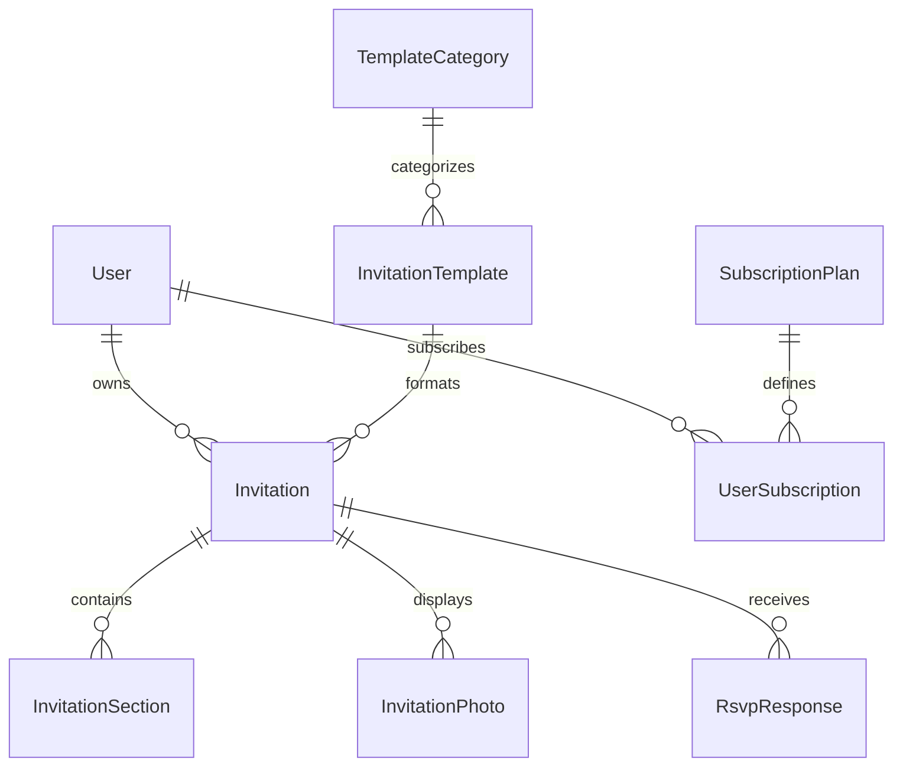
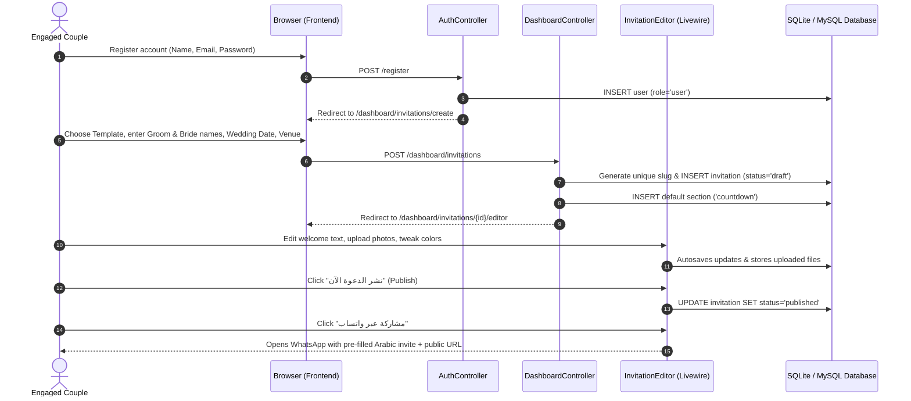
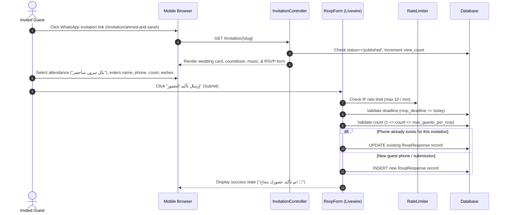

# Zaffe (زفّــة) — Business & Product Overview

> **Single Source of Truth for Business Logic, Domain Concepts, and Product Requirements**  
> **Status:** Officially Documented | **Last Updated:** 2026-11-12  
> **Classification Legend:**
> - `[VERIFIED]`: Confirmed directly from source code, database migrations, controllers, or tests.
> - `[INFERRED]`: Strongly supported by implementation context and domain conventions.
> - `[UNKNOWN]`: Requires explicit confirmation from stakeholders/product owner.

---

## 1. Product Overview & Purpose

### 1.1 What is Zaffe? `[VERIFIED]`
**Zaffe (زفّــة)** — derived from the traditional Arabic wedding march and celebration — is a specialized Software-as-a-Service (SaaS) platform built for couples and wedding planners in Egypt and the MENA region. It allows couples to create, customize, publish, and distribute interactive digital wedding invitations with automated RSVP guest tracking, live countdowns, background music, interactive location maps, dress code guidance, and photo albums.

### 1.2 The Problem It Solves `[VERIFIED]`
1. **High Cost & Slowness of Physical Cards:** Traditional paper wedding invitations in the Middle East are expensive to print, slow to distribute geographically, and prone to logistical loss.
2. **Inflexibility:** If a wedding date, hall, or timing changes, printed cards cannot be updated. Digital invitations on Zaffe update instantly.
3. **Chaotic RSVP & Attendance Management:** Families historically tracked attendees via disorganized phone calls, paper notebooks, or scattered WhatsApp messages. Couples struggled to give wedding banquet caterers and hotel venues accurate headcount estimates.
4. **Poor Digital Experience:** Existing solutions are often static image designs (PDFs or static JPEGs) that cannot play the couple's chosen music, calculate live countdowns, provide direct Google Maps navigation, or collect interactive guest RSVPs with dietary requirements and guest limits.

### 1.3 Value Proposition `[VERIFIED]`
- **Culturally Tailored Luxury Designs:** Curated Arabic typography (Amiri, Cairo, Tajawal, Playfair) and regional aesthetic themes (Royal Gold, Floral Romance, Minimalist Chic, Islamic Heritage, Starry Gala, Classic Aristocrat).
- **Zero-Code Real-Time Studio:** An intuitive visual editor with device toggle previews (mobile, tablet, desktop) that autosaves every keystroke without requiring any technical design skills.
- **Frictionless WhatsApp Distribution:** Native 1-click WhatsApp invitations with localized custom messages (Arabic and English) and deep links.
- **Controlled & Capped RSVP Management:** Couples can enforce maximum guests per RSVP (e.g., max 2 or 5 per invitation), set strict RSVP submission deadlines, and export guest data into an Excel-ready CSV file formatted with a UTF-8 BOM.
- **Bilingual Support:** Dual-language switching support between Arabic (`ar`) and English (`en`), with RTL/LTR layout handling.

---

## 2. Target Audience & User Personas

### 2.1 Primary User Roles `[VERIFIED]`

| User Role | Identification in System | Primary Objectives & Interactions |
| :--- | :--- | :--- |
| **Engaged Couple / Customer** | `User` with `role = 'user'` | Creates account, picks wedding template, customizes text, colors, music, and photos, sets RSVP deadline and limits, publishes invitation, shares via WhatsApp, reviews guest responses, exports CSV. |
| **Invited Guest** | Unauthenticated Public Visitor | Accesses `/invitation/{slug}` on mobile, views invitation card, plays music, reads schedule/timeline, checks venue map, fills RSVP form (attending/declining, guest count, dietary notes, heartfelt wishes), copies invitation link. |
| **Platform Super Admin** | `User` with `role = 'admin'` | Accesses `/admin` (Filament v5 panel), monitors platform analytics (registered users, total invitations, confirmed attendees), manages templates, categories, subscription packages, and global system settings. |

### 2.2 Stakeholders & Secondary Actors `[INFERRED]`
- **Wedding Planners & Coordinators:** Potential agency users managing invitations on behalf of multiple couples.
- **Venue Caterers & Hoteliers:** Benefit directly from accurate guest counts and dietary restrictions exported by couples via Zaffe.

---

## 3. Business Domain & Terminology

### 3.1 Domain Vocabulary `[VERIFIED]`
- **Zaffe (زفّة):** The traditional celebratory wedding procession in Arabic culture; the core brand identity.
- **Invitation (دعوة زفاف):** The primary digital asset created by the couple containing all metadata, schedule, styles, and public link.
- **Template (قالب التصميم):** A pre-designed visual theme defining default colors, borders, ornaments, and typography.
- **RSVP (تأكيد الحضور):** "Répondez s'il vous plaît" — the interactive guest confirmation system capturing attendance status, guest counts, and personal messages.
- **Slug (الرابط الفريد):** The human-readable URL identifier (e.g., `ahmed-and-sarah`) used for public sharing.
- **Dress Code (قواعد اللباس والأناقة):** Instructions guiding guests on attire (e.g., Black Tie, formal evening, colors to avoid like white).
- **Timeline / Program (برنامج الحفل):** Chronological agenda of wedding milestones (reception, zaffe entrance, dinner banquet, cake cutting).
- **Guest Count / Companions (عدد الحضور والمرافقين):** Total head count confirmed under a single RSVP response.
- **RSVP Deadline (الموعد النهائي لتأكيد الحضور):** The calendar cut-off date after which guests can no longer submit RSVPs.

---

## 4. Core Business Entities & Relationships

### 4.1 Detailed Entity Directory `[VERIFIED]`

1. **`User` (`users` table)**
   - Represents platform account holders.
   - Key attributes: `name`, `email`, `phone`, `password`, `role` (`user` vs `admin`), `avatar_url`.
   - Business Rule: Only `role === 'admin'` can access the Filament `/admin` dashboard (`canAccessPanel`).

2. **`TemplateCategory` (`template_categories` table)**
   - Classifies templates into distinct aesthetic collections (`luxury`, `floral`, `minimal`, `islamic`, `classic`, `romantic`).
   - Fields: `name_ar`, `name_en`, `slug`, `icon`, `description_ar`, `description_en`, `is_active`, `sort_order`.

3. **`InvitationTemplate` (`invitation_templates` table)**
   - Pre-configured visual themes mapping directly to Blade views (`templates.royal_gold`, `templates.floral_romance`, etc.).
   - Fields: `category_id`, `name_ar`, `name_en`, `slug`, `view_name`, `thumbnail`, `preview_url`, `default_styles` (JSON), `is_premium` (boolean), `is_active` (boolean), `sort_order`.

4. **`Invitation` (`invitations` table)**
   - The central business entity holding the wedding event details.
   - Fields:
     - `user_id` (foreign key to `users`)
     - `template_id` (foreign key to `invitation_templates`)
     - `title`, `slug` (unique)
     - `groom_name`, `bride_name`
     - `wedding_date`, `wedding_time`
     - `venue_name`, `venue_address`, `venue_map_url`
     - `welcome_message`, `invitation_message`
     - `cover_photo`, `music_url`
     - `custom_styles` (JSON overrides for colors and fonts)
     - `status` (`draft`, `published`, `archived`)
     - `is_rsvp_enabled` (boolean), `rsvp_deadline` (date), `max_guests_per_rsvp` (int, default 5)
     - `view_count` (unsigned int, auto-incremented on view)

5. **`InvitationSection` (`invitation_sections` table)**
   - Modular blocks within an invitation (`countdown`, `timeline`, `gallery`, `dress_code`).
   - Fields: `invitation_id`, `section_type`, `title_ar`, `title_en`, `content` (JSON), `sort_order`, `is_enabled`.

6. **`InvitationPhoto` (`invitation_photos` table)**
   - Gallery images attached to an invitation.
   - Fields: `invitation_id`, `image_path`, `caption`, `is_cover`, `sort_order`.

7. **`RsvpResponse` (`rsvp_responses` table)**
   - RSVP confirmations submitted by guests.
   - Fields: `invitation_id`, `guest_name`, `phone`, `email`, `attendance_status` (`attending`, `declined`, `tentative`), `guest_count`, `message`, `dietary_notes`, `ip_address`.

8. **`SubscriptionPlan` (`subscription_plans` table) & `UserSubscription` (`user_subscriptions` table)**
   - Defines commercial tiers (`Starter Free` at 0 EGP, `Royal Wedding Pro` at 799 EGP).
   - Fields: `name_ar`, `name_en`, `slug`, `price`, `currency`, `features` (JSON), `is_active`, `sort_order`.

9. **`PlatformSetting` (`platform_settings` table)**
   - Key-value configuration store for site-wide settings (`site_name_ar`, `contact_email`, `whatsapp_support`).

---

## 5. Comprehensive Feature Inventory & Status Matrix

| Feature Module | Business Purpose | Target User | Verification Status | Implementation File Reference |
| :--- | :--- | :--- | :--- | :--- |
| **Public Marketing & Home** | Introduce Zaffe, showcase value, feature templates, plans, and demo live card | Public / Leads | **Fully Implemented** `[VERIFIED]` | `HomeController.php`, `resources/views/pages/home.blade.php` |
| **Template Catalog & Filter** | Browse templates by category, search by name/keyword | Public / Leads | **Fully Implemented** `[VERIFIED]` | `HomeController::templates()`, `pages/templates.blade.php` |
| **Interactive Template Preview** | Live full preview of templates using mock data before registration | Public / Leads | **Fully Implemented** `[VERIFIED]` | `HomeController::previewTemplate()`, `pages/preview-template.blade.php` |
| **Authentication & Registration** | Sign up, login with throttling (6/min), remember me, session regeneration | Couples / Users | **Fully Implemented** `[VERIFIED]` | `AuthController.php`, `resources/views/auth/` |
| **Password Reset Request** | User enters email to reset password | Couples / Users | **Partially Implemented** `[VERIFIED]` | `AuthController::sendResetLink()` (returns simulated message, mailer broker not wired) |
| **Bilingual Language Switcher** | Switch interface locale between Arabic and English (`/lang/{locale}`) | All Users | **Fully Implemented** `[VERIFIED]` | `SetLocale.php`, `routes/web.php:38-43` |
| **Customer Studio Dashboard** | Overview statistics (invitations count, confirmed attendees, declining count) | Couples | **Fully Implemented** `[VERIFIED]` | `DashboardController::index()`, `views/dashboard/index.blade.php` |
| **Invitation Creation Wizard** | Step 1: choose template & enter names, date, hall; generates unique slug | Couples | **Fully Implemented** `[VERIFIED]` | `DashboardController::store()`, `views/dashboard/create.blade.php` |
| **Live Visual Studio Editor** | Real-time multi-tab editor (Basics, Content, Design, Media, Sections, Share) with responsive phone mockup | Couples | **Fully Implemented** `[VERIFIED]` | `app/Livewire/InvitationEditor.php`, `views/livewire/invitation-editor.blade.php` |
| **Autosave & Publishing Toggle** | Autosaves changes on input, toggles between `draft` and `published` | Couples | **Fully Implemented** `[VERIFIED]` | `InvitationEditor::saveChanges()`, `InvitationEditor::togglePublish()` |
| **Image & Gallery Uploads** | Upload cover photos and album gallery photos with 5MB validation & cleanup | Couples | **Fully Implemented** `[VERIFIED]` | `InvitationEditor::updatedNewCoverPhoto()`, `InvitationEditor::deleteGalleryPhoto()` |
| **Template Switching in Editor** | Change invitation template on the fly while retaining couple details | Couples | **Fully Implemented** `[VERIFIED]` | `InvitationEditor::changeTemplate()` |
| **WhatsApp Invitation Generator** | Generate localized WhatsApp invitation message with deep link | Couples | **Fully Implemented** `[VERIFIED]` | `Invitation::getWhatsAppShareUrl()`, `views/templates/partials/share_box.blade.php` |
| **Public Invitation Rendering** | Displays invitation card using selected template, enforces draft privacy | Public Guests / Owner | **Fully Implemented** `[VERIFIED]` | `InvitationController::show()`, `views/templates/*.blade.php` |
| **Interactive Wedding Countdown** | Real-time countdown clock to wedding moment (days, hours, minutes, seconds) | Guests | **Fully Implemented** `[VERIFIED]` | `views/templates/partials/countdown.blade.php` (Alpine.js) |
| **Audio / Background Music** | Floating toggleable background music audio player with loop | Guests | **Fully Implemented** `[VERIFIED]` | `views/templates/partials/music_player.blade.php` |
| **Live RSVP Submission** | Interactive RSVP form with guest cap, deadline check, duplicate resolution | Guests | **Fully Implemented** `[VERIFIED]` | `app/Livewire/RsvpForm.php`, `views/livewire/rsvp-form.blade.php` |
| **RSVP Guest Management** | View RSVP responses, search by name/phone/notes, filter by status | Couples | **Fully Implemented** `[VERIFIED]` | `DashboardController::guests()`, `views/dashboard/guests.blade.php` |
| **Excel/CSV Guest Export** | Streamed CSV download with UTF-8 BOM and formula injection protection | Couples | **Fully Implemented** `[VERIFIED]` | `DashboardController::exportGuestsCsv()` |
| **Customer Profile Management** | Update name, email, phone, and password | Couples | **Fully Implemented** `[VERIFIED]` | `DashboardController::updateProfile()`, `views/dashboard/profile.blade.php` |
| **Super Admin Panel (Filament v5)** | Full CRUD for users, invitations, templates, categories, plans, settings, stats | Admin (`role=admin`) | **Fully Implemented** `[VERIFIED]` | `app/Filament/*`, `AdminPanelProvider.php` |
| **Payment Gateway Integration** | Subscription plan purchase & checkout (Paymob / Fawry / Stripe) | Couples | **Planned / Not Implemented** `[VERIFIED]` | Models exist; no checkout routes or payment webhooks exist |
| **Automated WhatsApp / SMS Bot** | Send automated SMS/WhatsApp RSVP reminders to guests via Twilio or Meta | System / Couples | **Planned / Not Implemented** `[VERIFIED]` | Currently relies on user-initiated WhatsApp link sharing |

---

## 6. End-to-End User Journeys & Workflows

### 6.1 Couple Onboarding & Invitation Publishing Journey `[VERIFIED]`

### 6.2 Guest RSVP Journey `[VERIFIED]`

---

## 7. Business Rules, Constraints & Validations

### 7.1 Invitation & Slug Generation `[VERIFIED]`
1. **Slug Generation Rule:**
   - Generated from `{groom_name}-and-{bride_name}` via `Str::slug()`.
   - If non-Latin/empty, falls back to `wedding-{random}`.
   - If slug exists in database, systematically appends incrementing integer suffix (`-1`, `-2`, etc.) until unique (`DashboardController::store()`).
2. **Access & Privacy Rule:**
   - A `published` invitation is accessible publicly to anyone with the link.
   - A `draft` invitation responds with **HTTP 403 Forbidden** (`pages.unpublished` view) unless the viewer is logged in as the owner or a platform admin (`InvitationController::show()`).

### 7.2 RSVP Business Rules `[VERIFIED]`
1. **Deadline Enforcement:** If `rsvp_deadline` is set and `now()->startOfDay() > rsvp_deadline`, the form rejects submission with: *"عذراً، لقد انتهت المهلة المحددة لتأكيد الحضور"*.
2. **Guest Cap Enforcement:** Guest count cannot exceed `max_guests_per_rsvp` (default 5, configurable per invitation).
3. **Attendance Status & Headcount Coherence:** If `attendance_status === 'declined'`, `guest_count` is forcibly stored as `0` (`RsvpForm::submit()`).
4. **Duplicate Deduplication Rule:** If a submission includes a phone number that already responded to this invitation, the existing `RsvpResponse` is updated in-place rather than creating duplicate records (`RsvpForm::submit()`).
5. **Anti-Abuse Rate Limit:** Maximum 10 RSVP submissions per minute per IP address (`RateLimiter::tooManyAttempts('rsvp:IP:invitationId', 10)`).

### 7.3 Data Protection & Export Rules `[VERIFIED]`
1. **Formula Injection Sanitization:** CSV exports sanitize strings beginning with `=`, `+`, `-`, or `@` by prefixing a single quote `'` (`DashboardController::exportGuestsCsv()`).
2. **Excel Arabic Character Support:** CSV stream writes UTF-8 Byte Order Mark (`0xEF, 0xBB, 0xBF`) at the beginning of the file so Microsoft Excel correctly renders Arabic script.
3. **Ownership Isolation:** All dashboard operations (`guests`, `destroy`, `exportGuestsCsv`, `editor`) enforce ownership checks (`Auth::user()->invitations()->findOrFail($id)`). Unauthorized access yields HTTP 404 or HTTP 403.

---

## 8. Business Edge Cases & Handled Scenarios `[VERIFIED]`
- **Couple with Arabic Names:** `Str::slug()` handles Arabic text gracefully by transliterating or using randomized fallback.
- **Multiple RSVPs from Same Family Phone:** When a guest updates their response or corrections, their previous response is updated rather than inflating counts.
- **Deleted Images Cleanup:** Deleting an image from the gallery cleans up the physical storage file on the `public` disk if stored locally (`InvitationEditor::deleteGalleryPhoto()`).
- **Template Switching with Custom Styles:** Switching templates imports the new template's default primary/secondary colors and fonts without overwriting wedding data.

---

## 9. Missing & Planned Business Requirements `[UNKNOWN]`
- **Commercial Monetization / Subscriptions:** Subscription plans are defined in the database, but no billing checkout or gating logic is currently active in controllers. (Can free users create unlimited invitations today? Yes, currently unrestricted in code).
- **Custom Domain / Subdomain Support:** Whether couples can point custom domains (e.g. `ahmed-and-sarah.com`) to their invitation.
- **Automated WhatsApp Notification API:** Direct notification to the couple's phone whenever a new RSVP is received.

