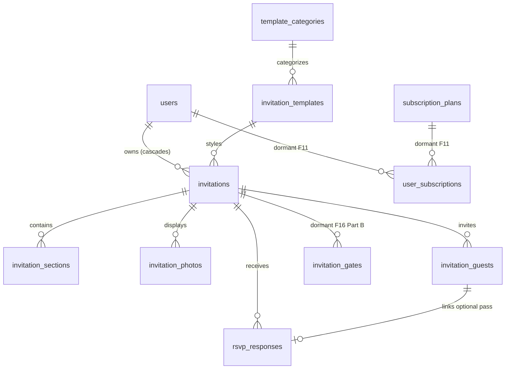

# PROJECT CONTEXT — Zaffe (زفّــة)

> **Single Source of Truth for Business Domain, Product Features, Technical Architecture & AI/MCP Integrations**  
> **Repository:** `e:\GithubProjects\Zaffe` | **Last Verified:** 2026-11-22 (`dev` post PR #4–#8; **Milestone A — Locally Complete**, hosting/deployment deferred pending Gate 4)  
> **Market Priority:** Saudi Arabia (KSA) First, Egypt Second (MENA) | **Primary Language:** Arabic (`ar`, RTL default), with English (`en`, LTR) support  
> **Status:** BRD v0.5 Approved & Phase 1 PRs 1–3 + PHP 8.4 CI Merged on `dev` (`F01`–`F10`, `F12`–`F14`, `ZAFFE-016`–`030` active; `F16` Part B QR Scanning & Gatekeeper Check-In isolated on `feature/ZAFFE-018-smart-guests-and-qr-checkin`)

---

## 1. Executive Summary, Business Problem & Value Proposition `[VERIFIED]`

**Zaffe (زفّــة)** is a Software-as-a-Service (SaaS) platform built for engaged couples, families, and wedding planners in **Saudi Arabia** and **Egypt**. It enables couples to create, customize, publish, and distribute luxury interactive digital wedding invitations with smart guest rosters, automated RSVP confirmation tracking, live timezone-aware countdowns, mobile user-tap audio playback, Google Maps venue navigation, dress code guidance, photo galleries, and pure-PHP personal QR passes.

### 1.1 Business Problems Solved
1. **High Cost & Rigidity of Physical Cards:** Traditional printed wedding cards are expensive, slow to distribute across cities/countries, and cannot be updated once printed if a venue, date, or time changes. Zaffe invitations update instantaneously.
2. **Chaotic RSVP & Attendance Tracking:** Families historically tracked attendees via scattered phone calls, paper notebooks, and WhatsApp chats, making accurate headcounts difficult for caterers and hotel venues. Zaffe centralizes confirmed adult and child counts, dietary requirements, and guest messages into filterable dashboards and Excel-ready CSV exports.
3. **Static Digital Flyers Lack Utility:** PDFs and static JPEGs cannot run live countdowns, launch map directions, enforce per-invitee adult/child quotas, prevent duplicate RSVPs, or generate personal QR passes.

### 1.2 Core Value Proposition
- **Culturally Tailored Arabic-First Luxury:** Fourteen specialized themes (`sort_order 1–8`: Saudi Signature Collection — Vol. 1; `sort_order 9–14`: baseline themes) styled with curated typography (`Amiri`, `Cairo`, `Tajawal`, `Playfair Display`), formal-simple Arabic (`الفصحى البسيطة`), crisp SVG icons (`<x-app-icon>`), nullable/optional `bride_name` privacy support across all 14 themes, and photo-free luxury rendering.
- **Zero-Code Visual Studio Editor:** A real-time Livewire 4 studio (`InvitationEditor`) with device previews, instant autosave, custom palette/font overrides, server-side WebP cover/gallery compression, and draft/publish/delete lifecycle controls.
- **Mobile & WhatsApp WebView First:** Optimized for guests opening links inside WhatsApp's in-app browser over 4G mobile connections, featuring 1-click WhatsApp share links, stateless `/demo`, absolute OG preview metadata (`public/images/og-zaffe.jpg` fallback), and self-hosted WebP imagery.
- **View-First Card With Optional RSVP & Legacy Compatibility:** New invitations default to view-only `announcement` (`is_rsvp_enabled = false`, `Asia/Riyadh`); when RSVP is enabled, couples track RSVPs cleanly via `rsvp_only` (zero QR/roster clutter for new R1 cards), while existing pre-R1 `rsvp_qr`/`qr_only` cards and personal `/pass/{qrToken}` passes remain intact.

---

## 2. AI, Tool & MCP Integration Snapshot `[VERIFIED]`

External tools, MCP servers, and AI coding agents reading this file should rely on the following canonical project facts:

| Context Dimension | Authoritative Project Truth |
| :--- | :--- |
| **Product Domain** | B2C Wedding SaaS — Interactive Digital Invitations, Real-Time Studio Editor, Pre-Invited Guest Roster, RSVP Engine & Personal QR Passes |
| **Primary Stack** | PHP `^8.4.1` (`composer.json` & CI `PHP 8.4.28`; `ext-intl` mandatory), Laravel 13, Livewire 4, Alpine.js, Tailwind CSS v4, Filament v5, Vite 8 |
| **Market Priority** | **Saudi Arabia (KSA) First** (`+966`, `Asia/Riyadh`, Umm al-Qura Hijri + Gregorian dates, formal-simple Arabic), **Egypt Second** (`+20`, `Africa/Cairo`) |
| **Release 1 Commercial Policy** | **100% Free Launch** — zero paywalls, zero invitation/guest/template tier limits. `/admin/subscription-plans` returns `403` (`SubscriptionPlanResource::canAccess(): false`). |
| **Deferred Monetization (`F11`)** | **Deferred Post-Release 1** behind a feature flag. Future commercial direction is **one-time pay-per-invitation** (free to design in studio; pay at publish or to unlock advanced guest tools) via **Paymob** in **SAR** and **EGP** configured dynamically in `PlatformSetting` — **no recurring subscriptions**. |
| **Active Capabilities in `dev`** | `F01`–`F10`, `F12`–`F14`, `ZAFFE-016`, `ZAFFE-017` Admin Coverage, `ZAFFE-022`/`023`/`024`, and **`F16` Part A** (Smart Guest Roster, 4 Invitation Modes, `?g=` personalized links, pure-PHP QR Pass Generation `/pass/{qrToken}`). |
| **Isolated Capabilities (NOT in `dev`)** | **`F16` Part B (QR Scanning & Gatekeeper Check-In `/gate/{gateToken}`)** — `GateScanner`, `InvitationGate`, camera `BarcodeDetector` scanning, manual `pass_code` check-in — is strictly **isolated** on `feature/ZAFFE-018-smart-guests-and-qr-checkin` per `docs/architecture/QR_FEATURE_ISOLATION_POLICY.md` (Owner Manual Merge Only). Tools/UI in `dev` must **never** promise live venue door scanning. (Note: `docs/qa/reports/ZAFFE_FINAL_QA_REPORT.md` flagged `F16` Part A as a scope conflict — requires PO confirmation.) |

---

## 3. Quick Documentation Map

| Document | Primary Focus & Contents |
| :--- | :--- |
| **[../README.md](../README.md)** | Repository landing overview for developers, tools, and MCP consumers summarizing product business, features, rules, and setup. |
| **[../AGENTS.md](../AGENTS.md)** | Mandatory development protocol, security rules, and step-by-step execution rules for AI agents. |
| **[README.md](README.md)** | Categorized master directory of all architecture, business, product, engineering, UI, and QA documentation. |
| **[DOCUMENTATION_GUIDELINES.md](DOCUMENTATION_GUIDELINES.md)** | Documentation governance, directory ownership, living-vs-historical rules, Markdown conventions, and anti-duplication standard. |
| **[business/project-discovery.md](business/project-discovery.md)** | Phase 1 reverse-engineering discovery report verified against `dev` source code (actors, 34 features, workflows, 36 business rules, schema, gaps). |
| **[business/DOCUMENTATION_AUDIT_SUMMARY.md](business/DOCUMENTATION_AUDIT_SUMMARY.md)** | Phase 2 documentation audit inventory across all Markdown files, resolved conflicts, and remaining clarification items. |
| **[business/business-requirements-document.md](business/business-requirements-document.md)** | Phase 3 BRD (draft `v0.1`, pending PO sign-off): business objectives, KPIs, stakeholders, `BRQ-01`–`BRQ-43` with `dev` status, NFRs, constraint gap analysis, proposed release phasing, and traceability. |
| **[product/PRODUCT.md](product/PRODUCT.md)** | Concise product identity, target users, positioning, and accessibility commitments. |
| **[product/BUSINESS_OVERVIEW.md](product/BUSINESS_OVERVIEW.md)** | Comprehensive business domain analysis, target personas, feature matrix, detailed user journeys, and business rules. |
| **[architecture/ARCHITECTURE.md](architecture/ARCHITECTURE.md)** | Technical architecture, component diagrams, layered responsibilities, relational database schema, indexes, routes, and security design. |
| **[engineering/DEVELOPMENT_GUIDE.md](engineering/DEVELOPMENT_GUIDE.md)** | Local environment setup, installation steps, test execution, seed accounts, coding conventions, and template authoring guide. |
| **[product/SAUDI_MARKET_DECISIONS.md](product/SAUDI_MARKET_DECISIONS.md)** | Saudi-first priorities, formal-simple Arabic copy rules, privacy by default, Umm al-Qura Hijri dates, WebP/LCP mobile targets, music gate & religious text rules, per-invitation pricing direction, PDPL alignment, and KPIs. |
| **[product/RELEASE_1_PRODUCT_DECISIONS.md](product/RELEASE_1_PRODUCT_DECISIONS.md)** | Release 1 100% Free Launch policy, Resend transactional email, Paymob future direction, and sequential milestone decisions. |
| **[architecture/QR_FEATURE_ISOLATION_POLICY.md](architecture/QR_FEATURE_ISOLATION_POLICY.md)** | Governance separating QR Pass Generation (`dev`) from QR Scanning & Gatekeeper Check-In (`feature/ZAFFE-018-smart-guests-and-qr-checkin`). |
| **[architecture/TECHNICAL_AUDIT.md](architecture/TECHNICAL_AUDIT.md)** | Code quality audit, security assessment (IDOR & CSV injection mitigations), scalability findings, and technical debt register. |
| **[engineering/DEPLOYMENT_CHECKLIST.md](engineering/DEPLOYMENT_CHECKLIST.md)** | Staging/production deployment checklist including MySQL 8.4 and PHP `ext-intl` verification. |
| **[product/OPEN_QUESTIONS.md](product/OPEN_QUESTIONS.md)** | Unresolved business, product, and operational decisions awaiting stakeholder confirmation. |
| **[ui/DESIGN.md](ui/DESIGN.md)** | Canonical design system tokens, typography, components, and RTL/accessibility guardrails. |
| **[qa/ZAFFE_MASTER_QA_PLAN.md](qa/ZAFFE_MASTER_QA_PLAN.md)** | Master QA and business validation plan across Release 1 features. |

---

## 4. Technology Stack & Application Layering `[VERIFIED]`

### 4.1 Core Stack
- **Backend:** PHP `^8.4.1` (verified locally on WinGet PHP 8.5 + GitHub Actions CI `PHP 8.4` with `ext-intl`, `gd` WebP), Laravel 13.
- **Full-Stack Reactivity:** Livewire 4, Alpine.js (bundled with Livewire 4).
- **CSS / Styling:** Tailwind CSS v4 (`@tailwindcss/vite`) with `@import 'tailwindcss';` and custom luxury Arabic aesthetic tokens (`font-cairo`, `font-tajawal`, `font-amiri`, `font-playfair`).
- **Super Admin Panel:** Filament v5 mounted at `/admin`.
- **Frontend Asset Pipeline:** Vite 8 (`laravel-vite-plugin`).
- **Database:** SQLite 3 (local development & PHPUnit test suite); **MariaDB `11.4` / MySQL `8.4`** CI & production/staging target.
- **Email & Queues:** `MAIL_MAILER=log` locally; **Resend** transactional SMTP configured for production behind queued Laravel Mail & Notifications (`ShouldQueue` using `database` queue driver with `$deleteWhenMissingModels = true`).
- **Storage & Image Processing:** Local `public` disk (`storage/app/public` linked to `public/storage`) with server-side `ImageOptimizationService` WebP conversion (`1200x1200` covers / `1600px` gallery, memory-guarded) + queued retry (`PurgeInvitationMediaJob`) + daily `zaffe:cleanup-orphaned-media` maintenance.
- **Testing & CI:** PHPUnit 12 & Laravel Pint across 22 test files (`234` tests passing) plus `.github/workflows/ci.yml` running PHP `8.4` + MariaDB `11.4` migration smoke checks on PRs.

### 4.2 Domain Services & Support Modules (`app/Services/` & `app/Support/`)
- **`App\Services\InvitationDateFormatter`:** Formats Gregorian and **Umm al-Qura Hijri** dates (`IntlDateFormatter`), handles invitation timezones (`Africa/Cairo` / `Asia/Riyadh`), and converts numeric outputs between `latin` (`0-9`) and `arabic_indic` (`٠-٩`).
- **`App\Services\PhoneService`:** Validates and normalizes Egypt (`+20`) and Saudi Arabia (`+966`) mobile phone numbers into international **E.164** format.
- **`App\Services\QrCodeService`:** Pure-PHP ISO/IEC 18004 Byte-mode QR Code SVG encoder (Versions 1–10, ECC Level M, 4-module white quiet zone) with zero external packages or third-party QR APIs.
- **`App\Support\CsvSanitizer`:** Neutralizes CSV formula injection payloads starting with `=`, `+`, `-`, `@`, `\t`, or `\r` (after `ltrim`) by prefixing a single quote (`'`).
- **`App\Support\PlatformSettingCatalog` & `App\Support\TemplateStyleCatalog`:** Canonical configuration definitions for `PlatformSetting` keys and the 14-theme color/typography presets, validated Blade view map (`resolveBladeView()`), and Saudi Signature Collection Vol. 1 helpers.

---

## 5. Key User Roles & System Permissions `[VERIFIED]`

1. **Invited Guest (Public Visitor):**
   - No login or app installation required.
   - Accesses `/invitation/{slug}` (and optional personalized `/invitation/{slug}?g={inviteToken}`) to view wedding details, unlock background music via the mobile user-tap gate, inspect agenda/timeline/dress code/maps, submit or update RSVPs, and view personal QR passes at `/pass/{qrToken}`.
   - Blocked (`HTTP 403`) from viewing unpublished (`draft`) invitations.
2. **Engaged Couple / Customer (`User` with `role = 'user'`):**
   - Registers, logs in, and resets password via Resend email flow.
   - Creates invitations via the creation wizard, customizes content/design/media/sections/modes in the Livewire Visual Studio Editor (`/dashboard/invitations/{id}/editor`), manages pre-invited guest rosters (`GuestRosterManager`), reviews RSVP responses, shares via 1-click WhatsApp deep links, and exports Excel-ready CSVs.
   - Strictly isolated to their own invitations (`Auth::user()->invitations()`).
3. **Super Admin (`User` with `role = 'admin'`):**
   - Accesses Filament v5 Admin Panel at `/admin` (`User::canAccessPanel()` checks `isAdmin()`).
   - Manages users, invitations, templates, categories, RSVP moderation, pre-invited guest passes (`InvitationGuestResource`), dynamic `PlatformSetting` values, analytics (`PlatformStatsOverview`), and system health (`OperationsMonitor`).
   - Permitted to view unpublished draft invitations and passes for support/moderation.

---

## 6. Product Features & Domain Workflows `[VERIFIED]`

### 6.1 Public Marketing & Luxury Theme Catalog (`F02`)
- Public landing page (`/`), searchable/filterable template gallery (`/templates`, including `?collection=saudi-signature`), interactive live template previews with Arabic/English sample data (`/templates/{slug}/preview`), 100% Free Release 1 pricing communication (`/pricing`), plus `/about`, `/contact`, and `/faq`.
- Fourteen curated wedding themes under `resources/views/templates/` (see [ui/ZAFFE_023_SAUDI_SIGNATURE_COLLECTION.md](ui/ZAFFE_023_SAUDI_SIGNATURE_COLLECTION.md)):
  - **Baseline (6):** `royal_gold`, `floral_romance`, `minimal_chic`, `islamic_elegance`, `emerald_night`, `classic_aristocrat`.
  - **Saudi Signature Collection — Vol. 1 (8, `ZAFFE-023`):** `diriyah_heritage`, `rawashin_elegance`, `sadu_signature`, `taif_rose`, `palm_oasis`, `red_sea_pearl`, `desert_dusk`, `modern_monogram`.

### 6.2 Customer Studio & Livewire Visual Editor (`F03`, `F04`, `F08`)
- **Customer Dashboard (`/dashboard`):** Displays total invitations, view counters, and RSVP attendance KPIs (note: `DashboardController::index()` omits `children_count` from its confirmed sum, unlike `/guests`, and labels `archived` invitations as Draft).
- **Invitation Creation Wizard (`/dashboard/invitations/create`):** Creates invitation with auto-generated unique slug (`{groom_name}-and-{bride_name}` via `Str::slug()`, incrementing `-1`, `-2` on collision, or `wedding-{random}` fallback) and default `countdown` section.
- **Visual Studio Editor (`App\Livewire\InvitationEditor`):**
  - Six-tab live editor (`basics`, `content`, `design`, `media`, `templates`, `rsvp`) plus a Publish Share Modal, responsive device preview, and real-time autosave.
  - Selects event timezone (`Africa/Cairo` / `Asia/Riyadh`), invitation mode, RSVP deadline, guest limits, custom style JSON overrides (`custom_styles`), and instant template switching without data loss.
  - Manages cover photo and gallery uploads (`5MB` max, MIME-validated, automatic local `public` disk cleanup when deleting via `InvitationEditor` / `DashboardController`).
  - Toggles modular `InvitationSection` blocks (`countdown`, `timeline`, `gallery`, `dress_code`; note `timeline` and `dress_code` are currently boolean visibility toggles without custom item/attire editors).
  - Toggles status (`draft` ↔ `published`; `archived` status exists in schema/Filament/POST `/archive` route, with no customer UI button) and generates localized 1-click WhatsApp share URLs (`Invitation::getWhatsAppShareUrl()`).

### 6.3 Four Invitation Access Modes (`F16` Part A)
`Invitation` supports four invitation modes via `invitation_mode` (automatically synchronized with `is_rsvp_enabled` in `Invitation::booted()`):
- **`rsvp_qr` (`Invitation::MODE_RSVP_QR`):** Interactive RSVP form + automatic personal QR pass issuance upon confirmation (or directly when opened via `?g=` token).
- **`rsvp_only` (`Invitation::MODE_RSVP_ONLY`):** Interactive RSVP confirmation without generating or displaying a QR pass.
- **`qr_only` (`Invitation::MODE_QR_ONLY`):** Direct personal QR pass display (`?g=` invitees) without requiring an RSVP form submission.
- **`announcement` (`Invitation::MODE_ANNOUNCEMENT`):** View-only digital wedding announcement (no RSVP form and no QR pass).

### 6.4 Smart Guest Roster & QR Pass Generation (`F16` Part A)
- **Pre-Invited Guest Roster (`App\Livewire\GuestRosterManager`):**
  - Hosts add individual guests or bulk import via CSV file upload or pasted text.
  - Supports guest categories (`general`, `vip`, `family_groom`, `family_bride`, `kids`), normalized E.164 phone numbers, adult quotas (`max_adults`), and child quotas (`max_children`).
  - Generates unique 36-char `invite_token`, unique 36-char `qr_token`, and human-readable 6-char `pass_code` (excluding ambiguous characters).
  - Tracks per-guest WhatsApp invite (`invited_at`) and reminder (`reminded_at`) actions and exports formula-safe roster CSVs (`/dashboard/invitations/{id}/guests/roster-export`).
- **Personalized Invite Links & Personal QR Passes (`InvitationController`, `GuestPassController`, `QrCodeService`):**
  - Opening `/invitation/{slug}?g={inviteToken}` resolves the `InvitationGuest` strictly scoped to that `invitation_id` (preventing cross-event IDOR), pre-fills guest name/phone, enforces their personal adult/child quotas, and reveals/links their pass.
  - `/pass/{qrToken}` (`throttle:60,1`) renders a high-contrast personal pass page with inline pure-PHP SVG QR code (encoding the pass URL), confirmed headcount, and `pass_code`, returning `404` if the invitation's mode does not support QR passes and `403` if unpublished (for non-owners/non-admins).
- **Strict Isolation of Venue Scanning (`F16` Part B):**
  - Live venue gatekeeper scanning (`/gate/{gateToken}`, `GateScanner`, camera `BarcodeDetector`, manual `pass_code` check-in, and `InvitationGate` management) is **isolated** on `feature/ZAFFE-018-smart-guests-and-qr-checkin` and must **not** be promised or activated in `dev` without explicit Product Owner manual merge.

### 6.5 Interactive RSVP Engine, Queued Notifications & Exports (`F06`, `F07`, `F10`)
- **`App\Livewire\RsvpForm`:** Handles public and `?g=`-linked RSVPs (`attending`, `declined`, `tentative`), adult & child headcounts, dietary checkboxes/notes, and guest wishes.
- **Transactional Emails (Resend + `database` queue):**
  - `ResetPasswordNotification` (password reset links), `NewRsvpNotification` (couple alert), and `RsvpConfirmationNotification` (guest confirmation when email is supplied).
- **Guest List & CSV Exports (`DashboardController`):**
  - Searchable/filterable RSVP responses and pre-invited roster management at `/dashboard/invitations/{id}/guests`.
  - Streamed UTF-8 BOM + formula-sanitized CSV exports for both RSVP responses (`/guests/export`) and guest rosters (`/guests/roster-export`).

### 6.6 Super Admin Panel (`Filament v5` at `/admin`, `F09` + `ZAFFE-017`)
- Resources (`app/Filament/Resources/`): `UserResource`, `InvitationResource`, `InvitationTemplateResource`, `TemplateCategoryResource`, `RsvpResponseResource` (read-only + CSV export + spam deletion), `InvitationGuestResource`, and `PlatformSettingResource` (consuming `PlatformSettingCatalog`).
- `SubscriptionPlanResource` returns `false` from `canAccess()` (`403`) during Release 1.
- Dashboard & Operations: `PlatformStatsOverview` widget and `OperationsMonitor` page (`/admin/operations-monitor`) showing sanitized Release 1 funnel counts, mail driver, and queue health.

---

## 7. Core Entities, Relational Schema & HTTP Routes `[VERIFIED]`

### 7.1 Entity Directory
- **`User` (`users`):** Platform accounts (`role`: `'user' | 'admin'`, `phone`, `avatar_url`). HasMany `Invitation`, HasMany `UserSubscription`.
- **`TemplateCategory` (`template_categories`):** Aesthetic themes (`luxury`, `floral`, `minimal`, `islamic`, `classic`, `romantic`).
- **`InvitationTemplate` (`invitation_templates`):** Fourteen active free visual layouts (6 baseline + 8 Saudi Signature Collection — Vol. 1) mapped to validated Blade views (`templates.royal_gold`, `templates.diriyah_heritage`, `templates.rawashin_elegance`, etc.) with `default_styles` JSON.
- **`Invitation` (`invitations`):** Core wedding record (`user_id`, `template_id`, `slug`, `groom_name`, `bride_name`, `wedding_date`, `wedding_time`, `timezone`, venue fields, `custom_styles` JSON, `status`, `invitation_mode`, `is_rsvp_enabled`, `rsvp_deadline`, `max_guests_per_rsvp`, `view_count`).
- **`InvitationSection` (`invitation_sections`):** Modular blocks (`countdown`, `timeline`, `gallery`, `dress_code`).
- **`InvitationPhoto` (`invitation_photos`):** Gallery images with local storage cleanup on deletion.
- **`InvitationGuest` (`invitation_guests`):** Pre-invited or self-registered guest roster entries (`category`, `max_adults`, `max_children`, `invite_token`, `qr_token`, `pass_code`, `rsvp_status`, `confirmed_adults`, `confirmed_children`, `rsvp_response_id`, `is_self_registered`, `invited_at`, `reminded_at`, `notes`).
- **`RsvpResponse` (`rsvp_responses`):** Guest attendance tracking (`attending`, `declined`, `tentative`), `guest_count`, `children_count`, `message`, `dietary_notes`, `ip_address`, and optional `invitation_guest_id`.
- **`PlatformSetting` (`platform_settings`):** Cached key-value global settings (`site_name_ar`, `site_name_en`, `contact_email`, `contact_phone`, `whatsapp_support`, etc.).
- **Dormant Tables/Columns:** `subscription_plans` & `user_subscriptions` (for Post-Release 1 `F11`); `invitation_gates` table plus `checked_in_at`, `checked_in_count`, and `checked_in_by_gate_id` columns on `invitation_guests` (dormant while `F16` Part B is isolated).

### 7.2 Relational Schema Diagram

### 7.3 HTTP Route Directory (`routes/web.php` & Filament)

| URI | Method(s) | Handler / Middleware | Purpose |
| :--- | :--- | :--- | :--- |
| `/` | `GET` | `HomeController::index` | Public landing page |
| `/templates`, `/templates/{slug}/preview` | `GET` | `HomeController` | Searchable template gallery & live interactive mock preview |
| `/pricing`, `/about`, `/contact`, `/faq` | `GET` | `HomeController` | Free Release 1 pricing & informational pages |
| `/lang/{locale}` | `GET` | Closure (`ar`, `en`) | Bilingual RTL/LTR session locale switcher |
| `/login`, `/register`, `/forgot-password`, `/reset-password/{token}` | `GET`, `POST` | `AuthController` (`guest`, `throttle:6,1`) | Couple authentication & password reset via Resend |
| `/logout` | `POST` | `AuthController::logout` (`auth`) | Session invalidation & logout |
| `/dashboard` | `GET` | `DashboardController::index` (`auth`) | Couple studio KPIs & overview |
| `/dashboard/invitations`, `/dashboard/invitations/create` | `GET`, `POST` | `DashboardController` (`auth`) | Invitation list, creation wizard & slug persistence |
| `/dashboard/invitations/{id}/editor` | `GET` | `InvitationEditor` (`auth`, Livewire) | Real-time visual studio editor |
| `/dashboard/invitations/{id}/toggle-publish`, `archive`, `DELETE` | `POST`, `DELETE` | `DashboardController` (`auth`) | Publish/draft toggle, archive & deletion |
| `/dashboard/invitations/{id}/guests` | `GET` | `DashboardController::guests` (`auth`) | RSVP response manager & `GuestRosterManager` |
| `/dashboard/invitations/{id}/guests/export` | `GET` | `DashboardController::exportGuestsCsv` (`auth`) | Formula-safe UTF-8 BOM CSV export of RSVPs |
| `/dashboard/invitations/{id}/guests/roster-export` | `GET` | `DashboardController::exportRosterCsv` (`auth`) | Formula-safe UTF-8 BOM CSV export of guest roster |
| `/dashboard/profile` | `GET`, `PUT` | `DashboardController` (`auth`) | Couple profile, phone & password update |
| `/invitation/{slug}` | `GET` | `InvitationController::show` | Public wedding card (supports `?g={inviteToken}`; enforces draft `403`) |
| `/pass/{qrToken}` | `GET` | `GuestPassController::show` (`throttle:60,1`) | Personal high-contrast QR pass page |
| `/admin/*` | Multi | Filament Panel (`auth`, `canAccessPanel`) | Super Admin resources & `/admin/operations-monitor` |

---

## 8. Critical Business Rules, Security & Saudi Market Guardrails `[VERIFIED]`

### 8.1 Access Control, Security & Data Integrity
1. **Privacy & Draft Protection:** Published invitations (`status === 'published'`) are public. Draft and archived invitations (`status !== 'published'`) return **HTTP 403 Forbidden** (`pages.unpublished`) unless requested by the owning user or an admin (`InvitationController::show()`, `GuestPassController::show()`).
2. **Ownership Isolation (IDOR Defense):** Every customer dashboard operation and Livewire mutation must scope queries through `Auth::user()->invitations()` or `InvitationEditor::getAuthorizedInvitation()`.
3. **Livewire State Locks:** Sensitive/identifying Livewire properties (`$invitationId` and `$status` on `InvitationEditor`, `$invitationId`, `$guestId`, `$maxGuests`, `$maxChildren`, `$issuedPassUrl`, `$issuedPassCode`, `$passPreviouslyIssued` on `RsvpForm` / `GuestRosterManager`) keep `#[Locked]` attributes to prevent client tampering.
4. **Explicit Model Policies & HTTP Hardening:**
   - Domain models and Filament resources are protected by `InvitationPolicy`, `InvitationTemplatePolicy`, `UserPolicy` (prevents self-deletion and last-admin deletion), `TemplateCategoryPolicy`, `RsvpResponsePolicy`, `InvitationGuestPolicy`, `PlatformSettingPolicy`, and `SubscriptionPlanPolicy`.
   - **`SecurityHeaders` middleware** applies HTTP security headers across both web routes and Filament `/admin/*` panel routes (`X-Content-Type-Options`, `X-Frame-Options`, `Referrer-Policy`, `X-XSS-Protection`), plus `noindex, nofollow`, `no-referrer`, and `no-store` on `/pass/*` and personalized `/invitation/*?g=*` routes.
5. **RSVP Constraints & Deduplication (`RsvpForm::submit()`):**
   - Rejects submissions if `isPublished()` is false, `allowsRsvp()` is false, or `rsvp_deadline` has passed (`now()->startOfDay()->gt($invitation->rsvp_deadline)`).
   - Enforces `max_guests_per_rsvp` (or pre-invited `InvitationGuest` `max_adults` / `max_children` quotas).
   - When `attendance_status !== 'attending'` (including `declined`), `guest_count` and `children_count` are forcibly stored as `0`.
   - Phone numbers are validated and normalized to E.164 (`+20` / `+966`) via `PhoneService`. Resubmissions matching an existing `RsvpResponse` phone on that invitation update the record in place.
   - Public (non-`?g=`) submissions matching a pre-invited (`is_self_registered = false`) roster entry's phone or bound response are blocked from overwriting that guest's reservation and directed to use their personal WhatsApp invite link.
   - Rate limited to **10 RSVP submissions per minute per IP per invitation** (`throttle:6,1` on auth/password routes; `throttle:60,1` on `/pass/{qrToken}`).
6. **CSV Injection Defense & Arabic Excel Compatibility:** CSV exports sanitize cells starting with `=`, `+`, `-`, `@`, `\t`, or `\r` (after `ltrim`) via `App\Support\CsvSanitizer::cell()` (leading `'`) and emit UTF-8 BOM (`0xEF, 0xBB, 0xBF`).

### 8.2 Saudi-First Cultural, Privacy & Performance Directives (`SAUDI_MARKET_DECISIONS.md`)
1. **Formal-Simple Arabic (`الفصحى البسيطة`):** All KSA-facing customer copy, notifications, and shared templates must use polite, formal-simple Arabic and avoid Egyptian colloquial slang.
2. **Privacy by Default & Photo-Free Luxury:** `bride_name` is nullable across schema, creation wizard, studio editor, Filament Admin, WhatsApp share text, notifications, and all 14 templates (with no orphan `و` / `&` conjunctions); all 14 templates render cleanly photo-free with zero `InvitationPhoto` rows and zero broken `` tags.
3. **Umm al-Qura Hijri Dates & Configurable Numerals:** KSA invitations display the **Umm al-Qura Hijri** date alongside the Gregorian date, and both server dates and the live JS `countdown` partial respect configurable `latin` (`0-9`) vs. `arabic_indic` (`٠-٩`) digits in `Asia/Riyadh` or `Africa/Cairo`.
4. **Mobile User-Tap Audio Gate & Licensed Audio:** When background music is configured, public views render an interactive open-gate screen (`شاشة فتح الدعوة`) so the guest's tap triggers playback inside iOS Safari, Android Chrome, and WhatsApp WebViews. Never include copyrighted/unlicensed commercial music.
5. **Religious Text Integrity:** **Never** generate, paraphrase, autocomplete, or type Quranic verses (`آيات قرآنية`) from memory or AI output; copy only exact Product-Owner-verified strings character-for-character.
6. **SVG-Only Iconography in Luxury Templates:** Unicode emojis are forbidden inside luxury wedding template Blade files; use `<x-app-icon>` inline SVGs only.
7. **Self-Hosted WebP & Mobile LCP Target:** Never hotlink external image CDNs (such as Unsplash) in templates or seeders; serve self-hosted WebP assets targeting **LCP < 2.5s** on mid-range mobile devices over 4G inside WhatsApp WebViews.
8. **PDPL-Minded Minimal Guest PII & Transaction-Safe Deletion (`DEC-05`):** Collect minimal attendance data (`PhoneService` supports SA, EG, and `OTHER` `+` international E.164 numbers); customers can self-delete invitations via confirmed dialog on `/dashboard/invitations` (`DB::transaction()` + `DB::afterCommit()` storage purge + queued `PurgeInvitationMediaJob` retry + daily `zaffe:cleanup-orphaned-media`), and both customer and Filament `/admin` deletions purge relative and full-URL media cleanly.

---

## 9. Core Product KPIs, Operational Notes & Execution Protocol

### 9.1 Core Product Success Metrics (`OperationsMonitor` & `SAUDI_MARKET_DECISIONS.md`)
1. **`KPI-01` (`creation_start` -> `published`):** Deduplicated `funnel_daily_metrics` creation-start visits vs. published cards (all-time & 30d).
2. **`KPI-02` (`Published` -> `Shared`):** Published cards with `view_count >= 10` or `>= 1` RSVP (approximate unique sessions).
3. **`KPI-03b` (`RSVP Adoption & Average RSVPs per RSVP-Enabled Published Card`):** Separates cards with `is_rsvp_enabled = true` so toggling RSVP off preserves responses without distorting averages.
4. **`KPI-05` (`Invite Footer Referral Attribution`):** Three-stage privacy-safe tracking from public `?ref=invite` footer links (omitted on `/demo` & previews) -> coarse `users.signup_source` -> referred published invitations & activated couples.

### 9.2 Milestone A (Locally Complete) vs. Milestone B (Production Ready) Gates `[VERIFIED]`
1. **PHP `^8.4.1` + `ext-intl` & MariaDB/MySQL Parity:** `composer.json` specifies `"php": "^8.4.1"`, verified via WinGet PHP 8.5 (`ext-intl`, `gd` WebP) locally and GitHub Actions CI (`PHP 8.4` + `MariaDB 11.4`). See [engineering/DEVELOPMENT_GUIDE.md](engineering/DEVELOPMENT_GUIDE.md).
2. **Remaining Milestone B Pre-Launch Gates (Explicitly Deferred Pending PO/Legal Approvals & Hosting):**
   - Production hosting/domain selection, HTTPS DNS/Resend (`SPF`/`DKIM`/`DMARC`) delivery test, live OG scrape, and mobile 4G LCP `< 2.5s` check ([engineering/PR4_LAUNCH_READINESS_PACK.md](engineering/PR4_LAUNCH_READINESS_PACK.md)).
   - Counsel/PO approval and implementation of public `/privacy` & `/terms` pages (`DEC-05`), operator identity/verified Saudi contacts (`DEC-06` & `PlatformSetting` migration), legacy `music_url` audio disposition (`EX-01`), proposed 30-day post-event guest/RSVP PII retention automation (`EX-02`, currently OFF), and EU host cross-border disclosure (`EX-03`) ([business/PR4_LEGAL_AND_PRIVACY_REVIEW_PACK.md](business/PR4_LEGAL_AND_PRIVACY_REVIEW_PACK.md)).
3. **Deferred Monetization (`F11`):** Release 1 operates intentionally 100% free with zero paywalls; Paymob per-invitation checkout is planned Post-Release 1 behind a feature flag.
4. **Local Windows Composer Issue:** Winget's pre-packaged Composer wrapper fails with `PharException: manifest cannot be larger than 100 MB`. Use standalone `php composer.phar` as documented in [engineering/DEVELOPMENT_GUIDE.md](engineering/DEVELOPMENT_GUIDE.md).
5. **Catalog Data Migrations Over Seeder-Only Changes:** Never ship new templates, `sort_order` changes, or catalog updates solely in `DatabaseSeeder.php` (`firstOrCreate()` skips existing rows and production deploys only run `migrate --force`). Always pair `DatabaseSeeder` updates with an idempotent, non-destructive data migration (guarded against empty `RefreshDatabase` test DBs, preserving `is_active` toggles), a legacy-DB upgrade test, `php artisan migrate`, `php artisan view:clear`, and `npm run build`.

### 9.3 Future Task Execution Protocol for Developers & Agents
Whenever implementing features, fixing bugs, or integrating tools/MCPs with Zaffe:
1. **Context First:** Read `docs/PROJECT_CONTEXT.md`, `README.md`, `docs/product/SAUDI_MARKET_DECISIONS.md`, and the relevant spec in `docs/` before writing code.
2. **Branch Hygiene:** Branch from `dev` following `docs/engineering/GIT_WORKFLOW.md` (`feature/ZAFFE-[ID]-*`, `bugfix/ZAFFE-[ID]-*`). Never commit directly to `dev`, `staging`, or `production`, and never auto-merge `feature/ZAFFE-018-smart-guests-and-qr-checkin`.
3. **Preserve Isolation & Reusability:** Scope customer queries via `Auth::user()->invitations()`, keep `#[Locked]` on sensitive Livewire state, preserve `CsvSanitizer::cell()` + UTF-8 BOM, use `<x-app-icon>`, and never install unapproved dependencies without user approval.
4. **Verify Thoroughly:** Run `php artisan test`, `./vendor/bin/pint --test`, and `npm run build` before finishing any code change.
