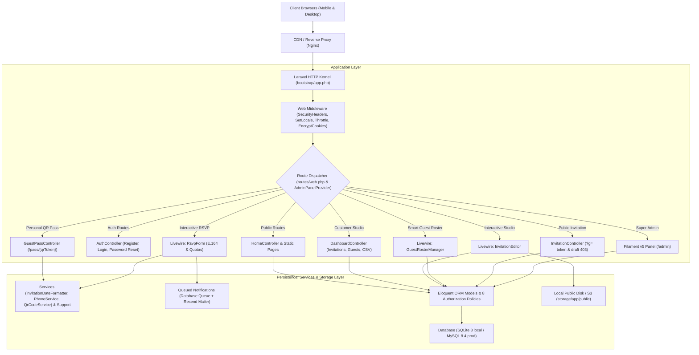
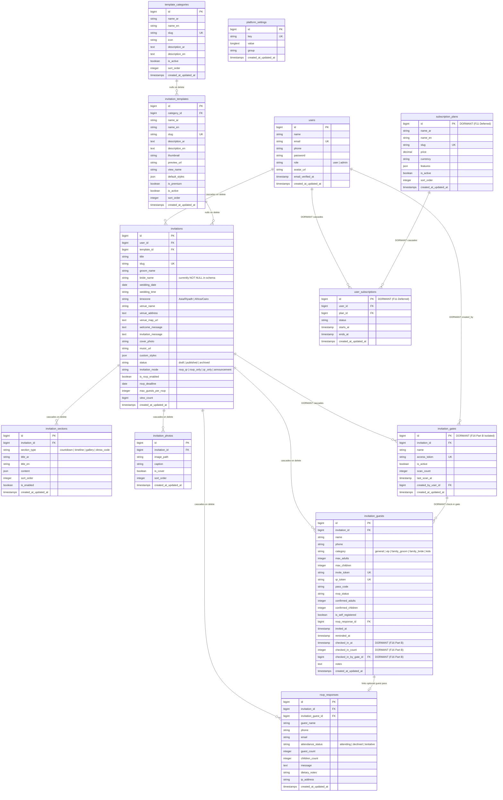

# Zaffe (زفّــة) — Technical Architecture & System Design

> **Single Source of Truth for System Architecture, Component Relationships, and Data Flow**  
> **Status:** Living Architecture Reference | **Last Updated:** 2026-11-19 (`dev` branch `d88d381`)  
> **Classification Legend:**
> - `[VERIFIED]`: Directly confirmed from codebase, configuration files, and database migrations.
> - `[INFERRED]`: Architectural deduction based on patterns in the codebase.
> - `[UNKNOWN]`: Architectural decision not yet finalized or explicitly documented.

---

## 1. High-Level System Architecture

Zaffe is structured as a modern full-stack web application built on **Laravel 13** with **Livewire 4**, **Tailwind CSS v4**, and **Filament v5** for administration. It follows an MVC-extended pattern incorporating component-driven reactive interfaces for complex user interactions without requiring a separate single-page application (SPA) frontend.



---

## 2. Technology Stack Breakdown `[VERIFIED]`

| Layer / Concern | Technology | Version | Location / Evidence | Purpose & Architectural Rationale |
| :--- | :--- | :--- | :--- | :--- |
| **Backend Language** | PHP | `^8.3` declared / **`>= 8.4.1` runtime (`ext-intl` mandatory)** | `composer.json:9`, `composer.lock` (`symfony/http-foundation v8.1.11`) | Strict types, property hooks/runtime reqs from Symfony 8.1, `IntlDateFormatter` (Hijri), Filament `Number::format()`. |
| **Core Framework** | Laravel Framework | `v13.42.0` | `composer.lock` | Full-stack MVC framework providing routing, password broker, ORM, queues, policies, and testing. |
| **Reactive Component Layer** | Livewire | `v4.4.8` | `composer.lock` | Drives real-time UI (`InvitationEditor`, `GuestRosterManager`, `RsvpForm`) without a separate SPA build. |
| **Client-Side Reactivity** | Alpine.js | Bundled with Livewire 4 | Blade templates | Client countdown timers, WhatsApp audio user-tap gate, copy helpers, modal controls. |
| **CSS / Styling** | Tailwind CSS | `v4.0.0` | `package.json`, `resources/css/app.css` | Utility-first styling with `@import 'tailwindcss';` and custom luxury design tokens. |
| **Admin Panel** | Filament Admin | `v5.11.2` | `composer.lock` | Backoffice for super admins (`/admin` + `/admin/operations-monitor`) with 417-key AR/EN parity. |
| **Asset Bundler** | Vite | `^8.0.0` | `package.json`, `vite.config.js` | HMR dev server and production asset compilation (`public/build/`). |
| **Database** | SQLite (dev/test) / MySQL 8.4 (prod) | SQLite 3 / MySQL 8.4 | `config/database.php`, `phpunit.xml` | Fast in-memory PHPUnit tests + local SQLite; MySQL 8.4 target in staging/production. |
| **Mail & Queues** | Resend / Laravel Queues | `database` queue + SMTP/Resend | `config/mail.php`, `config/queue.php` | Asynchronous queued notifications (`ShouldQueue`); see [TECHNICAL_AUDIT.md](TECHNICAL_AUDIT.md) `CONF-01` for Resend driver quirks. |
| **Filesystem / Storage** | Local Public Storage / S3 | Driver: `local` (`public` disk) / `s3` | `config/filesystems.php` | Cover/gallery uploads (`public/storage`), plus self-hosted `.webp` catalog thumbnails (`public/images/templates/`). |
| **Testing & Code Style** | PHPUnit / Laravel Pint | PHPUnit `^12.5`, Pint `^1.27` | `composer.json`, `tests/` | `22` test files (`19` Feature + `3` Unit); `196` tests / `2,230` assertions passing on PHP 8.5 + `ext-intl`. |

---

## 3. Directory Structure & Module Responsibilities `[VERIFIED]`

```
E:\GithubProjects\Zaffe
├── app/
│   ├── Console/Commands/
│   │   └── CreateAdminUser.php            # zaffe:create-admin CLI bootstrap command
│   ├── Filament/                          # Filament v5 Super Admin Panel (/admin)
│   │   ├── Pages/
│   │   │   └── OperationsMonitor.php      # Sanitized Release 1 funnel, mailer & queue health monitor
│   │   ├── Resources/
│   │   │   ├── InvitationGuests/          # Pre-invited & self-registered guest roster + QR passes
│   │   │   ├── Invitations/
│   │   │   ├── InvitationTemplates/       # 3-column structured visual editor (14-view allowlist, free lock)
│   │   │   ├── PlatformSettings/          # 2-tab workspace (General Workspace + All Settings)
│   │   │   ├── RsvpResponses/             # Read-only monitoring, CSV export & spam moderation
│   │   │   ├── SubscriptionPlans/         # Disabled in Release 1 (canAccess(): false -> 403)
│   │   │   ├── TemplateCategories/
│   │   │   └── Users/
│   │   └── Widgets/
│   │       └── PlatformStatsOverview.php  # Platform KPI dashboard widget
│   ├── Http/
│   │   ├── Controllers/
│   │   │   ├── AuthController.php         # Registration, Login, Logout, Password Broker Reset, Throttle
│   │   │   ├── DashboardController.php    # Customer Studio, Invitation CRUD, Lifecycle & Guest/Roster CSV Exports
│   │   │   ├── GuestPassController.php    # Personal ISO/IEC 18004 QR Pass Page (/pass/{qrToken})
│   │   │   ├── HomeController.php         # Public Marketing, Template Catalog, Live Previews
│   │   │   └── InvitationController.php   # Public Wedding Card, ?g= Token Lookup & Draft Privacy Gate
│   │   └── Middleware/
│   │       ├── SecurityHeaders.php        # Global security headers + no-referrer/noindex/no-store on /pass/* & ?g=*
│   │       └── SetLocale.php              # Session-based Locale Switcher (ar/en)
│   ├── Livewire/
│   │   ├── GuestRosterManager.php         # Pre-invited guest CRUD, CSV/text import & WhatsApp links
│   │   ├── InvitationEditor.php           # 6-tab Visual Studio Editor + Publish modal + 5MB uploads
│   │   └── RsvpForm.php                   # Public & ?g= RSVP submission with rate-limiting & E.164 dedup
│   ├── Models/                            # 11 Eloquent Models (9 active + 2 dormant/deferred)
│   │   ├── Invitation.php
│   │   ├── InvitationGuest.php            # Active F16 Part A roster; checked_in_* cols dormant (Part B isolated)
│   │   ├── InvitationPhoto.php
│   │   ├── InvitationSection.php
│   │   ├── InvitationTemplate.php
│   │   ├── PlatformSetting.php
│   │   ├── RsvpResponse.php
│   │   ├── SubscriptionPlan.php           # Dormant (F11 deferred)
│   │   ├── TemplateCategory.php
│   │   ├── User.php
│   │   └── UserSubscription.php           # Dormant (F11 deferred)
│   ├── Notifications/                     # ShouldQueue via database queue + Resend
│   │   ├── NewRsvpNotification.php        # Couple alert (mail + database)
│   │   ├── ResetPasswordNotification.php  # Password reset link email
│   │   └── RsvpConfirmationNotification.php
│   ├── Policies/                          # 8 Auto-Discovered Authorization Policies
│   │   ├── InvitationGuestPolicy.php
│   │   ├── InvitationPolicy.php
│   │   ├── InvitationTemplatePolicy.php
│   │   ├── PlatformSettingPolicy.php
│   │   ├── RsvpResponsePolicy.php
│   │   ├── SubscriptionPlanPolicy.php
│   │   ├── TemplateCategoryPolicy.php
│   │   └── UserPolicy.php
│   ├── Providers/
│   │   ├── AppServiceProvider.php
│   │   └── Filament/AdminPanelProvider.php
│   ├── Services/
│   │   ├── InvitationDateFormatter.php    # Gregorian + Umm al-Qura Hijri + latin/arabic_indic numerals
│   │   ├── PhoneService.php               # +20 / +966 validation & E.164 normalization
│   │   └── QrCodeService.php              # Pure-PHP ISO/IEC 18004 Vector SVG QR Encoder (V1-10, ECC M)
│   └── Support/
│       ├── CsvSanitizer.php               # Formula injection prevention (= + - @ \t \r after ltrim)
│       ├── PlatformSettingCatalog.php     # Canonical PlatformSetting definitions & defaults
│       └── TemplateStyleCatalog.php       # 14-theme presets, WCAG helper & resolveBladeView() allowlist
├── bootstrap/app.php                      # Middleware Stack (SecurityHeaders, SetLocale)
├── config/                                # Laravel Config Files
├── database/
│   ├── factories/UserFactory.php
│   ├── migrations/                        # 21 Migrations (16 schema + 5 catalog/data migrations)
│   └── seeders/DatabaseSeeder.php         # Admin, Demo Couple, 6 Categories, 14 Free Templates, Settings
├── public/
│   └── images/templates/*.webp            # 14 Self-hosted WebP template thumbnails (0 external hotlinks)
├── resources/
│   ├── css/app.css                        # Tailwind CSS v4 Stylesheet & Luxury Design Tokens
│   ├── js/app.js                          # Vite Frontend Entry
│   └── views/
│       ├── auth/                          # login, register, forgot-password, reset-password
│       ├── components/                    # <x-app-icon>, legacy <x-icon>, layouts/*
│       ├── dashboard/                     # index, create, invitations, guests, profile
│       ├── filament/                      # operations-monitor, template-style-preview, platform-settings-preview
│       ├── layouts/                       # Legacy duplicate wrappers (base, marketing, dashboard)
│       ├── livewire/                      # invitation-editor, guest-roster-manager, rsvp-form
│       ├── pages/                         # home, templates, preview-template, pricing, about, contact, faq, invitation-show, guest-pass, unpublished, welcome
│       └── templates/                     # 14 Wedding Templates (8 Saudi Signature Vol. 1 + 6 Baseline) + 8 partials/
├── routes/
│   ├── console.php
│   └── web.php                            # HTTP Route Declarations
└── tests/
    ├── Feature/                           # 19 Feature Test Suites (incl. Admin, Security, F16, Saudi Signature)
    ├── Unit/                              # 3 Unit Test Suites (Example, InvitationDateFormatter, QrCodeService)
    └── TestCase.php
```

---

## 4. Architectural Patterns & Layer Responsibilities `[VERIFIED]`

### 4.1 Layered Separation of Concerns
1. **Routing & Dispatch (`routes/web.php`):** Clean RESTful grouping divided into Public Marketing, Authentication (`throttle:6,1`), Customer Dashboard (`auth`), Public Invitation (`?g=`), Personal QR Pass (`/pass/{qrToken}`, `throttle:60,1`), and Filament `/admin`.
2. **Controllers (`app/Http/Controllers`):** Handle validation, session deduplication, authorization scoping, and HTTP response orchestration while delegating interactive UI flows to Livewire.
3. **Livewire Reactive Layer (`app/Livewire`):**
   - Encapsulates stateful flows (`InvitationEditor`, `GuestRosterManager`, `RsvpForm`).
   - Uses `#[Locked]` attributes on critical properties (`$invitationId`, `$status`, `$guestId`, `$maxGuests`, `$maxChildren`, `$issuedPassUrl`, `$issuedPassCode`, `$passPreviouslyIssued`) to prevent client-side tampering.
   - Manages asynchronous file uploads (`WithFileUploads`, `5MB` max) with MIME validation and deletion cleanup.
4. **Services & Support (`app/Services`, `app/Support`):** Encapsulate Hijri/numeral formatting, E.164 phone parsing, pure-PHP QR encoding, CSV neutralization, canonical settings, and the 14-view template allowlist.
5. **Eloquent Data Layer (`app/Models` & `app/Policies`):** Rich domain helpers (`getPublicUrlAttribute()`, `getEffectiveStylesAttribute()`, `getWhatsAppShareUrl()`, `isPublished()`, `allowsRsvp()`, `issuesQrPass()`) and 8 explicit policies.
6. **Admin Abstraction Layer (`app/Filament`):** Resource CRUD separated into Schemas, Infolists, and Tables; access restricted via `User::canAccessPanel()`.

---

## 5. Detailed Database Architecture `[VERIFIED]`

### 5.1 Relational Schema Diagram



> **Dormant Tables & Columns (`[VERIFIED]`):** Across 20 application tables (9 Laravel/infra including `users`, `sessions`, `password_reset_tokens`, `cache`, `cache_locks`, `jobs`, `job_batches`, `failed_jobs`, `notifications` + 11 domain tables), three domain tables (`subscription_plans`, `user_subscriptions`, `invitation_gates`) and three `invitation_guests` columns (`checked_in_at`, `checked_in_count`, `checked_in_by_gate_id`) remain dormant in `dev` pending Post-R1 (`F11`) or PO Manual Approval (`F16` Part B).

### 5.2 Key Database Indexes & Optimizations `[VERIFIED]`
- **`invitations`:** Composite `['user_id', 'status']`, unique `slug`, plus `['status', 'wedding_date']`, `['status', 'created_at']`, and an explicit redundant `INDEX(slug)` added by `2026_11_14_000001_add_performance_indexes.php`.
- **`invitation_templates`:** Composite `['is_active', 'sort_order']` (`2026_11_14_000001`).
- **`template_categories`:** Composite `['is_active', 'sort_order']` (`2026_11_14_000001`).
- **`invitation_sections`:** Composite `['invitation_id', 'is_enabled']`.
- **`invitation_guests` (`2026_11_15_100001`):** Unique `invite_token` & `qr_token`; composite indexes on `['invitation_id', 'rsvp_status']` and `['invitation_id', 'pass_code']`; index on `['invitation_id', 'phone']`.
- **`rsvp_responses`:** Composite `['invitation_id', 'attendance_status']` and `['invitation_id', 'phone']`.
- **`invitation_photos`:** Foreign-key index on `invitation_id`.

---

## 6. API & Route Architecture `[VERIFIED]`

### 6.1 Route Directory

| URI | HTTP Method | Controller / Component | Action / Middleware | Purpose |
| :--- | :--- | :--- | :--- | :--- |
| `/` | `GET` | `HomeController` | `index` (`SecurityHeaders`, `SetLocale`) | Public landing page showcasing featured Saudi Signature & baseline templates |
| `/templates` | `GET` | `HomeController` | `templates` | Searchable & filterable template catalog (14 free templates, 6 categories) |
| `/templates/{slug}/preview` | `GET` | `HomeController` | `previewTemplate` | Interactive mock preview of any active template with bilingual sample data |
| `/pricing` | `GET` | `HomeController` | `pricing` | Free Release 1 launch campaign page (0 paywalls / 0 tier gates) |
| `/about`, `/contact`, `/faq` | `GET` | `HomeController` | `about`, `contact`, `faq` | Supporting informational pages (note: `/contact` form is currently client-side Alpine simulation only) |
| `/lang/{locale}` | `GET` | Closure | Session update (`ar` / `en`) | Switch UI language between Arabic and English |
| `/login` | `GET`, `POST` | `AuthController` | `guest`, `throttle:6,1` on `POST` | Authentication login page & processing |
| `/register` | `GET`, `POST` | `AuthController` | `guest`, `throttle:6,1` on `POST` | User registration & initial setup |
| `/forgot-password` | `GET`, `POST` | `AuthController` | `guest`, `throttle:6,1` on `POST` | Password reset email request via Laravel Password Broker |
| `/reset-password/{token}` | `GET`, `POST` | `AuthController` | `guest`, `throttle:6,1` on `POST` | Password reset token form & password update |
| `/logout` | `POST` | `AuthController` | `auth` | Session invalidation and CSRF token regeneration |
| `/dashboard` | `GET` | `DashboardController` | `auth` | Customer studio KPI metrics & summary overview |
| `/dashboard/invitations` | `GET`, `POST` | `DashboardController` | `auth` | Paginated listing of user's invitations & wizard creation handler |
| `/dashboard/invitations/create` | `GET` | `DashboardController` | `auth` | Invitation creation wizard |
| `/dashboard/invitations/{id}/editor` | `GET` | `InvitationEditor` | `auth`, Livewire | Full-screen 6-tab visual studio editor + Publish Share Modal |
| `/dashboard/invitations/{id}/toggle-publish` | `POST` | `DashboardController` | `auth` | Toggle invitation between `draft` and `published` |
| `/dashboard/invitations/{id}/archive` | `POST` | `DashboardController` | `auth` | Transition invitation to `archived` (no customer UI button wired) |
| `/dashboard/invitations/{id}` | `DELETE` | `DashboardController` | `auth` | Permanently delete user invitation & associated local files |
| `/dashboard/invitations/{id}/guests` | `GET` | `DashboardController` | `auth` | Searchable RSVP table & pre-invited smart guest roster (`GuestRosterManager`) |
| `/dashboard/invitations/{id}/guests/export` | `GET` | `DashboardController` | `auth` | Streamed UTF-8 BOM + `CsvSanitizer` CSV export of RSVP responses |
| `/dashboard/invitations/{id}/guests/roster-export` | `GET` | `DashboardController` | `auth` | Streamed UTF-8 BOM + `CsvSanitizer` CSV export of pre-invited guest roster |
| `/dashboard/profile` | `GET`, `PUT` | `DashboardController` | `auth` | User profile update (name, email, phone, password) |
| `/invitation/{slug}` | `GET` | `InvitationController` | `show` (`SecurityHeaders`) | Public wedding card view (supports `?g={inviteToken}`); enforces draft/archive `403` |
| `/pass/{qrToken}` | `GET` | `GuestPassController` | `show` (`throttle:60,1`, `SecurityHeaders`) | Personal ISO/IEC 18004 SVG QR pass page for confirmed/invited guests |
| `/gate/{gateToken}` *(Isolated)* | `GET` | `GateScanner` | `Livewire` | **Isolated on `feature/ZAFFE-018-smart-guests-and-qr-checkin`** — not active in `dev` ([QR_FEATURE_ISOLATION_POLICY.md](QR_FEATURE_ISOLATION_POLICY.md)) |
| `/up` | `GET` | Laravel Health | Framework built-in | Lightweight HTTP health endpoint (`bootstrap/app.php`) |
| `/admin/*` | Multi | Filament Panel Provider | `auth`, `canAccessPanel` | Super admin management suite & `/admin/operations-monitor` (note: lacks `SecurityHeaders`) |

---

## 7. Authentication, Authorization & Security Architecture `[VERIFIED]`

### 7.1 Access Control Matrix
- **Guest / Public:** Has read-only access to marketing pages, published `/invitation/{slug}` (and personalized `?g=` tokens), `/pass/{qrToken}` (`throttle:60,1`), plus write access to `RsvpForm` (`10/min/IP/invitation`) and auth routes (`throttle:6,1`). Blocked from `draft`/`archived` cards (`403`).
- **Couple / Authenticated User (`role = 'user'`):** Full ownership-scoped CRUD over their own invitations, sections, photos, guest roster, and CSV exports (`Auth::user()->invitations()`). Blocked from cross-tenant records and `/admin` (`403`).
- **Super Admin (`role = 'admin'`):** Accesses `/admin` via `User::canAccessPanel()`, previews draft invitations/passes, and exercises role-based access governed by **8 explicit Policies**.

### 7.2 Applied Security Hardening & Known Gaps `[VERIFIED]`
1. **Livewire IDOR Prevention (`#[Locked]`):** `InvitationEditor` locks `$invitationId` and `$status` and verifies `getAuthorizedInvitation()` on every action. `RsvpForm` and `GuestRosterManager` lock `$invitationId`, `$guestId`, `$maxGuests`, `$maxChildren`, `$issuedPassUrl`, `$issuedPassCode`, and `$passPreviouslyIssued`.
2. **Pre-Invited Roster Hijack Defense (`RsvpForm`):** Unauthenticated public (non-`?g=`) RSVP submissions cannot overwrite a pre-invited (`is_self_registered = false`) guest entry and receive a prompt instructing use of their personal invite link. Open phone resubmissions suppress bearer QR URL/code display (`$passPreviouslyIssued`).
3. **CSV Formula Injection (`App\Support\CsvSanitizer`):** Escapes values matching `=`, `+`, `-`, `@`, `\t`, or `\r` after `ltrim()` across customer and Filament CSV exports, prepending UTF-8 BOM.
4. **HTTP Security Headers (`SecurityHeaders` middleware):** Globally attaches `X-Content-Type-Options: nosniff`, `X-Frame-Options: SAMEORIGIN`, `Referrer-Policy`, and `X-XSS-Protection`, and adds `Referrer-Policy: no-referrer`, `X-Robots-Tag: noindex, nofollow`, and `Cache-Control: no-store, no-cache, must-revalidate, private` on `/pass/*` and `/invitation/*?g=*`. *(Open gap `SEC-05`: Filament `/admin/*` does not register `SecurityHeaders`.)*
5. **Authorization Policies (8 total):** `InvitationPolicy`, `InvitationTemplatePolicy`, `UserPolicy` (blocks self-delete and last-admin delete), `TemplateCategoryPolicy`, `RsvpResponsePolicy`, `InvitationGuestPolicy`, `PlatformSettingPolicy`, and `SubscriptionPlanPolicy` (returns `false` for all actions). *(Open gap `SEC-06`: `PlatformSettingsTable` `DeleteBulkAction` and `deleteAny()` do not block deletion of canonical catalog keys.)*
6. **Upload Cleanup Asymmetry (`DATA-01`):** `InvitationEditor` and customer deletion clean up local `public` files cleanly, whereas `Invitation::deleting` skips full `http(s)://` URLs written by `InvitationEditor`, causing orphaned files when invitations are deleted from Filament Admin.

---

## 8. External Integrations & Infrastructure

### 8.1 WhatsApp Sharing `[VERIFIED]`
- Implemented via universal URL protocol: `https://api.whatsapp.com/send?text={encoded_message}` (`Invitation::getWhatsAppShareUrl()` and per-guest `GuestRosterManager` invite/reminder deep links).

### 8.2 Google Maps Navigation `[VERIFIED]`
- Uses `venue_map_url` validation & external buttons across luxury wedding templates.

### 8.3 Self-Hosted WebP Catalog Assets `[VERIFIED]`
- **Zero Unsplash / External CDN Hotlinks:** All **14** active templates serve self-hosted `.webp` thumbnails from `public/images/templates/` (replaced Unsplash URLs in `2026_11_14_000002_update_template_thumbnails_and_names.php`, expanded in `2026_11_19_000001_sync_saudi_signature_vol1_templates.php`). User-uploaded cover/gallery photos are validated up to `5MB` and stored locally on `public` disk (with S3 compatibility documented).

### 8.4 Resend Transactional Mail & Database Queue `[VERIFIED]`
- Queued notifications (`ResetPasswordNotification`, `NewRsvpNotification`, `RsvpConfirmationNotification`) implement `ShouldQueue` over the `database` queue driver using Laravel Mail (`config/mail.php` defines separate `resend` SMTP and `resend_api` mailers; see [TECHNICAL_AUDIT.md](TECHNICAL_AUDIT.md) `CONF-01` for `.env.example` `RESEND_API_KEY=` trap and `resend/resend-php` note).

