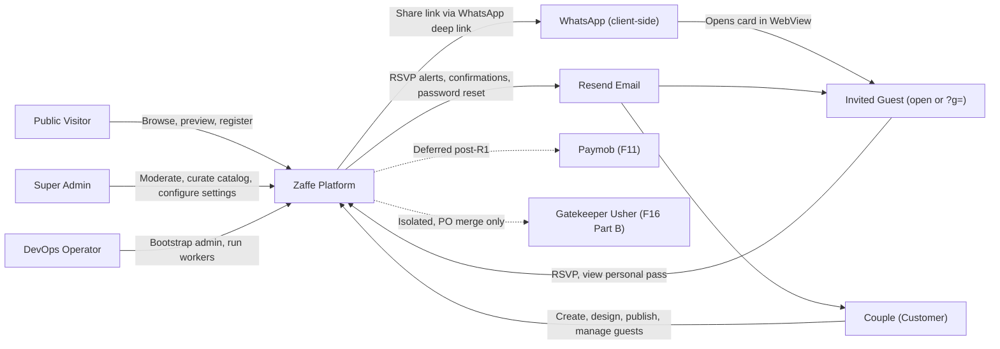
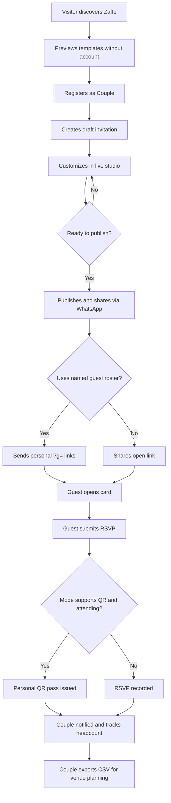
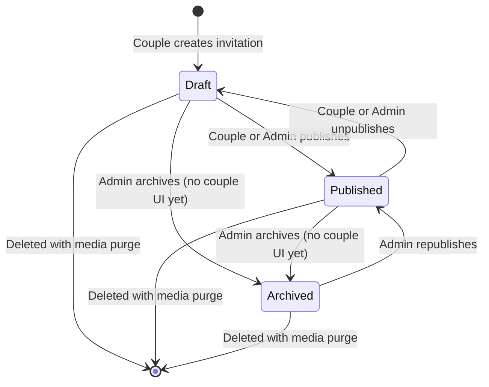
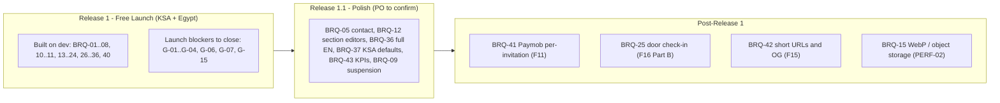

# Zaffe (زفّــة) — Business Requirements Document (BRD)

> **Status:** Draft for Product Owner Review (`v0.1`)  
> **Last Verified Date:** 2026-11-19  
> **Baseline:** Git branch `dev` (`d88d381`)  
> **Evidence Sources:** [project-discovery.md](project-discovery.md) (Phase 1, code-verified) · [DOCUMENTATION_AUDIT_SUMMARY.md](DOCUMENTATION_AUDIT_SUMMARY.md) (Phase 2) · [SAUDI_MARKET_DECISIONS.md](../product/SAUDI_MARKET_DECISIONS.md) · [RELEASE_1_PRODUCT_DECISIONS.md](../product/RELEASE_1_PRODUCT_DECISIONS.md) · [COMPETITIVE_ANALYSIS_HAYHOM.md](../product/strategy/COMPETITIVE_ANALYSIS_HAYHOM.md)  
> **Governance:** [DOCUMENTATION_GUIDELINES.md](../DOCUMENTATION_GUIDELINES.md)

> [!IMPORTANT]
> **How to read this BRD.** Every requirement states the business need (*what* and *why*), its **current implementation status on `dev`**, and its **proposed priority**. Status values come from code-verified Phase 1 evidence. Priorities, release-blocker flags, and anything labeled **Proposed** are analyst recommendations and **are not approved** until the Product Owner (PO) signs off in [§16](#16-approval--sign-off). Facts that could not be verified are marked **`[REQUIRES PO CLARIFICATION]`**.

## Table of Contents

- [1. Executive Summary](#1-executive-summary)
- [2. Business Problem](#2-business-problem)
- [3. Business Objectives, Value & KPIs](#3-business-objectives-value--kpis)
- [4. Stakeholder Analysis](#4-stakeholder-analysis)
- [5. Market Analysis](#5-market-analysis)
- [6. Business Context & Process Model](#6-business-context--process-model)
- [7. High-Level Business Requirements](#7-high-level-business-requirements)
- [8. Non-Functional Business Requirements](#8-non-functional-business-requirements)
- [9. Governing Business Rules](#9-governing-business-rules)
- [10. Constraint Gap Analysis](#10-constraint-gap-analysis)
- [11. Release Scope & Phasing](#11-release-scope--phasing)
- [12. Risks, Constraints, Assumptions & Dependencies](#12-risks-constraints-assumptions--dependencies)
- [13. Open Decisions Required](#13-open-decisions-required)
- [14. Requirements Traceability Matrix](#14-requirements-traceability-matrix)
- [15. Glossary](#15-glossary)
- [16. Approval & Sign-Off](#16-approval--sign-off)

---

## 1. Executive Summary

| Item | Detail |
| :--- | :--- |
| **Project Name** | Zaffe (زفّــة) — Digital Wedding Invitation & Guest Management Platform |
| **Product Type** | B2C web SaaS (Laravel 13 + Livewire 4 + Filament v5), browser-only — no mobile app required |
| **Sponsor / Product Owner** | `[REQUIRES PO CLARIFICATION]` — no named sponsor is recorded in the repository |
| **Primary Market** | Saudi Arabia (KSA) first; Egypt second ([SAUDI_MARKET_DECISIONS.md](../product/SAUDI_MARKET_DECISIONS.md) §1) |
| **Objective** | Let engaged couples and families design, publish, and share culturally appropriate digital wedding invitations from a phone browser, collect structured RSVPs, and manage named guests — reaching a published, shared invitation in one session at zero cost during Release 1. |
| **Key Drivers (Why now)** | (1) Regional competitors put core capabilities behind app downloads, up-front packages, and minimum guest counts (e.g., Hayhom from `185 SAR` for `25` guests — [COMPETITIVE_ANALYSIS_HAYHOM.md](../product/strategy/COMPETITIVE_ANALYSIS_HAYHOM.md) `EV-01`); (2) WhatsApp is the main way invitations are shared in KSA/Egypt, so a browser-native card that opens inside WhatsApp removes friction; (3) most Release 1 capabilities already exist on `dev` (`7` features fully and `23` partially implemented out of `34` cataloged). |
| **Commercial Model** | **Release 1: 100% free** (all `14` templates, `is_premium = false`). **After Release 1:** one-time payment per invitation through Paymob (`SAR`/`EGP`), behind a feature flag, with no subscriptions ([SAUDI_MARKET_DECISIONS.md](../product/SAUDI_MARKET_DECISIONS.md) §8). |
| **Readiness Snapshot** | Core product loop works end-to-end on `dev` (`196` tests / `2,230` assertions passing on PHP 8.5 + `ext-intl`). Before a KSA commercial launch, policy-compliance gaps (optional `bride_name`, PDPL workflows), security hardening (`SEC-05`, `SEC-06`, `DATA-01`), and one governance conflict (`BR-031`) still need resolving. |

---

## 2. Business Problem

### 2.1 Current State (Market Pain Points)

| # | Pain Point | Who Feels It | Evidence Basis |
| :--- | :--- | :--- | :--- |
| P1 | Printed cards can't be edited after printing, cost money to distribute, and don't support last-minute changes. | Couple | [project-discovery.md](project-discovery.md) §2.1 |
| P2 | RSVPs are scattered across phone calls, notebooks, and WhatsApp threads, so headcount, children, and dietary planning are unreliable. | Couple, Family Host | §2.1 |
| P3 | Static PDF/JPEG flyers have no countdown, map, Hijri date, music, or personalization. | Guest, Couple | §2.1 |
| P4 | Family privacy expectations in KSA (e.g., omitting the bride's name, photo-free designs) aren't served by generic templates. | Couple, Family | [SAUDI_MARKET_DECISIONS.md](../product/SAUDI_MARKET_DECISIONS.md) §2 |
| P5 | Competitors require app installs, OTP onboarding, package purchases, and design-approval waits of `1–3` days before a couple sees value. | Prospective Couple | [FEATURE_GAP_ANALYSIS.md](../product/strategy/FEATURE_GAP_ANALYSIS.md) dimension 15 |

### 2.2 Proposed Solution

A browser-native platform where a couple can:

1. Register and pick one of `14` free, self-hosted themes (`8` Saudi Signature Collection Vol. 1 + `6` baseline).
2. Customize the invitation in a live studio and publish it.
3. Share it in one click through WhatsApp.
4. Collect deduplicated, quota-capped RSVPs.
5. Optionally manage a named guest roster with personalized `?g=` links and zero-PII personal QR passes.

A Super Admin moderates content and configures the platform through Filament, with no code deployments needed.

### 2.3 Scope

| In Scope (Release 1 — as built on `dev`, subject to PO confirmation) | Out of Scope for Release 1 |
| :--- | :--- |
| Public marketing site, template gallery, live previews | Payments, checkout, and entitlements (`F11` — deferred) |
| Couple accounts: registration, login, password reset, profile | Door check-in scanning / Gatekeeper (`F16` Part B — isolated on `feature/ZAFFE-018-smart-guests-and-qr-checkin`) |
| Invitation creation, live studio editor, publish/unpublish, delete | Short URLs `/i/{code}`, dynamic OG cards (`F15` — unmerged, see [OQ-2](#13-open-decisions-required)) |
| `14` templates, Hijri + Gregorian dates, configurable digits, audio gate | Native mobile apps |
| Public card, RSVP engine, couple + guest email notifications | Messaging APIs (WhatsApp Business / SMS) — client-side deep links only |
| Named guest roster, `?g=` links, personal QR passes (`F16` Part A — **pending [OQ-1](#13-open-decisions-required) / `BR-031`**) | Physical gatekeeper staffing services |
| RSVP & roster CSV exports | Object storage (S3/R2) and server-side WebP conversion (`PERF-02` — deferred, see [OQ-9](#13-open-decisions-required)) |
| Filament Super Admin (`7` active resources + Operations Monitor) | Multi-user collaboration on a single invitation |

---

## 3. Business Objectives, Value & KPIs

### 3.1 Business Objectives

| ID | Objective | Measured By |
| :--- | :--- | :--- |
| **BO-01** | Win early KSA adoption with a free, frictionless first invitation | KPI-01, KPI-02, registered couples |
| **BO-02** | Make RSVP tracking more reliable for hosts | KPI-03, share of RSVPs captured in-platform |
| **BO-03** | Respect Saudi cultural and privacy norms by default | Compliance with [SAUDI_MARKET_DECISIONS.md](../product/SAUDI_MARKET_DECISIONS.md) §1–§10 testable rules |
| **BO-04** | Prepare a pay-per-invitation revenue path after Release 1 without rebuilding the core | `F11` readiness (feature flag, `PlatformSetting` pricing) |
| **BO-05** | Let the platform be operated without engineering involvement | Admin can manage catalog, settings, moderation, and monitoring in `/admin` |

### 3.2 Business Value

- **Tangible:** No printing or distribution cost for couples. Lower cost of acquiring customers, because every shared invitation shows the Zaffe brand to its guests. A future one-time revenue stream per invitation (`SAR`/`EGP`). Exact revenue projections are **`[REQUIRES PO CLARIFICATION]`**: no pricing, volume, or cost data exists in the repository.
- **Intangible:** A brand positioned as culturally fluent (Hijri dates, photo-free designs, SVG-only luxury styling, formal-simple Arabic). Guests trust it because QR passes contain no PII and drafts stay private. Couples feel in control through live editing and instant publishing.

### 3.3 Success Metrics (KPIs)

KPI definitions come from [SAUDI_MARKET_DECISIONS.md](../product/SAUDI_MARKET_DECISIONS.md) §10. Instrumentation status comes from `app/Filament/Pages/OperationsMonitor.php` ([project-discovery.md](project-discovery.md) §2.4).

| KPI | Definition | Instrumentation on `dev` | Target |
| :--- | :--- | :--- | :--- |
| **KPI-01** Wizard-Start → Published Rate | % of started invitations/wizard sessions that reach `published` | **Partial** — proxy only (`activated_couples / total_couples`); no wizard-start telemetry | `[REQUIRES PO CLARIFICATION]` |
| **KPI-02** Published → Shared-with-10+-Guests Rate | % of published invitations with `>= 10` deduplicated views and/or RSVPs | **Not Implemented** | `[REQUIRES PO CLARIFICATION]` |
| **KPI-03** Average RSVPs per Invitation | Mean `RsvpResponse` count across published invitations | **Fully Implemented** (`avg_rsvps_per_published`) | `[REQUIRES PO CLARIFICATION]` |
| **KPI-04** (Supporting) Mobile LCP | Largest Contentful Paint for public cards in WhatsApp WebView over 4G | **Not measured** — no performance telemetry in repo | `< 2.5s` ([PROJECT_CONTEXT.md](../PROJECT_CONTEXT.md) guardrail 7) |

---

## 4. Stakeholder Analysis

| Stakeholder Group | Impact | Influence | Needs / Interests | Primary Touchpoints |
| :--- | :--- | :--- | :--- | :--- |
| **Product Owner / Business Sponsor** | High | High | Launch scope, compliance, future monetization, KPIs | This BRD, [OPEN_QUESTIONS.md](../product/OPEN_QUESTIONS.md) |
| **Engaged Couple / Customer** (`role = 'user'`) | High | Medium | Fast and beautiful invitation, privacy control, reliable RSVP counts, zero cost in R1 | `/dashboard*`, Studio, Guest roster |
| **Invited Guest — Open Link** | High | Low | Opens instantly in WhatsApp, clear details, easy RSVP | `/invitation/{slug}`, `RsvpForm` |
| **Pre-Invited Named Guest** (`?g=`) | High | Low | Personal greeting, pre-filled quotas, personal pass | `/invitation/{slug}?g=…`, `/pass/{qrToken}` |
| **Public Visitor / Prospect** | Medium | Low | Understand the offer, browse/preview themes without signing up | `/`, `/templates`, previews, `/pricing` |
| **Platform Super Admin** (`role = 'admin'`) | High | High | Moderation, catalog curation, settings without deploys, ops visibility | `/admin/*` |
| **DevOps / System Operator** | Medium | High | Reliable runtime (PHP `>= 8.4.1` + `ext-intl`), mail delivery, queue workers, admin bootstrap | CLI, `.env`, Supervisor |
| **Legal / Compliance Counsel** | High | High | PDPL alignment, privacy notice, retention and deletion | [SAUDI_MARKET_DECISIONS.md](../product/SAUDI_MARKET_DECISIONS.md) §9 |
| **Venue Gatekeeper / Usher** *(future)* | Low (R1) | Low | Fast, reliable check-in at the door | Isolated `F16` Part B — not in R1 |
| **Payment Provider (Paymob)** *(future)* | Low (R1) | Medium | Integration contract for `SAR`/`EGP` one-time payments | Deferred `F11` |

The full code-verified actor/permission matrix is in [project-discovery.md](project-discovery.md) §4.

---

## 5. Market Analysis

### 5.1 Target Market

- **Primary:** Saudi couples and families organizing weddings. Expectations: `+966` phones, `Asia/Riyadh` timezone, Umm al-Qura Hijri dates, formal-simple Arabic, photo-free and privacy-respecting designs.
- **Secondary:** Egyptian couples (`+20`, `Africa/Cairo`).
- **Usage context:** Guests mainly open invitations on mobile devices inside WhatsApp's in-app browser.

### 5.2 Competitor Overview (Snapshot `2026-11-15`)

Details and evidence IDs are in [COMPETITIVE_ANALYSIS_HAYHOM.md](../product/strategy/COMPETITIVE_ANALYSIS_HAYHOM.md).

| Dimension | Hayhom (حيهم) — Verified Snapshot | Zaffe Position on `dev` |
| :--- | :--- | :--- |
| Entry model | App + OTP; packages from `185 SAR` (`25`-guest minimum) up to `10,950 SAR` (`EV-01`) | Web-first; free Release 1; no minimum guest count |
| Bilingual AR/EN | Locked to `Special` tier (`850+ SAR`) (`EV-10`) | Marketing, auth, dashboard, and admin are bilingual. **Editor, RSVP, and public cards are still Arabic-only** (`UX-01`) |
| Door check-in | Paid physical gatekeepers in 10 KSA + 4 GCC cities only (`EV-08`) | Personal QR passes live (`F16` Part A); usher scanning isolated (`F16` Part B) |
| Design turnaround | Custom designs in `2–3` business days | Self-service live editor with instant publishing |

### 5.3 Differentiation Hypotheses

These need validation through KPI-01/KPI-02 after launch:

1. A free, instant start in the browser will convert better than paid, app-first onboarding.
2. Culturally specific themes (Saudi Signature Vol. 1) and Hijri support increase KSA preference.
3. Personal QR passes without staffing serve cities and markets (including Egypt) where competitors don't offer gatekeepers.

---

## 6. Business Context & Process Model

### 6.1 Business Context



### 6.2 Core Value Loop (Business Process)



### 6.3 Invitation Business Lifecycle



> [!NOTE]
> Post-event behavior (expiry, automatic archival, PII purge) is **undefined** (`BR-030`, [OQ-5](#13-open-decisions-required)).

---

## 7. High-Level Business Requirements

**Conventions**

- `BRQ-XX` = Business Requirement. This is a separate namespace from the `BR-XXX` business-rule catalog in [project-discovery.md](project-discovery.md) §7.
- **Priority (Proposed, MoSCoW):** `Must` · `Should` · `Could` · `Won't (R1)`.
- **Status on `dev`:** `Fully Implemented` · `Partially Implemented` · `Not Implemented` · `Isolated — PO Manual Merge Only` · `Deferred`. Labels follow [DOCUMENTATION_GUIDELINES.md](../DOCUMENTATION_GUIDELINES.md) §5.
- A `FEAT-XX` reference points to the code-verified feature inventory ([project-discovery.md](project-discovery.md) §5), which contains the detailed gap evidence.

### 7.1 Acquisition & Public Discovery

| ID | Requirement | Business Rationale | Actor | Proposed Priority | Status on `dev` | Key Gap |
| :--- | :--- | :--- | :--- | :--- | :--- | :--- |
| **BRQ-01** | The platform shall present a public landing page communicating the value proposition and the free Release 1 offer. | Acquisition (BO-01) | Visitor | Must | Partially Implemented (`FEAT-01`) | Hero demo and dates are hardcoded; queried data unused |
| **BRQ-02** | Visitors shall browse the active template catalog with collection, category, and keyword filters. | Lets visitors self-qualify before signing up | Visitor | Must | Partially Implemented (`FEAT-02`) | Count pill and EN card titles are wrong |
| **BRQ-03** | Visitors shall preview any active template with realistic sample data on mobile, tablet, and desktop frames without an account. | Shows value before registration (P5) | Visitor | Must | Fully Implemented (`FEAT-03`) | — |
| **BRQ-04** | Pricing and About pages shall accurately state the current offer (`14` free templates in R1). | Trust and consistency | Visitor | Must | Partially Implemented (`FEAT-04`, `FEAT-05`) | Stale "six themes" copy (`UX-01`) |
| **BRQ-05** | Visitors shall be able to reach support through a working contact channel whose messages are actually received. | Support and lead capture | Visitor | Should | Partially Implemented (`FEAT-06`) | Form discards submissions client-side ([OQ-7](#13-open-decisions-required)) |

### 7.2 Customer Account & Identity

| ID | Requirement | Business Rationale | Actor | Proposed Priority | Status on `dev` | Key Gap |
| :--- | :--- | :--- | :--- | :--- | :--- | :--- |
| **BRQ-06** | Couples shall self-register, log in, and log out, with optional `SA`/`EG` phone numbers normalized to E.164. | Self-service onboarding | Couple | Must | Fully Implemented (`FEAT-08`) | — |
| **BRQ-07** | Couples shall reset forgotten passwords by email without support involvement. | Lower support load | Couple | Must | Fully Implemented (`FEAT-09`) | Depends on production mail config (`CONF-01`) |
| **BRQ-08** | Couples shall update their name, email, phone, and password. | Account hygiene | Couple | Must | Fully Implemented (`FEAT-10`) | — |
| **BRQ-09** | Admins shall be able to suspend a couple's account without deleting data. | Abuse handling | Admin | Could | Not Implemented | Business behavior undefined (`BR-032`, [OQ-6](#13-open-decisions-required)) |

### 7.3 Invitation Studio & Lifecycle

| ID | Requirement | Business Rationale | Actor | Proposed Priority | Status on `dev` | Key Gap |
| :--- | :--- | :--- | :--- | :--- | :--- | :--- |
| **BRQ-10** | Couples shall create a draft invitation from an active template with a unique, human-readable link. | Time-to-value (KPI-01) | Couple | Must | Partially Implemented (`FEAT-12`) | `bride_name` mandatory; `Africa/Cairo` default |
| **BRQ-11** | Couples shall customize content, design, media, template, mode, and RSVP settings in a live editor with autosave and device preview. | Core product experience | Couple | Must | Partially Implemented (`FEAT-14`) | Arabic-only UI; validation runs on tab switch; input max `10` vs rule `20` |
| **BRQ-12** | Couples shall author the content of every section they enable, including event timeline and dress code. | Avoid placeholder content on live cards | Couple | Should | Partially Implemented | `timeline`/`dress_code` are toggle-only ([OQ-7](#13-open-decisions-required)) |
| **BRQ-13** | Couples shall control the invitation lifecycle (publish, unpublish, archive, delete) from their dashboard. Deletion shall purge uploaded media. | Control and data hygiene | Couple, Admin | Must | Partially Implemented (`FEAT-13`) | No publish/archive buttons in list; Admin delete orphans media (`DATA-01`) |
| **BRQ-14** | The platform shall offer a curated catalog of culturally appropriate, photo-free-capable themes rendered only from an allowlist. | Differentiation and safety (BO-03) | Couple, Guest | Must | Partially Implemented (`FEAT-15`) | Theme-specific override bugs (`KSA-01`) |
| **BRQ-15** | Couples shall upload cover and gallery images (`<= 5MB`), delivered in a form suitable for WhatsApp WebView performance. | KPI-04 mobile speed | Couple | Should | Partially Implemented | No WebP conversion or captions (`PERF-02`) |
| **BRQ-16** | Couples shall select one of four invitation modes (`rsvp_qr`, `rsvp_only`, `qr_only`, `announcement`) to fit the event type. | Flexibility across event styles | Couple | Must | Partially Implemented (`FEAT-21`) | Mode-switch toggle edge case |

### 7.4 Guest Experience & RSVP

| ID | Requirement | Business Rationale | Actor | Proposed Priority | Status on `dev` | Key Gap |
| :--- | :--- | :--- | :--- | :--- | :--- | :--- |
| **BRQ-17** | Only published invitations shall be publicly visible. Drafts and archived invitations shall remain private to the owner and admins. | Privacy and trust | Guest, Couple | Must | Fully Implemented (`FEAT-16`) | — |
| **BRQ-18** | Cards shall show Gregorian and Umm al-Qura Hijri dates with couple-selectable Latin or Arabic-Indic digits, applied consistently, including the countdown. | KSA cultural fit | Guest | Must | Partially Implemented (`FEAT-17`) | Countdown ignores `arabic_indic` (`KSA-01`) |
| **BRQ-19** | Guests shall submit or update an RSVP with adult/child counts and dietary notes, enforcing deadlines, quotas, deduplication by phone, and protection of pre-invited reservations. | Reliable headcount (BO-02) | Guest | Must | Partially Implemented (`FEAT-18`) | Arabic-only; `tentative` validation quirk |
| **BRQ-20** | Background music shall play only after an explicit guest tap and shall use licensed or user-provided audio. | Mobile autoplay rules; licensing | Guest, Couple | Should | Partially Implemented | URL-only music source; no licensed library ([SAUDI_MARKET_DECISIONS.md](../product/SAUDI_MARKET_DECISIONS.md) §6) |
| **BRQ-21** | Couples shall share invitations with one click via WhatsApp using a localized message. | Primary distribution channel | Couple | Must | Fully Implemented | — |

### 7.5 Guest Roster & Personal Passes (`F16` Part A — subject to [OQ-1](#13-open-decisions-required))

| ID | Requirement | Business Rationale | Actor | Proposed Priority | Status on `dev` | Key Gap |
| :--- | :--- | :--- | :--- | :--- | :--- | :--- |
| **BRQ-22** | Couples shall maintain a named guest roster with categories and adult/child quotas, bulk CSV/text import, and invite/reminder tracking. | Formal-event guest control | Couple | Must *(pending `BR-031`)* | Fully Implemented (`FEAT-20`) | Minor EN leaks |
| **BRQ-23** | Each named guest shall receive a personal link (`?g=`) showing a personalized greeting and pre-applied quotas. | Personalization and control | `?g=` Guest | Must *(pending `BR-031`)* | Fully Implemented | — |
| **BRQ-24** | Eligible guests shall receive a personal QR pass whose payload contains no personal data. | Privacy-safe entry credential | Guest | Must *(pending `BR-031`)* | Partially Implemented (`FEAT-21`) | Arabic-only pass; residual "entrance" wording; `tentative` eligibility mismatch |
| **BRQ-25** | Venue staff shall verify passes and record single-use check-in at the door. | Event-day operations | Usher | Won't (R1) | Isolated — PO Manual Merge Only (`FEAT-32`) | Release gate undefined ([OQ-3](#13-open-decisions-required)) |
| **BRQ-26** | Couples shall view, filter, and export RSVPs and the roster as Excel-compatible, formula-safe CSV files. | Venue and caterer coordination | Couple | Must | Fully Implemented (`FEAT-22`) | — |

### 7.6 Notifications

| ID | Requirement | Business Rationale | Actor | Proposed Priority | Status on `dev` | Key Gap |
| :--- | :--- | :--- | :--- | :--- | :--- | :--- |
| **BRQ-27** | Couples shall be notified of each new or updated RSVP. Guests who provide an email shall receive a confirmation whose wording matches their response. | Engagement and reassurance | Couple, Guest | Must | Partially Implemented (`FEAT-19`) | No in-app inbox; "confirmed" wording on decline; mail config trap (`CONF-01`) |

### 7.7 Platform Administration & Operations

| ID | Requirement | Business Rationale | Actor | Proposed Priority | Status on `dev` | Key Gap |
| :--- | :--- | :--- | :--- | :--- | :--- | :--- |
| **BRQ-28** | Only Super Admins shall access the admin panel. The first admin shall be provisioned securely from the CLI. | Platform security | Admin, DevOps | Must | Partially Implemented (`FEAT-23`) | Admin panel lacks security headers (`SEC-05`) |
| **BRQ-29** | Admins shall manage user accounts and shall be prevented from deleting themselves or the last admin. | Operational continuity | Admin | Must | Partially Implemented (`FEAT-24`) | Form field defects (`DATA-02`) |
| **BRQ-30** | Admins shall moderate invitations (publish, unpublish, archive, edit, delete). | Content governance | Admin | Must | Partially Implemented (`FEAT-25`) | Media orphaning on delete (`DATA-01`) |
| **BRQ-31** | Admins shall curate templates and categories (activate/deactivate, styling presets) with changes reflected immediately on customer pages. | Catalog agility (BO-05) | Admin | Must | Partially Implemented (`FEAT-26`) | New categories default to inactive |
| **BRQ-32** | Admins shall review and delete spam RSVPs, export RSVPs, and be unable to alter guest responses. | Data integrity | Admin | Should | Partially Implemented (`FEAT-27`) | Export ignores filters; omits children count |
| **BRQ-33** | Admins shall oversee named guests and their passes for support purposes. | Support | Admin | Should | Partially Implemented (`FEAT-28`) | Unlocalized status labels |
| **BRQ-34** | Admins shall edit site branding and contact settings without a deployment. Canonical settings shall not be deletable. | Ops independence (BO-05) | Admin | Must | Partially Implemented (`FEAT-29`) | Canonical keys bulk-deletable (`SEC-06`) |
| **BRQ-35** | Admins shall monitor funnel KPIs and mail/queue health without exposing secrets. | Data-driven decisions | Admin | Should | Partially Implemented (`FEAT-30`) | KPI-01 proxy only; KPI-02 missing |

### 7.8 Localization & Saudi Market Fit

| ID | Requirement | Business Rationale | Actor | Proposed Priority | Status on `dev` | Key Gap |
| :--- | :--- | :--- | :--- | :--- | :--- | :--- |
| **BRQ-36** | The platform shall support Arabic (RTL) and English (LTR) across all customer and guest surfaces. | Bilingual audiences; differentiator vs `EV-10` | All | Must *(scope per [OQ-7](#13-open-decisions-required))* | Partially Implemented (`FEAT-07`) | Editor, RSVP, public card, and pass are Arabic-only |
| **BRQ-37** | Defaults shall reflect the KSA-first strategy (`Asia/Riyadh`, `+966`) while still supporting Egypt. | Market priority | Couple | Should | Partially Implemented | Several `Africa/Cairo` / `EG` defaults remain |
| **BRQ-38** | Couples shall be able to omit the bride's name, and every template and view shall render cleanly without it. | KSA family privacy ([SAUDI_MARKET_DECISIONS.md](../product/SAUDI_MARKET_DECISIONS.md) §2) | Couple | Must | Not Implemented (only the `8` Saudi Signature views tolerate an empty value) | DB `NOT NULL` + `required` validation (`BR-005`, proposed `BR-034`, [OQ-4](#13-open-decisions-required)) |

### 7.9 Privacy & Data Protection

| ID | Requirement | Business Rationale | Actor | Proposed Priority | Status on `dev` | Key Gap |
| :--- | :--- | :--- | :--- | :--- | :--- | :--- |
| **BRQ-39** | The platform shall publish a privacy notice and define and enforce a post-event retention policy. Owners and guests shall be able to request deletion of their data, including uploaded media. | Saudi PDPL alignment (subject to legal review) | Couple, Guest, Admin | Must *(before KSA commercial launch)* | Not Implemented (`FEAT-34`) | No notice, retention job, or deletion workflow (`BR-030`, [OQ-5](#13-open-decisions-required)) |

### 7.10 Monetization

| ID | Requirement | Business Rationale | Actor | Proposed Priority | Status on `dev` | Key Gap |
| :--- | :--- | :--- | :--- | :--- | :--- | :--- |
| **BRQ-40** | During Release 1, all templates and features shall be free with no payment walls. | Adoption (BO-01) | Couple | Must | Fully Implemented (`BR-021`, `BR-022`) | — |
| **BRQ-41** | After Release 1, a one-time per-invitation payment through Paymob shall unlock publishing or guest tools, priced in `SAR`/`EGP` via `PlatformSetting` and gated behind a feature flag. | Revenue (BO-04) | Couple, Admin | Won't (R1) | Deferred (`FEAT-31`) | Unlock point and prices undefined (`BR-033`, [OQ-8](#13-open-decisions-required)); dormant schema is subscription-shaped |

### 7.11 Growth & Measurement

| ID | Requirement | Business Rationale | Actor | Proposed Priority | Status on `dev` | Key Gap |
| :--- | :--- | :--- | :--- | :--- | :--- | :--- |
| **BRQ-42** | Shared invitations shall use short links and rich social preview cards. | Higher click-through from WhatsApp | Couple, Guest | Could | Isolated — PO Manual Merge Only (`FEAT-33`) | Branch disposition undecided ([OQ-2](#13-open-decisions-required)) |
| **BRQ-43** | The platform shall measure all three product KPIs accurately, without double-counting. | Product-market-fit evaluation | PO, Admin | Should | Partially Implemented | Wizard-start telemetry and KPI-02 missing |

### 7.12 Key Acceptance Criteria (Gherkin)

These criteria cover the highest-risk requirements. Detailed criteria for all `BRQ`s belong in follow-up PRDs and user stories.

```gherkin
Feature: BRQ-17 Draft privacy
  Scenario: Guest opens an unpublished invitation
    Given an invitation with status "draft"
    And the visitor is not the owner and not an admin
    When the visitor requests /invitation/{slug}
    Then the response status is 403
    And no invitation details are disclosed

Feature: BRQ-19 RSVP protection of pre-invited guests
  Scenario: Open-link guest uses a pre-invited guest's phone
    Given a published invitation in "rsvp_qr" mode
    And a pre-invited roster guest exists with phone "+9665XXXXXXXX"
    When an open-link guest submits an RSVP with the same phone
    Then the submission is rejected
    And the guest is told to use their personal WhatsApp link

Feature: BRQ-38 Optional bride name (target behavior - not yet implemented)
  Scenario: Couple omits the bride's name
    Given a couple creating an invitation
    When they leave the bride's name empty and save
    Then the invitation is saved successfully
    And every template, guest pass, and dashboard view renders without orphan connectors such as "و" or "&"

Feature: BRQ-39 Data deletion (target behavior - not yet implemented)
  Scenario: Couple deletes an invitation
    Given an invitation with uploaded cover and gallery images and guest RSVPs
    When the couple or an admin deletes the invitation
    Then all related guest PII records are removed
    And all uploaded media files are removed from storage
```

---

## 8. Non-Functional Business Requirements

| ID | Requirement | Source | Status on `dev` |
| :--- | :--- | :--- | :--- |
| **NFR-01** | **Tenant isolation:** customers can only access their own invitations, guests, and RSVPs; sensitive Livewire state is locked. | `BR-002`, `BR-003` | Fully Implemented |
| **NFR-02** | **Abuse protection:** rate limits on auth (`6/min`), passes (`60/min`), and RSVP (`10/min/IP/invitation`). | `BR-013` | Fully Implemented |
| **NFR-03** | **HTTP security headers on all surfaces**, with stricter `no-referrer`/`noindex`/`no-store` on bearer-token pages. | `BR-025`; proposed `BR-036` | Partially Implemented (`/admin/*` excluded — `SEC-05`) |
| **NFR-04** | **Mobile performance:** public card LCP `< 2.5s` on mid-range mobile over 4G inside WhatsApp WebView. | [SAUDI_MARKET_DECISIONS.md](../product/SAUDI_MARKET_DECISIONS.md) §4 | Unknown — not measured |
| **NFR-05** | **No third-party image hotlinking:** all template assets are self-hosted. | [SAUDI_MARKET_DECISIONS.md](../product/SAUDI_MARKET_DECISIONS.md) §4 | Fully Implemented (`14` local `.webp`) |
| **NFR-06** | **Spreadsheet safety:** all CSV exports are UTF-8 BOM and formula-injection safe. | `BR-017` | Fully Implemented |
| **NFR-07** | **Data minimization:** RSVPs collect only the fields needed for attendance coordination. | [SAUDI_MARKET_DECISIONS.md](../product/SAUDI_MARKET_DECISIONS.md) §9 | Fully Implemented (to be confirmed by legal review) |
| **NFR-08** | **Luxury presentation standard:** SVG icons only, no emojis in templates; religious text reproduced accurately. | [SAUDI_MARKET_DECISIONS.md](../product/SAUDI_MARKET_DECISIONS.md) §5, §7 | Partially Implemented (templates are emoji-free; an emoji remains in the editor publish message) |
| **NFR-09** | **Supported runtime:** PHP `>= 8.4.1` with `ext-intl`, MySQL 8.4 target, database queue worker. | `CONF-01` | Partially Implemented (`composer.json` still declares `^8.3`) |
| **NFR-10** | **Resilience:** mail failures must not block guest RSVP submission. | `BR-029` (Inferred) | Fully Implemented |
| **NFR-11** | **Quality gate:** every change passes the automated suite (`196` tests baseline), Pint, and catalog-migration rules. | [QUALITY_GATES.md](../engineering/QUALITY_GATES.md), [AGENTS.md](../../AGENTS.md) Rule 12 | Fully Implemented (process) |

---

## 9. Governing Business Rules

This BRD does not duplicate the rule catalog. The **authoritative catalog** (`BR-001`–`BR-036`, with code evidence and confidence levels) is in [project-discovery.md](project-discovery.md) §7. The rules below are the ones that most shape business scope:

| Rule | Summary | Confidence | Drives |
| :--- | :--- | :--- | :--- |
| `BR-001` | Unpublished invitations and passes return `403` except to owner/admin | Confirmed | BRQ-17, BRQ-24 |
| `BR-005` | Groom name, bride name, date, and venue are mandatory today | Confirmed (conflicts with KSA policy) | BRQ-10, BRQ-38 |
| `BR-006` / `BR-007` / `BR-008` | RSVP deadline/mode gating; quota caps; non-attending counts stored as `0` | Confirmed | BRQ-19 |
| `BR-010` / `BR-011` / `BR-012` | Phone deduplication; pre-invited reservation protection; no pass credential leakage | Confirmed | BRQ-19, BRQ-24 |
| `BR-014` / `BR-015` / `BR-016` | Four modes; zero-PII QR; unique tokens and pass codes | Confirmed | BRQ-16, BRQ-23, BRQ-24 |
| `BR-021` / `BR-022` | All templates free in R1; subscription admin disabled | Confirmed | BRQ-40 |
| `BR-030` | Post-event retention period | **Unknown** | BRQ-39 |
| `BR-031` | Whether `F16` Part A ships in R1 | **Unknown** | BRQ-22–BRQ-24 |
| `BR-032` | Suspension behavior | **Unknown** | BRQ-09 |
| `BR-033` | Post-R1 pricing and unlock point | **Unknown** | BRQ-41 |
| `BR-034` / `BR-035` / `BR-036` | Optional bride name; protect canonical settings; admin security headers | **Proposed** | BRQ-38, BRQ-34, NFR-03 |

---

## 10. Constraint Gap Analysis

The table compares business requirements and policy against current `dev` constraints. The release-blocker recommendation is a **Proposed** analyst view. Technical IDs map to [TECHNICAL_AUDIT.md](../architecture/TECHNICAL_AUDIT.md) §6.

| Gap | Requirement / Policy | Current Constraint on `dev` | Business Impact | Proposed Blocker for KSA Commercial Launch? |
| :--- | :--- | :--- | :--- | :--- |
| **G-01** | BRQ-38 / KSA §2 optional bride name | `bride_name` is `NOT NULL` and required everywhere except the `8` Saudi Signature views (`KSA-01`) | Directly violates a core cultural promise | **Yes** |
| **G-02** | BRQ-39 / KSA §9 PDPL | No privacy notice, retention policy, or deletion workflow (`FEAT-34`) | Legal and regulatory exposure | **Yes** (legal review required) |
| **G-03** | BRQ-13 / BRQ-30 media purge | Admin deletion orphans uploaded files (`DATA-01`) | Retains personal media after deletion; storage cost | **Yes** |
| **G-04** | BRQ-28 / NFR-03 | `/admin/*` lacks security headers (`SEC-05`) | Clickjacking/MIME risk on the most privileged surface | **Yes** |
| **G-05** | BRQ-34 | Canonical settings can be bulk-deleted (`SEC-06`) | Site branding/contact could break | Recommended |
| **G-06** | BRQ-27 / BRQ-07 | Mail env trap and missing SDK for API transport (`CONF-01`) | Password reset and RSVP alerts may silently fail | **Yes** (configuration) |
| **G-07** | NFR-09 | `composer.json` `^8.3` vs lockfile `>= 8.4.1` (`CONF-01`) | Deployment failure on PHP 8.3 hosts | **Yes** (configuration) |
| **G-08** | BRQ-05 | Contact form discards messages (`UX-01`) | Lost leads; misleading UX | Recommended (or hide the form) |
| **G-09** | BRQ-04 | Stale "six themes" copy (`UX-01`) | Undersells the offer; inconsistency | Recommended (low effort) |
| **G-10** | BRQ-18 | Countdown ignores Arabic-Indic digits (`KSA-01`) | Inconsistent cultural presentation | Recommended |
| **G-11** | BRQ-12 | Timeline and dress code show placeholder text only | Placeholder content may appear on live cards | PO decision ([OQ-7](#13-open-decisions-required)) |
| **G-12** | BRQ-36 | Editor, RSVP, card, and pass are Arabic-only | EN audiences underserved | PO decision ([OQ-7](#13-open-decisions-required)) |
| **G-13** | BRQ-13 | No couple UI for publish toggle (list) or archive | Couples depend on admin for archival | PO decision ([OQ-7](#13-open-decisions-required)) |
| **G-14** | BRQ-43 / KPI-01, KPI-02 | No wizard-start telemetry; KPI-02 not computed | Cannot evaluate product-market fit as defined | Recommended before launch measurement window |
| **G-15** | BRQ-22–24 | Governance conflict on `F16` Part A (`BR-031`) | Release scope ambiguity | **Yes** (decision only) |
| **G-16** | BRQ-41 | Dormant schema is subscription-shaped vs one-time per-invitation policy | Rework needed before `F11` | No (post-R1) |

---

## 11. Release Scope & Phasing

This phasing is **Proposed** and needs PO confirmation. It assumes `F16` Part A stays in Release 1, per the current policy documents ([OQ-1](#13-open-decisions-required)).



> [!WARNING]
> **BRQ-39 (PDPL)** is listed as a launch blocker for a **KSA commercial launch**. If Release 1 is a closed beta or a non-commercial pilot, the PO and legal counsel may decide a different gate. That decision must be recorded in [OPEN_QUESTIONS.md](../product/OPEN_QUESTIONS.md).

---

## 12. Risks, Constraints, Assumptions & Dependencies

### 12.1 Risks

| ID | Risk | Likelihood | Impact | Mitigation (Proposed) |
| :--- | :--- | :--- | :--- | :--- |
| **R-01** | Launching in KSA without PDPL notice, retention, and deletion workflows | Medium | High | Close G-02 with legal review before commercial launch |
| **R-02** | Cultural backlash if the bride's name cannot be omitted | High | High | Close G-01 (schema + validation + templates) |
| **R-03** | Transactional email silently failing in production | Medium | High | Close G-06; verify Resend domain; monitor `failed_jobs` in Operations Monitor |
| **R-04** | Release scope dispute over `F16` Part A delays launch | Medium | Medium | Decide `BR-031` ([OQ-1](#13-open-decisions-required)) |
| **R-05** | Unverified mobile performance hurts conversion inside WhatsApp WebView | Medium | Medium | Measure KPI-04; prioritize `PERF-02` if LCP exceeds target |
| **R-06** | Free R1 creates expectation resistance when `F11` pricing is introduced | Medium | Medium | Define grandfathering for existing invitations (`BR-033`) |
| **R-07** | Admin misconfiguration deletes canonical settings | Low | Medium | Close G-05 |
| **R-08** | Competitor response (price cuts or free tiers) | Unknown | Medium | Track via [COMPETITIVE_ANALYSIS_HAYHOM.md](../product/strategy/COMPETITIVE_ANALYSIS_HAYHOM.md) refreshes |

### 12.2 Constraints

- **Technical:** Laravel 13 monolith; Livewire 4; Filament v5; Tailwind v4. No REST API layer. Local `public` disk storage. PHP `>= 8.4.1` + `ext-intl` required.
- **Governance:** `F16` Part B may only reach `dev` through a PO manual merge ([QR_FEATURE_ISOLATION_POLICY.md](../architecture/QR_FEATURE_ISOLATION_POLICY.md)). Catalog/reference data changes need idempotent data migrations ([AGENTS.md](../../AGENTS.md) Rule 12).
- **Commercial:** No payment collection in Release 1.
- **Budget / Timeline:** `[REQUIRES PO CLARIFICATION]` — not recorded in the repository.

### 12.3 Assumptions

1. WhatsApp remains the dominant invitation-sharing channel in the target markets.
2. Couples accept web-based (non-app) invitations as premium enough for weddings.
3. Client-side WhatsApp deep links are sufficient for R1; no WhatsApp Business API is needed.
4. A single couple account per invitation is sufficient for R1 (no co-host collaboration).

### 12.4 Dependencies

| Dependency | Needed For | Status |
| :--- | :--- | :--- |
| Resend account and verified sending domain | BRQ-07, BRQ-27 | `[REQUIRES PO CLARIFICATION]` ([OQ-9](#13-open-decisions-required)) |
| Production hosting (PHP `>= 8.4.1`, `ext-intl`, MySQL 8.4, Supervisor) | All | `[REQUIRES PO CLARIFICATION]` ([OQ-9](#13-open-decisions-required)) |
| Legal counsel review (PDPL) | BRQ-39 | Not started (no evidence in repository) |
| Paymob merchant account | BRQ-41 | Deferred |
| Canonical support email/phone values (replacing placeholders) | BRQ-05, BRQ-34 | `[REQUIRES PO CLARIFICATION]` |

---

## 13. Open Decisions Required

The canonical register is [OPEN_QUESTIONS.md](../product/OPEN_QUESTIONS.md) §2. This BRD refers to its numbered items as `OQ-1`–`OQ-10`.

| Ref | Decision Needed | Affects |
| :--- | :--- | :--- |
| **OQ-1** | Does `F16` Part A (roster, `?g=`, personal QR passes) ship in Release 1? (`BR-031`) | BRQ-22–24, G-15 |
| **OQ-2** | Should the `F15` (short URLs/OG) and `ZAFFE-017` (wizard) branches be merged, deferred, or closed? | BRQ-42, BRQ-10 |
| **OQ-3** | What release gate and criteria apply to `F16` Part B door check-in? | BRQ-25 |
| **OQ-4** | Is the `bride_name` nullable schema + validation change approved before launch? | BRQ-38, G-01 |
| **OQ-5** | Retention period, PDPL notice copy, and self-service deletion scope (`BR-030`) | BRQ-39, G-02 |
| **OQ-6** | Is account suspension needed, and does it hide live invitations? (`BR-032`) | BRQ-09 |
| **OQ-7** | Which UX gaps block launch: contact form, full EN, section editors, archive UI, KPIs, template fixes? (`UX-01`, `KSA-01`) | BRQ-05, 12, 13, 36, 43 |
| **OQ-8** | Paymob unlock point (publish vs guest tools) and `SAR`/`EGP` prices (`BR-033`) | BRQ-41 |
| **OQ-9** | Hosting target, runtime, storage/WebP timeline, Resend production setup | NFR-09, BRQ-15, BRQ-27 |
| **OQ-10** *(raised by this BRD; added to the register §2.5)* | Named business sponsor, budget, launch date, and numeric KPI targets | §1, §3.3, §12.2 |

---

## 14. Requirements Traceability Matrix

| BRQ | Feature (`FEAT`) | Engineering Feature (`F`) | Business Rules | Workflow | Technical Finding |
| :--- | :--- | :--- | :--- | :--- | :--- |
| BRQ-01–04 | FEAT-01–05 | F12, F14 | BR-019, BR-020, BR-021 | — | UX-01 |
| BRQ-05 | FEAT-06 | F12 | — | — | UX-01 |
| BRQ-06–08 | FEAT-08–10 | F01 | BR-009, BR-013 | WF-01, WF-08 | CONF-01 |
| BRQ-09 | — | — | BR-032 | — | — |
| BRQ-10 | FEAT-12 | F03 | BR-004, BR-005 | WF-01 | KSA-01 |
| BRQ-11–12 | FEAT-14 | F04 | BR-003, BR-018 | WF-02 | UX-01 |
| BRQ-13 | FEAT-13, FEAT-25 | F03, F09 | BR-002, BR-018 | WF-02, WF-07 | DATA-01 |
| BRQ-14 | FEAT-15 | F02, F13, F14 | BR-019, BR-020 | WF-04 | KSA-01 |
| BRQ-15 | FEAT-14 | F04 | BR-018 | WF-02 | PERF-02 |
| BRQ-16 | FEAT-21 | F16-A | BR-014 | WF-02 | DATA-02 |
| BRQ-17 | FEAT-16 | F05 | BR-001, BR-025, BR-027 | WF-04 | — |
| BRQ-18 | FEAT-17 | F13 | — | WF-04 | KSA-01 |
| BRQ-19 | FEAT-18 | F06, F16-A | BR-006–BR-013 | WF-05 | — |
| BRQ-20 | FEAT-15 | F05 | — | WF-04 | — |
| BRQ-21 | — | F05 | — | WF-02, WF-03 | — |
| BRQ-22–24 | FEAT-20, FEAT-21 | F16-A | BR-015, BR-016, BR-031 | WF-03, WF-05, WF-06 | — |
| BRQ-25 | FEAT-32 | F16-B | — | — | — |
| BRQ-26 | FEAT-22 | F07, F08 | BR-017 | WF-03 | — |
| BRQ-27 | FEAT-19 | F10 | BR-029 | WF-05 | CONF-01 |
| BRQ-28–35 | FEAT-23–30 | F09, ZAFFE-017 | BR-022–BR-024, BR-026, BR-028, BR-035 | WF-07 | SEC-05, SEC-06, DATA-01, DATA-02 |
| BRQ-36–38 | FEAT-07, FEAT-12, FEAT-15 | F13, ZAFFE-022 | BR-005, BR-034 | WF-01, WF-04 | KSA-01, UX-01 |
| BRQ-39 | FEAT-34 | — | BR-030 | — | DATA-01 |
| BRQ-40–41 | FEAT-04, FEAT-31 | F11 | BR-021, BR-022, BR-033 | — | — |
| BRQ-42 | FEAT-33 | F15 | — | — | — |
| BRQ-43 | FEAT-30 | F09 | BR-027 | WF-07 | — |

> [!NOTE]
> The `F`-code mapping is indicative. The authoritative feature-to-file mapping is [FEATURE_MAP.md](../engineering/FEATURE_MAP.md).

---

## 15. Glossary

| Term | Definition |
| :--- | :--- |
| **Couple** | Authenticated customer (`role = 'user'`) who owns invitations |
| **Invitation** | A wedding microsite with a lifecycle of `draft` → `published` (↔ `draft`) / `archived` |
| **Invitation Mode** | `rsvp_qr`, `rsvp_only`, `qr_only`, or `announcement`; controls RSVP and pass availability |
| **Open-Link Guest** | Guest arriving at `/invitation/{slug}` without a personal token |
| **Pre-Invited Guest** | Named roster guest reached via a personal `?g={inviteToken}` link |
| **Personal QR Pass** | Page at `/pass/{qrToken}` showing a zero-PII QR code and a 6-character pass code |
| **Gatekeeper / Usher** | Future door-staff role for scanning passes (`F16` Part B, isolated) |
| **Saudi Signature Collection Vol. 1** | `8` KSA-inspired themes (catalog `sort_order 1–8`) |
| **R1** | Release 1 — free launch |
| **PDPL** | Saudi Personal Data Protection Law (نظام حماية البيانات الشخصية) |
| **BRQ / BR / FEAT / WF** | Business Requirement / Business Rule / Discovered Feature / Business Workflow identifiers |

---

## 16. Approval & Sign-Off

| Role | Name | Decision | Date |
| :--- | :--- | :--- | :--- |
| Product Owner / Sponsor | `[REQUIRES PO CLARIFICATION]` | Pending | — |
| Engineering Lead | `[REQUIRES PO CLARIFICATION]` | Pending | — |
| Legal / Compliance (PDPL) | `[REQUIRES PO CLARIFICATION]` | Pending | — |

### Revision History

| Version | Date | Author | Change |
| :--- | :--- | :--- | :--- |
| 0.1 | 2026-11-19 | Business Analysis (AI-assisted, Phase 3) | Initial BRD derived from Phase 1 discovery and Phase 2 audited documentation on `dev` `d88d381` |
