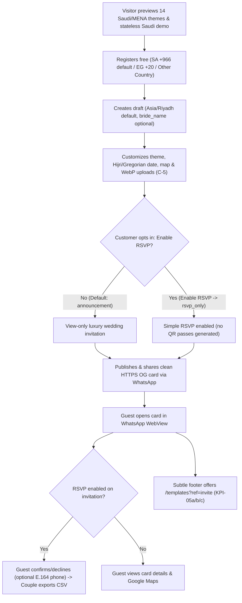
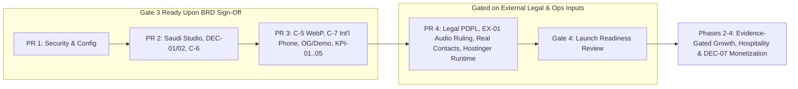

# Zaffe (زفّــة) — Business Requirements Document (BRD)

> **Status:** `Final Candidate v0.5 — Incorporates Final PO Decisions (DEC-01..07, C-5..C-7, KPI-03b, KPI-05) — Pending Formal PO Document Sign-Off`  
> **Last Verified Date:** 2026-11-21  
> **Baseline:** Git branch `dev` (`d833b95`)  
> **Evidence Sources:** [project-discovery.md](project-discovery.md) · [DOCUMENTATION_AUDIT_SUMMARY.md](DOCUMENTATION_AUDIT_SUMMARY.md) · [OPEN_QUESTIONS.md](../product/OPEN_QUESTIONS.md) · [ZAFFE_PRODUCT_STRATEGY.md](../product/strategy/ZAFFE_PRODUCT_STRATEGY.md) (`v2.3`) · [SAUDI_MARKET_DECISIONS.md](../product/SAUDI_MARKET_DECISIONS.md) · [RELEASE_1_PRODUCT_DECISIONS.md](../product/RELEASE_1_PRODUCT_DECISIONS.md) · [QR_FEATURE_ISOLATION_POLICY.md](../architecture/QR_FEATURE_ISOLATION_POLICY.md) · [MASTER_ROADMAP.md](../engineering/MASTER_ROADMAP.md)  
> **Governance:** [DOCUMENTATION_GUIDELINES.md](../DOCUMENTATION_GUIDELINES.md)

> [!IMPORTANT]
> **Approval & Code-Freeze Governance:**
> - **Explicitly Settled Decisions:** `DEC-01`, `DEC-02`, `DEC-03`, `DEC-04` (`4.1`–`4.5`), `DEC-07`, `C-5`, `C-6`, `C-7`, `KPI-03b`, and `KPI-05` are **Product Owner Approved**.
> - **Pending Legal / Operational Clearances:** `DEC-05` (Saudi PDPL legal review & 30-day retention approval pending; auto-delete OFF), `EX-01` (legacy `music_url` public playback legal check), and `DEC-06` (Hostinger verification, contacts, domain, ops owner, sponsor, budget, launch date).
> - **Formal Sign-Off Gate:** Approving individual decisions does **not** auto-approve this document or code execution. **Application code changes (`PR 1`–`PR 3`) begin ONLY after formal Product Owner sign-off of this consolidated specification ([§16](#16-approval--sign-off)), and production deployment remains a separate Gate 4 sign-off.**

## Table of Contents

- [1. Executive Summary](#1-executive-summary)
- [2. Business Problem & Phase 1 Final Scope](#2-business-problem--phase-1-final-scope)
- [3. Business Objectives & Approved KPIs](#3-business-objectives--approved-kpis)
- [4. Stakeholder Analysis](#4-stakeholder-analysis)
- [5. Market Positioning Hypotheses](#5-market-positioning-hypotheses)
- [6. Core Value Loop](#6-core-value-loop)
- [7. Implementation-Ready Phase 1 Business Requirements & Acceptance Criteria](#7-implementation-ready-phase-1-business-requirements--acceptance-criteria)
- [8. Non-Functional Business Requirements](#8-non-functional-business-requirements)
- [9. Governing Business Rules & Proposed 30-Day Retention Specification](#9-governing-business-rules--proposed-30-day-retention-specification)
- [10. Data Preservation, Migration & Implementation Readiness](#10-data-preservation-migration--implementation-readiness)
- [11. Evidence-Gated Phased Roadmap](#11-evidence-gated-phased-roadmap)
- [12. Risks, Constraints & Provisional Hosting](#12-risks-constraints--provisional-hosting)
- [13. Pre-Launch Dependency Register](#13-pre-launch-dependency-register)
- [14. Requirements Traceability Matrix](#14-requirements-traceability-matrix)
- [15. Glossary](#15-glossary)
- [16. Approval & Sign-Off](#16-approval--sign-off)

---

## 1. Executive Summary

| Item | Detail |
| :--- | :--- |
| **Project Name** | Zaffe (زفّــة) — Saudi-First Digital Wedding Invitation Platform |
| **Product Type** | B2C browser-native web SaaS (`Laravel 13 + Livewire 4 + Filament v5`), zero mobile app download |
| **Sponsor / Product Owner** | `[Product Owner — Confirm Formal Sponsor Details in §16]` (`DEC-06`) |
| **Primary Market** | **Saudi Arabia (KSA)** first; **Egypt** second |
| **Core Experience** | **Choose a Design → Customize → Preview → Publish → Share** *(optional simple RSVP disabled by default per `DEC-02` Option B)* |
| **Commercial Policy (`DEC-07`)** | **Release 1 is completely free** with zero subscriptions. Future monetization follows **one-time payment per invitation**; final model (`A/B/C`) is intentionally undecided. Copy states Release 1 is free and future pricing is undetermined (**NO `"Free Forever"`, NO fake deadlines/urgency, NO retroactive charges without separate policy**). |
| **Launch Readiness (`DEC-05`)** | Business direction is **Full Public Saudi Launch** strictly contingent on legal (`DEC-05` + `EX-01`), privacy, security, functional, hosting (`DEC-06`), and Gate 4 readiness verification. |

---

## 2. Business Problem & Phase 1 Final Scope

### 2.1 Market Pain Points
1. **Printed Cards (`P1`):** Costly, slow to distribute across Saudi cities, impossible to edit once sent.
2. **Static Digital Flyers (`P2`):** Canva/PDF/MP4 assets lack live Google Maps navigation, countdowns, Umm al-Qura Hijri conversion, optional RSVP, and post-send updates.
3. **Event-Ops Bloat (`P3`):** Heavy attendance/WABA/scanner suites (`Hayhom`, etc.) charge `185+ SAR`, impose edit lockouts, and intimidate couples seeking simple invitation sharing.
4. **Saudi Family Privacy (`P4`):** Generic builders lack optional `bride_name`, photo-free themes, and clear PDPL controls.

### 2.2 Final Phase 1 Implementation Scope vs. Pre-Launch External Blockers

| Stream | Items Included | Governance / Gate |
| :--- | :--- | :--- |
| **Gate 3 Immediately Authorized *(After Formal BRD `v0.5` Sign-Off — PRs 1–3)*** | - **Public & Sharing:** Homepage, `14` free `.webp` themes, `/templates/{slug}/preview`, stateless production-safe Saudi demo (`DEC-03`), `og-zaffe.jpg`, absolute `https://` `og:image`, honest `/pricing` & `/faq` (`DEC-04.4`, `DEC-07`), direct WA/Email `/contact` (`DEC-04.2`), tasteful `/templates?ref=invite` footer (`KPI-05`).<br>- **Core Studio & Saudi Culture:** Auth, Resend password reset, profile edit, `Asia/Riyadh` defaults, **`C-7` Option B** (`+966` default, `+20`, `Other Country` international E.164, optional phone), **`bride_name` optional** (`DEC-04.1`), **`C-5` Option A** (optimized WebP for newly uploaded images with type/size/memory guards & graceful failure recovery), **`C-6` Option A** (hide external `music_url` on new creations), suppress `"Black Tie"` placeholders (`DEC-04.3`), `arabic_indic` countdowns, `emerald_night`/`desert_dusk`/`islamic_elegance`/`timeline.blade.php:33`/`share_box.blade.php:30`, dashboard `children_count`/`archived` badge (`DEC-04.5`), email fixes.<br>- **View-First & Optional RSVP (`DEC-01`/`DEC-02` Option B):** `announcement` default (`is_rsvp_enabled = false`), binary **Enable/Disable RSVP** (`rsvp_only` ↔ `announcement`), non-destructive off, fix `Invitation::booted()` & `InvitationEditor::updatedIsRsvpEnabled()`, hide `GuestRosterManager`/`?g=` UI on new cards, preserve legacy QR/guest rows & `"بطاقة الدعوة الشخصية"` copy, `CsvSanitizer` export.<br>- **Security & KPIs:** `DATA-01` media purge, `SEC-05` `/admin/*` `SecurityHeaders`, `SEC-06` `PlatformSetting` lock, `CONF-01`, minor `DATA-02`, and **`KPI-01`–`KPI-05` (`KPI-03b` & 3-stage `KPI-05a/b/c`)** in `OperationsMonitor`. | **Authorized to Build in PRs 1–3 Upon Formal PO BRD Sign-Off** |
| **Gate 4 Blocked on External Inputs *(PR 4 & Launch)*** | - Counsel-reviewed `/privacy` & `/terms`, form notices, and documented privacy request SLA (`DEC-05`).<br>- **30-day guest/RSVP PII retention clearance (`EX-02`)** *(auto-delete stays OFF unless/until legally & operationally approved)*.<br>- **Legacy external `music_url` public playback ruling (`EX-01`)** *(do NOT assume metadata preservation authorizes playback)*.<br>- **Real verified Saudi `PlatformSetting` support email & WhatsApp/phone** (`DEC-06`).<br>- **Verified Hostinger plan (`PHP >= 8.4.1`, `ext-intl`, `gd/WebP`, MariaDB, cron/sync queues, EU PDPL clearance `EX-03`, renewal quote) or KVM 1/2 VPS fallback**, production domain & Resend DNS, ops owner, budget, launch date, and staging/live-HTTPS drills. | **Blocked Until External Legal, Hosting & Operational Inputs Provided** |
| **Deferred Post-Launch *(Evidence-Gated Ph 2–4)*** | `F15` short `/i/` links & dynamic OG generator, `ZAFFE-017` wizard patterns, curated audio library, full EN card/editor parity (`BRQ-36`), customer archive button, account suspension (`BR-032`), self-service account deletion UI, dual halls/multi-event/co-hosts/wishes wall, automated retention jobs (`if deferred`), Phase 4 Paymob one-time billing (`Model A/B/C`). | **Deferred — No Phase 1 Code** |
| **Excluded** | QR scanning, Gatekeeper (`/gate/{gateToken}` on `feature/ZAFFE-018`), physical door admission, subscriptions, custom agency service, WABA/SMS blasts. | **Permanently Excluded** |

---

## 3. Business Objectives & Approved KPIs

### 3.1 Business Objectives
`BO-01` Win Saudi adoption via craft & WhatsApp reliability · `BO-02` Keep creation view-first (`announcement`) with optional RSVP · `BO-03` Protect Saudi family & guest PII (`bride_name`, `C-5`, `C-6`, `DEC-05`) · `BO-04` Measure privacy-safe organic growth (`KPI-05`) · `BO-05` Preserve one-time billing optionality (`DEC-07`) · `BO-06` Maintain clean admin funnel visibility (`KPI-01`–`KPI-05`).

### 3.2 Approved Success Metrics (`KPI-01` – `KPI-05`)

> [!NOTE]
> **All 6 KPI definitions below (`KPI-01`–`KPI-04`, `KPI-03b`, `KPI-05a/b/c`) are Product Owner Approved (`2026-11-21`).** Suggested numeric expectations remain **calibration hypotheses only** until real launch cohorts establish baselines.

| KPI | Exact Calculation & State Rules | Time Window & Duplicate Rules | Privacy & Honesty Limitations |
| :--- | :--- | :--- | :--- |
| **`KPI-01`** | **Creation-Start → Published Rate:** distinct creation starts transitioning to `published` ÷ total creation starts (using `invitations` + lightweight creation-visit counter). | `All-Time` & `Rolling 30 Days`; invitation ID deduplicates repeat edits. | Measures funnel completion, not external distribution. |
| **`KPI-02`** | **Published → Shared (`>= 10` Activity) Rate:** published invitations with `view_count >= 10 OR rsvp_count >= 1` ÷ total published invitations. | Lifetime per published invitation; session-deduplicated browser loads. | **Session views ≠ verified unique human guests. Share button clicks ≠ confirmed WhatsApp deliveries.** |
| **`KPI-03`** | **Average RSVPs per Published Invitation *(Original — Unchanged)*:** `COUNT(rsvp_responses on published cards)` ÷ `COUNT(published invitations)`. | `All-Time` & `Rolling 30 Days`; phone/guest updates overwrite in place. | Naturally depressed under `DEC-02` Option B because view-only `announcement` cards stay in denominator. |
| **`KPI-03b`** *(Approved)* | **Average RSVPs per RSVP-Enabled Published Invitation:**<br>- **Numerator:** `COUNT(rsvp_responses)` belonging to `status = 'published' AND is_rsvp_enabled = true`.<br>- **Denominator:** `COUNT(invitations)` where `status = 'published' AND is_rsvp_enabled = true` (`0.0` if `0`).<br>- Companion readout: **RSVP Adoption Rate** (`RSVP-enabled published ÷ total published`) & **`>=1 RSVP` Enabled Count**. | **`All-Time` & `Rolling 30 Days`.**<br>- **State Transitions:** Disabling RSVP removes the invitation from the denominator and its responses from `KPI-03b` numerator (preventing inflation; DB responses stay intact for `KPI-03` and owner CSV). Re-enabling restores both.<br>- **Duplicates:** Same `?g=` guest or normalized phone updates existing `RsvpResponse`; phone-less submissions stay distinct rows. | Measures submission parties (`rsvp_responses`), not headcount (`guest_count + children_count`); does not adjust for time-since-enabling. |
| **`KPI-04`** | **Mobile WebView Speed (`< 2.5s` LCP):** Largest Contentful Paint on public card over throttled 4G / mid-range mobile. | Verified via staging & live Lighthouse / DevTools checks. | Lab/field test only; no third-party RUM scripts. |
| **`KPI-05`** *(Approved)* | **3-Stage Privacy-Safe Referral Attribution (`/templates?ref=invite`):**<br>- **`KPI-05a` Referral Visits:** session-deduplicated daily count of `?ref=invite` arrivals.<br>- **`KPI-05b` Referred Signups:** count & `%` of new `user` signups storing `signup_source = 'invite_footer'`.<br>- **`KPI-05c` Published Cards by Referred Users:** count & `%` of published invitations (plus distinct couples `>=1` published card) from referred accounts. | `All-Time` & `Rolling 30 Days`; session referral tag clears automatically after registration/expiry. | **Strict Privacy:** Stores ONLY coarse `'invite_footer'` label (zero source card slug, zero guest IP).<br>**Limitations:** **Never equate `KPI-05a` visits with acquired customers.** Cross-device WhatsApp-mobile → desktop signups are untracked. |

---

## 4. Stakeholder Analysis

Engaged Couple (`role = 'user'`), Invited Guest (no login), Legacy Pre-Invited Guest (`?g=` / `/pass/{qrToken}` preserved), Public Marketing Visitor, Super Admin (`role = 'admin'`), Product Owner / Sponsor, Saudi PDPL Legal Counsel, Resend, Candidate Hosting Provider (`Hostinger`), and Future Phase 4 Paymob Gateway. Gatekeeper / Usher is **excluded**.

---

## 5. Market Positioning Hypotheses

1. **Craft + View-First Calm vs. Event-Ops (`Hayhom`):** Zero app download, free R1 entry, flexible edits, and `announcement` default serve modern Saudi weddings better than 185+ SAR scanner systems.
2. **Interactive Web Microsite vs. Static Flyers (`Canva`/PDF):** Live Maps links, Umm al-Qura Hijri conversion, optional RSVP, and live editing deliver real utility inside WhatsApp WebViews.

---

## 6. Core Value Loop



*(Existing `rsvp_qr`/`qr_only` invitations, `InvitationGuest` rows, `?g=` tokens, `/pass/{qrToken}`, and legacy `music_url` metadata remain governed by §10.1 Data Preservation Rules.)*

---

## 7. Implementation-Ready Phase 1 Business Requirements & Acceptance Criteria

**Conventions:** `BRQ-XX` = Requirement · `Status`: `PO Approved (P1)` · `Pending Gate 4 Input` · `Legacy Preserve (P1)` · `Deferred` · `Excluded`.

### 7.1 Acquisition, Showcase & Public Discovery
- **`BRQ-01` (`PO Approved P1`):** Homepage communicates Saudi-first luxury studio & free R1 launch; zero QR Pass / Gatekeeper hype (`home.blade.php:214,337,511`).
- **`BRQ-02`–`03` (`PO Approved P1`):** Filterable `14`-theme gallery (`/templates`) & responsive zero-login `/templates/{slug}/preview`.
- **`BRQ-04` (`PO Approved P1`):** `/pricing` & `/about` state `14` free themes, Release 1 free offer, future pricing undetermined, **NO `"Free Forever"` claim and NO fake urgency/deadlines** (`pricing.blade.php`, `about.blade.php`).
- **`BRQ-05` (`PO Approved P1`):** Remove simulated Alpine `/contact` form (`contact.blade.php:65-116`), retaining direct `PlatformSetting` WhatsApp & Email links (real values injected in PR 4).
- **`BRQ-44` (`PO Approved P1`):** Homepage/footer demo CTA links to a **stateless, production-safe Saudi Signature demo route** (`HTTP 200`, never `404` when local seeders are absent).
- **`BRQ-45` (`PO Approved P1`):** Public cards emit valid **absolute `https://` `og:image` / `twitter:image`** with `public/images/og-zaffe.jpg` fallback, exposing zero private metadata; must pass real HTTPS WhatsApp preview verification.

### 7.2 Accounts, Studio, Aesthetics, Media & Simple Optional RSVP
- **`BRQ-06`–`08` & `BRQ-19` (`C-7` Option B PO Approved P1):** `/register`, `/dashboard/profile`, `RsvpForm`, and `AuthController`/`DashboardController` support **`SA (+966)` default**, **`EG (+20)` secondary**, and **`Other Country` (`OTHER`)** accepting valid E.164 international numbers (`+[1-9]\d{7,14}`). Fixing `PhoneService::normalize()` prevents international inputs from falling back to `+20` rules; **phone remains optional** across registration, profile, and guest RSVP.
- **`BRQ-09` (`Deferred — DEC-04.5`):** Customer archive UI & account suspension (`BR-032`) deferred post-launch unless legal/security dependency requires them.
- **`BRQ-10`, `BRQ-37`–`38` (`DEC-04.1` PO Approved P1):** Saudi default `Asia/Riyadh`; non-destructive nullable `invitations.bride_name` migration + validation (`DashboardController`, `InvitationEditor`, `InvitationForm`) + zero orphan `"و"`/`"وَ"`/`"&"` across all **`14` templates**, titles, slugs, dashboard lists, WhatsApp text, passes, and notification emails.
- **`BRQ-11` (`PO Approved P1`):** 6-tab Studio Editor aligned with backend `max_guests_per_rsvp` (`max="20"`), responsive preview, and autosave.
- **`BRQ-12` (`DEC-04.3` Option A PO Approved P1):** Suppress unedited hardcoded `"Black Tie"` / dummy text in `dress_code.blade.php` & `timeline.blade.php`; hide incomplete placeholder toggles for new Phase 1 creations; **preserve & render genuine saved customer `content`** alongside Saudi `ceremonyStages()`.
- **`BRQ-13` (`DEC-05`/`04.5` PO Approved P1):** Customer self-service delete & Filament Admin delete enforce authorization/confirmation, cascade cleanly, purge local & `http(s)://.../storage/...` media (`DATA-01`), return `404` on deleted `/invitation/{slug}` & `/pass/{qrToken}`, and recover cleanly on DB failures. Fix `DashboardController::index()` `children_count` sum & `archived` status badge.
- **`BRQ-14` (`DEC-04.1` PO Approved P1):** All `14` photo-free/custom-styled templates honor style overrides & `welcome_message`; fix `emerald_night`, `desert_dusk`, `islamic_elegance`, `timeline.blade.php:33`, `share_box.blade.php:30`, `RsvpConfirmationNotification` declined copy, and `NewRsvpNotification` emoji.
- **`BRQ-15` (`C-5` Option A PO Approved P1):** Newly uploaded `cover_photo` and `gallery` images are validated (MIME, `<= 5MB`, safe pixel-budget dimensions) and converted server-side to optimized `.webp` using verified runtime libraries (`gd` WebP locally, respecting `memory_limit`), with graceful failure handling (**write-before-delete** so failures never delete prior photos) and **zero destructive batch conversion of historical non-WebP uploads**.
- **`BRQ-16` (`DEC-02` Option B PO Approved P1):** New invitations default to view-only **`announcement`** (`is_rsvp_enabled = false`) with one simple **Enable RSVP / Disable RSVP** control (`rsvp_only` ↔ `announcement`). Disabling RSVP hides the form without destroying collected `rsvp_responses`. Zero QR passes generated for new invitations; **both** [Invitation.php](../../app/Models/Invitation.php#L38-L41) and [InvitationEditor.php](../../app/Livewire/InvitationEditor.php#L175-L177) fixed so toggling RSVP on transitions to `MODE_RSVP_ONLY`, never `MODE_RSVP_QR`.
- **`BRQ-17`–`18`, `21`, `46` (`PO Approved P1`):** Draft `403`, Umm al-Qura Hijri + **`arabic_indic` countdown fix**, subtle `/templates?ref=invite` card footer.
- **`BRQ-20` (`C-6` Option A PO Approved P1 + `EX-01` Legal Escalation):** Hide external `music_url` input for newly created Phase 1 invitations (`InvitationEditor`), preserving stored legacy `music_url` metadata in DB cleanly without building an audio library or allowing unsolicited autoplay; **public playback legality of any existing legacy `music_url` records is escalated under `EX-01` prior to launch**.

### 7.3 Legacy Preservation, Privacy, Admin & Future Phases
- **`BRQ-22`–`24` (`DEC-01` Option B Legacy Preserve P1):** Hide `GuestRosterManager`, bulk CSV import, quotas, and `?g=` UI on new Phase 1 cards; keep `/guests` focused on calm RSVP stats, responses, and `CsvSanitizer` export. Preserve existing `InvitationGuest` records, `?g=` links, `rsvp_qr`/`qr_only` modes, and `/pass/{qrToken}` pages; replace `"بطاقة دخول"` with `"بطاقة الدعوة الشخصية"`.
- **`BRQ-25` (`Excluded`):** Gatekeeper `/gate/{gateToken}` (`feature/ZAFFE-018`) permanently excluded.
- **`BRQ-26`–`35`, `BRQ-43` (`PO Approved P1`):** `SEC-05` `/admin/*` `SecurityHeaders`, `SEC-06` `PlatformSetting` lock, `DATA-02` Admin filter/export fixes, and **`KPI-01`–`KPI-05` (`KPI-03b` & `KPI-05a/b/c`)** inside `OperationsMonitor`.
- **`BRQ-36` (`DEC-04.4` Option A PO Approved):** Arabic-first Phase 1 cards/editor/RSVP; sync honest `faq.blade.php`; keep EN Marketing/Auth/Dashboard/Admin; defer full EN card parity to Phase 2.
- **`BRQ-39` (`DEC-05` Business Direction Approved; Legal Pending):** Legal-reviewed `/privacy` & `/terms`, form notices, self-service invite delete + documented account/guest privacy request workflow & SLA (`PR 4`), and §9.1 retention spec (**auto-delete OFF pending legal**).
- **`BRQ-40`–`41` (`DEC-07` PO Approved):** Free Release 1; deferred Phase 4 one-time Paymob checkout (`Model A/B/C` undecided; `SubscriptionPlanResource` `403`).
- **`BRQ-42`, `47`–`48` (`Deferred`):** Evidence-gated Phases 2–3.

### 7.12 Acceptance Criteria Matrix & Gherkin Scenarios

| Requirement Group | Customer-Visible Behavior | Mandatory Automated & Manual Test Obligations |
| :--- | :--- | :--- |
| **`DEC-01` Option B** | New P1 couples see calm RSVP summary + responses + CSV export on `/guests` (`GuestRosterManager` & `?g=` hidden); legacy invitations with `InvitationGuest` rows or `rsvp_qr`/`qr_only` retain full roster, `?g=`, & `/pass/{qrToken}` with `"بطاقة الدعوة الشخصية"`. | Feature tests asserting new P1 vs. legacy visibility, `?g=` pre-filled form & quota protection, `/pass/{qrToken}` `200`, and zero `"بطاقة دخول"` wording. |
| **`DEC-02` Option B** | New cards start in `announcement` (`RSVP OFF`); 1-tap toggle switches `rsvp_only` ↔ `announcement`; turning RSVP OFF hides form without deleting collected RSVPs; zero QR passes created. | Feature tests for `DashboardController::store()`, `Invitation::booted()`, `InvitationEditor::updatedIsRsvpEnabled()`, non-destructive RSVP off/on, and legacy `rsvp_qr`/`qr_only` preservation. |
| **`DEC-03` Option A** | Live demo link returns `HTTP 200` on fresh production DB (no local seeds); WhatsApp link share renders valid absolute `https://` `og:image` with `og-zaffe.jpg` fallback & no PII leak. | Feature test verifying stateless `/demo` `200` on unseeded DB, absolute URL regex on `og:image`, plus **live public HTTPS Meta/WhatsApp preview verification** in Gate 4. |
| **`DEC-04.1`–`4.5`** | `bride_name` optional with zero orphan `"و"`/`"&"` anywhere; all `14` themes render cleanly; `arabic_indic` countdown works; no fake `/contact` form; no unedited `"Black Tie"` text (saved custom sections render); accurate dashboard counts & FAQ copy. | Automated render tests across **all 14 templates** (with & without `bride_name`/photos/overrides), notification & dashboard assertions, countdown output check, `/contact` & `/faq` route assertions. |
| **`DEC-05` Invite Delete** | Confirmed owner deletion & Admin deletion remove all uploaded files (`local` & `http(s)` URLs) + DB children; deleted `/invitation/{slug}`, `?g=`, & `/pass/{qrToken}` return `404`; unauthorized users get `403`. | Feature tests for owner vs. non-owner IDOR delete, `DATA-01` `Storage::disk('public')->assertMissing(...)` on full-URL files, post-delete `404`, and rollback check. |
| **`C-5` WebP Uploads** | Newly uploaded cover/gallery photos convert to optimized `.webp` on upload cleanly; bad files or oversized dimensions fail gracefully without deleting the couple's previous photo; old non-WebP files still display. | Unit & Feature tests for `ImageOptimizationService` (`JPEG`/`PNG` → `.webp`, invalid MIME rejection, oversized dimension/pixel-budget rejection without OOM, failed upload preserving previous photo, plus **real-image quality & mobile speed verification**). |
| **`C-6` Audio Gate** | New Phase 1 Studio Editor shows no raw external `music_url` field; existing DB `music_url` records stay intact & tap-to-open gate never autoplays; legacy playback governed by `EX-01` ruling. | Feature tests verifying Editor omits `music_url` for new creations, refuses unapproved edits or clears safely, and `music_player` keeps tap-gate without autoplay. |
| **`C-7` Int'l Phone** | Registration, profile & RSVP default to `SA (+966)`, offer `EG (+20)` & `Other Country` accepting valid international E.164 (`+44...`, `+971...`), and allow blank optional phone cleanly. | Unit (`PhoneServiceTest` covering `+966`, `+20`, `OTHER`, Arabic-Indic digits) + Feature tests across `/register`, `/dashboard/profile`, and `RsvpForm` preserving legacy records. |
| **`KPI-03b` & `KPI-05`** | `OperationsMonitor` shows separate `KPI-03` & `KPI-03b` (state-transition accurate) plus separated `KPI-05a` visits, `KPI-05b` signups, and `KPI-05c` referred publishes with zero extra PII. | Feature tests simulating RSVP on/off transitions on `KPI-03b`, `?ref=invite` visit -> signup -> publish attribution on `KPI-05`, and `DEC-07` non-forever `/pricing` copy check. |

```gherkin
Feature: C-5 Option A — Safe WebP Upload Conversion Without Memory Exhaustion or Data Loss
  Scenario: Couple uploads a JPEG cover photo in Studio Editor
    Given an authenticated couple has an existing cover_photo on disk
    When they upload a valid JPEG/PNG image within size and pixel-dimension limits
    Then ImageOptimizationService encodes an optimized .webp asset and removes the old cover only after the new file saves
    And if validation or image encoding fails (invalid type or decompression-bomb dimensions), the previous cover_photo remains intact

Feature: C-6 Option A — Hidden New-Creation Music URL & Preserved Legacy Metadata
  Scenario: New Phase 1 couple uses Studio Editor while legacy invitation exists
    Given a newly created Phase 1 invitation
    When the couple inspects all tabs of Studio Editor
    Then no external music_url input is exposed
    And any pre-existing database row containing music_url keeps its stored metadata preserved untouched

Feature: C-7 Option B — Saudi Default, Egypt & International E.164 Phone Support
  Scenario: Guest or couple enters an international phone number or leaves phone empty
    Given registration, profile edit, or an RSVP-enabled invitation form defaulting to SA (+966)
    When the user switches to Other Country and enters "+971501234567" (or leaves phone blank on RSVP)
    Then PhoneService validates and stores "+971501234567" (or null when omitted) without coercing it into "+20"
```

---

## 8. Non-Functional Business Requirements

Baseline `NFR-01`–`NFR-11` remain active: `NFR-01` ownership scoping & `#[Locked]` state; `NFR-02` throttling; `NFR-03` `SecurityHeaders` globally + `/admin/*`; `NFR-04` mobile 4G LCP `< 2.5s`; `NFR-05` zero external hotlinks; `NFR-06` `CsvSanitizer` + BOM; `NFR-07` minimal PII; `NFR-08` SVG-only templates; `NFR-09` verified `PHP >= 8.4.1`, `ext-intl`, `gd/WebP` within `memory_limit`, MariaDB/MySQL compatibility; `NFR-10` mail/queue reliability; `NFR-11` automated tests + Pint + idempotent migrations.

---

## 9. Governing Business Rules & Proposed 30-Day Retention Specification

Authoritative rules `BR-001`–`BR-036` reside in [project-discovery.md](project-discovery.md) §7 (`BR-005`/`034` nullable `bride_name`; `BR-006` international E.164 phone; `BR-014`/`031` `DEC-01`/`DEC-02` Option B; `BR-030` §9.1 below; `BR-033` deferred one-time Phase 4 billing).

### 9.1 Proposed 30-Day Post-Event Guest & RSVP PII Retention Specification (`DEC-05` — Pending Legal)

> [!WARNING]
> **Not Legally Approved — Auto-Delete Remains OFF:** **30 days after `wedding_date`** is a PO business preference for personal guest/RSVP data (`rsvp_responses`, legacy `invitation_guests`) **ONLY** — never couple `users` or `invitations` design records. Automated erasure/anonymization of production or historical records **MUST NOT run** before legal counsel, customer notices, transition window, and operational sign-offs complete.

1. **Purpose:** Bound guest personal data lifecycle once wedding coordination finishes.
2. **Covered vs. Excluded:** Scrubs `rsvp_responses` (`guest_name`, `phone`, `email`, `message`, `dietary_notes`) & `invitation_guests` PII (`name`, `phone`, tokens); preserves couple accounts & invitation designs.
3. **Date Calculation:** `wedding_date + 30 calendar days` at `23:59:59` in the invitation's timezone (`Asia/Riyadh`/`Africa/Cairo`); `NULL` dates excluded from post-event triggers.
4. **Rescheduling:** Updating `wedding_date` dynamically recalculates `+30 days` and cancels pending purge alerts.
5. **Customer Notice & Export Window:** Pre-purge warning notification & CSV download link (e.g., `T + 23` / 7-day export window, subject to counsel).
6. **Deletion vs. Anonymization:** Legal Counsel advises whether `T + 30` performs hard deletion OR irreversible PII scrubbing keeping aggregate counts for `KPI-03`.
7. **Exceptions:** Hold records under active legal, abuse, or deletion disputes.
8. **Historical Transition:** Existing past-date records get an explicit notice & grace window (never silent day-1 wipe).
9. **Backups & Recovery:** Documented backup aging & post-restore re-erasure log prevents deleted PII resurrection.
10. **Pre-Launch Gate (`EX-02`):** Counsel determines if automated enforcement is legally mandatory prior to public launch.

---

## 10. Data Preservation, Migration & Implementation Readiness

### 10.1 Strict Data Preservation Plan (`Zero Destructive Migrations`)
1. **Legacy QR Data & Modes (`DEC-01` / `DEC-02`):** Preserve every existing `rsvp_qr`/`qr_only` invitation, `InvitationGuest` row, `qr_token`, `pass_code`, `/pass/{qrToken}` route, and historical check-in column cleanly in DB. Zero bulk `UPDATE` scripts changing existing `invitation_mode` values.
2. **Legacy `?g=` Personalized Links:** Existing `invite_token` query links, `RsvpForm` quota protections, and legacy `guests.blade.php` visibility remain fully functional whenever an invitation has guest rows or legacy QR mode.
3. **Legacy Audio Metadata (`C-6` Option A + `EX-01`):** Preserve stored `invitations.music_url` column and historical strings in DB cleanly. Do **not** overwrite existing `music_url` data, and **require `EX-01` legal/PO ruling** before permitting public playback of external legacy URLs in production.
4. **Existing RSVP Responses (`DEC-02`):** Toggling RSVP OFF sets `is_rsvp_enabled = false` / `invitation_mode = 'announcement'` while preserving all submitted `rsvp_responses` intact (hidden from public form, accessible to couple until handled under approved lifecycle/retention rules).
5. **Existing Uploaded Customer Media (`C-5` Option A + `DATA-01`):** Zero destructive batch conversion of pre-existing `.jpg`/`.png` uploads. Both `cover_photo` and `invitation_photos` remain readable; new uploads write optimized `.webp` prior to deleting any replaced file; `DATA-01` purges both relative and `http(s)://.../storage/...` files on deletion.
6. **Non-Destructive `bride_name` & Section Records:** Schema migration converts `invitations.bride_name` to `nullable()` safely across SQLite and MariaDB/MySQL with clean `down()` rollback and zero row mutations. Existing custom `timeline`/`dress_code` JSON records render faithfully (`DEC-04.3`).

### 10.2 Implementation Readiness Separation (`Gate 3 PRs 1–3` vs. `PR 4 / Gate 4`)
Phase 1 engineering readiness splits cleanly into **PR 1 → PR 2 → PR 3** (100% unblocked the moment PO formally signs BRD `v0.5`) and **PR 4** (isolated cleanly for external legal copy, `EX-01` audio ruling, real support contacts, and verified Hostinger runtime/DNS inputs). Detailed PR task breakdown lives in [MASTER_ROADMAP.md](../engineering/MASTER_ROADMAP.md).

---

## 11. Evidence-Gated Phased Roadmap



*(Phases 2–4 remain evidence-gated proposals in [ZAFFE_PRODUCT_STRATEGY.md](../product/strategy/ZAFFE_PRODUCT_STRATEGY.md) §5; zero Phase 2–4 activation in Phase 1.)*

---

## 12. Risks, Constraints & Provisional Hosting

- **Technical Constraints:** Laravel 13 (`PHP >= 8.4.1`, `ext-intl`, `gd` WebP within server `memory_limit`); shared hosting lacks Supervisor (`sync` reset + cron queue verification OR KVM 1/2 VPS fallback); `feature/ZAFFE-018` permanently excluded; `F15` & `ZAFFE-017` kept unmerged.
- **Top Risks Requiring PO Oversight:** Unverified Hostinger PHP `8.4.1` CLI/GD-WebP/memory caps (`DEC-06`), EU hosting international transfer review (`EX-03`), unresolved `EX-01` legacy audio playback legality, `EX-02` 30-day retention counsel outcome, and verifying real HTTPS WhatsApp previews before Gate 4 launch.

---

## 13. Pre-Launch Dependency Register

Tracked exhaustively in [OPEN_QUESTIONS.md](../product/OPEN_QUESTIONS.md) §5: formal BRD `v0.5` sign-off (unlocks `PR 1–3`); Saudi PDPL counsel + `/privacy`/`/terms` + SLA + `EX-01`/`EX-02`/`EX-03` clearances, real Saudi support email & WhatsApp, production domain & Resend DNS, verified Hostinger compatibility + plan/budget approval, named ops owner/sponsor & launch date (unlock `PR 4` & `Gate 4`).

---

## 14. Requirements Traceability Matrix

| BRQ Group | Decisions (`DEC` / `C`) | Target PR | Key Verification Artifact / Test |
| :--- | :--- | :---: | :--- |
| `DATA-01`, `SEC-05`, `SEC-06`, `CONF-01`, `DATA-02` | `DEC-05` safety, existing Admin/Ops rules | **PR 1** | `AuditTest`, `AdminManagementTest`, `AdminFeatureCoverageTest` |
| `BRQ-10, 12, 14, 16, 20, 22–24, 37–38` | `DEC-01`, `DEC-02`, `DEC-04.1/4.3`, **`C-6`** | **PR 2** | 14-template suite, `InvitationEditorTest`, `RsvpEngineTest`, `NotificationTest`, legacy QR tests |
| `BRQ-01–08, 13, 15, 19, 36, 40, 43–46` | `DEC-03`, `DEC-04.2/4.4/4.5`, `DEC-06` KPIs, `DEC-07`, **`C-5`**, **`C-7`** | **PR 3** | `ImageOptimizationTest`, `PhoneServiceTest`, stateless `/demo`, `og:image`, `/pricing`, `KPI-03b`/`05` |
| `BRQ-39`, `/privacy`, `/terms`, contacts, host | `DEC-05` Legal Gate, **`EX-01`–`03`**, `DEC-06` Ops/Hostinger | **PR 4 & Gate 4** | Legal sign-off, Hostinger PHP/MariaDB/cron & restore drills, live HTTPS WhatsApp preview & 4G LCP |

---

## 15. Glossary

Core domain terms unchanged from v0.1 (`Couple`, `Invitation`, `Saudi Signature Collection Vol. 1`, `PDPL`, `BRQ / BR / FEAT`). Legacy `"بطاقة دخول"` becomes `"بطاقة الدعوة الشخصية"`; Gatekeeper door admission is excluded.

---

## 16. Approval & Sign-Off

| Role | Name | Sign-Off Status | Date |
| :--- | :--- | :--- | :--- |
| **Product Owner / Business Sponsor** | `[Product Owner — Confirm Name / Title]` | **Pending Formal Sign-Off (`v0.5`) — Authorizes Gate 3 (`PR 1–3`)** | — |
| **Legal / Compliance Counsel (Saudi PDPL)** | `[Pending Counsel Engagement]` | **Pending (`DEC-05` & `EX-01`–`03` Mandatory Gate 4 Review)** | — |

### Revision History

| Version | Date | Author | Change |
| :--- | :---: | :--- | :--- |
| `0.1` | `2026-11-19` | Business Analysis | Initial baseline BRD (`dev` `d88d381`) |
| `0.2`–`0.4` | `2026-11-20`–`21` | Principal PM / BA / Architect | Saudi-first strategy realignment & `DEC-01`–`DEC-07` reconciliation |
| `0.5` | `2026-11-21` | Principal PM / BA / Architect | Incorporated PO approvals (`C-5` Opt A, `C-6` Opt A, `C-7` Opt B, `KPI-03b`, `KPI-05a/b/c`), added Acceptance Criteria Matrix, 6-class Data Preservation Plan, Policy Exception Register (`EX-01`–`04`), Hostinger GD/WebP/CLI verification requirements, and balanced Gate 3 (`PR 1–3`) vs. Gate 4 (`PR 4`) separation — ready for formal PO BRD sign-off |
