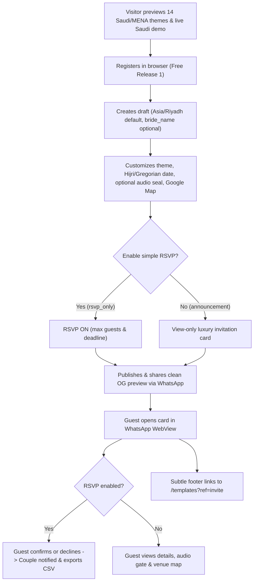

# Zaffe (زفّــة) — Business Requirements Document (BRD)

> **Status:** `Draft v0.3 — Reconciled with 2026-11-20 PO Strategic Direction, Pending PO Approval`  
> **Last Verified Date:** 2026-11-20  
> **Baseline:** Git branch `dev` (`d833b95`)  
> **Evidence Sources:** [project-discovery.md](project-discovery.md) · [DOCUMENTATION_AUDIT_SUMMARY.md](DOCUMENTATION_AUDIT_SUMMARY.md) · [ZAFFE_PRODUCT_STRATEGY.md](../product/strategy/ZAFFE_PRODUCT_STRATEGY.md) (`v2.1`) · [OPEN_QUESTIONS.md](../product/OPEN_QUESTIONS.md) (`DEC-01`–`DEC-07`) · [SAUDI_MARKET_DECISIONS.md](../product/SAUDI_MARKET_DECISIONS.md) · [RELEASE_1_PRODUCT_DECISIONS.md](../product/RELEASE_1_PRODUCT_DECISIONS.md)  
> **Governance:** [DOCUMENTATION_GUIDELINES.md](../DOCUMENTATION_GUIDELINES.md)

> [!IMPORTANT]
> **Governance & Approval Notice.** Every requirement states the business need, its **verified status on `dev` (`d833b95`)**, and its **proposed priority/phase**. Items marked **`Proposed`** or **`Evidence-Gated Candidate`** and decisions **`DEC-01`–`DEC-07`** are **NOT approved** until the Product Owner signs off in [§16](#16-approval--sign-off). Business requirements sign-off and production deployment approval are strictly separate.

## Table of Contents

- [1. Executive Summary](#1-executive-summary)
- [2. Business Problem & Scope](#2-business-problem--scope)
- [3. Business Objectives & KPIs](#3-business-objectives--kpis)
- [4. Stakeholder Analysis](#4-stakeholder-analysis)
- [5. Market Positioning Hypotheses](#5-market-positioning-hypotheses)
- [6. Business Context & Core Value Loop](#6-business-context--core-value-loop)
- [7. High-Level Business Requirements](#7-high-level-business-requirements)
- [8. Non-Functional Business Requirements](#8-non-functional-business-requirements)
- [9. Governing Business Rules](#9-governing-business-rules)
- [10. Constraint Gap Analysis](#10-constraint-gap-analysis)
- [11. Proposed Evidence-Gated Phased Roadmap](#11-proposed-evidence-gated-phased-roadmap)
- [12. Risks, Constraints & Dependencies](#12-risks-constraints--dependencies)
- [13. Open Decisions Required](#13-open-decisions-required)
- [14. Requirements Traceability Matrix](#14-requirements-traceability-matrix)
- [15. Glossary](#15-glossary)
- [16. Approval & Sign-Off](#16-approval--sign-off)

---

## 1. Executive Summary

| Item | Detail |
| :--- | :--- |
| **Project Name** | Zaffe (زفّــة) — Saudi-First Digital Wedding Invitation Platform |
| **Product Type** | B2C browser-native web SaaS (`Laravel 13 + Livewire 4 + Filament v5`), zero mobile app download |
| **Sponsor / Product Owner** | `[REQUIRES PO CLARIFICATION]` (`DEC-06`) |
| **Primary Market** | **Saudi Arabia (KSA)** first; **Egypt** second |
| **Objective** | Launch a refined, culturally authentic, mobile-first digital wedding invitation platform where couples create, customize, publish, and share luxury wedding cards via WhatsApp in minutes, with simple optional RSVP and Saudi family privacy by default. |
| **Commercial Policy** | **Release 1 (Phase 1): 100% Free** (no paywalls, all `14` themes unlocked). *(Note: "Free Core Forever" is **NOT approved** — future Phase 4 monetization uses one-time per-invitation payment via Paymob without recurring subscriptions; exact model open in `DEC-07`.)* |
| **Readiness Snapshot** | Core flows and `196` PHPUnit tests (`2,230` assertions) exist on `dev` (`d833b95`). Launch requires resolving `DEC-01`–`DEC-06` and closing verified security/data (`DATA-01`, `SEC-05`, `SEC-06`, `CONF-01`), privacy (`/privacy`, `/terms`, deletion SLA + legal review), Saudi compatibility (`bride_name` nullable, `arabic_indic` countdown), and WhatsApp/demo blockers (`G-17`, `G-18`, `G-19`). |

### 1.1 Confirmed `2026-11-20` Strategic Directives
1. Design-led digital wedding invitation platform — **not** venue management or physical attendance operations.
2. Phase 1 prioritizes creating, customizing, publishing, and sharing beautiful invitations with simple optional RSVP.
3. Advanced guest management must never complicate primary creation; QR Passes must not be promoted at launch; QR scanning / Gatekeeper / physical door check-in are **excluded** from strategy.
4. Existing user data, invitations, guest records, and links must be protected.
5. Release 1 remains free; Saudi Arabia primary, Egypt secondary; future monetization stays one-time per invitation (no subscriptions).

---

## 2. Business Problem & Scope

### 2.1 Market Pain Points
1. **Printed Cards (`P1`):** Costly, slow to distribute across Saudi cities, impossible to update after printing.
2. **Static Digital Files (`P2`):** Canva/PDF/MP4 flyers lack Google Maps links, live countdowns, Umm al-Qura Hijri conversion, interactive audio, post-send updates, and optional RSVP.
3. **Event-Ops Bloat (`P3`):** Platforms built around paid bulk SMS/WABA, native apps, and door staffing (`Hayhom`, etc.) introduce high cost (`185+ SAR`), OTP friction, and rigid `<72h` edit locks.
4. **Saudi Family Privacy (`P4`):** Generic templates lack optional bride-name / family kunya support, photo-free elegance, and private draft protection.
5. **Informal RSVP Noise (`P5`):** When hosts want headcounts, scattered WhatsApp replies yield inaccurate numbers.

### 2.2 Proposed Scope (`Pending PO Approval`)

| Proposed Phase 1 Scope (`Free Release 1`) | Evidence-Gated Candidates (`Phases 2–4`) | Excluded from Strategy |
| :--- | :--- | :--- |
| Public site, `14` free themes, live previews, production-safe Saudi demo (`BRQ-44`) | **Phase 2:** Short `/i/` links & cover OG pipeline (`F15` selective), WebP upload compression (`PERF-02`), guided wizard (`ZAFFE-017` patterns), licensed audio library (`BRQ-48`), full EN public cards (`BRQ-36`) | QR scanning & Gatekeeper Check-In (`F16` Part B / `feature/ZAFFE-018`) |
| Couple auth, password reset (`Resend`), profile | **Phase 3 Candidates *(signal-gated)*:** Dual Men/Women venues, Multi-Event suites, Family Co-Hosts (`F18`), Wishes Wall & Thank-You Card, Vol. 2 themes, Planner workspace, automated PDPL retention | Physical door staffing & hardware |
| Live 6-tab Studio Editor with Saudi defaults (`Asia/Riyadh`, `+966`), optional `bride_name`, zero placeholders (`BRQ-12` simplified) | **Phase 4:** One-time Paymob per-invitation monetization (`SAR`/`EGP`, Model A/B/C per `DEC-07`) | Manual custom design agency & outbound call center |
| Simple optional RSVP (`rsvp_only` ↔ `announcement`) + CSV export | | Recurring monthly/annual subscriptions |
| WhatsApp 1-click sharing + absolute `og:image` + `?ref=invite` footer | | Native iOS/Android apps |
| **Legacy-Only Preservation (`DEC-01`):** Existing `InvitationGuest` rosters, `?g=` links, and `/pass/{qrToken}` kept working for pre-existing invitations; hidden from new Phase 1 creations | | |
| Technical & Privacy Blockers: `DATA-01`, `SEC-05`, `SEC-06`, `CONF-01`, `/privacy`, `/terms`, deletion request SLA, direct `/contact` channels (`DEC-04`), `OperationsMonitor` KPIs | | |

---

## 3. Business Objectives & KPIs

### 3.1 Business Objectives
- **`BO-01`:** Win initial Saudi adoption through luxury aesthetics, effortless creation, and reliable WhatsApp sharing.
- **`BO-02`:** Keep onboarding radically simple while delivering optional RSVP tracking.
- **`BO-03`:** Honor Saudi cultural and family privacy defaults (`bride_name` optional, photo-free luxury, Hijri, formal-simple Arabic).
- **`BO-04`:** Build measurable Guest-to-Couple organic attribution via `?ref=invite`.
- **`BO-05`:** Maintain clean one-time per-invitation monetization readiness for Phase 4 without breaking Release 1 pricing honesty.
- **`BO-06`:** Enable self-sufficient Super Admin operations and accurate funnel observability in `/admin`.

### 3.2 Success Metrics (KPIs — Approved vs. Proposed)

> [!NOTE]
> Approved KPI definitions from [SAUDI_MARKET_DECISIONS.md](../product/SAUDI_MARKET_DECISIONS.md) §10 are preserved verbatim. Proposed companion metrics (`KPI-03b`, `KPI-05`) require PO sign-off. All numeric targets are **Initial Validation Hypotheses (`Pending PO Calibration`)** — Zaffe has no live production baseline yet.

| KPI | Classification | Definition | Status on `dev` (`d833b95`) | Initial Validation Hypothesis *(Pending PO)* |
| :--- | :--- | :--- | :--- | :--- |
| **`KPI-01`** | **Approved** | `Wizard-Start -> Published Rate` (`%` of started creations reaching `published`) | **Partial** — user-level proxy only (`activated_couples / total_couples`) | `[REQUIRES PO CLARIFICATION]` *(Hypothesis: `>= 45%`)* |
| **`KPI-02`** | **Approved** | `Published -> Shared-with-10+-Guests Rate` (`>= 10` deduplicated views/RSVPs) | **Not Implemented** | `[REQUIRES PO CLARIFICATION]` *(Hypothesis: `>= 60%`)* |
| **`KPI-03`** | **Approved** | `Average RSVPs per Invitation` (mean RSVPs across all published cards) | **Implemented** (`avg_rsvps_per_published` = `0.0` baseline) | Baseline observed post-launch |
| **`KPI-03b`** | **Proposed** | `Average RSVPs per RSVP-Enabled Published Invitation` (excludes `announcement` cards from denominator) | **Not Implemented** | `[REQUIRES PO CLARIFICATION]` *(Hypothesis: `>= 15`)* |
| **`KPI-04`** | **Approved** | Public card **Mobile LCP** inside WhatsApp WebView over 4G | **Not Measured** | `< 2.5s` ([SAUDI_MARKET_DECISIONS.md](../product/SAUDI_MARKET_DECISIONS.md) §4) |
| **`KPI-05`** | **Proposed** | Viral attribution (`%` of signups/published cards from `/templates?ref=invite`) | **Not Implemented** | `[REQUIRES PO CLARIFICATION]` *(Hypothesis: `>= 15%`)* |

---

## 4. Stakeholder Analysis

Unchanged stakeholder set from v0.2: Product Owner (`DEC-06` needed), Engaged Couple (`role = 'user'`), Invited Guest (open card visitor), Legacy Pre-Invited Guest (`?g=` / `/pass/{qrToken}` preserved), Public Visitor, Super Admin (`role = 'admin'`), Legal / Compliance Counsel (PDPL review), and future Phase 4 Paymob provider. Gatekeeper / Usher is **excluded**.

---

## 5. Market Positioning Hypotheses

1. **Simplicity + Luxury Craft (`P1–P3`):** Zero-app, `$0` entry with couture Saudi Signature designs outperforms both heavy paid Event-Ops apps (`Hayhom`) and static files (`Canva`) on creation-to-publish velocity.
2. **WhatsApp Trust Loop:** Reliable absolute `og:image` previews, Saudi cultural fidelity, and subtle attribution turn shared wedding links into organic couple signups.
3. **Optionality Over Feature Bloat:** Making RSVP a simple binary choice removes decision paralysis for conservative or open-invitation Saudi families.

---

## 6. Business Context & Core Value Loop (`Proposed Phase 1`)



*(Existing legacy `rsvp_qr`/`qr_only` invitations, `InvitationGuest` rows, `?g=` links, and `/pass/{qrToken}` pages remain backward-compatible for pre-existing records without appearing in the new Phase 1 workflow.)*

---

## 7. High-Level Business Requirements (`v0.3`)

**Conventions:** `BRQ-XX` = Business Requirement · `Priority`: `Must (Phase 1)` · `Should (Phase 1)` · `Legacy Preserve` · `Evidence-Gated (Ph 2–4)` · `Excluded` · `Status on dev` verified against `d833b95`.

### 7.1 Acquisition, Showcase & Public Discovery

| ID | Requirement | Business Rationale | Proposed Priority | Status on `dev` (`d833b95`) | Key Gap / Decision |
| :--- | :--- | :--- | :--- | :--- | :--- |
| **BRQ-01** | Public landing page communicating Saudi-first design-led studio & free Release 1 launch (no QR/Gatekeeper hype). | Acquisition (`BO-01`) | Must (P1) | Partially Implemented (`FEAT-01`) | Markets QR passes; demo link 404s on prod (`G-17`, `G-18`) |
| **BRQ-02** | Searchable, filterable 14-theme catalog (`Saudi Signature Vol. 1` spotlight). | Self-qualification | Must (P1) | Partially Implemented (`FEAT-02`) | — |
| **BRQ-03** | Zero-account live template preview across mobile, tablet, desktop frames. | Show craft early | Must (P1) | Fully Implemented (`FEAT-03`) | — |
| **BRQ-04** | `/pricing` & `/about` accurately state `14` free themes, Release-1-only free offer (no "Free Forever"), SAR/KSA framing, zero QR hype. | Trust & pricing optionality (`DEC-07`) | Must (P1) | Partially Implemented (`FEAT-04`, `FEAT-05`) | Stale `"6 themes"`, EGP-first copy, QR bullet |
| **BRQ-05** | Working customer support contact page via real WhatsApp & Email channels (removing simulated Alpine contact form per `DEC-04` Option 4.2A). | Trust (`P4`) | Must (P1) | Partially Implemented (`FEAT-06`) | Simulated Alpine `/contact` form discards data (`G-08`) |
| **BRQ-44** *(Proposed)* | Homepage & footer live demo CTA opens a **production-safe Saudi Signature invitation** (`HTTP 200`, never `404`). | First-impression credibility | Must (P1) | **Not Implemented** | Hardcodes `/invitation/ahmed-and-sarah` (local seeder only) |
| **BRQ-45** *(Proposed)* | Public invitations emit valid **absolute `http(s)://` `og:image` / `twitter:image`** tags backed by `public/images/og-zaffe.jpg` fallback (`Phase 1`). | Reliable WhatsApp link cards | Must (P1) | **Partially Implemented** | Missing `og-zaffe.jpg`; `invitation-show.blade.php:3` emits relative thumbnail path |

### 7.2 Accounts, Studio, Aesthetics & Simple Optional RSVP

| ID | Requirement | Business Rationale | Proposed Priority | Status on `dev` | Key Gap / Decision |
| :--- | :--- | :--- | :--- | :--- | :--- |
| **BRQ-06–08** | Self-registration (`+966` default), login, password reset (`Resend`), profile edit. | Self-service onboarding | Must (P1) | Fully Implemented (`FEAT-08`–`10`) | Prod mail config (`CONF-01`) |
| **BRQ-09** | Admin couple suspension without deleting records. | Moderation | Evidence-Gated (Ph 2–3) | Not Implemented | Deferred (`DEC-04`, `BR-032`) |
| **BRQ-10** | Create draft with unique slug & **Saudi defaults** (`Asia/Riyadh`). | Onboarding speed | Must (P1) | Partially Implemented (`FEAT-12`) | `bride_name` required (`G-01`); `Africa/Cairo` fallback (`G-18`) |
| **BRQ-11** | Live 6-tab Studio Editor with autosave, device preview, custom colors/fonts, instant publish. | Core creation | Must (P1) | Partially Implemented (`FEAT-14`) | Arabic-only; input `max="10"` vs rule `20` |
| **BRQ-12** *(Simplified)* | Unedited `timeline` & `dress_code` sections **never** display hardcoded placeholder text (`"Black Tie"`); toggles hidden for new Phase 1 creations while Saudi Signature themes render `ceremonyStages()`. | Card polish without editor bloat | Must (P1) | Partially Implemented | `timeline`/`dress_code` show placeholders (`G-11`, `DEC-04`) |
| **BRQ-13** | Dashboard lifecycle & complete uploaded media cleanup across **both** customer and Filament Admin deletes. | Control & data hygiene | Must (P1) | Partially Implemented (`FEAT-13`) | Admin delete orphans `http(s)://` media (`DATA-01`); dashboard `children_count`/`archived` label |
| **BRQ-14** | All `14` photo-free themes honor custom palette overrides and `welcome_message` cleanly. | Design quality | Must (P1) | Partially Implemented (`FEAT-15`) | `emerald_night`, `desert_dusk`, `islamic_elegance`, `timeline.blade.php:33` bugs |
| **BRQ-15** | Optional `<= 5MB` image uploads in Phase 1; async WebP compression (`PERF-02`) evidence-gated in Phase 2. | Mobile speed | Must (P1 upload) / Ph 2 (WebP) | Partially Implemented | Raw upload storage in P1 |
| **BRQ-16** *(Reconciled)* | Single customer decision: **Enable RSVP / Disable RSVP** (`rsvp_only` ↔ `announcement`), hiding QR modes from new creation while keeping legacy records compatible. | Simplicity + zero QR promotion | Must (P1) | **Divergent** | `rsvp_qr` default; `Invitation::booted()` forces `MODE_RSVP_QR` (`DEC-02`) |
| **BRQ-17–21** | Draft `403`, Umm al-Qura Hijri + `arabic_indic` countdown fix, optional simple RSVP (`RsvpForm`), tap-to-open audio gate, 1-click WhatsApp share + defensive clipboard. | Guest hospitality | Must (P1) | Partially Implemented | `countdown` ignores `arabic_indic` (`G-10`); `share_box` unguarded clipboard |
| **BRQ-46** *(Proposed)* | Subtle invitation footer links to `/templates?ref=invite` with `OperationsMonitor` attribution counter. | `$0 CAC` organic growth | Must (P1) | **Not Implemented** | Footers link `route('home')`; no counter |

### 7.3 Legacy Guest Roster / QR Preservation, Admin, Privacy & Future Candidates

| ID | Requirement | Business Rationale | Proposed Priority | Status on `dev` | Key Gap / Decision |
| :--- | :--- | :--- | :--- | :--- | :--- |
| **BRQ-22–24** *(Reconciled)* | **Option B (`DEC-01`):** Hide `GuestRosterManager`, `?g=`, and QR Pass UI for newly created Phase 1 invitations; keep existing `InvitationGuest` rows, `?g=` links, and `/pass/{qrToken}` functional for legacy invitations (`"بطاقة دخول"` cleaned to `"بطاقة الدعوة"`). | Zero Phase 1 clutter + full backward compatibility | Legacy Preserve (P1) | Implemented (`FEAT-20`, `FEAT-21`) | Currently rendered for all invitations above RSVPs (`G-18`) |
| **BRQ-25** | Venue door QR scanning & Gatekeeper Check-In (`/gate/{gateToken}`). | **Excluded from Strategy** | **Excluded** | Isolated (`feature/ZAFFE-018`) | Permanently excluded |
| **BRQ-26–35** | CSV export (`CsvSanitizer`), status-accurate RSVP confirmation emails, secure Filament Admin (`SecurityHeaders`, canonical setting protection, policy enforcement, ops KPIs). | Ops & accuracy | Must (P1) | Partially Implemented | `SEC-05`, `SEC-06`, `DATA-01`, `DATA-02`, declined email copy |
| **BRQ-36** | Bilingual AR/EN parity across public cards, RSVP, and Editor (with `faq.blade.php` synced honestly in Phase 1). | Bilingual clarity | P1 (Marketing/Dash/Admin) · Ph 2 Candidate (Cards/Editor) | Partially Implemented | Editor/RSVP/cards Arabic-only; FAQ over-promises (`DEC-04`) |
| **BRQ-37–38** | KSA-first defaults (`Asia/Riyadh`, `+966`) & strictly optional `bride_name` with zero orphan connectors across all `14` themes, WhatsApp shares, dashboard, passes, and emails. | Core Saudi cultural trust | Must (P1) | **Not Implemented** (`bride_name` DB `NOT NULL`) | `G-01`, `G-18`, `G-19` |
| **BRQ-39** | **Launch-necessary PDPL basics in Phase 1:** `/privacy` & `/terms`, form privacy notices, `DATA-01` media purge, working deletion request workflow/SLA + Legal Counsel review. Unapproved retention period (`BR-030`) & automated purge deferred until defined. | Legal & user privacy | Must (P1 Basics + Legal Gate) | **Not Implemented** | `G-02`, `DEC-05` |
| **BRQ-40–41** | Release 1 Free (`BRQ-40`); Phase 4 Paymob one-time per-invitation monetization (`Model A/B/C` per `DEC-07`, **never** "Free Core Forever" assumed). | Commercial clarity | Must (P1 Free) / Ph 4 (`DEC-07`) | R1 Free Live / Ph 4 Deferred | Dormant `subscription_plans` schema mismatch (`G-16`) |
| **BRQ-42** | Short `/i/{code}` URLs & `F15` cover-photo OG cropper/WebP pipeline. | Evidence-gated growth | Evidence-Gated (Ph 2) | Isolated (`feature/ZAFFE-015`) | Predates `ZAFFE-022`; low ROI for photo-free Phase 1 (`DEC-03`) |
| **BRQ-43** | Instrument `KPI-01` start/publish, `KPI-02` `>=10` views, `KPI-03b` RSVP-enabled avg, and `?ref=invite` in `OperationsMonitor`. | Data-driven decisions | Must (P1) | Partially Implemented | `G-14`, `DEC-06` |
| **BRQ-47–48** | **Evidence-Gated Candidates:** Licensed Audio Library, Dual Men/Women Halls, Multi-Event Suites, Family Co-Hosts, Wishes Wall, Vol. 2 Themes, Planner Workspace. | Speculative bloat control | Evidence-Gated (Ph 2–3) | **Not Implemented** | Require Phase 1–2 validation signals |

### 7.12 Key Acceptance Criteria (Gherkin)

```gherkin
Feature: BRQ-16 & BRQ-22 Legacy-Only Guest Roster & Simple Optional RSVP (DEC-01 Option B + DEC-02)
  Scenario: New Phase 1 invitation shows simple RSVP without QR passes or bulk roster
    Given a couple creates a new invitation in Phase 1
    When they open the Studio Editor RSVP settings and /dashboard/invitations/{id}/guests
    Then the editor presents a simple Enable/Disable RSVP toggle (without QR mode selectors)
    And /dashboard/invitations/{id}/guests displays simple RSVP stats, responses, and CSV export without exposing GuestRosterManager
    And an attending RSVP does not issue or display a QR pass

  Scenario: Existing legacy invitation preserves GuestRosterManager, ?g= links, and QR passes
    Given an existing invitation created with GuestRosterManager rows or mode "rsvp_qr"
    When the couple visits /dashboard/invitations/{id}/guests or a guest opens ?g={inviteToken} or /pass/{qrToken}
    Then the roster manager, personal invitation link, and personal pass continue operating without data loss

Feature: BRQ-38 & G-19 Optional Bride Name Everywhere
  Scenario: Couple omits bride_name on any of the 14 templates
    Given a couple saves an invitation with empty bride_name
    Then saving succeeds across Wizard, Studio Editor, and Filament Admin
    And zero trailing orphan "و", "وَ", or "&" appears on any template, dashboard card, WhatsApp share text, pass, or email

Feature: BRQ-44 & BRQ-45 Production Saudi Demo & Absolute Open Graph Image
  Scenario: Visitor checks live demo and guest shares link on WhatsApp
    Given a clean production database without local/testing seed accounts
    When a visitor clicks "View Live Invitation" from the homepage
    Then the demo invitation resolves with HTTP 200 displaying a Saudi Signature template
    And every public invitation page renders an absolute http(s):// og:image URL pointing to an existing image
```

---

## 8. Non-Functional Business Requirements

Baseline `NFR-01`–`NFR-11` remain unchanged (`NFR-01` Tenant isolation, `NFR-02` Rate limits, `NFR-03` SecurityHeaders globally + `/admin/*`, `NFR-04` Mobile LCP `< 2.5s`, `NFR-05` Self-hosted assets, `NFR-06` CSV formula safety, `NFR-07` Minimal PII, `NFR-08` SVG-only templates, `NFR-09` PHP `>= 8.4.1` + `ext-intl` + MySQL 8.4, `NFR-10` Mail failure resilience, `NFR-11` Automated tests + Pint + catalog migrations).

---

## 9. Governing Business Rules

Authoritative code-verified rules `BR-001`–`BR-036` live in [project-discovery.md](project-discovery.md) §7. Rules pending PO reconciliation: `BR-005` vs `BR-034` (`bride_name` optional), `BR-014`/`BR-031` (binary RSVP toggle + legacy preservation under `DEC-01`/`DEC-02`), `BR-030` (retention period open — **no duration approved**), `BR-033` (Phase 4 Paymob Model `A/B/C` open under `DEC-07`), and `BR-035`/`BR-036` (Admin settings lock + `/admin/*` security headers).

---

## 10. Constraint Gap Analysis (`v0.3`)

| Gap | Requirement | Current Constraint on `dev` (`d833b95`) | Phase 1 Bucket |
| :--- | :--- | :--- | :---: |
| **G-01 / G-19** | `BRQ-38` | `bride_name` `NOT NULL`/required; orphan `"و"`/`"&"` in 6 views, WhatsApp, dashboard, pass, emails | **1. Mandatory Blocker** |
| **G-02** | `BRQ-39` | Missing `/privacy`, `/terms`, form notices, deletion workflow/SLA (`DATA-01`), legal counsel review | **1. Mandatory Blocker** |
| **G-03** | `DATA-01` | `Invitation::deleting` skips `http(s)://` URLs on Admin delete | **1. Mandatory Blocker** |
| **G-04** | `SEC-05` | `/admin/*` omits `SecurityHeaders` | **1. Mandatory Blocker** |
| **G-05** | `SEC-06` | Canonical `PlatformSetting` keys bulk-deletable | **1. Mandatory Blocker** |
| **G-06 / G-07** | `CONF-01` | `.env.example` `RESEND_API_KEY=` trap; dead `encryption`; `composer.json` `^8.3` vs `>= 8.4.1` | **1. Mandatory Blocker** |
| **G-08** | `BRQ-05` | Simulated Alpine `/contact` form discards messages (`DEC-04`: remove fake form) | **1. Mandatory Blocker** |
| **G-17** | `BRQ-44`, `45` | Missing `og-zaffe.jpg`; relative `og:image`; prod `404` on `/invitation/ahmed-and-sarah` | **1. Mandatory Blocker** |
| **G-18** | `BRQ-16`, `22–24` | `rsvp_qr` default, `Invitation::booted()` forcing `MODE_RSVP_QR`, QR marketing, `"بطاقة دخول"`, `GuestRosterManager` shown to all, `Africa/Cairo`/`+20` defaults | **1. Mandatory Blocker (`DEC-01`/`DEC-02`)** |
| **G-09 / G-10 / G-11 / G-13** | `BRQ-04, 12, 14, 18, 27` | Stale `"6 themes"`, `"Free Forever"` risk, `timeline`/`dress_code` placeholders, `countdown` `arabic_indic`, 3 template bugs, `share_box` clipboard, declined email copy, dashboard `children_count`/`archived`, FAQ copy | **2. Core Experience** |
| **G-14** | `BRQ-43`, `46` | Missing `?ref=invite` footers, `KPI-01` start, `KPI-02`, `KPI-03b` | **3. Growth Essentials** |
| **G-12 / G-16 / `DATA-02` minor** | `BRQ-09, 15, 36, 41, 42` | Full EN public cards, `F15` short `/i/` & WebP compression, `ZAFFE-017`, suspension, automated PDPL cron, Phase 4 Paymob schema | **4. Post-Launch / Evidence-Gated** |

---

## 11. Proposed Evidence-Gated Phased Roadmap (`Pending PO Approval`)

```mermaid
flowchart LR
    subgraph P1["Phase 1: Lean Saudi Launch (Free R1)"]
        P1a["1. Blockers: DATA-01, SEC-05/06, CONF-01, bride_name, OG/Demo, /privacy, DEC-01/02"]
        P1b["2. Core Polish: Saudi defaults, countdown digits, suppress placeholders, copy/email fixes"]
        P1c["3. Growth: ?ref=invite footer + OperationsMonitor KPI-01/02/03b"]
    end
    subgraph P2["Phase 2: Activation & Virality (Evidence-Gated)"]
        P2a["Dynamic OG/Short Links, Async WebP, Audio Library, Guided Wizard, Full EN Cards"]
    end
    subgraph P3["Phase 3: Hospitality & Retention (Evidence-Gated)"]
        P3a["Dual Halls, Multi-Event, Co-Hosts, Wishes Wall, Named ?g= Revival, Auto PDPL"]
    end
    subgraph P4["Phase 4: One-Time Monetization (Evidence-Gated)"]
        P4a["Paymob One-Time Per-Wedding (Model A/B/C per DEC-07) + ZATCA/VAT"]
    end
    P1 -->|"Cohort 1 KPI & Feedback Gate"| P2 -->|"Validated Pull Gate"| P3 -->|"Scale & Model Gate"| P4
```



*(Evidence triggers for every Phase 2–4 candidate live in [ZAFFE_PRODUCT_STRATEGY.md](../product/strategy/ZAFFE_PRODUCT_STRATEGY.md) §5.)*

---

## 12. Risks, Constraints & Dependencies

- **Key Risks:** Leaving QR promotion/`rsvp_qr` default live (`G-18`); launching with `404` demo & broken OG previews (`G-17`); `bride_name` cultural blocker (`G-01`/`G-19`); claiming PDPL compliance without counsel review (`G-02`); over-promising `"Free Forever"` on `/pricing` (`DEC-07`); or misinterpreting initial hypotheses as proven benchmarks (`DEC-06`).
- **Constraints:** Laravel 13 monolith (`PHP >= 8.4.1` + `ext-intl`, MySQL 8.4, Supervisor `database` queue); Gatekeeper (`feature/ZAFFE-018`) excluded; catalog changes require idempotent migrations ([AGENTS.md](../../AGENTS.md) Rule 12).

---

## 13. Open Decisions Required

Full decision options, trade-offs, and impacts live in [OPEN_QUESTIONS.md](../product/OPEN_QUESTIONS.md) §3 (`DEC-01`–`DEC-07`):
- `DEC-01` (Guest Roster Option B legacy-only vs Option A) · `DEC-02` (RSVP default ON vs OFF) · `DEC-03` (Targeted OG/demo vs `F15`/`ZAFFE-017` merges) · `DEC-04` (`bride_name` nullable + `/contact` & placeholder simplification + EN timing) · `DEC-05` (Soft Beta vs Full Commercial + Legal PDPL review + Retention period) · `DEC-06` (Sponsor, VPS host/residency, real Saudi contacts, KPI approvals) · `DEC-07` (`Release 1 Free` copy guardrail + future Model A/B/C timing).

---

## 14. Requirements Traceability Matrix

| BRQ | Feature (`FEAT`) | Business Rules | Gap / Decision | Proposed Bucket / Phase |
| :--- | :--- | :--- | :--- | :---: |
| `BRQ-01`–`04`, `44`, `45` | `FEAT-01`–`05` | `BR-019`–`021` | `G-09`, `G-17`, `G-18`, `DEC-03`, `DEC-07` | Phase 1 (Buckets 1–2) |
| `BRQ-05` | `FEAT-06` | — | `G-08`, `DEC-04` | Phase 1 (Bucket 1) |
| `BRQ-06`–`08` | `FEAT-08`–`10` | `BR-009`, `BR-013` | `CONF-01` | Phase 1 (Bucket 1) |
| `BRQ-09` | — | `BR-032` | `DEC-04` | Evidence-Gated (Ph 2–3) |
| `BRQ-10`–`14`, `16` | `FEAT-12`–`15` | `BR-002`–`005`, `014`, `034` | `G-01`, `G-03`, `G-11`, `G-18`, `G-19`, `DEC-02`, `DEC-04` | Phase 1 (Buckets 1–2) |
| `BRQ-15`, `42` | `FEAT-14`, `33` | `BR-018` | `PERF-02`, `DEC-03` | Evidence-Gated (Ph 2) |
| `BRQ-17`–`21`, `46` | `FEAT-16`–`18` | `BR-001`, `006`–`013`, `025`, `027` | `G-10`, `G-14` | Phase 1 (Buckets 2–3) |
| `BRQ-22`–`24` | `FEAT-20`, `21` | `BR-015`, `016`, `031` | `DEC-01`, `G-18` | Phase 1 (Legacy Preserve) |
| `BRQ-25` | `FEAT-32` | — | `feature/ZAFFE-018` | **Excluded** |
| `BRQ-26`–`35`, `43` | `FEAT-19`, `22`–`30` | `BR-017`, `022`–`029`, `035`–`036` | `SEC-05/06`, `DATA-01/02`, `G-14` | Phase 1 (Buckets 1–3) |
| `BRQ-36`–`39` | `FEAT-07`, `34` | `BR-030`, `BR-034` | `G-01`, `G-02`, `G-12`, `DEC-04`, `DEC-05` | Phase 1 (P1 Basics + `bride_name`) / Ph 2–3 (EN, Auto Purge) |
| `BRQ-40`–`41` | `FEAT-04`, `31` | `BR-021`, `022`, `033` | `G-16`, `DEC-07` | Phase 1 Free / Phase 4 Paymob |
| `BRQ-47`–`48` | — | `SAUDI_MARKET_DECISIONS` §6 | — | Evidence-Gated Candidates (Ph 2–3) |

---

## 15. Glossary

Core domain terms unchanged from v0.1 (`Couple`, `Invitation`, `Saudi Signature Collection Vol. 1`, `PDPL`, `BRQ / BR / FEAT`). Legacy `"بطاقة دخول"` wording is replaced with `"بطاقة الدعوة الشخصية"` on preserved passes; Gatekeeper door check-in is excluded.

---

## 16. Approval & Sign-Off

| Role | Name | Decision | Date |
| :--- | :--- | :--- | :--- |
| **Product Owner / Sponsor** | `[REQUIRES PO CLARIFICATION]` | **Pending (`v0.3`)** | — |
| **Engineering Lead** | `[REQUIRES PO CLARIFICATION]` | **Pending** | — |
| **Legal / Compliance (Saudi PDPL)** | `[REQUIRES PO CLARIFICATION]` | **Pending** | — |

### Revision History

| Version | Date | Author | Change |
| :--- | :---: | :--- | :--- |
| `0.1` | `2026-11-19` | Business Analysis (Phase 3) | Initial BRD on `dev` `d88d381` |
| `0.2` | `2026-11-20` | Principal PM / BA / Architect (`ZAFFE-026`) | Reconciled with `2026-11-20` PO vision, added 4-phase roadmap & `BRQ-44`–`48` |
| `0.3` | `2026-11-20` | Principal PM / BA / Architect (`ZAFFE-026`) | Refined Phase 1 into 4 lean buckets, aligned `DEC-01` Option B, factual `F15` assessment, simplified `/contact` & placeholder suppression, added explicit PDPL & non-forever monetization guardrails, made Phases 2–4 evidence-gated |
