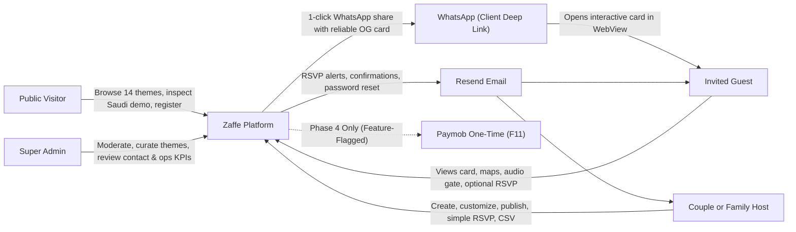
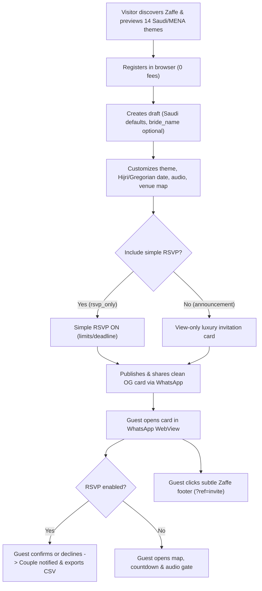

# Zaffe (زفّــة) — Business Requirements Document (BRD)

> **Status:** `Draft v0.2 — Reconciled with 2026-11-20 PO Direction, Pending Product Owner Approval`  
> **Last Verified Date:** 2026-11-20  
> **Baseline:** Git branch `dev` (`d833b95`)  
> **Evidence Sources:** [project-discovery.md](project-discovery.md) (Phase 1, code-verified) · [DOCUMENTATION_AUDIT_SUMMARY.md](DOCUMENTATION_AUDIT_SUMMARY.md) (Phase 2) · [ZAFFE_PRODUCT_STRATEGY.md](../product/strategy/ZAFFE_PRODUCT_STRATEGY.md) (v2.0 Proposed) · [SAUDI_MARKET_DECISIONS.md](../product/SAUDI_MARKET_DECISIONS.md) · [RELEASE_1_PRODUCT_DECISIONS.md](../product/RELEASE_1_PRODUCT_DECISIONS.md) · [OPEN_QUESTIONS.md](../product/OPEN_QUESTIONS.md)  
> **Governance:** [DOCUMENTATION_GUIDELINES.md](../DOCUMENTATION_GUIDELINES.md)

> [!IMPORTANT]
> **Governance & Approval Notice.** Every requirement states the business need (*what* and *why*), its **verified status on `dev` (`d833b95`)**, and its **proposed phase/priority**. Requirements, priorities, release-blocker flags, and anything labeled **`Proposed`** are recommendations and **are NOT approved** until the Product Owner signs off in [§16](#16-approval--sign-off). Business requirements approval and production deployment approval are separate sign-offs. Unresolved decisions are tracked in [OPEN_QUESTIONS.md](../product/OPEN_QUESTIONS.md) (`DEC-01`–`DEC-07`).

## Table of Contents

- [1. Executive Summary](#1-executive-summary)
- [2. Business Problem](#2-business-problem)
- [3. Business Objectives, Value & KPIs](#3-business-objectives-value--kpis)
- [4. Stakeholder Analysis](#4-stakeholder-analysis)
- [5. Market Analysis](#5-market-analysis)
- [6. Business Context & Process Model](#6-business-context--process-model)
- [7. High-Level Business Requirements](#7-high-level-business-requirements)
- [8. Non-Functional Business Requirements](#8-non-functional-business-requirements)
- [9. Governing Business Rules](#9-governing-business-rules)
- [10. Constraint Gap Analysis](#10-constraint-gap-analysis)
- [11. Proposed Release Scope & 4-Phase Roadmap](#11-proposed-release-scope--4-phase-roadmap)
- [12. Risks, Constraints, Assumptions & Dependencies](#12-risks-constraints-assumptions--dependencies)
- [13. Open Decisions Required](#13-open-decisions-required)
- [14. Requirements Traceability Matrix](#14-requirements-traceability-matrix)
- [15. Glossary](#15-glossary)
- [16. Approval & Sign-Off](#16-approval--sign-off)

---

## 1. Executive Summary

| Item | Detail |
| :--- | :--- |
| **Project Name** | Zaffe (زفّــة) — Saudi-First Digital Wedding Invitation Studio |
| **Product Type** | B2C web SaaS (Laravel 13 + Livewire 4 + Filament v5), browser-only — zero mobile app downloads |
| **Sponsor / Product Owner** | `[REQUIRES PO CLARIFICATION]` — no named sponsor recorded in repository (`DEC-06`) |
| **Primary Market** | **Saudi Arabia (KSA)** first; **Egypt** second ([SAUDI_MARKET_DECISIONS.md](../product/SAUDI_MARKET_DECISIONS.md) §1) |
| **Objective** | Empower engaged couples and families to create, customize, publish, and share culturally authentic luxury wedding invitations via WhatsApp in minutes — with optional simple RSVP and family privacy by default — at zero cost during Phase 1. |
| **Commercial Model** | **Phase 1 (Release 1): 100% Free** (all `14` templates unlocked, zero paywalls). **Phase 4 (Deferred):** One-time per-invitation payment via Paymob (`SAR`/`EGP`), feature-flagged, with **no recurring subscriptions**. |
| **Readiness Snapshot** | Core creation, `14` themes (`8` Saudi Signature Vol. 1 + `6` baseline), live studio, public card, and RSVP engine work end-to-end on `dev` (`196` PHPUnit tests / `2,230` assertions passing on PHP 8.5 + `ext-intl`). However, `dev` currently over-promotes QR passes (`rsvp_qr` default), lacks optional `bride_name` DB support (`G-01`/`G-19`), has fragile WhatsApp OG tags & a production demo `404` (`G-17`), and has open audit/PDPL blockers (`G-02`–`G-07`). |

### 1.1 Product Owner Strategic Direction Reconciliation (`2026-11-20` — `Confirmed Baseline`)
This v0.2 BRD reconciles v0.1 (`2026-11-19`) with the Product Owner's explicit `2026-11-20` product directives:
1. **Design-Led Invitation Core:** Phase 1 prioritizes creating, customizing, publishing, and sharing beautiful digital wedding invitations.
2. **Simple, Optional RSVP:** RSVP must be lightweight and optional; advanced guest management must never complicate invitation creation.
3. **No QR Pass Promotion / Gatekeeper Excluded:** QR Passes (`/pass/{qrToken}`) must **not** be promoted in the primary Phase 1 launch experience; QR scanning, Gatekeeper (`/gate/{gateToken}`), physical door check-in, and venue attendance operations are **excluded** from the current product strategy.
4. **Preserve Legacy Data & Evaluate Progressive Disclosure:** Existing user data, invitations, guest records, and links must be preserved safely; existing `GuestRosterManager` and `?g=` personalized links are evaluated for progressive disclosure or Phase 2–3 positioning (`DEC-01`, `DEC-02`).
5. **Commercial & Market Guardrails:** Release 1 remains completely free; KSA is primary followed by Egypt; future monetization remains one-time per-invitation (no subscriptions).

---

## 2. Business Problem

### 2.1 Current State (Market Pain Points)

| # | Pain Point | Who Feels It | Evidence Basis |
| :--- | :--- | :--- | :--- |
| **P1** | Printed wedding cards are costly, slow to distribute across cities, and impossible to update when a venue, hall, or time changes. | Couple, Family | [project-discovery.md](project-discovery.md) §2.1 |
| **P2** | Static Canva/PDF/MP4 flyers lack interactive utility: no Google Maps launch, no live countdown, no dual Hijri/Gregorian clarity, no tap-to-play zaffa audio, and no optional RSVP tally. | Guest, Couple | [ZAFFE_PRODUCT_STRATEGY.md](../product/strategy/ZAFFE_PRODUCT_STRATEGY.md) §3.1 |
| **P3** | Event-ops platforms (`Hayhom`, etc.) require mobile app downloads, SMS OTPs, upfront per-guest fees (`185+ SAR`), and enforce rigid `<72h` modification lockouts (`EV-05`). | Prospective Couple | [COMPETITIVE_ANALYSIS_HAYHOM.md](../product/strategy/COMPETITIVE_ANALYSIS_HAYHOM.md) `EV-01`, `EV-05`, `EV-06` |
| **P4** | Saudi family privacy expectations (omitting the bride's name / using kunya phrasing, photo-free elegance, draft privacy) are poorly served by generic wedding templates. | Couple, Family | [SAUDI_MARKET_DECISIONS.md](../product/SAUDI_MARKET_DECISIONS.md) §2 |
| **P5** | Informal RSVP collection across phone calls and WhatsApp chats creates unreliable headcounts when hosts do choose to collect attendance confirmations. | Couple, Host Family | [project-discovery.md](project-discovery.md) §2.1 |

### 2.2 Proposed Solution (`Reconciled v0.2`)
A browser-native, mobile-first wedding invitation studio where a couple can:
1. Browse live interactive Saudi & MENA themes without registering.
2. Create an account in seconds and pick one of `14` free self-hosted themes (`8` Saudi Signature Collection Vol. 1 + `6` baseline).
3. Customize couple/family names (with `bride_name` optional), Umm al-Qura Hijri & Gregorian date, Riyadh/Cairo timezone, venue map, optional audio seal, and optional RSVP toggle in a live studio.
4. Publish instantly and share a trustworthy, rich-preview link via WhatsApp in one click.
5. Optionally view simple RSVP attendance counts and export Excel-safe CSVs (with existing pre-invited guest rosters & legacy QR links preserved cleanly without cluttering Phase 1).

### 2.3 Scope (`Proposed Reconciliation — Pending PO Approval`)

| Proposed In Scope — Phase 1 Launch (`100% Free`) | Proposed Deferred (Phases 2–4) | Excluded from Strategy (`2026-11-20`) |
| :--- | :--- | :--- |
| Public marketing pages, 14-theme catalog, live previews, and production-safe Saudi demo card | **Phase 2:** `/i/{code}` short URLs + dynamic OG images (`F15` port), async WebP upload resizing (`PERF-02`), SA-first wizard patterns (`ZAFFE-017` port), licensed audio library, full EN public cards, Saudi Signature Vol. 2 | Venue QR scanning & Gatekeeper Check-In (`F16` Part B on `feature/ZAFFE-018`) |
| Couple accounts: registration, login, password reset (`Resend`), profile | **Phase 3:** Dual Men's/Women's venue support, Multi-Event (`Milka`/`Henna`/`Wedding`), Family Co-Hosts (`F18`), Wishes Wall & Thank-You card (`F21`), automated PDPL retention | Physical gatekeeper staffing & hardware |
| Invitation creation, live 6-tab editor, publish/draft/archive, deletion with full media purge | **Phase 4:** One-time per-wedding Paymob checkout (`F11`, `SAR`/`EGP`, feature-flagged) | Manual human custom design agency & outbound call center |
| `14` free themes, optional `bride_name`, Hijri + Gregorian, fixed `arabic_indic` countdown, audio gate, reliable `og:image` | Optional progressive elevation of named `?g=` links (without gatekeeper claims) once PMF is validated | Recurring monthly/annual subscriptions |
| Simple optional RSVP (`rsvp_only` / `announcement` toggle) + Excel-safe CSV export | | Native iOS/Android apps |
| Preservation of existing `InvitationGuest` records, `?g=` links, and `/pass/{qrToken}` routes (not promoted in Phase 1; roster presentation per `DEC-01`/`DEC-02`) | | |
| Filament Super Admin (`7` active resources, `SecurityHeaders`, protected canonical settings, `OperationsMonitor`, `/contact` handling per `DEC-04`) | | |

---

## 3. Business Objectives, Value & KPIs

### 3.1 Business Objectives

| ID | Objective | Measured By |
| :--- | :--- | :--- |
| **BO-01** | Win early Saudi wedding adoption through design quality, cultural fit, and effortless WhatsApp sharing | `KPI-01`, `KPI-02`, Time-to-First-Publish, registered couples |
| **BO-02** | Keep creation radically simple while delivering optional, reliable RSVP tracking | `KPI-01`, `KPI-03` (scoped to RSVP-enabled invitations) |
| **BO-03** | Enforce Saudi cultural and family privacy defaults (`bride_name` optional, photo-free, Hijri, formal-simple Arabic) | Compliance with [SAUDI_MARKET_DECISIONS.md](../product/SAUDI_MARKET_DECISIONS.md) §1–§9 |
| **BO-04** | Establish a self-sustaining Guest-to-Couple organic growth loop via shared WhatsApp cards | `?ref=invite` referral signups (`BRQ-46`) |
| **BO-05** | Preserve future one-time per-invitation monetization readiness without gating Phase 1 | `F11` Phase 4 Paymob architecture readiness (no subscriptions) |
| **BO-06** | Enable non-engineering platform administration, moderation, and KPI/ops visibility | `/admin/*` Filament coverage + `OperationsMonitor` |

### 3.2 Business Value
- **Tangible:** Eliminates paper printing costs and `185+ SAR` paywalls for couples; minimizes customer acquisition cost via viral guest-to-couple footer traffic; prepares a high-margin one-time digital upgrade path for Phase 4. *(Financial projections remain `[REQUIRES PO CLARIFICATION]`.)*
- **Intangible:** Positions Zaffe as Saudi Arabia's most tasteful, culturally respectful digital wedding brand (Umm al-Qura Hijri, optional bride name, zero-photo luxury, zero app friction).

### 3.3 Success Metrics (KPIs)

| KPI | Definition | Instrumentation on `dev` (`d833b95`) | Target (`Proposed — Pending PO`) |
| :--- | :--- | :--- | :--- |
| **KPI-01** Activation | `%` of started invitations/wizard creations reaching `status = 'published'` | **Partial** — proxy only (`activated_couples / total_couples`) | `[REQUIRES PO CLARIFICATION]` *(Proposed: `>= 45%`)* |
| **KPI-02** Real Sharing | `%` of published invitations achieving `>= 10` deduplicated views/RSVPs | **Not Implemented** | `[REQUIRES PO CLARIFICATION]` *(Proposed: `>= 60%`)* |
| **KPI-03** RSVP Engagement | Mean `RsvpResponse` count across **RSVP-enabled** published invitations | **Partial** — `OperationsMonitor` divides by *all* published cards (`announcement` cards distort avg) | `[REQUIRES PO CLARIFICATION]` *(Proposed: `>= 15`)* |
| **KPI-04** Mobile Speed | Public card LCP inside WhatsApp WebView over simulated 4G | **Not Measured** | `< 2.5s` ([SAUDI_MARKET_DECISIONS.md](../product/SAUDI_MARKET_DECISIONS.md) §4) |
| **KPI-05** *(Proposed)* Viral Attribution | Signups & published cards attributed via `/templates?ref=invite` | **Not Implemented** (footers link to `/`) | `[REQUIRES PO CLARIFICATION]` *(Proposed: `>= 15%`)* |

---

## 4. Stakeholder Analysis

| Stakeholder Group | Impact | Influence | Needs / Interests | Primary Touchpoints |
| :--- | :---: | :---: | :--- | :--- |
| **Product Owner / Business Sponsor** | High | High | Saudi PMF, clean Phase 1 scope, compliance, future one-time monetization | This BRD, [OPEN_QUESTIONS.md](../product/OPEN_QUESTIONS.md) |
| **Engaged Couple / Host Family (`role = 'user'`)** | High | High | Couture Saudi card in `<5` mins, optional `bride_name`, clean WhatsApp preview, simple optional RSVP, `$0` R1 | `/dashboard*`, Studio, Share Modal |
| **Invited Guest (Public Card Visitor)** | High | Low | Instant load inside WhatsApp WebView, zero login/app, tap-to-open audio, Maps pin, simple RSVP | `/invitation/{slug}`, `RsvpForm` |
| **Legacy Pre-Invited Guest (`?g=` / Pass Holder)** | Medium | Low | Preserved access to existing personalized greetings and passes without breaking links | `/invitation/{slug}?g=…`, `/pass/{qrToken}` |
| **Public Visitor / Prospect** | Medium | Low | Inspect real Saudi demo & 14 themes instantly without registration | `/`, `/templates`, previews, `/pricing` |
| **Platform Super Admin (`role = 'admin'`)** | High | High | Catalog curation, content moderation, contact/support triage, accurate funnel ops | `/admin/*`, `OperationsMonitor` |
| **Legal / Compliance Counsel** | High | High | Saudi PDPL privacy notice, retention rules, data deletion compliance | `/privacy`, `/terms`, retention policy |
| **Payment Provider (Paymob)** *(Phase 4)* | Low (P1) | Medium | `SAR` (`Mada`/`Apple Pay`/`STC Pay`) & `EGP` one-time payment contract | Deferred `F11` (Phase 4) |

---

## 5. Market Analysis (`Reconciled`)

### 5.1 Target Market
- **Primary:** Saudi couples and families in Riyadh, Jeddah, Dammam/Khobar, and regional cities seeking refined digital cards compatible with conservative or modern norms (`+966`, `Asia/Riyadh`, Umm al-Qura Hijri, formal-simple Arabic, optional bride name, photo-free designs).
- **Secondary:** Egyptian couples (`+20`, `Africa/Cairo`) planning `Katb Kitab`, engagements, and ballroom weddings.
- **Runtime Context:** Guests predominantly open invitation links inside **WhatsApp's mobile in-app browser** over cellular networks.

### 5.2 Saudi Competitive Landscape (Two-Pole Analysis)
- **Pole A — Event-Ops & Door-Control Platforms (`Hayhom` `[VERIFIED 2026-11-15]`, plus observed KSA platforms `Mazoom`, `Da3wa Online`, `Arheb`, `Kart`, `MyInvite`):** Compete on WABA bulk blasting, per-guest quotas (`Hayhom` starts at `185 SAR` for `25` guests), native apps, QR scanning, and physical gatekeepers (`785–2,250 SAR`). High friction, rigid edit locks (`<72h`), and punitive cancellation penalties.
- **Pole B — Static Design Tools (`Canva`, `InShot`, freelance Salla/Instagram designers):** Offer visual cards/videos with zero RSVP ops, but produce static files lacking live Google Maps links, Hijri/Gregorian countdowns, tap-to-open audio, post-send edits, or optional RSVP tracking.

### 5.3 Differentiation Hypotheses (`Proposed — To Validate via Phase 1–2 KPIs`)
1. **Design + Simplicity Wins Top-of-Funnel:** Removing upfront fees, app downloads, and mandatory guest-roster setup yields higher `Wizard -> Published` activation than Pole A platforms.
2. **Living Interactive Microsites Beat Static Images:** Saudi Signature templates with live countdowns, Google Maps, audio gates, optional `bride_name`, and instant post-publish edits convert guests into new couple signups faster than Canva PDFs/JPEGs.
3. **Reliability Inside WhatsApp Drives Organic Virality:** Working Open Graph link previews + tasteful attribution footers turn every published wedding into zero-CAC customer acquisition.

---

## 6. Business Context & Process Model

### 6.1 Business Context (`Reconciled Phase 1–4 Boundary`)



### 6.2 Proposed Phase 1 Core Value Loop (`Design-Led & Simple Optional RSVP`)



*(Note: Legacy `?g=` links and `/pass/{qrToken}` routes remain operational for backward compatibility without appearing in the primary Phase 1 creation path.)*

---

## 7. High-Level Business Requirements (`v0.2`)

**Conventions:** `BRQ-XX` = Business Requirement · `Priority (Proposed, MoSCoW)`: `Must` · `Should` · `Could` · `Phase 2–4` · `Excluded` · `Status on dev`: verified against `d833b95`.

### 7.1 Acquisition, Showcase & Public Discovery

| ID | Requirement | Business Rationale | Actor | Proposed Phase / Priority | Status on `dev` (`d833b95`) | Key Gap |
| :--- | :--- | :--- | :--- | :--- | :--- | :--- |
| **BRQ-01** | Public landing page communicating the Saudi-first design-led studio and free Phase 1 offer (without QR/Gatekeeper hype). | Acquisition (`BO-01`) | Visitor | Phase 1 / Must | Partially Implemented (`FEAT-01`) | Markets QR passes; links to non-existent `/invitation/ahmed-and-sarah` on prod |
| **BRQ-02** | Filterable, searchable 14-theme catalog (`Saudi Signature Vol. 1` spotlight). | Self-qualification | Visitor | Phase 1 / Must | Partially Implemented (`FEAT-02`) | Count pill/EN card alignment minor polish |
| **BRQ-03** | Zero-account live template preview across mobile, tablet, desktop frames. | Show craft before signup | Visitor | Phase 1 / Must | Fully Implemented (`FEAT-03`) | — |
| **BRQ-04** | `/pricing` & `/about` accurately state `14` free themes, KSA-first framing, and no QR Pass promotion. | Trust & accuracy | Visitor | Phase 1 / Must | Partially Implemented (`FEAT-04`, `FEAT-05`) | Stale `"6 themes"`, EGP-first pricing badge, QR pass bullet |
| **BRQ-05** | Visitors can reach support via real working channels (persisted `/contact` form + Admin visibility, OR direct WhatsApp/Email only per `DEC-04`). | Trust (`P4`) | Visitor | Phase 1 / Must | Partially Implemented (`FEAT-06`) | Simulated Alpine `/contact` form discards data (`UX-01`) |
| **BRQ-44** *(Proposed)* | Public homepage `"View Live Invitation"` CTA opens a **production-safe Saudi Signature showcase invitation** (`HTTP 200`, never `404`). | First-impression credibility | Visitor | Phase 1 / Must | **Not Implemented** | `home.blade.php` links `/invitation/ahmed-and-sarah` (local/testing seeder only -> 404 in prod) |
| **BRQ-45** *(Proposed)* | Every shared invitation emits valid **absolute `https://` Open Graph / Twitter preview metadata** with existing fallback image (`public/images/og-zaffe.jpg`) in Phase 1, and dynamic couple OG cards + `/i/{code}` short URLs in Phase 2. | WhatsApp share click-through | Couple, Guest | Phase 1 (absolute OG + fallback) / Phase 2 (`/i/` + `OgImageService`) | **Partially Implemented / Isolated** | `og-zaffe.jpg` missing; `invitation-show.blade.php:3` outputs relative `/images/templates/...`; `F15` unmerged |

### 7.2 Customer Account & Identity

| ID | Requirement | Business Rationale | Actor | Proposed Phase / Priority | Status on `dev` | Key Gap |
| :--- | :--- | :--- | :--- | :--- | :--- | :--- |
| **BRQ-06** | Self-registration, login, logout with `+966`/`+20` E.164 normalization. | Self-service onboarding | Couple | Phase 1 / Must | Fully Implemented (`FEAT-08`) | — |
| **BRQ-07** | Self-service email password reset via Resend. | Reduce support load | Couple | Phase 1 / Must | Fully Implemented (`FEAT-09`) | Prod mail config (`CONF-01`) |
| **BRQ-08** | Couple profile updates (name, email, phone, password). | Account hygiene | Couple | Phase 1 / Must | Fully Implemented (`FEAT-10`) | — |
| **BRQ-09** | Admin account suspension without deleting data. | Abuse moderation | Admin | Phase 2–3 / Could | Not Implemented | Business behavior undefined (`BR-032`) |

### 7.3 Invitation Studio, Aesthetics & Lifecycle

| ID | Requirement | Business Rationale | Actor | Proposed Phase / Priority | Status on `dev` | Key Gap |
| :--- | :--- | :--- | :--- | :--- | :--- | :--- |
| **BRQ-10** | Create draft invitation with auto-generated slug (`groom-and-bride` or `groom` when `bride_name` omitted) and **Saudi defaults** (`Asia/Riyadh`). | Time-to-value (`KPI-01`) | Couple | Phase 1 / Must | Partially Implemented (`FEAT-12`) | `bride_name` required (`G-01`); `Africa/Cairo` default (`G-18`); `ZAFFE-017` wizard unmerged |
| **BRQ-11** | Live 6-tab visual editor with autosave, device preview, custom palette/fonts, and instant publishing. | Core studio craft | Couple | Phase 1 / Must | Partially Implemented (`FEAT-14`) | Arabic-only UI; input max `10` vs backend `20` |
| **BRQ-12** | Sections enabled by couples never display fake hardcoded placeholders (`timeline` & `dress_code` must either have lightweight editors or be cleanly gated off when unedited). | Card polish (`BO-01`) | Couple | Phase 1 (guard/lightweight edit per `DEC-04`) | Partially Implemented | `timeline`/`dress_code` are toggle-only rendering `"Black Tie"` placeholder (`G-11`) |
| **BRQ-13** | Dashboard lifecycle control (publish, unpublish, archive, delete) with **complete storage cleanup** across both customer & Admin delete. | Control & data hygiene | Couple, Admin | Phase 1 / Must | Partially Implemented (`FEAT-13`) | No couple `archive` button; Admin delete orphans `http(s)://` media (`DATA-01`) |
| **BRQ-14** | Curated photo-free themes rendered from allowlist, honoring custom palette overrides and welcome text cleanly across all 14 themes. | Visual differentiation | Couple, Guest | Phase 1 / Must | Partially Implemented (`FEAT-15`) | `emerald_night`/`desert_dusk` ignore palette overrides; `islamic_elegance` ignores `welcome_message`; `timeline.blade.php` CSS bug |
| **BRQ-15** | Optional cover & gallery image uploads (`<= 5MB`), converted/compressed to fast mobile WebP in Phase 2 (`PERF-02`). | `KPI-04` mobile speed | Couple | Phase 1 (5MB validation) / Phase 2 (WebP compression) | Partially Implemented | No server-side WebP conversion (`F15` has async GD pipeline on unmerged branch) |
| **BRQ-16** *(Reconciled)* | Primary creation & editor UX offers a **simple RSVP ON/OFF mode** (`rsvp_only` default or `announcement`), hiding `rsvp_qr` / `qr_only` from new creation while preserving existing `rsvp_qr` / `qr_only` invitations seamlessly. | Simplicity + zero QR promotion (`PO #1–#5, #9`) | Couple | Phase 1 / Must | **Divergent** (`rsvp_qr` is default & heavily promoted) | `G-18`; requires `DEC-02` sign-off |

### 7.4 Guest Experience, WhatsApp Sharing & Optional RSVP

| ID | Requirement | Business Rationale | Actor | Proposed Phase / Priority | Status on `dev` | Key Gap |
| :--- | :--- | :--- | :--- | :--- | :--- | :--- |
| **BRQ-17** | Unpublished (`draft`/`archived`) invitations return `HTTP 403` to public visitors (`owner`/`admin` only). | Family privacy (`BO-03`) | Guest, Couple | Phase 1 / Must | Fully Implemented (`FEAT-16`) | — |
| **BRQ-18** | Umm al-Qura Hijri + Gregorian dates and `latin`/`arabic_indic` numerals applied everywhere including live countdown. | Saudi cultural accuracy | Guest | Phase 1 / Must | Partially Implemented (`FEAT-17`) | `countdown.blade.php` ignores `arabic_indic` (`G-10`) |
| **BRQ-19** | Optional simple RSVP (`attending`/`declined`, optional `tentative` reconciled) with E.164 dedup, deadlines, quotas, and pre-invited hijack guard. | Reliable optional RSVP (`BO-02`) | Guest | Phase 1 / Must | Partially Implemented (`FEAT-18`) | Arabic-only; `tentative` validation quirk |
| **BRQ-20** | Mobile tap-to-open audio gate (`music_player.blade.php`) with user URL in Phase 1; curated royalty-free Saudi audio library (`BRQ-48`) in Phase 2. | Mobile WebView autoplay + delight | Guest, Couple | Phase 1 (gate) / Phase 2 (library) | Partially Implemented | URL-only music input |
| **BRQ-21** | 1-click localized WhatsApp share links (without emitting orphan connectors when `bride_name` is omitted) and defensive clipboard fallback. | Primary distribution | Couple, Guest | Phase 1 / Must | Partially Implemented | Orphan `"و"`/`"&"` if `bride_name` blank; `share_box.blade.php` unguarded clipboard |
| **BRQ-46** *(Proposed)* | Public invitation footers include tasteful `?ref=invite` attribution linking to `/templates?ref=invite` with `OperationsMonitor` conversion tracking. | `$0 CAC` viral flywheel (`BO-04`) | Guest, Admin | Phase 1 (footer + counter) | **Not Implemented** | Footers link `route('home')`; no attribution counter |

### 7.5 Legacy Guest Roster & Personal QR Passes (`Reconciled to PO Items #3–#6 & #9`)

| ID | Requirement | Business Rationale | Actor | Proposed Phase / Priority | Status on `dev` | Key Gap |
| :--- | :--- | :--- | :--- | :--- | :--- | :--- |
| **BRQ-22** *(Reconciled)* | Preserve existing `GuestRosterManager` (`InvitationGuest` quotas, CSV import/export, `?g=` generation) without deleting data, surfaced behind **progressive disclosure** below simple RSVPs in Phase 1 (`DEC-01`) rather than complicating initial creation. | Protect legacy data while keeping creation simple (`PO #3, #4, #9`) | Couple | Phase 1 (de-emphasize) / Phase 2–3 (optional module) | Implemented (`FEAT-20`) | Currently rendered *above* simple RSVP table (`dashboard/guests.blade.php:37`) |
| **BRQ-23** *(Reconciled)* | Keep existing `?g={inviteToken}` personalized guest links working seamlessly with security headers (`no-referrer`, `noindex`, `no-store`). | Backward compatibility (`PO #9`) | `?g=` Guest | Phase 1 (Preserve) | Fully Implemented | Minor `"بطاقة دخول"` wording in strip |
| **BRQ-24** *(Reconciled)* | Preserve `/pass/{qrToken}` and pure-PHP `QrCodeService` **strictly for legacy invitations already using QR modes** — do **not** market or promote QR Passes in Phase 1 UI/marketing copy, and replace `"بطاقة دخول"` with `"بطاقة الدعوة"`. | Protect existing passes while removing QR marketing (`PO #5, #9`) | Legacy Guest | Phase 1 (Preserve Only) | Implemented (`FEAT-21`) | Promoted across `/`, `/pricing`, `/about`, and Editor (`G-18`) |
| **BRQ-25** *(Reconciled)* | Venue door QR scanning & Gatekeeper Check-In (`/gate/{gateToken}`, `GateScanner`, `InvitationGate`). | **Excluded from current product strategy (`PO #6`)** | Usher | **Excluded** | Isolated on `feature/ZAFFE-018` | Permanently excluded; never merge |
| **BRQ-26** | Filterable RSVP table and Excel-compatible, UTF-8 BOM, `CsvSanitizer`-safe CSV exports. | Host coordination | Couple | Phase 1 / Must | Fully Implemented (`FEAT-22`) | — |

### 7.6 Notifications, Super Admin, Saudi Fit, Privacy & Future Phases

| ID | Requirement | Business Rationale | Actor | Proposed Phase / Priority | Status on `dev` | Key Gap |
| :--- | :--- | :--- | :--- | :--- | :--- | :--- |
| **BRQ-27** | Couple RSVP alerts & guest confirmation emails whose subject/body match response status (`attending` vs `declined`) and omit blank `bride_name` connectors. | Trust & accuracy | Couple, Guest | Phase 1 / Must | Partially Implemented (`FEAT-19`) | Confirmation wording sent on `declined`; `CONF-01` mail trap |
| **BRQ-28–35** | Filament Super Admin (`SecurityHeaders` on `/admin/*`, safe `User` management, media-purging `Invitation` delete, template/category curation, filtered RSVP CSV with `children_count`, protected canonical `PlatformSetting` keys, localized guest status, true KPIs in `OperationsMonitor`). | Ops autonomy (`BO-06`) | Admin, DevOps | Phase 1 / Must | Partially Implemented | `SEC-05`, `SEC-06`, `DATA-01`, `DATA-02`, `G-14` |
| **BRQ-36** | Full English (`en`) parity across marketing, dashboard, Admin, AND public cards / RSVP / Editor. | Bilingual audiences | All | Phase 1 (Marketing/Dashboard/Admin) · Phase 2 (Public Cards/Editor) | Partially Implemented (`FEAT-07`) | Editor, RSVP, public cards Arabic-only |
| **BRQ-37** | Regional defaults favor Saudi Arabia (`Asia/Riyadh`, `+966`, Saudi support contact) while supporting Egypt. | KSA-first priority (`PO #8`) | Couple | Phase 1 / Must | Partially Implemented | `Africa/Cairo` & `+20` defaults in creation/editor/Admin |
| **BRQ-38** | `bride_name` strictly optional in DB, validation, all 14 templates, WhatsApp shares, dashboard cards, passes, and emails (zero orphan `"و"` / `"&"`). | KSA family privacy (`BO-03`) | Couple, Admin | Phase 1 / Must | **Not Implemented** (only 8 Saudi Signature views guard empty) | `G-01`, `G-19` |
| **BRQ-39** | Publish Arabic/English `/privacy` & `/terms` notices, define post-event retention schedule, and support data deletion requests (incl. storage purge). | Saudi PDPL compliance | Couple, Guest, Admin | Phase 1 (Notice + Admin/User purge) · Phase 3 (Auto retention) | **Not Implemented** | Requires legal review (`DEC-05`) |
| **BRQ-40** | Release 1 / Phase 1 remains 100% free across all 14 templates (`is_premium = false`, `/admin/subscription-plans` `403`). | Free launch (`PO #7`) | Couple | Phase 1 / Must | Fully Implemented | — |
| **BRQ-41** | Post-launch one-time per-wedding monetization (`SAR`/`EGP` via Paymob, feature-flagged, zero recurring subscriptions, grandfathered early users). | Sustainable revenue (`BO-05`) | Couple, Admin | **Phase 4** (Deferred) | Deferred / Dormant | Dormant `subscription_plans` schema is tier-shaped (`G-16`) |
| **BRQ-42** | Short `/i/{code}` links & cached dynamic couple OG images (`F15` selective port). | WhatsApp CTR & branding | Couple, Guest | **Phase 2** (`DEC-03`) | Isolated (`feature/ZAFFE-015`) | Predates `ZAFFE-022`/`023`; needs clean port |
| **BRQ-43** | Accurate instrumentation of `KPI-01`, `KPI-02`, `KPI-03` (RSVP-enabled denominator), and `?ref=invite` in `OperationsMonitor`. | Data-driven PMF | PO, Admin | Phase 1 / Must | Partially Implemented | Missing KPI-01 start tracking, KPI-02, `?ref=invite` |
| **BRQ-47** *(Proposed)* | Dual-hall (Men's/Women's) venues, Multi-Event suites (`Milka + Wedding`), and Bilateral Family Co-Hosts (`F18`/`F19`). | High-value Saudi family weddings | Couple, Family | **Phase 3** | Not Implemented | Planned post-PMF |
| **BRQ-48** *(Proposed)* | Curated, copyright-cleared royalty-free Zaffe/Oud/Duff/Nasheed audio library selectable inside Editor. | Audio delight + legal safety | Couple, Guest | **Phase 2** | Not Implemented | Requires cleared audio assets |

### 7.12 Key Acceptance Criteria (Gherkin)

```gherkin
Feature: BRQ-16 & BRQ-24 Phase 1 Simple Optional RSVP Without QR Pass Promotion
  Scenario: Couple creates and publishes a new invitation in Phase 1
    Given an authenticated couple creates a new invitation on dev
    When they open the Studio Editor
    Then the default invitation_mode is "rsvp_only" (or PO-selected default)
    And the editor presents a simple RSVP ON/OFF toggle without promoting QR passes
    And when a guest submits an attending RSVP on that invitation, no QR pass URL or "بطاقة دخول" badge is generated or displayed

Feature: BRQ-22 & BRQ-24 Legacy Guest Roster & QR Pass Preservation
  Scenario: Existing legacy invitation with rsvp_qr mode and pre-invited guests
    Given an existing invitation created before Phase 1 simplification with mode "rsvp_qr" and an InvitationGuest record
    When the guest visits /invitation/{slug}?g={inviteToken} or /pass/{qrToken}
    Then the invitation and pass continue to resolve and render accurately without broken links or data loss

Feature: BRQ-38 & G-19 Optional Bride Name Across All Surfaces
  Scenario: Couple leaves bride_name blank on any of the 14 themes
    Given a couple creates or updates an invitation with groom_name "فيصل العتيبي" and empty bride_name
    When the invitation is saved, shared via WhatsApp, rendered on any of the 14 templates, or confirmed by email
    Then the save succeeds without validation errors
    And no trailing orphan "و", "وَ", or "&" appears in the card, dashboard title, WhatsApp message, or email subject

Feature: BRQ-44 & BRQ-45 Production-Safe Saudi Demo & Reliable WhatsApp OG Previews
  Scenario: Public visitor inspects live demo and guest link OG metadata
    Given the homepage "View Live Invitation" button on a clean production database
    When a visitor opens the demo link
    Then it returns HTTP 200 showcasing a Saudi Signature invitation (never 404)
    And every public invitation page emits an absolute http(s):// og:image URL resolving to an existing asset
```

---

## 8. Non-Functional Business Requirements

Unchanged baseline `NFR-01`–`NFR-11` from v0.1 remain active (`NFR-01` Tenant Isolation, `NFR-02` Rate Limits, `NFR-03` Global + `/admin/*` Security Headers, `NFR-04` WhatsApp WebView LCP `< 2.5s`, `NFR-05` Self-Hosted Assets, `NFR-06` CSV Safety, `NFR-07` Minimal PII, `NFR-08` Luxury SVG-Only Standard, `NFR-09` PHP `>= 8.4.1` + `ext-intl` + MySQL 8.4, `NFR-10` Mail Resilience, `NFR-11` Quality Gates).

---

## 9. Governing Business Rules

Authoritative code-verified rules `BR-001`–`BR-036` live in [project-discovery.md](project-discovery.md) §7. Key rules affected by the `2026-11-20` realignment:
- **`BR-005` vs Proposed `BR-034`:** `bride_name` is currently required in code/DB; `BR-034` proposes relaxing DB + validation + all 14 templates before Phase 1 launch.
- **`BR-014` & `BR-031` (`Reconciled`):** Four modes (`rsvp_qr`, `rsvp_only`, `qr_only`, `announcement`) exist in schema/code; PO direction (`2026-11-20`) resolves the `BR-031` QR Pass conflict by forbidding Phase 1 QR promotion while preserving legacy records. Implementation of default mode & progressive roster disclosure awaits `DEC-01` / `DEC-02`.
- **`BR-035` & `BR-036` (`Proposed`):** Protect canonical `PlatformSetting` keys from bulk deletion and apply `SecurityHeaders` to `/admin/*`.

---

## 10. Constraint Gap Analysis (`v0.2` — Verified on `dev` `d833b95`)

| Gap | Requirement / Policy | Current Constraint on `dev` | Business Impact | Proposed Phase 1 Blocker? |
| :--- | :--- | :--- | :--- | :---: |
| **G-01** | `BRQ-38` Optional `bride_name` | `invitations.bride_name` is `NOT NULL` and `required` in all forms | Violates core KSA privacy promise | **Yes (`DEC-04`)** |
| **G-02** | `BRQ-39` Saudi PDPL | No `/privacy` notice, retention policy, or self-service deletion | Regulatory exposure in KSA | **Yes (Notice/Purge + Legal Review)** |
| **G-03** | `BRQ-13` Media purge (`DATA-01`) | `Invitation::deleting` skips `http(s)://` URLs on Admin delete | Leaves personal photos orphaned on disk | **Yes** |
| **G-04** | `BRQ-28` / `NFR-03` (`SEC-05`) | `/admin/*` omits `SecurityHeaders` middleware | Clickjacking/MIME gap on admin panel | **Yes** |
| **G-05** | `BRQ-34` (`SEC-06`) | Canonical `PlatformSetting` keys can be bulk-deleted | Site branding/contact can break | **Yes** |
| **G-06** | `BRQ-27` / `BRQ-07` (`CONF-01`) | `.env.example` `RESEND_API_KEY=` shadows password; dead `encryption` key | Silent production email failure | **Yes (Config)** |
| **G-07** | `NFR-09` (`CONF-01`) | `composer.json` declares `^8.3` vs lockfile `>= 8.4.1` | Host runtime mismatch risk | **Yes (Config)** |
| **G-08** | `BRQ-05` (`UX-01`) | Simulated Alpine `/contact` form discards submissions | Lost customer inquiries; damages trust | **Yes (`DEC-04`)** |
| **G-09** | `BRQ-04` (`UX-01`) | `/pricing` & `/about` say `"6 themes"` and put EGP before SAR | Undersells 14 themes & misaligns KSA priority | **Yes** |
| **G-10** | `BRQ-18` (`KSA-01`) | `countdown.blade.php` ignores `arabic_indic` numerals | Inconsistent KSA date/digit presentation | **Yes** |
| **G-11** | `BRQ-12` (`UX-01`) | `timeline`/`dress_code` render hardcoded `"Black Tie"` placeholder | Embarrassing placeholder text on live cards | **Yes (`DEC-04`)** |
| **G-12** | `BRQ-36` Full EN parity | Editor, RSVP, public cards hardcoded Arabic | EN couples underserved | Phase 2 (`DEC-04`) |
| **G-13** | `BRQ-13` Dashboard polish | `DashboardController::index()` omits `children_count`; mislabels `archived`; no couple `archive` button | Inaccurate host summary & missing action | Recommended Phase 1 |
| **G-14** | `BRQ-43` / `BRQ-46` | Missing `KPI-01` start telemetry, `KPI-02` (>=10 views), `?ref=invite` footer | Cannot measure launch PMF or viral loop | **Yes** |
| **G-15** | `BRQ-16`, `BRQ-22–24` | `BR-031` resolved conceptually (`2026-11-20` PO), implementation options open | Need `DEC-01`/`DEC-02` to simplify UI cleanly | **Yes (`DEC-01`/`DEC-02`)** |
| **G-16** | `BRQ-41` Paymob schema | Dormant `subscription_plans` table is recurring-tier shaped | Rework needed before Phase 4 | No (Phase 4) |
| **G-17** *(New)* | `BRQ-44`, `BRQ-45` | `public/images/og-zaffe.jpg` missing; `og:image` emits relative path; homepage live demo `/invitation/ahmed-and-sarah` 404s in prod | Broken WhatsApp link previews & broken hero CTA | **Yes** |
| **G-18** *(New)* | `BRQ-16`, `BRQ-37` | `rsvp_qr` default mode; QR promoted on `/`, `/pricing`, `/about`, Editor; `"بطاقة دخول"` wording; `GuestRosterManager` above RSVPs; `Africa/Cairo` & `+20` defaults | Directly conflicts with `2026-11-20` PO direction | **Yes (`DEC-01`/`DEC-02`)** |
| **G-19** *(New)* | `BRQ-38` | Orphan `"و"` / `"&"` connectors in 6 baseline templates, WhatsApp share text, dashboard, pass, & email subjects when `bride_name` empty | Broken grammar if `bride_name` omitted | **Yes (with G-01)** |

---

## 11. Proposed Release Scope & 4-Phase Roadmap (`Pending PO Approval`)

```mermaid
flowchart LR
    subgraph Phase1["Phase 1: Saudi-First Launch (Free)"]
        P1A["14 Themes + Live Studio + Simple Optional RSVP"]
        P1B["Close Blockers: G-01..G-11, G-14, G-15, G-17..G-19"]
        P1C["Preserve legacy GuestRoster & /pass silently"]
    end
    subgraph Phase2["Phase 2: Virality & Craft (Free)"]
        P2A["Port F15 (/i/ short URL, OG Cards, WebP Uploads)"]
        P2B["Port ZAFFE-017 SA Wizard + Licensed Audio + Vol. 2 + EN Cards"]
    end
    subgraph Phase3["Phase 3: Family Hospitality & Retention"]
        P3A["Dual Men/Women Halls + Multi-Event (Milka/Wedding)"]
        P3B["Family Co-Hosts (F18) + Wishes Wall + Auto PDPL Purge"]
    end
    subgraph Phase4["Phase 4: One-Time Monetization"]
        P4A["Paymob One-Time Per-Wedding (SAR/EGP, Flagged)"]
    end
    Phase1 --> Phase2 --> Phase3 --> Phase4
```



*(Detailed business objectives, dependencies, admin controls, and release gates for Phases 1–4 are documented canonically in [ZAFFE_PRODUCT_STRATEGY.md](../product/strategy/ZAFFE_PRODUCT_STRATEGY.md) §4.)*

---

## 12. Risks, Constraints, Assumptions & Dependencies

### 12.1 Key Risks (`v0.2`)

| ID | Risk | Likelihood | Impact | Proposed Mitigation |
| :--- | :--- | :---: | :---: | :--- |
| **R-01** | Launching with QR Pass defaults (`G-18`) creates bloated UX & confuses customers | High | High | Approve `DEC-01`/`DEC-02` and simplify primary journey before Phase 1 launch |
| **R-02** | Broken production demo link & missing `og-zaffe.jpg` (`G-17`) kill first-impression WhatsApp sharing | High | High | Seed production-safe Saudi demo + fix absolute `og:image` in Phase 1 |
| **R-03** | Cultural backlash if `bride_name` cannot be omitted (`G-01`, `G-19`) | High | High | Close `G-01` + `G-19` across DB, validation, templates, and emails |
| **R-04** | Launching commercially in KSA without PDPL notice & deletion workflows (`G-02`) | Medium | High | Ship `/privacy`, `/terms`, Admin/user purge, and complete legal review |
| **R-05** | Transactional email silently fails due to `CONF-01` | Medium | High | Clean `.env.example`/`config/mail.php`; verify Resend domain & `OperationsMonitor` |
| **R-06** | Uncompressed `5MB` user cover/gallery photos hurt mobile LCP on 4G (`PERF-02`) | Medium | Medium | Encourage photo-free cards in Phase 1; prioritize `F15` WebP pipeline in Phase 2 |
| **R-07** | Introducing Paymob later alienates free Phase 1 users (`R-06`) | Medium | Medium | Keep core cards free forever + grandfather Phase 1–3 weddings (`BRQ-41`) |

### 12.2 Constraints & Assumptions
- **Constraints:** Laravel 13 monolith (`PHP >= 8.4.1` + `ext-intl`, MySQL 8.4); no payment code in Phase 1; Gatekeeper (`feature/ZAFFE-018`) permanently excluded; catalog updates must use idempotent migrations ([AGENTS.md](../../AGENTS.md) Rule 12).
- **Assumptions:** WhatsApp client-side deep links remain primary sharing medium in KSA/Egypt; couples adopt browser-native web invitations when design quality and OG link previews feel luxury-grade.

---

## 13. Open Decisions Required

Reconciled open items live canonically in [OPEN_QUESTIONS.md](../product/OPEN_QUESTIONS.md) (`DEC-01`–`DEC-07`):
- **`DEC-01`:** Phase 1 UI placement of existing `GuestRosterManager` & `?g=` personalized links (Progressive disclosure vs. hidden for new invitations).
- **`DEC-02`:** Default `invitation_mode` (`rsvp_only` vs. `announcement`) & hiding QR modes from new creation while preserving legacy passes.
- **`DEC-03`:** Disposition of unmerged branches `F15` (short `/i/`, dynamic OG, WebP) and `ZAFFE-017` (country-first wizard).
- **`DEC-04`:** Phase 1 UX/Privacy bundle (`bride_name` nullable, `/contact` persistence vs. removal, `timeline`/`dress_code` lightweight editor vs. hiding placeholders, EN public cards timing, suspension deferral).
- **`DEC-05`:** Commercial Launch vs. Controlled Saudi Beta gate & PDPL post-event retention window.
- **`DEC-06`:** Sponsor identity, hosting stack (`PHP >= 8.4.1`, `ext-intl`, MySQL 8.4), Resend domain, real Saudi support contacts, launch date, and numeric KPI targets.
- **`DEC-07`:** Phase 4 Paymob one-time per-wedding unlock model (`Free Core + Paid Upgrade` vs. `Pay-at-Publish`).

---

## 14. Requirements Traceability Matrix

| BRQ | Feature (`FEAT`) | Business Rules | Technical Finding / Gap | Proposed Phase |
| :--- | :--- | :--- | :--- | :---: |
| `BRQ-01`–`04`, `BRQ-44` | `FEAT-01`–`05` | `BR-019`–`021` | `UX-01`, `G-09`, `G-17`, `G-18` | Phase 1 |
| `BRQ-05` | `FEAT-06` | — | `UX-01`, `G-08` | Phase 1 (`DEC-04`) |
| `BRQ-06`–`08` | `FEAT-08`–`10` | `BR-009`, `BR-013` | `CONF-01` | Phase 1 |
| `BRQ-09` | — | `BR-032` | — | Phase 2–3 |
| `BRQ-10`–`14`, `BRQ-16` | `FEAT-12`–`15` | `BR-002`–`005`, `BR-014`, `BR-034` | `G-01`, `G-03`, `G-11`, `G-13`, `G-18`, `G-19` | Phase 1 (`DEC-02`, `DEC-04`) |
| `BRQ-15`, `BRQ-42`, `BRQ-45` | `FEAT-14`, `FEAT-33` | `BR-018` | `PERF-02`, `G-17` | Phase 1 (OG fix) / Phase 2 (`F15`) |
| `BRQ-17`–`21`, `BRQ-46` | `FEAT-16`–`18` | `BR-001`, `BR-006`–`013`, `BR-025`, `BR-027` | `KSA-01`, `G-10`, `G-14` | Phase 1 |
| `BRQ-22`–`24` | `FEAT-20`–`21` | `BR-015`, `BR-016`, `BR-031` | `G-15`, `G-18` | Phase 1 (Preserve / `DEC-01`) |
| `BRQ-25` | `FEAT-32` | — | Isolated `feature/ZAFFE-018` | **Excluded** |
| `BRQ-26`–`35`, `BRQ-43` | `FEAT-19`, `22`–`30` | `BR-017`, `BR-022`–`029`, `BR-035`–`036` | `SEC-05`, `SEC-06`, `DATA-01`, `DATA-02`, `G-14` | Phase 1 |
| `BRQ-36`–`39` | `FEAT-07`, `34` | `BR-030`, `BR-034` | `G-01`, `G-02`, `G-12`, `G-19` | Phase 1 (`G-01`, `G-02` notice) / Phase 2–3 (`EN`, auto retention) |
| `BRQ-40`–`41` | `FEAT-31` | `BR-021`, `BR-022`, `BR-033` | `G-16` | Phase 1 Free / **Phase 4** Paymob |
| `BRQ-47`–`48` | — | `SAUDI_MARKET_DECISIONS` §6 | — | Phase 2 (`BRQ-48`) / Phase 3 (`BRQ-47`) |

---

## 15. Glossary

Key terms unchanged from v0.1 (`Couple`, `Invitation`, `Invitation Mode`, `Saudi Signature Collection Vol. 1`, `PDPL`, `BRQ / BR / FEAT`). **Clarification (`2026-11-20`):** Legacy `"بطاقة دخول"` wording is being retired in favor of `"بطاقة الدعوة الشخصية"` on preserved passes; Gatekeeper door check-in is excluded from strategy.

---

## 16. Approval & Sign-Off

| Role | Name | Decision | Date |
| :--- | :--- | :--- | :--- |
| **Product Owner / Sponsor** | `[REQUIRES PO CLARIFICATION]` | **Pending (`v0.2`)** | — |
| **Engineering Lead** | `[REQUIRES PO CLARIFICATION]` | **Pending** | — |
| **Legal / Compliance (Saudi PDPL)** | `[REQUIRES PO CLARIFICATION]` | **Pending** | — |

### Revision History

| Version | Date | Author | Change |
| :---: | :---: | :--- | :--- |
| `0.1` | `2026-11-19` | Business Analysis (Phase 3) | Initial BRD derived from Phase 1 discovery & Phase 2 audit on `dev` `d88d381` |
| `0.2` | `2026-11-20` | Principal PM / BA / Architect (`ZAFFE-026`) | Reconciled with PO `2026-11-20` strategic vision: design-led Phase 1, simple optional RSVP, no QR Pass promotion, Gatekeeper excluded, 4-phase roadmap, added `BRQ-44`–`48` & `G-17`–`G-19` (Pending PO Approval) |
