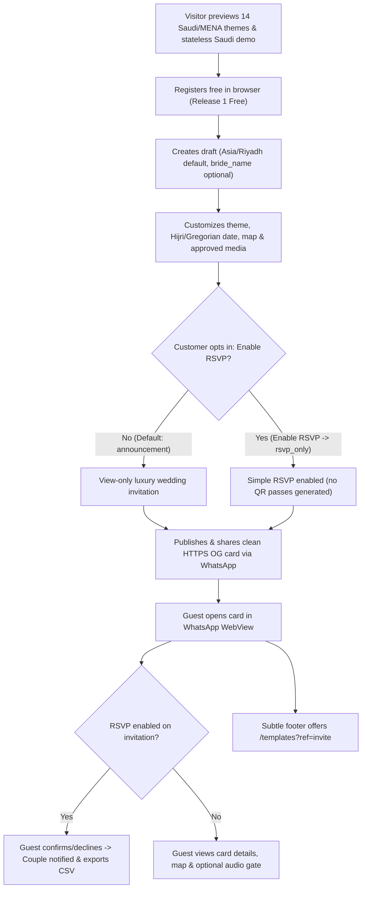
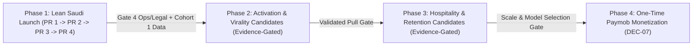

# Zaffe (زفّــة) — Business Requirements Document (BRD)

> **Status:** `Draft v0.4 — Synchronized with Confirmed PO Decisions (DEC-01..04, DEC-07 Approved; DEC-05 Legal/Ops Pending; DEC-06 Provisional) — Pending Final Doc Sign-Off`  
> **Last Verified Date:** 2026-11-21  
> **Baseline:** Git branch `dev` (`d833b95`)  
> **Evidence Sources:** [project-discovery.md](project-discovery.md) · [DOCUMENTATION_AUDIT_SUMMARY.md](DOCUMENTATION_AUDIT_SUMMARY.md) · [OPEN_QUESTIONS.md](../product/OPEN_QUESTIONS.md) (`DEC-01`–`DEC-07`) · [ZAFFE_PRODUCT_STRATEGY.md](../product/strategy/ZAFFE_PRODUCT_STRATEGY.md) (`v2.2`) · [SAUDI_MARKET_DECISIONS.md](../product/SAUDI_MARKET_DECISIONS.md) · [RELEASE_1_PRODUCT_DECISIONS.md](../product/RELEASE_1_PRODUCT_DECISIONS.md) · [QR_FEATURE_ISOLATION_POLICY.md](../architecture/QR_FEATURE_ISOLATION_POLICY.md)  
> **Governance:** [DOCUMENTATION_GUIDELINES.md](../DOCUMENTATION_GUIDELINES.md)

> [!IMPORTANT]
> **Gate 2 Approval Boundary:** Decisions `DEC-01` through `DEC-04` and `DEC-07` are **Product Owner Approved**. `DEC-05` reflects **Approved Business Direction** with mandatory **Legal and Operational Sign-Off Pending**. `DEC-06` and policy deviations `C-5`, `C-6`, `C-7` remain open. This BRD (`v0.4`) awaits explicit Product Owner sign-off ([§16](#16-approval--sign-off)) before Gate 3 application implementation begins. Production deployment remains separately gated (Gate 4).

## Table of Contents

- [1. Executive Summary](#1-executive-summary)
- [2. Business Problem & Scope](#2-business-problem--scope)
- [3. Business Objectives & KPIs](#3-business-objectives--kpis)
- [4. Stakeholder Analysis](#4-stakeholder-analysis)
- [5. Market Positioning Hypotheses](#5-market-positioning-hypotheses)
- [6. Business Context & Core Value Loop](#6-business-context--core-value-loop)
- [7. Implementation-Ready Phase 1 Business Requirements](#7-implementation-ready-phase-1-business-requirements)
- [8. Non-Functional Business Requirements](#8-non-functional-business-requirements)
- [9. Governing Business Rules & Proposed 30-Day Retention Specification](#9-governing-business-rules--proposed-30-day-retention-specification)
- [10. Data Preservation, Migration & Constraint Gap Analysis](#10-data-preservation-migration--constraint-gap-analysis)
- [11. Evidence-Gated Phased Roadmap](#11-evidence-gated-phased-roadmap)
- [12. Risks, Constraints & Provisional Hosting](#12-risks-constraints--provisional-hosting)
- [13. Unresolved Approvals Needed Before Implementation & Launch](#13-unresolved-approvals-needed-before-implementation--launch)
- [14. Requirements Traceability Matrix](#14-requirements-traceability-matrix)
- [15. Glossary](#15-glossary)
- [16. Approval & Sign-Off](#16-approval--sign-off)

---

## 1. Executive Summary

| Item | Detail |
| :--- | :--- |
| **Project Name** | Zaffe (زفّــة) — Saudi-First Digital Wedding Invitation Platform |
| **Product Type** | B2C browser-native web SaaS (`Laravel 13 + Livewire 4 + Filament v5`), zero mobile app download |
| **Sponsor / Product Owner** | `[Product Owner — Confirm Name/Title in §16]` (`DEC-06`) |
| **Primary Market** | **Saudi Arabia (KSA)** first; **Egypt** second |
| **Core Experience** | **Choose a Design → Customize → Preview → Publish → Share** *(optional simple RSVP disabled by default per `DEC-02`)* |
| **Commercial Policy (`DEC-07`)** | **Release 1 is completely free** with **no subscriptions**. Future monetization direction stays **one-time payment per invitation**, with final model (`A/B/C`) deferred until real usage/cost data. Pricing copy states Release 1 is free and future pricing is undetermined (**no "Free Forever" promise; no misleading urgency or invented deadlines**). |
| **Launch Readiness (`DEC-05`)** | Approved business direction is **Full Public Saudi Launch** strictly gated on completing legal/PDPL, privacy, security, functional, infrastructure, and production-readiness gates (NOT immediate deployment). |

### 1.1 Confirmed Product Owner Strategic Directives
1. Design-led digital wedding invitation platform — **not** venue management, physical guest admission, QR scanning, Gatekeeper (`/gate/{gateToken}`), or door check-in operations.
2. **Legacy-Only Roster (`DEC-01` Option B):** Hide bulk guest roster, CSV import, quotas, and `?g=` links for newly created Phase 1 invitations; preserve all pre-existing guest records, `?g=` links, and `/pass/{qrToken}` passes intact.
3. **View-First by Default (`DEC-02` Option B):** New invitations start as view-only digital invitations (`announcement`, `is_rsvp_enabled = false`) with a single clean **Enable RSVP / Disable RSVP** toggle (`rsvp_only` ↔ `announcement`). Disabling RSVP hides the form without destroying collected responses. No QR pass generation for new invitations; no QR promotion.
4. **Surgical WhatsApp & Saudi Polish (`DEC-03` Option A + `DEC-04`):** Fix live HTTPS OG previews, add `og-zaffe.jpg`, ship a production-safe Saudi demo link, leave `F15` & `ZAFFE-017` unmerged, make `bride_name` genuinely optional, enforce Saudi defaults (`Asia/Riyadh`, `+966`), fix `arabic_indic` countdowns & template bugs across all `14` themes, replace fake `/contact` form with direct `PlatformSetting` WhatsApp/Email cards, suppress unedited `"Black Tie"` placeholders, keep Phase 1 Arabic-first on cards/editor/RSVP with honest FAQ claims, and fix dashboard counters.

---

## 2. Business Problem & Scope

### 2.1 Market Pain Points
1. **Printed Cards (`P1`):** Costly, slow to distribute across Saudi cities, impossible to update after printing.
2. **Static Digital Files (`P2`):** Canva/PDF/MP4 flyers lack live Google Maps links, countdowns, Umm al-Qura Hijri conversion, user-tap audio playback, post-send updates, and optional RSVP.
3. **Event-Ops Bloat (`P3`):** Platforms centered on bulk SMS/WABA, apps, and door staffing add cost (`185+ SAR`), OTP friction, and edit lockouts.
4. **Saudi Family Privacy (`P4`):** Generic templates lack optional `bride_name`, photo-free elegance, draft `403` protection, and clear retention/deletion commitments.
5. **Informal RSVP Noise (`P5`):** Couples who opt into headcount tracking otherwise rely on messy WhatsApp chat logs.

### 2.2 Final Proposed Phase 1 Scope *(Approved Decisions vs. Unresolved Dependencies)*

| Category | Item | Approval Status (`2026-11-21`) |
| :--- | :--- | :--- |
| **Approved Phase 1 Core** | Public showcase (`/`), `14` free `.webp` themes (`/templates`), live device previews (`/templates/{slug}/preview`), production-safe Saudi demo (`BRQ-44`), truthful Release-1-free `/pricing` & `/faq` (`DEC-04.4`, `DEC-07`), direct WhatsApp & Email `/contact` (`DEC-04.2`) | **PO Approved** *(PR 4 populates verified real support contacts)* |
| **Approved Phase 1 Core** | Auth, password reset (`Resend`), profile edit, Saudi defaults (`Asia/Riyadh`, `+966`), optional `bride_name` nullable schema + zero orphan connectors (`DEC-04.1`), 6-tab Studio Editor with placeholder suppression (`DEC-04.3`) | **PO Approved** |
| **Approved Phase 1 Core** | **Simple Optional RSVP (`DEC-02` Option B):** Default `announcement` (`is_rsvp_enabled = false`), clean Enable/Disable RSVP toggle (`rsvp_only` ↔ `announcement`), non-destructive off-state, fix `Invitation::booted()` & `InvitationEditor` QR-mode bugs, CSV export (`CsvSanitizer`), status-accurate RSVP confirmation emails | **PO Approved** |
| **Approved Phase 1 Core** | **Legacy-Only Preservation (`DEC-01` Option B):** Hide `GuestRosterManager` & `?g=` UI on new invitations; preserve existing `InvitationGuest` rows, `?g=` tokens, `rsvp_qr`/`qr_only`, and `/pass/{qrToken}` (`"بطاقة دخول"` → `"بطاقة الدعوة الشخصية"`) | **PO Approved** |
| **Approved Phase 1 Core** | **WhatsApp & Organic Growth (`DEC-03` Option A + `DEC-06`):** Absolute `https://` `og:image`, `public/images/og-zaffe.jpg`, clean photo-free OG metadata, subtle `?ref=invite` footer, dashboard KPI/label fixes (`DEC-04.5`), `OperationsMonitor` `KPI-01`/`KPI-02` | **PO Approved** |
| **Approved Tech / Security** | `DATA-01` media purge on Admin/customer delete, `SEC-05` `/admin/*` `SecurityHeaders`, `SEC-06` canonical `PlatformSetting` lock, `CONF-01` PHP `^8.4` & `.env.example`/mail fix, template & notification fixes | **Authorized Under Existing Policy (Upon Gate 2)** |
| **Unresolved Dependencies** | **1.** `C-5`: User-upload WebP GD resize vs. Phase 1 exception (`SAUDI_MARKET_DECISIONS.md` §4)<br>**2.** `C-6`: External `music_url` gate vs. attestation vs. PO tracks (§6)<br>**3.** `C-7`: `International` phone UI vs. `SA`/`EG` only<br>**4.** `DEC-06`: Approval of candidate `KPI-03b` & `KPI-05`<br>**5.** `DEC-05` Legal Gate: Saudi PDPL counsel review (`/privacy`, `/terms`, 30-day retention preference, transfer notices, request SLA, pre-launch automation check)<br>**6.** `DEC-06` Ops Gate: Hostinger Unlimited verification vs. KVM VPS, real Saudi support email/WhatsApp, production domain & Resend DNS, ops owner/sponsor | **Pending Explicit PO / Legal Sign-Off** |
| **Evidence-Gated Future** | **Phase 2:** Unmerged `F15` (`/i/`, dynamic OG), `ZAFFE-017` wizard patterns, curated audio library, full EN public cards (`BRQ-36`). **Phase 3:** Dual halls, multi-event, co-hosts, wishes wall, named `?g=` revival, Vol. 2 themes, automated retention enforcement (if post-launch). **Phase 4:** One-time Paymob per-invitation (`Model A/B/C`) + ZATCA/VAT | **Deferred & Evidence-Gated** |
| **Excluded** | QR scanning, Gatekeeper (`/gate/{gateToken}` on `feature/ZAFFE-018`), physical door check-in, venue ops, subscriptions, agency design, SMS/WABA blasts | **Permanently Excluded from Current Strategy** |

---

## 3. Business Objectives & KPIs

### 3.1 Business Objectives
- **`BO-01`:** Win strong Saudi user adoption through refined Saudi designs, frictionless creation, and polished WhatsApp previews.
- **`BO-02`:** Keep creation view-first and calm (`announcement` default) with optional RSVP.
- **`BO-03`:** Deliver Saudi family privacy (`bride_name` optional, photo-free cards, draft `403`, PDPL-ready notices & deletion workflows).
- **`BO-04`:** Enable zero-cost viral discovery via `?ref=invite` while strictly protecting guest privacy.
- **`BO-05`:** Maintain clean future one-time payment optionality (`DEC-07`) with truthful Release-1 pricing communication.
- **`BO-06`:** Provide accurate admin funnel observability without vanity distortions.

### 3.2 Success Metrics (KPIs — Approved vs. Candidate Pending PO Approval)

> [!NOTE]
> Approved metrics `KPI-01`–`KPI-04` come from [SAUDI_MARKET_DECISIONS.md](../product/SAUDI_MARKET_DECISIONS.md) §10. Candidate supplementary metrics `KPI-03b` and `KPI-05` are **Pending Explicit PO Approval** (`DEC-06`). **No suggested figure below is an established benchmark; targets will be calibrated after Cohort 1 launch data.**

| KPI | Status | Exact Formula / Scope | Privacy & Measurement Limitations |
| :--- | :--- | :--- | :--- |
| **`KPI-01`** | **Approved** | `Wizard-Start -> Published Rate`: published invitations created in window ÷ distinct invitation creation sessions started (`/dashboard/invitations/create` GET or `invitations.created_at`) | Requires lightweight session/creation counter so abandoned pre-submit wizard visits aren't missed. Currently only user-level proxy in `OperationsMonitor`. |
| **`KPI-02`** | **Approved** | `Published -> Shared-with-10+-Guests Rate`: published invitations with `view_count >= 10` OR `rsvp_count >= 1` ÷ total published invitations *(configurable proxy threshold)* | `view_count` is session-deduplicated per server session, **NOT unique human count**; forwarded screenshots/VPNs skew counts. Share clicks ≠ confirmed message delivery. |
| **`KPI-03`** | **Approved** | `Average RSVPs per Invitation`: `COUNT(rsvp_responses)` ÷ `COUNT(published invitations)` | Clean zero-PII aggregate; however, under `DEC-02` Option B (`announcement` default), view-only cards dilute RSVP engagement signal. |
| **`KPI-04`** | **Approved** | Public card **Mobile LCP `< 2.5s`** on mid-range smartphones over throttled 4G / WhatsApp WebView | Verified via Chrome DevTools / Lighthouse staging audits prior to Gate 4 launch. |
| **`KPI-03b`** | **Candidate — Pending PO Approval** | `Average RSVPs per RSVP-Enabled Published Invitation`: `COUNT(rsvp_responses where status='published' AND is_rsvp_enabled=1)` ÷ `COUNT(published invitations with is_rsvp_enabled=1)` | Zero extra PII, ~15 min implementation. Solves `DEC-02` Option B dilution; excludes opt-out rate from its numerator. |
| **`KPI-05`** | **Candidate — Pending PO Approval** | `Invite Footer Attribution Rate`: couple registrations/publishes with `signup_source = 'invite_footer'` via `/templates?ref=invite` ÷ total new registrations/publishes (~0.5 day, 1 nullable string col) | Stores coarse channel `'invite_footer'` only — **never** source wedding slug or guest IP. Loses cross-device WhatsApp-mobile → desktop signups; captures only `?ref=invite` link clicks, not word-of-mouth. |

---

## 4. Stakeholder Analysis

Engaged Couple (`role = 'user'`), Invited Guest (public visitor, no login), Legacy Pre-Invited Guest (`?g=` / `/pass/{qrToken}` preserved), Public Marketing Visitor, Super Admin (`role = 'admin'`), Product Owner / Sponsor (`DEC-06`), Legal / Compliance Counsel (Saudi PDPL Gate 4 reviewer), Transactional Email Provider (`Resend`), Candidate Web Hosting (`Hostinger`, pending verification), and Future Phase 4 Payment Provider (`Paymob`). Gatekeeper / Usher is **excluded**.

---

## 5. Market Positioning Hypotheses

1. **Craft + Simplicity Over Heavy Event-Ops (`Hayhom` vs `Zaffe`):** Zero app download, `$0` R1 entry, and edit flexibility beat 185+ SAR door-control suites for typical couples sending via personal WhatsApp.
2. **Living Web Microsite Over Static Images (`Canva`/`PDF` vs `Zaffe`):** Live Google Maps buttons, Umm al-Qura Hijri conversion, optional RSVP toggle, and instant venue edits beat static image/PDF flyers.
3. **Calm View-First Defaults (`DEC-02` Option B):** Defaulting to `announcement` respects Saudi open-invitation hospitality (*"الدعوة عامة"*) while leaving simple RSVP one click away.

---

## 6. Business Context & Core Value Loop (`Phase 1 Target`)



*(Pre-existing legacy `rsvp_qr`/`qr_only` invitations, `InvitationGuest` records, `?g=` links, and `/pass/{qrToken}` pages continue operating seamlessly for existing invitations.)*

---

## 7. Implementation-Ready Phase 1 Business Requirements

**Conventions:** `BRQ-XX` = Requirement · `Status`: `PO Approved (P1)` · `Pending Resolution (P1)` · `Legacy Preserve (P1)` · `Evidence-Gated (Ph 2–4)` · `Excluded`.

### 7.1 Acquisition, Showcase & Public Pages
| ID | Requirement | Approval & Phase | Current `dev` State (`d833b95`) & Implementation Spec |
| :--- | :--- | :---: | :--- |
| **`BRQ-01`** | Homepage communicates Arabic-first luxury wedding studio & free R1 launch; zero QR/Gatekeeper hype. | **PO Approved (P1)** | Remove QR bullet marketing (`home.blade.php:214,337,511`) & sync copy (`DEC-02`, `DEC-03`). |
| **`BRQ-02`–`03`** | Searchable `14`-theme catalog (`/templates`) + zero-login responsive preview (`/templates/{slug}/preview`). | **PO Approved (P1)** | Live on `dev` (`14` `.webp` self-hosted themes). |
| **`BRQ-04`** | `/pricing` & `/about` reflect `14` free themes, zero QR hype, Release 1 free offer, future pricing undetermined, **no `"Free Forever"` promise AND no fake deadlines/urgency**. | **PO Approved (P1)** | Update stale `"6 themes"`, EGP-first copy, QR bullet (`pricing.blade.php:17,30,91`, `about.blade.php:62-65`). |
| **`BRQ-05`** | Remove simulated Alpine `/contact` form (`DEC-04.2` Option A); retain direct WhatsApp & Email support options powered by `PlatformSetting`. | **PO Approved (P1)** | Delete dead form (`contact.blade.php:65-116`); verify real contacts in PR 4 (`DEC-06`). |
| **`BRQ-44`** | Homepage & footer `"View Live Invitation"` CTA resolves `HTTP 200` on a **production-safe Saudi Signature demo** without relying on `local`/`testing` seeder data. | **PO Approved (P1)** | Replace hardcoded `/invitation/ahmed-and-sarah` with stateless read-only demo route/fixture (`DEC-03`). |
| **`BRQ-45`** | Public invitations emit valid **absolute `https://` `og:image` / `twitter:image`** URLs using existing self-hosted assets + default `public/images/og-zaffe.jpg`, exposing zero unnecessary private metadata. | **PO Approved (P1)** | Create `public/images/og-zaffe.jpg`; fix `invitation-show.blade.php:3` `url()` resolution; verify live HTTPS WhatsApp preview (`DEC-03`). |

### 7.2 Accounts, Studio, Aesthetics & Simple Optional RSVP
| ID | Requirement | Approval & Phase | Current `dev` State & Implementation Spec |
| :--- | :--- | :---: | :--- |
| **`BRQ-06`–`08`** | Registration (`+966` priority; see `C-7`), login, Resend password reset, profile edit. | **PO Approved (P1)** | Fix `CONF-01` (`composer.json` `^8.4`, `.env.example`, `mail.php`); confirm `C-7` (`International` UI option). |
| **`BRQ-09`** | Admin couple suspension without deletion (`BR-032`). | **Deferred (`DEC-04.5`)** | Revisit post-launch unless legal/security dependency surfaces. |
| **`BRQ-10`** | New draft wizard uses **Saudi default `Asia/Riyadh`** and **genuinely optional `bride_name`**. | **PO Approved (P1)** | Nullable `invitations.bride_name` migration + validation (`BRQ-38`); `Asia/Riyadh` default across create/editor/Admin. |
| **`BRQ-11`** | 6-tab Studio Editor with responsive preview, autosave, and `max_guests_per_rsvp` bound `<= 20`. | **PO Approved (P1)** | Align HTML `max="20"` (`invitation-editor.blade.php`) with backend rule; remove mode jargon. |
| **`BRQ-12`** | Suppress unedited `"Black Tie"` / dummy text in `timeline` & `dress_code`; hide incomplete placeholder toggles on new creations; **preserve & render genuine saved custom content** (`DEC-04.3`). | **PO Approved (P1)** | Guard partials so hardcoded placeholders never render; hide incomplete section toggles in `InvitationEditor`; keep `ceremonyStages()`. |
| **`BRQ-13`** | Customer self-service delete (`DashboardController::destroy()`) + Filament delete both enforce ownership, purge uploaded local/`http(s)` media (`DATA-01`), return `404` on deleted slugs/passes. Dashboard fixes `children_count` & `archived` badge (`DEC-04.5`). | **PO Approved (P1)** | Fix `Invitation::deleting()` (`DATA-01`), `DashboardController::index()` (`:35`), `dashboard/index.blade.php` badge. Customer `archive` button deferred. |
| **`BRQ-14`** | All `14` themes honor custom styles & `welcome_message`; fix CSS/clipboard/notification bugs (`emerald_night`, `desert_dusk`, `islamic_elegance`, `timeline.blade.php:33`, `share_box.blade.php:30`, `RsvpConfirmationNotification` declined wording, `NewRsvpNotification` emoji). | **PO Approved (P1)** | Surgical Blade + notification fixes tested across all `14` templates. |
| **`BRQ-15`** | Couple photo upload format (`SAUDI_MARKET_DECISIONS.md` §4 `.webp` rule vs. raw `<= 5MB` JPEG/PNG `PERF-02`). | **Pending (`C-5`)** | Either add synchronous GD `.webp` resize/convert on upload (Option A, ~2–3h) OR record explicit PO Phase 1 upload exception (Option B). |
| **`BRQ-16`** | **Simple Optional RSVP (`DEC-02` Option B):** New invitations default to **`announcement` (`is_rsvp_enabled = false`)**. Single **Enable RSVP / Disable RSVP** toggle (`rsvp_only` ↔ `announcement`). Disabling RSVP hides form without deleting collected RSVPs. Zero QR passes generated for new cards. | **PO Approved (P1)** | Update `DashboardController::store()` (`MODE_ANNOUNCEMENT`, `is_rsvp_enabled = false`), `InvitationEditor` defaults + toggle UI, and fix BOTH bugs at `Invitation.php:38-41` & `InvitationEditor.php:175-177` (switch `MODE_ANNOUNCEMENT` → `MODE_RSVP_ONLY`, **never** `MODE_RSVP_QR`!). Preserve existing `rsvp_qr`/`qr_only` records. |
| **`BRQ-17`–`21`** | Draft `403`, Umm al-Qura Hijri + **`arabic_indic` countdown fix**, simple `RsvpForm`, WhatsApp sharing (`?ref=invite` `BRQ-46`), audio open-gate (**`C-6` external `music_url` gate**). | **PO Approved / Audio `C-6` Pending** | Fix `countdown.blade.php` digit formatter & add `?ref=invite` footer (`BRQ-46`). Awaiting PO resolution on `C-6` (`music_url` hiding vs attestation vs tracks). |

### 7.3 Legacy Preservation, Privacy, Admin & Future Phases
| ID | Requirement | Approval & Phase | Implementation Spec & Constraints |
| :--- | :--- | :---: | :--- |
| **`BRQ-22`–`24`** | **Legacy-Only Roster & QR Preservation (`DEC-01` Option B):** Hide `GuestRosterManager`, bulk CSV import, quotas, and `?g=` UI on newly created invitations; show `/guests` simple RSVP summary & CSV export only. Keep legacy UI + `?g=` + `/pass/{qrToken}` functional for invitations with existing guest rows or `rsvp_qr`/`qr_only` modes; clean `"بطاقة دخول"` → `"بطاقة الدعوة الشخصية"`. | **PO Approved (Legacy Preserve)** | Conditional Blade guard in `dashboard/guests.blade.php:37` + preserve `GuestRosterManager`, `GuestPassController`, `RsvpForm` `?g=` lock, and `InvitationGuestResource`. |
| **`BRQ-25`** | Gatekeeper Portal & venue QR door check-in (`/gate/{gateToken}`). | **Excluded** | Remains isolated on `feature/ZAFFE-018-smart-guests-and-qr-checkin` (never merge). |
| **`BRQ-26`–`35`** | `CsvSanitizer` export, Filament Admin `SecurityHeaders` (`SEC-05`), `PlatformSetting` lock (`SEC-06`), `DATA-02` table/form hardening, accurate KPIs (`BRQ-43`). | **PO Approved (`KPI-03b`/`05` Pending)** | Complete in PR 1 & PR 3; `OperationsMonitor` awaits PO confirmation on `KPI-03b` & `KPI-05`. |
| **`BRQ-36`** | Arabic-first Phase 1 cards/editor/RSVP (`DEC-04.4`); sync honest `faq.blade.php` copy; keep Marketing/Auth/Dashboard/Admin bilingual; EN cards in Phase 2. | **PO Approved (P1 Scope Change)** | Update `faq.blade.php:22-45` & `RELEASE_1_PRODUCT_DECISIONS.md`; no broken EN promises. |
| **`BRQ-37`–`38`** | First-class Saudi defaults & **optional `bride_name`** with zero orphan `"و"`/`"وَ"`/`"&"` everywhere. | **PO Approved (P1)** | Non-destructive nullable migration + helper formatting across `14` views, titles, slugs, WhatsApp, dashboard, passes, and notifications. |
| **`BRQ-39`** | **Phase 1 Privacy Essentials + Mandatory Legal Gate (`DEC-05`):** Publish counsel-reviewed `/privacy` & `/terms`, form notices, `DATA-01` media purge, self-service invite delete + documented account/guest deletion request process & SLA, proposed 30-day guest PII retention spec (§9.1 — **auto-delete NOT active**). | **Business Direction Approved / Legal Gate Pending** | Tech foundation (`DATA-01`) in PR 1; notices/routes & real privacy request process finalized in PR 4 **only after Saudi PDPL counsel review**. |
| **`BRQ-40`–`41`** | Release 1 Free (`BRQ-40`); future Paymob one-time per-invitation (`BRQ-41`, `DEC-07`). | **PO Approved** | Model `A/B/C` explicitly deferred; `SubscriptionPlanResource` stays `403`. |
| **`BRQ-42`, `47`–`48`** | Evidence-gated Phase 2–3 backlog (`F15`, `ZAFFE-017`, audio library, dual halls, multi-event, co-hosts, wishes wall, named `?g=` revival). | **Deferred / Evidence-Gated** | Tracked in [ZAFFE_PRODUCT_STRATEGY.md](../product/strategy/ZAFFE_PRODUCT_STRATEGY.md) §5. |

### 7.12 Phase 1 Implementation-Ready Acceptance Criteria (Gherkin)

```gherkin
Feature: BRQ-16 & DEC-02 Option B — View-First Default & Non-Destructive Optional RSVP
  Scenario: Newly created invitation starts in view-only announcement mode with zero QR passes
    Given an authenticated couple creates a new wedding invitation
    When the draft is saved and inspected in Studio Editor
    Then invitation_mode equals "announcement" and is_rsvp_enabled is false
    And guests visiting the published URL do not see an RSVP submission form
    When the couple clicks "Enable RSVP"
    Then invitation_mode transitions to "rsvp_only" (never "rsvp_qr") and is_rsvp_enabled is true
    And existing model hooks (Invitation::booted and InvitationEditor) preserve "rsvp_only"
    And submitting an attending RSVP displays confirmation without generating or linking any QR pass

  Scenario: Disabling RSVP hides the guest form without destroying stored responses
    Given a published "rsvp_only" invitation with 3 submitted RsvpResponse records
    When the couple switches the control to "Disable RSVP"
    Then invitation_mode becomes "announcement" and the guest RSVP form is hidden
    And all 3 existing RsvpResponse records remain intact in the database for owner viewing/export or retention handling

Feature: BRQ-22 & DEC-01 Option B — Legacy-Only Roster & Backward Compatibility
  Scenario: New Phase 1 couple sees calm RSVP management without GuestRosterManager
    Given an invitation created in Phase 1 with 0 InvitationGuest rows and mode "announcement" or "rsvp_only"
    When the couple visits /dashboard/invitations/{id}/guests
    Then GuestRosterManager, bulk CSV import, quotas, and ?g= link UI are hidden
    And only simple RSVP stats, submitted responses, and CSV export are shown

  Scenario: Existing legacy invitation retains full roster, ?g= links, and QR pass routes
    Given an existing invitation with InvitationGuest records or mode "rsvp_qr" or "qr_only"
    When the couple visits /dashboard/invitations/{id}/guests or a guest opens ?g={inviteToken} or /pass/{qrToken}
    Then GuestRosterManager, personalized ?g= greeting, and /pass/{qrToken} continue operating cleanly
    And legacy UI displays "بطاقة الدعوة الشخصية" rather than door-admission "بطاقة دخول" copy

Feature: BRQ-38 & DEC-04.1 — Optional Bride Name & Template/Email Integrity
  Scenario: Invitation without bride_name saves and renders cleanly across all 14 templates
    Given a couple omits bride_name during creation, in Studio Editor, or in Filament Admin
    When saving, publishing, and viewing the invitation across each of the 14 template views
    Then validation and DB persistence succeed cleanly with bride_name = NULL
    And zero orphan "و", "وَ", or "&" connectors appear in the card, title, dashboard list, WhatsApp share text, or emails
    And countdown numbers reflect "arabic_indic" numerals when selected

Feature: BRQ-44 & BRQ-45 — Production Saudi Demo & Valid Absolute Social Metadata
  Scenario: Fresh production DB without local seeders serves a live Saudi demo and HTTPS OG image
    Given an environment other than local or testing with only schema migrations and catalog templates
    When an unauthenticated visitor clicks the homepage/footer Live Demo CTA
    Then the target resolves HTTP 200 rendering a Saudi Signature invitation (never HTTP 404)
    And every published invitation page outputs an absolute https:// og:image and twitter:image URL without exposing private owner/guest data

Feature: DEC-05 Option B — Self-Service Invitation Deletion & Post-Delete Isolation
  Scenario: Owner or Super Admin deletes a published invitation safely
    Given an invitation with uploaded cover/gallery photos (stored locally or accessed via full /storage URL), RSVPs, and legacy guest passes
    When the verified owner deletes it via confirmed dashboard deletion (or Admin deletes in Filament)
    Then ownership or admin authorization is enforced before deletion
    And all uploaded files on Storage::disk('public') and child DB rows are deleted atomically
    And subsequent guest requests to /invitation/{slug}, ?g={token}, or /pass/{qrToken} return HTTP 404
```

---

## 8. Non-Functional Business Requirements

Baseline `NFR-01`–`NFR-11` remain mandatory: `NFR-01` strict `Auth::user()->invitations()` & `#[Locked]` tenant isolation; `NFR-02` public rate limits (`rsvp` 10/min, `/pass` 60/min); `NFR-03` `SecurityHeaders` globally & `/admin/*`; `NFR-04` mobile WhatsApp WebView LCP `< 2.5s`; `NFR-05` zero external Unsplash hotlinks; `NFR-06` `CsvSanitizer` + UTF-8 BOM; `NFR-07` minimal RSVP PII; `NFR-08` `<x-app-icon>` SVG templates (zero emojis in luxury themes); `NFR-09` `PHP >= 8.4.1` + `ext-intl` compatibility verified on target MySQL/MariaDB; `NFR-10` mail/queue resilience on target hosting; `NFR-11` automated test suite + Pint + idempotent migrations.

---

## 9. Governing Business Rules & Proposed 30-Day Retention Specification

Authoritative rules `BR-001`–`BR-036` reside in [project-discovery.md](project-discovery.md) §7. Rules updated or gated by `2026-11-21` decisions:
- `BR-005` & `BR-034`: Reconciled — `bride_name` is **genuinely optional** (`nullable`).
- `BR-014` & `BR-031`: Reconciled — `DEC-01` Option B (legacy roster/QR preserved for existing rows/modes) & `DEC-02` Option B (new cards start `announcement`, opt-in `rsvp_only`, non-destructive off toggle).
- `BR-030`: Replaced by §9.1 below (**30-day proposed guest/RSVP PII preference — NOT legally approved; auto-delete disabled**).
- `BR-033`: Deferred Phase 4 one-time per-invitation monetization (`DEC-07`).

### 9.1 Proposed 30-Day Post-Event Guest & RSVP PII Retention Specification (`DEC-05` §4.4)

> [!WARNING]
> **Proposal Status:** **30 days post-`wedding_date`** is a **Product Owner business preference — NOT a finalized legal rule**. **Automated deletion of historical or production guest records MUST NOT be activated** until Saudi PDPL counsel reviews this specification, legal/notice wording is finalized, and a historical-data transition plan is approved.

1. **Processing Purpose:** Enable wedding hosts to coordinate event attendance, seating/catering counts, and post-event guest communication cleanly, then eliminate stale third-party guest personal data once event coordination ends.
2. **Covered vs. Excluded Records:**
   - *Covered (Personal Guest / RSVP PII):* `rsvp_responses` (`guest_name`, `phone`, `email`, `message`, `dietary_notes`, attendance counts) and legacy `invitation_guests` personal guest records (`name`, `phone`, `invite_token`, `qr_token`, `pass_code`).
   - *Explicitly Excluded:* The customer's `User` account (`users`), authentication credentials, billing/entitlement history, and the invitation design/metadata itself (`invitations`, `invitation_sections`, `invitation_template`) are **NOT** automatically erased by this rule so couples retain their account and invitation history unless they request full deletion.
3. **Event-Date Calculation:** Calculated in the **invitation's configured timezone** (`Asia/Riyadh` or `Africa/Cairo`): `expiration_at = wedding_date + 30 calendar days (23:59:59 local)`. If an invitation has `wedding_date = NULL` (legacy or incomplete draft), it must NOT enter post-event purge automatically; legal/ops review defines an inactivity fallback if desired.
4. **Wedding Date Changes (Rescheduling):** If a couple updates `wedding_date` (to a future or rescheduled date), the 30-day retention clock **recalculates dynamically** from the updated `wedding_date`. Any pending purge notice is cancelled automatically when the new `wedding_date + 30 days` moves back into the future.
5. **Customer Notice & Export Window:** Before erasure/anonymization executes, couples receive automated email notification (and/or dashboard banner) — recommended **`T + 23 days` (`7 days` warning prior to `T + 30`)** — with a direct link to download their Formula-Safe **CSV Export** before guest PII is removed. *(Exact warning lead time subject to Legal Counsel & PO review.)*
6. **Deletion vs. Irreversible Anonymization:** Legal Counsel must advise whether records at `T + 30` should be **hard-deleted** (`DELETE FROM rsvp_responses`) OR **irreversibly anonymized** (scrubbing `guest_name`, `phone`, `email`, `message`, `dietary_notes` while keeping aggregate numeric `guest_count`/`children_count`/`attendance_status` solely for `KPI-03` platform analytics without any re-identification path).
7. **Justified Exceptions (Purge Hold):** Purge must pause on records subject to an active Saudi legal/regulatory hold, an unresolved privacy/erasure dispute, or an active abuse/security investigation.
8. **Historical-Data Transition Handling:** Any invitations whose `wedding_date` has already passed (plus 30+ days) at the time a retention rule is eventually adopted must receive an explicit grace period and owner notice window (**never** silently wiped on day 1 of deployment).
9. **Backups & Recovery Behavior:** Encrypted database snapshots expire on the hosting backup rotation schedule (e.g., 7–30 days). If a disaster backup must ever be restored, a **re-erasure log / replay check** ensures deleted privacy-request or expired guest PII is not silently resurrected in live tables.
10. **Legal Review & Pre-Launch Automation Dependency:** Saudi PDPL counsel must advise during Gate 4 whether **automated** `T + 30` enforcement is legally required before public launch OR whether documented periodic/privacy-request execution suffices initially.

---

## 10. Data Preservation, Migration & Constraint Gap Analysis

### 10.1 Data Preservation & Backward-Compatibility Requirements
1. **Zero Data Loss Across Existing Invitations:** Keep existing `invitation_mode` (`rsvp_qr`, `rsvp_only`, `qr_only`, `announcement`), `is_rsvp_enabled`, `InvitationGuest` rows, `invite_token` (`?g=`), `qr_token` (`/pass/{qrToken}`), `pass_code`, `rsvp_responses`, and custom `sections` (`timeline`/`dress_code`) **100% intact**. Zero mass-UPDATE scripts altering legacy invitation modes.
2. **Non-Destructive `bride_name` Migration:** Alter `invitations.bride_name` from `VARCHAR(255) NOT NULL` to `VARCHAR(255) NULL` cleanly on both SQLite (tests) and MySQL/MariaDB (staging/prod), with rollback (`down()`) guarded cleanly and zero modification of existing rows. Also note redundant `index('slug')` alongside `unique()` may be left untouched in Phase 1 to avoid risky table locks.
3. **Upload & Storage Path Integrity:** Purging uploaded photos in `Invitation::deleting()` (`DATA-01`) normalizes both `invitations/covers/...` and `http(s)://{host}/storage/invitations/...` before calling `Storage::disk('public')->delete(...)`, wrapped cleanly inside deletion authorization/transaction error handling so failed DB operations never silently leave dangling or broken state.
4. **Catalog Changes:** Any updates to `platform_settings` or `invitation_templates` follow [AGENTS.md](../../AGENTS.md) Rule 12 (idempotent, non-destructive migrations, preserving admin `is_active` overrides).

### 10.2 Phase 1 Prioritized Gap Summary (`v0.4`)

| Gap ID | Requirement | `dev` Constraint | Target PR |
| :--- | :--- | :--- | :---: |
| **`DATA-01` / `SEC-05` / `SEC-06` / `CONF-01`** | `BRQ-13, 35, 08` | Admin delete leaves `http(s)` photos; `/admin/*` lacks `SecurityHeaders`; `PlatformSetting` deletable; `composer.json` `^8.3` vs `>= 8.4.1`, `.env.example` `RESEND_API_KEY=` trap | **PR 1** *(Upon Gate 2)* |
| **`G-01` / `G-19` / `G-18` / `G-10` / `G-11`** | `BRQ-10, 12, 14, 16, 22–24, 37–38` | `bride_name` `NOT NULL` + orphan `"و"`/`"&"`; `rsvp_qr` default & `Invitation::booted()` / `InvitationEditor` forcing QR mode; `GuestRosterManager` shown to all; `Africa/Cairo` fallback; `"بطاقة دخول"` wording; `"Black Tie"` placeholders; `countdown` `arabic_indic`; 3 theme bugs; email declined wording; optional `C-5`/`C-6`/`C-7` choices | **PR 2** *(Upon Gate 2 + `C-5/6/7`)* |
| **`G-17` / `G-08` / `G-09` / `G-14` / `DATA-02`** | `BRQ-01, 04, 05, 13, 36, 43, 44, 45, 46` | Missing `og-zaffe.jpg`, relative `og:image`, prod `404` on `/invitation/ahmed-and-sarah`; fake Alpine `/contact` form; `/pricing` `"6 themes"`/QR copy; `faq.blade.php` EN over-promise; `DashboardController::index()` `children_count` & `archived` badge; `?ref=invite` & KPIs; minor Admin polish | **PR 3** *(Upon Gate 2 + KPIs)* |
| **`G-02` / `CONF-02`** | `BRQ-39`, `DEC-05`, `DEC-06` | Legal-reviewed `/privacy` & `/terms`, privacy request SLA, real Saudi `PlatformSetting` email/WhatsApp, production domain/Resend DNS, verified Hostinger PHP/MariaDB/cron/EU residency compliance & staging drill | **PR 4 & Gate 4** *(Pending Legal & Ops)* |

---

## 11. Evidence-Gated Phased Roadmap



*(Full evidence triggers reside in [ZAFFE_PRODUCT_STRATEGY.md](../product/strategy/ZAFFE_PRODUCT_STRATEGY.md) §5; none of Phases 2–4 are automatically committed.)*

---

## 12. Risks, Constraints & Provisional Hosting

- **Technical Constraints:** Laravel 13 (`PHP >= 8.4.1` + `ext-intl`); `database` queue fallback compatibility (`Hostinger Shared` lacks Supervisor — requires sync password reset + cron worker verification OR KVM 1/2 VPS fallback); MariaDB compatibility test on staging before production cutover; `feature/ZAFFE-018` permanently excluded; `F15` & `ZAFFE-017` kept unmerged (`DEC-03`).
- **Key Risks:** Unverified Hostinger PHP `8.4.1` CLI/extension limits; shipping EU hosting without PDPL international-transfer legal review; enabling 30-day retention cron prematurely; failing `C-5`/`C-6` compliance; over-promising English parity or `"Free Forever"` / fake urgency on `/pricing`.

---

## 13. Unresolved Approvals Needed Before Implementation & Launch

Explicit list maintained in [OPEN_QUESTIONS.md](../product/OPEN_QUESTIONS.md) §4 (concise summary):
- **Unblocking Gate 3 (`PR 1–3`):** Sign off BRD `v0.4` & companion docs; resolve `C-5` (WebP uploads), `C-6` (`music_url`), `C-7` (`International` phone UI), and `KPI-03b` / `KPI-05` + Sponsor identity (`DEC-06`).
- **Unblocking `PR 4` & Gate 4 (`Launch`):** Saudi PDPL counsel review (`DEC-05`), real Saudi support email/WhatsApp, confirmed domain & Resend DNS, Hostinger verification & final plan authorization (`DEC-06`), ops owner & launch schedule.

---

## 14. Requirements Traceability Matrix

*(Synchronized cleanly with `OPEN_QUESTIONS.md` `DEC-01`–`DEC-07`: `BRQ-01`–`05, 44, 45` → PR 2/3/4; `BRQ-06`–`08` → PR 1/3; `BRQ-10`–`14, 16, 37–38` → PR 1/2/3; `BRQ-15` → `C-5`; `BRQ-17`–`21, 46` → PR 2/3 & `C-6`; `BRQ-22`–`24` → PR 2 Legacy Preserve; `BRQ-25` → Excluded; `BRQ-26`–`35, 43` → PR 1/3; `BRQ-36` → PR 3 FAQ sync / Ph 2 EN; `BRQ-39` → PR 1 `DATA-01` + PR 4 Legal Gate; `BRQ-40`–`41` → PR 3 `/pricing` + Ph 4 `DEC-07`; `BRQ-42, 47–48` → Phases 2–3.)*

---

## 15. Glossary

Core terms unchanged from v0.1 (`Couple`, `Invitation`, `Saudi Signature Collection Vol. 1`, `PDPL`, `BRQ / BR / FEAT`). Legacy `"بطاقة دخول"` becomes `"بطاقة الدعوة الشخصية"`; Gatekeeper door admission is excluded.

---

## 16. Approval & Sign-Off

| Role | Name | Decision Status | Date |
| :--- | :--- | :--- | :--- |
| **Product Owner / Sponsor** | `[Product Owner — Confirm Name / Title]` | **Pending Final Doc Sign-Off (`v0.4`)** | — |
| **Legal / Compliance Counsel (Saudi PDPL)** | `[Pending Counsel Engagement]` | **Pending (`DEC-05` Mandatory Gate 4 Review)** | — |

### Revision History

| Version | Date | Author | Change |
| :--- | :---: | :--- | :--- |
| `0.1` | `2026-11-19` | Business Analysis | Initial BRD on `dev` `d88d381` |
| `0.2` | `2026-11-20` | Principal PM / BA / Architect | Initial Saudi-first realignment (`ZAFFE-026`) |
| `0.3` | `2026-11-20` | Principal PM / BA / Architect | Decision Pack `DEC-01`–`DEC-07` review draft |
| `0.4` | `2026-11-21` | Principal PM / BA / Architect | Recorded official PO decisions (`DEC-01`–`04`, `DEC-07` Approved; `DEC-02` Option B view-first default; `DEC-05` Full Public Launch & 30-day guest PII preference spec pending legal; `DEC-06` Hostinger Unlimited compatibility assessment & KPI governance; `C-5`/`C-6`/`C-7` unresolved policy choices; Gate 3 PR 1–4 execution & acceptance criteria) |
