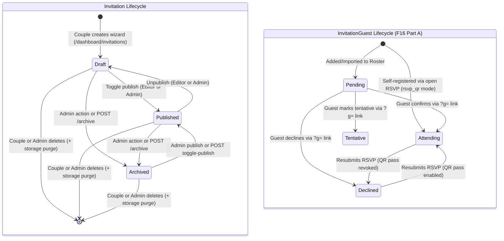
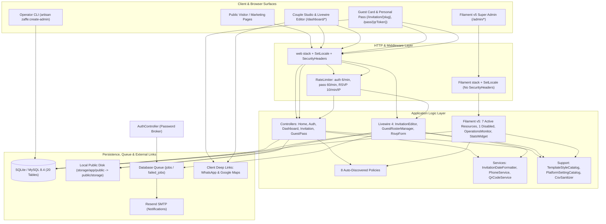
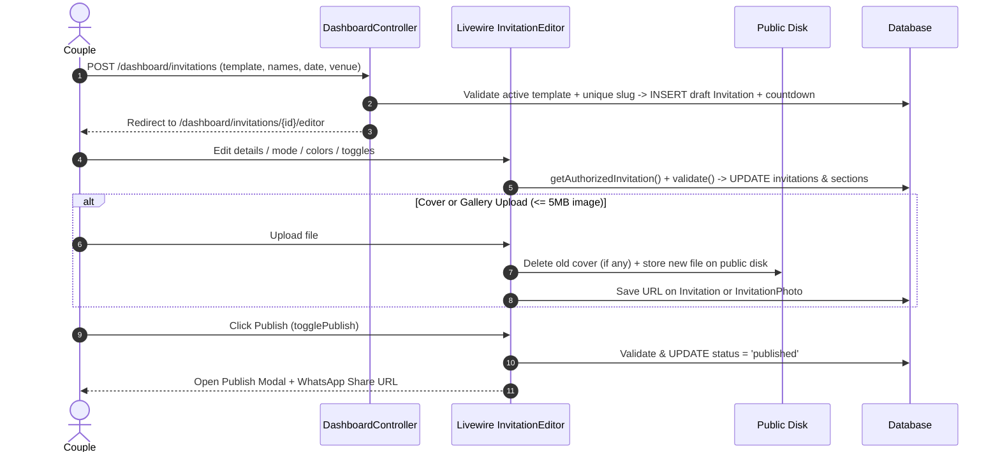
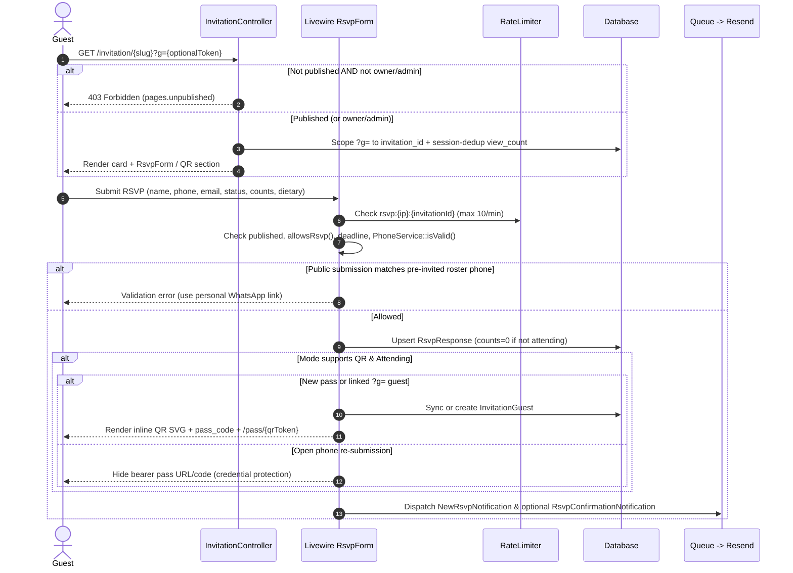
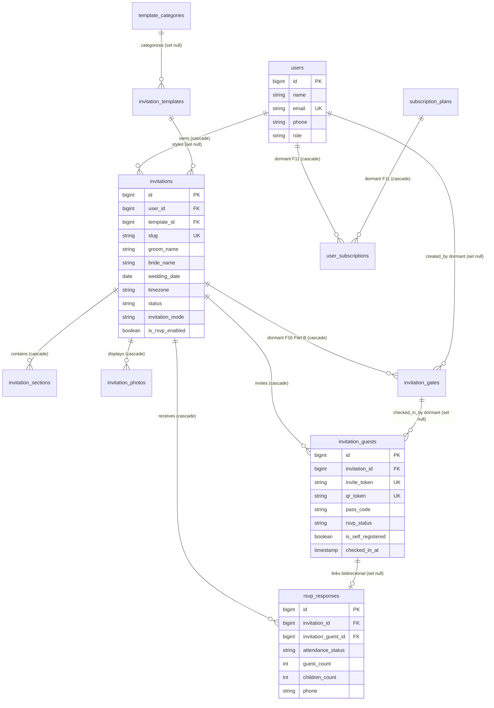

# Zaffe (زفّــة) — Phase 1 Project Discovery & Business Reverse Engineering

> **Scope & Ground Truth Notice:** This discovery report is reverse-engineered directly from the `dev` branch (`HEAD d88d381` + working-tree documentation reorganization in `docs/`). Every feature status, actor capability, route, schema column, business rule, and gap below was verified directly against application source files (`app/`, `bootstrap/`, `config/`, `database/`, `lang/`, `resources/`, `routes/`, `tests/`) and cross-checked against existing `docs/` artifacts. No application source code or existing documentation was modified during Phase 1.

## Table of Contents
- [1. Executive Overview](#1-executive-overview)
- [2. Business Concept](#2-business-concept)
- [3. Platform Architecture Overview](#3-platform-architecture-overview)
- [4. Actor and Role Matrix](#4-actor-and-role-matrix)
- [5. Complete Feature Inventory](#5-complete-feature-inventory)
- [6. Business Workflow Inventory](#6-business-workflow-inventory)
- [7. Business Rules Catalog](#7-business-rules-catalog)
- [8. Core Business Entities](#8-core-business-entities)
- [9. Technical Architecture Summary](#9-technical-architecture-summary)
- [10. External Integrations](#10-external-integrations)
- [11. Implementation Gaps & Documentation-vs-Code Drift](#11-implementation-gaps--documentation-vs-code-drift)
- [12. Unknowns and Open Questions](#12-unknowns-and-open-questions)
- [13. Evidence References](#13-evidence-references)

---

## 1. Executive Overview

**Zaffe (زفّــة)** is a Laravel 13 B2C Software-as-a-Service (SaaS) platform enabling engaged couples and families—initially targeting **Saudi Arabia (KSA)** and **Egypt**—to design, customize, publish, and distribute interactive digital wedding invitations, manage pre-invited guest rosters, track RSVP responses, and issue pure-PHP personal QR entry passes without requiring mobile app downloads.

### Quantitative Discovery Summary

| Dimension | Verified Count / State | Details |
| :--- | :--- | :--- |
| **Authoritative Branch** | `dev` (`d88d381`) | Active R1 features `F01`–`F10`, `F12`–`F14`, `ZAFFE-016`–`017`, `ZAFFE-020`, `ZAFFE-022`–`024`, plus `F16` Part A |
| **Stack Verified** | Laravel 13, Livewire 4, Filament v5, Tailwind CSS v4, Vite 8 | `composer.json` declares `php: ^8.3`, but `composer.lock` (`symfony/http-foundation v8.1.11`) requires PHP `>= 8.4.1`; `ext-intl` required for Filament & Hijri |
| **User Actors** | **6 Active** (+ **1 Dormant/Isolated**) | Public Visitor, Open-Link Guest, `?g=` Token Guest, Couple (`user`), Super Admin (`admin`), DevOps/CLI Operator; Gatekeeper Usher isolated |
| **Feature Inventory** | **34 Cataloged Features** | **7 Fully Implemented**, **23 Partially Implemented**, **4 Not Implemented / Isolated / Deferred**, **0 Unclear** |
| **Business Workflows** | **8 End-to-End Workflows** | `WF-01` through `WF-08` spanning onboarding, studio design, publishing, open/personalized RSVP, roster, QR pass, admin & CLI |
| **Business Rules** | **36 Rules Extracted** | **25 Confirmed**, **4 Inferred**, **4 Unknown**, **3 Proposed** |
| **Database Schema** | **20 Tables** across **21 Migrations** | 11 Domain tables (3 dormant: `subscription_plans`, `user_subscriptions`, `invitation_gates`) + 9 Laravel infrastructure tables |
| **Automated Test Baseline** | **196 Tests / 2,230 Assertions** | Verified passing on WinGet PHP 8.5 + `ext-intl` (SQLite `:memory:`); 11 `intl`-dependent tests fail under PHP 8.5 `herd-lite` without `ext-intl` |

### Key Headline Findings
1. **Release 1 Scope Governance Conflict (`F16` Part A):** `F16` Part A (Smart Guest Roster, 4 Invitation Modes, `?g=` personalized links, `/pass/{qrToken}`, `QrCodeService`, `GuestRosterManager`, `InvitationGuestResource`) **is fully active in `dev`**, matching [QR_FEATURE_ISOLATION_POLICY.md](../architecture/QR_FEATURE_ISOLATION_POLICY.md) and [RELEASE_1_PRODUCT_DECISIONS.md](../product/RELEASE_1_PRODUCT_DECISIONS.md), whereas [ZAFFE_FINAL_QA_REPORT.md](../qa/reports/ZAFFE_FINAL_QA_REPORT.md) classifies `F16` Part A in `dev` as a P0 scope violation. Only `F16` Part B (`/gate/{gateToken}` scanning & `GateScanner`) is isolated on `feature/ZAFFE-018-smart-guests-and-qr-checkin`.
2. **Saudi Privacy Policy vs. Schema/Validation Conflict (`bride_name`):** [SAUDI_MARKET_DECISIONS.md](../product/SAUDI_MARKET_DECISIONS.md) mandates optional `bride_name`, yet `invitations.bride_name` is `NOT NULL` in the DB and `required` in the creation wizard, `DashboardController`, `InvitationEditor`, and Filament `InvitationForm`; only the 8 Saudi Signature templates support empty `bride_name`.
3. **Fake Client-Side Contact Form & Unreachable Customer Archive:** `GET /contact` renders a client-side Alpine form that discards submissions (`pages/contact.blade.php:87`); couples have zero UI to trigger `POST /dashboard/invitations/{id}/archive` or toggle publish from `/dashboard/invitations`.
4. **Editor & Template Functional Gaps:** `timeline` and `dress_code` sections are boolean toggles with no content editors; `countdown.blade.php` ignores `arabic_indic` digits; `emerald_night` and `desert_dusk` hardcode theme colors over user overrides; `islamic_elegance` ignores `$invitation->welcome_message`.
5. **Security & Admin Edge-Case Findings:** Filament `/admin/*` omits `SecurityHeaders` middleware (`AdminPanelProvider.php:344-355`); `PlatformSettingPolicy` & table `DeleteBulkAction` allow deleting canonical `PlatformSetting` keys; `Invitation::deleting` skips `http(s)://` URLs written by `InvitationEditor`, orphaning uploaded files when deleted from Admin.
6. **Substantial Documentation Drift:** Older specs (`BUSINESS_OVERVIEW.md`, `ARCHITECTURE.md`, `TECHNICAL_AUDIT.md`, `OPEN_QUESTIONS.md`, `pricing.blade.php`, `about.blade.php`) still cite 6 templates, simulated password reset, Unsplash hotlinks, and unresolved questions that are already decided or shipped.

---

## 2. Business Concept

### 2.1 Value Proposition & Problems Solved
Verified from implemented behavior (`HomeController`, `DashboardController`, `InvitationEditor`, `GuestRosterManager`, `RsvpForm`, `GuestPassController`, `InvitationDateFormatter`, `PhoneService`, `QrCodeService`):

1. **Eliminates Rigid Physical Invitations:** Printed cards cannot be edited after printing and require physical distribution. Zaffe provides instant draft/publish control (`InvitationEditor::togglePublish()`) and 1-click WhatsApp deep-link sharing (`Invitation::getWhatsAppShareUrl()`).
2. **Eliminates Fragmented RSVP Tracking:** Replaces phone calls, notebooks, and WhatsApp threads with structured attendance confirmation (`attending`, `declined`, `tentative`), adult + child counts, dietary notes, deduplicated phone updates (`RsvpForm`), and formula-safe UTF-8 BOM Excel CSV exports (`CsvSanitizer::cell()`).
3. **Upgrades Static Digital Flyers (PDF/JPEG):** Adds timezone-aware countdowns, Google Maps venue links, tap-unlocked background audio (`music_player.blade.php`), bilingual Arabic RTL / English LTR stationery, Umm al-Qura Hijri conversion (`InvitationDateFormatter`), and self-contained SVG QR passes (`/pass/{qrToken}`).
4. **Protects Family Privacy & Cultural Tone:** Supports photo-free stationery layouts across all 14 themes, strict `403` blocking of unpublished drafts, zero PII inside QR payloads, and zero third-party image CDN dependencies (`.webp` thumbnails stored locally under `public/images/templates/`).

### 2.2 Market Focus & Commercial Model
- **Strategic Target Markets:** Saudi Arabia first (`+966`, `Asia/Riyadh`, Umm al-Qura Hijri, formal-simple Arabic) and Egypt second (`+20`, `Africa/Cairo`), per [SAUDI_MARKET_DECISIONS.md](../product/SAUDI_MARKET_DECISIONS.md).
  - *Implementation Reality:* Egypt-first defaults still persist in `DashboardController::store()` (`Africa/Cairo`), `InvitationEditor::$timezone` (`Africa/Cairo`), `InvitationForm` (`Africa/Cairo`), `InvitationDateFormatter::DEFAULT_TIMEZONE` (`Africa/Cairo`), `PhoneService::normalize()` (`EG`), `dashboard/create.blade.php:150`, `dashboard/profile.blade.php:3`, and `PlatformSettingCatalog` (`+20 100 000 0000`), while `auth/register.blade.php:65` defaults to `SA (+966)`.
- **Release 1 Commercial Policy:** **100% Free Launch** (`is_premium = false` enforced across all 14 templates via migration `2026_11_15_000001_set_release_1_templates_free.php`, `InvitationTemplateForm.php:236-247`, `CreateInvitationTemplate.php:20`, `EditInvitationTemplate.php:46`; `SubscriptionPlanResource::canAccess()` returns `false`; `SubscriptionPlanPolicy` denies all abilities; `/pricing` explicitly states Release 1 is 100% free).
- **Deferred Post-Release 1 Monetization (`F11`):** Planned one-time pay-per-invitation checkout via Paymob (`SAR` / `EGP`), no recurring subscriptions; `subscription_plans` and `user_subscriptions` remain dormant in the database.

### 2.3 Core Business Entity Lifecycles

### 2.4 Operational Processes & KPI Measurement Reality
Documented product KPIs ([SAUDI_MARKET_DECISIONS.md](../product/SAUDI_MARKET_DECISIONS.md) §10) vs. actual code instrumentation (`app/Filament/Pages/OperationsMonitor.php:43-91`):

| Target Product KPI | Documented Definition | Actual Implementation in `OperationsMonitor.php` | Status |
| :--- | :--- | :--- | :--- |
| **Wizard-Start -> Published Rate** | % of started wizard sessions reaching `published` | Not tracked (`total_couples` with >= 1 published invitation used instead: `activated_couples / total_couples`) | **Partially Implemented** (proxy only; no wizard-start telemetry) |
| **Published -> Shared-with-10+-Guests Rate** | % of published invitations with `>= 10` views and/or RSVPs | **Not computed** anywhere in Admin or Dashboard | **Not Implemented** |
| **Average RSVPs per Invitation** | Mean `RsvpResponse` count across published invitations | Implemented (`avg_rsvps_per_published` at `OperationsMonitor.php:62-64`) | **Fully Implemented** |

---

## 3. Platform Architecture Overview

Zaffe follows a monolithic server-rendered **Laravel 13 MVC + Livewire 4 + Filament v5** architecture backed by a single relational SQL database (`SQLite` locally/tests, `MySQL 8.4` staging/production target) and `database` queues. No REST/JSON API layer exists (`routes/api.php` absent; `bootstrap/app.php` routes only `web.php`, `console.php`, and `/up`).

### Active vs. Isolated / Deferred Scope Matrix (`dev` Branch)

| Feature Code / Domain | Branch / Status in `dev` | Authoritative Evidence |
| :--- | :--- | :--- |
| **`F01`–`F10`, `F12`–`F14`** | **Active in `dev`** | Auth, 14 templates (incl. `ZAFFE-023`/`024`), lifecycle, editor, public view, RSVP, roster/CSV, dashboard, Filament admin (`ZAFFE-017`), Resend notifications, `SecurityHeaders` & indexes, `InvitationDateFormatter`, local `.webp` assets |
| **`F16` Part A (Smart Roster, 4 Modes, `?g=`, `/pass/{qrToken}`)** | **Active in `dev`** *(contradicts QA Report §2.2)* | `InvitationGuest`, `GuestRosterManager`, `GuestPassController`, `QrCodeService`, `InvitationGuestResource`, `access_section.blade.php` |
| **`F16` Part B (QR Scanning & Gatekeeper `/gate/{gateToken}`)** | **Isolated on `feature/ZAFFE-018-smart-guests-and-qr-checkin`** | `GateScanner`, `InvitationGate`, camera `BarcodeDetector` absent from `dev`; `invitation_gates` table & `checked_in_*` columns dormant |
| **`F11` (Monetization & Paymob)** | **Deferred Post-Release 1** | `SubscriptionPlanResource::canAccess(): false`, `SubscriptionPlanPolicy` all `false`, `subscription_plans` & `user_subscriptions` dormant |
| **`F15` (Short URLs `/i/{code}`, Dynamic OG Cards, WebP Pipeline)** | **Unmerged on `origin/feature/ZAFFE-015-short-urls-and-og-tags`** | Zero `OgImageService`, `short_code`, or `/i/` routes in `dev` |
| **`ZAFFE-017` Wizard (`feature/ZAFFE-017-create-invitation-wizard`)** | **On Hold — Unmerged** | Country-first creation wizard not present in `dev` |

---

## 4. Actor and Role Matrix

### 4.1 Complete Actor Catalog

| # | Actor Name | System Identification | Description | Responsibilities | Permissions & Boundaries | Available Features | Interactions with Other Actors |
|---:| :--- | :--- | :--- | :--- | :--- | :--- | :--- |
| **1** | **Public Visitor / Prospective Couple** | Unauthenticated (`guest`) | Lead discovering Zaffe, browsing themes, or registering an account | Explore marketing pages, filter/search templates, preview mock weddings, register/reset password | Read-only access to public pages; blocked (`403`) from draft invitations; redirected to `/login` for `/dashboard*` | Landing (`/`), Gallery (`/templates`), Previews (`/templates/{slug}/preview`), `/pricing`, `/about`, `/contact`, `/faq`, `/lang/{locale}`, Auth flows | Submits registration to become **Couple**; views **Super Admin**-curated templates and `PlatformSetting` contact links |
| **2** | **Invited Wedding Guest (Open Link)** | Unauthenticated (`guest`, no `?g=`) | Guest opening shared `/invitation/{slug}` link | View card details, unlock audio gate, open venue map, submit/update RSVP by phone, obtain auto-QR pass (in `rsvp_qr` mode) | View only `published` cards (`403` on drafts); RSVP blocked past `rsvp_deadline`, outside `allowsRsvp()`, or >10/min/IP; **blocked from overwriting pre-invited roster records**; cannot retrieve previously issued open-RSVP QR pass via phone re-submission | Public card (`/invitation/{slug}`), audio gate, Google Maps, `RsvpForm`, `/pass/{qrToken}` (only on first `rsvp_qr` creation) | Receives link from **Couple**; RSVP updates **Couple** dashboard & triggers `NewRsvpNotification` + `RsvpConfirmationNotification` |
| **3** | **Pre-Invited Named Guest (`?g=` Holder)** | Unauthenticated bearer-token holder (`?g={inviteToken}` / `/pass/{qrToken}`) | Named invitee pre-registered in `invitation_guests` (`is_self_registered = false`) | Open personalized greeting card, confirm/update within personal adult/child quotas, print/save personal QR pass | Scoped strictly by `(invitation_id, invite_token)`; capped at `max_adults` & `max_children`; `403` on unpublished cards; `404` on `/pass/*` if mode lacks QR support; strict `no-referrer`/`noindex`/`no-store` headers | Personalized `/invitation/{slug}?g=...`, pre-filled quota-capped `RsvpForm`, inline QR card (`qr_only`), `/pass/{qrToken}` pass page | Pre-registered & messaged via WhatsApp by **Couple**; monitored/deleted by **Super Admin** |
| **4** | **Engaged Couple / Customer** | Authenticated `User` with `role = 'user'` (`auth`) | Wedding host creating and managing digital invitations and guests | Create invitations, design in Studio, upload media, manage 4 modes, toggle publish, build/import guest roster, share via WhatsApp, inspect/export RSVPs | Strictly scoped via `Auth::user()->invitations()` and `getAuthorizedInvitation()`; `403` on other users' invitations & `/admin/*`; can preview own draft cards & passes | Dashboard (`/dashboard`), Creation Wizard, Livewire `InvitationEditor`, `GuestRosterManager`, RSVP list & CSV exports, Profile (`/dashboard/profile`) | Distributes links to **Guests**; receives `NewRsvpNotification` (mail + DB); views **Admin**-configured templates & site settings |
| **5** | **Platform Super Admin** | Authenticated `User` with `role = 'admin'` (`canAccessPanel()`) | Platform operator & support moderator | Manage users, invitations, templates, categories, platform branding/contact settings; inspect RSVPs & guest passes; monitor KPIs & queue failures | Full `/admin/*` access (except locked `SubscriptionPlanResource`); bypasses draft `403` on public invitations & passes and editor/roster ownership checks; cannot delete self or last admin (`UserPolicy`); cannot create/edit RSVPs (`RsvpResponsePolicy`) or create guests; can also access `/dashboard*` | All 7 active Filament resources, `OperationsMonitor`, `PlatformStatsOverview`, AR/EN switcher, plus customer Studio/Dashboard override | Moderates **Couple** accounts/invitations and **Guest** RSVPs/passes; controls template catalog & live contact settings consumed by **Visitors** & **Couples** |
| **6** | **System Operator / DevOps Admin** | Server shell / CLI access | Engineer managing deployments, initial admin bootstrap, and workers | Provision initial Super Admin (`zaffe:create-admin`), run migrations/seeders, configure `.env` (Resend, MySQL), run queue workers (`queue:work`) | Direct DB/filesystem/CLI access outside HTTP layer; `zaffe:create-admin` refuses duplicate emails and weak/demo passwords (`<12` chars or missing mixed-case/number/symbol) | `php artisan zaffe:create-admin`, `migrate --force`, `filament:assets`, `storage:link`, Supervisor queue worker | Bootstraps **Super Admin** accounts and operates email delivery pipeline for **Couples** & **Guests** |
| **7** | **Venue Gatekeeper / Door Usher** *(Dormant / Isolated)* | Tokenized `/gate/{gateToken}` *(NOT in `dev`)* | Wedding door staff scanning guest QR passes | **Inactive in `dev`** — intended to scan QR / enter 6-char `pass_code` and mark single-use check-in | Completely absent from `dev` routes, models, Livewire, and Filament UI (`invitation_gates` table & `checked_in_*` columns dormant) | None active in `dev` (isolated on `feature/ZAFFE-018-smart-guests-and-qr-checkin`) | Would interact with **Couple** (gate setup) and **Guests** (door entry) if F16 Part B is manually merged |

### 4.2 Admin Dashboard vs. Couples Client Website Capability Analysis

#### A. Filament v5 Admin Panel (`/admin`, `app/Providers/Filament/AdminPanelProvider.php`)
- **Authentication & Guards:** Uses default `web` session guard (`config/auth.php:19,41-44`) gated by `User::canAccessPanel()` (`role === 'admin'`). Authenticated `user` accounts hitting `/admin` receive HTTP `403` rather than a login prompt.
- **Navigation Structure:** Ungrouped top-level menu sorted by `$navigationSort`:
  1. `Invitations` (`1`, `InvitationResource`) — CRUD, quick `viewPublic` / `publish` / `unpublish` / `archive` row actions, `KeyValue` `custom_styles`, filters (`status`, `invitation_mode`, `timezone`, `template_id`).
  2. `RSVP Responses` (`2`, `RsvpResponseResource`) — Read-only Infolist + Spam `DeleteAction` + CSV Export (`ListRsvpResponses`).
  3. `Invitation Guests` (`3`, `InvitationGuestResource`) & `Users` (`3`, `UserResource`) — **Navigation sort collision at `3`** (alphabetical class discovery order determines rendering order).
  4. `Invitation Templates` (`4`, `InvitationTemplateResource`) — 3-column studio editor with 14 preset actions, live WCAG contrast & card preview (`template-style-preview.blade.php`), strict 14-view allowlist, triple-locked `is_premium = false`.
  5. `Template Categories` (`5`, `TemplateCategoryResource`) — Category CRUD + `is_active` cascade hiding templates across customer pages (`availableForSelection()`).
  6. `Platform Settings` (`6`, `PlatformSettingResource`) — Custom 2-tab workspace (`General Workspace` live branding/contact editor + `All Settings` table) with cache invalidation (`PlatformSetting::clearCache()`).
  7. `Operations Monitor` (`99`, `OperationsMonitor`) — Custom page (`/admin/operations-monitor`) surfacing funnel KPIs, mail/queue/Resend readiness booleans, and sanitized `failed_jobs` rows.
  8. `Subscription Plans` (`SubscriptionPlanResource`) — Hidden (`$shouldRegisterNavigation = false`), blocked (`canAccess(): false`), and denied by `SubscriptionPlanPolicy` (`false`).

#### B. Couples Client Website (`/`, `/login`, `/dashboard*`, `/invitation/*`, `/pass/*`)
- **Onboarding & Auth:** Registration (`/register`), login (`/login`), password reset via Laravel `Password::broker()` + queued `ResetPasswordNotification` (`/forgot-password`, `/reset-password/{token}`). No email verification enforcement (`MustVerifyEmail` not implemented; `email_verified_at` remains null on self-registered and seeded accounts).
- **Studio & Management Lifecycle:** Creation wizard (`/dashboard/invitations/create`) creates a `draft` invitation and redirects directly into Livewire `InvitationEditor` (`/dashboard/invitations/{id}/editor`) with 6 tabs (`basics`, `content`, `design`, `media`, `templates`, `rsvp`), autosave, device frame toggle, and Publish modal. Guest management (`/dashboard/invitations/{id}/guests`) combines `GuestRosterManager` (pre-invited roster, bulk CSV import, `?g=` links, WhatsApp tracking) with RSVP filtering and dual CSV exports.
- **Admin ↔ Customer Integration Reality:**
  - **Working Integrations:** `PlatformSetting` updates propagate immediately (via `Cache::rememberForever` + model `saved`/`deleted` cache invalidation) to marketing layouts, `<title>` defaults, `/contact`, and WhatsApp CTA. Deactivating a `TemplateCategory` or `InvitationTemplate` removes it from `/templates`, `/templates/{slug}/preview`, creation wizard, and `InvitationEditor::changeTemplate()`. Admin publish/unpublish/archive actions immediately affect `/invitation/{slug}` and `/pass/{qrToken}` visibility (`403` vs `200`).
  - **Broken / Incomplete Integrations:** Deleting an `Invitation` from Filament runs `Invitation::deleting`, which skips `http(s)://` URLs and fails to strip `/storage/`, leaving `InvitationEditor`-uploaded files orphaned on disk (`app/Models/Invitation.php:45-60` vs `app/Livewire/InvitationEditor.php:198,215`). Customer notification inbox UI is absent (couples cannot read `database` channel `NewRsvpNotification` records on `/dashboard`).

---

## 5. Complete Feature Inventory

Status Definitions:
- **Fully Implemented:** Complete end-to-end flow (routes, validation, persistence, UI, edge-case guards) works as intended with no blocking functional defects.
- **Partially Implemented:** Core flow works, but exhibits confirmed functional gaps, missing UI triggers, localization leaks, validation mismatches, or documented rule conflicts.
- **Not Implemented:** Absent from active `dev` runtime (dormant DB tables/models, isolated feature branches, or unbuilt requirements).

### 5.1 Public Marketing & Localization (`FEAT-01`–`FEAT-07`)

| ID | Feature Name | Platform Area | Actor(s) | Status | Key Code Evidence |
|---|---|---|---|---|---|
| **`FEAT-01`** | **Public Marketing Landing Page** | Public Web (`/`) | Visitor | **Partially Implemented** | `HomeController::index()` (`HomeController.php:14-33`), `pages/home.blade.php:1-580` |
| **`FEAT-02`** | **Template Gallery, Filtering & Search** | Public Web (`/templates`) | Visitor | **Partially Implemented** | `HomeController::templates()` (`HomeController.php:35-78`), `pages/templates.blade.php:1-218` |
| **`FEAT-03`** | **Interactive Live Template Preview** | Public Web (`/templates/{slug}/preview`) | Visitor | **Fully Implemented** | `HomeController::previewTemplate()` (`HomeController.php:80-146`), `pages/preview-template.blade.php:1-89` |
| **`FEAT-04`** | **Release 1 Free Pricing Page** | Public Web (`/pricing`) | Visitor | **Partially Implemented** | `HomeController::pricing()` (`HomeController.php:148-153`), `pages/pricing.blade.php:1-123` |
| **`FEAT-05`** | **Static About & FAQ Pages** | Public Web (`/about`, `/faq`) | Visitor | **Partially Implemented** | `HomeController::{about,faq}()`, `pages/{about,faq}.blade.php` |
| **`FEAT-06`** | **Contact & Support Page** | Public Web (`/contact`) | Visitor | **Partially Implemented** | `HomeController::contact()`, `pages/contact.blade.php:1-125`, `PlatformSetting` |
| **`FEAT-07`** | **Bilingual Locale Switcher & RTL/LTR** | Cross-Platform (`/lang/{locale}`) | All | **Partially Implemented** | `routes/web.php:41-47`, `SetLocale.php`, `AdminPanelProvider.php:319-333`, `lang/{ar,en}/*` |

- **`FEAT-01` Details:** Showcases hero folio mockup, value props, 6 featured DB templates (`availableForSelection()`), and 14-template copy. **Why Partial:** `HomeController::index()` queries `$categories`, `$plans`, and `$demoInvitation` (`HomeController.php:22-30`), none of which are consumed in `pages/home.blade.php` (hardcodes `/invitation/ahmed-and-sarah` and static hero dates/countdown).
- **`FEAT-02` Details:** Filters active templates by `?collection=saudi-signature`, `?category=`, and `?search=` across AR/EN names & descriptions. **Why Partial:** "All Designs" pill displays filtered `$templates->count()` instead of total catalog count (`pages/templates.blade.php:87`); `$saudiSignatureCount` is ignored in favor of hardcoded `(8)`/`(٨)` (`:47`); card titles always print `name_ar` even in EN (`:175`).
- **`FEAT-03` Details:** Loads active template (guarded by `availableForSelection()`), chooses Riyadh Saudi sample wedding data for Saudi Signature slugs and Cairo sample data for baseline 6, provides Alpine `mobile`/`tablet`/`desktop` switcher, and safely resolves view via `TemplateStyleCatalog::resolveBladeView()`.
- **`FEAT-04` Details:** Communicates 100% Free Release 1 Launch (`0 SAR / EGP`) with no payment walls. **Why Partial:** Queries unused `$plans` from DB (`HomeController.php:150`) and still displays stale copy *"all six royal themes" / "القوالب الستة الفاخرة"* (`pages/pricing.blade.php:17,30,31,73`).
- **`FEAT-05` Details:** Renders bilingual About and 5-item FAQ accordion. **Why Partial:** Entirely static Blade views (no CMS) and `pages/about.blade.php:38,41` still advertises *"6 Curated Themes" / "٦ قوالب ملكية"*.
- **`FEAT-06` Details:** Pulls `whatsappUrl`, `contactPhone`, and `contactEmail` live from `PlatformSetting`. **Why Partial:** `<form @submit.prevent="submitted = true">` (`pages/contact.blade.php:87`) has no `action`, `method`, `@csrf`, or backend `POST` route — submitted messages are silently discarded client-side.
- **`FEAT-07` Details:** Session-based `ar` / `en` switcher works across web and Filament admin, with `lang/{ar,en}/admin.php` (417 keys, 100% parity) and `passwords.php`. **Why Partial:** Zero `__()` calls exist in customer Blade views; `invitation-editor.blade.php`, `rsvp-form.blade.php`, `invitation-show.blade.php`, `guest-pass.blade.php`, and 7 of 8 template partials are hardcoded Arabic; minor Arabic leaks exist in `base.blade.php:15,21,27`, `dashboard/index.blade.php:83`, `templates.blade.php:175`, and `guest-roster-manager.blade.php:79,96-97`.

### 5.2 Authentication & Profile (`FEAT-08`–`FEAT-10`)

| ID | Feature Name | Platform Area | Actor(s) | Status | Key Code Evidence |
|---|---|---|---|---|---|
| **`FEAT-08`** | **Couple Registration, Login & Logout** | Auth (`/login`, `/register`, `/logout`) | Visitor, Couple | **Fully Implemented** | `AuthController.php:19-99,164-171`, `routes/web.php:29-33,49`, `auth/{login,register}.blade.php` |
| **`FEAT-09`** | **Self-Service Password Reset** | Auth (`/forgot-password`, `/reset-password/{token}`) | Visitor | **Fully Implemented** | `AuthController.php:101-162`, `User::sendPasswordResetNotification()`, `ResetPasswordNotification.php` |
| **`FEAT-10`** | **Customer Profile & Password Update** | Customer Portal (`/dashboard/profile`) | Couple, Admin | **Fully Implemented** | `DashboardController::{profile,updateProfile}()` (`:340-381`), `dashboard/profile.blade.php` |

- **`FEAT-08` Details:** Validates credentials, enforces `throttle:6,1`, normalizes optional phone (`EG`/`SA`, `PhoneService`), regenerates session on login/registration, invalidates/regenerates CSRF on logout, and exposes demo login helper strictly in `local`/`testing`.
- **`FEAT-09` Details:** Uses Laravel `Password::broker()` with 60-minute expiry & 60s throttle (`config/auth.php:96-101`), `throttle:6,1`, and queued bilingual `ResetPasswordNotification` dispatched via `User::sendPasswordResetNotification()`.
- **`FEAT-10` Details:** Allows updating name, unique email, `EG`/`SA` phone (`PhoneService::isValid()` + `normalize()`), and optional confirmed password (`min:8`).

### 5.3 Customer Studio & Templates (`FEAT-11`–`FEAT-15`)

| ID | Feature Name | Platform Area | Actor(s) | Status | Key Code Evidence |
|---|---|---|---|---|---|
| **`FEAT-11`** | **Customer Dashboard Overview & KPIs** | Customer Portal (`/dashboard`) | Couple, Admin | **Partially Implemented** | `DashboardController::index()` (`:21-48`), `dashboard/index.blade.php:1-155` |
| **`FEAT-12`** | **Invitation Creation Wizard** | Customer Portal (`/dashboard/invitations/create`) | Couple, Admin | **Partially Implemented** | `DashboardController::{create,store}()` (`:60-139`), `dashboard/create.blade.php:1-183` |
| **`FEAT-13`** | **Invitation List & Lifecycle Actions** | Customer Portal (`/dashboard/invitations`) | Couple, Admin | **Partially Implemented** | `DashboardController::{invitations,togglePublish,archive,destroy}()` (`:50-58,141-178`), `dashboard/invitations.blade.php` |
| **`FEAT-14`** | **Real-Time Livewire Studio Editor** | Studio (`/dashboard/invitations/{id}/editor`) | Couple, Admin | **Partially Implemented** | `app/Livewire/InvitationEditor.php:1-434`, `livewire/invitation-editor.blade.php:1-629` |
| **`FEAT-15`** | **14 Wedding Templates & 8 Partials** | Public Card & Previews | Visitor, Guest, Couple | **Partially Implemented** | `resources/views/templates/*.blade.php`, `templates/partials/*.blade.php`, `TemplateStyleCatalog.php` |

- **`FEAT-11` Details:** Computes owned total invitations, published count, views sum, attending adults, declined count, and total responses. **Why Partial:** `confirmedAttendees` sums only `guest_count` (omitting `children_count`); `dashboard/index.blade.php:83` leaks Arabic `"مشاهدة"` in EN; `:123-131` mislabels `'archived'` as `'Draft'`; no notification inbox displays stored `NewRsvpNotification` rows.
- **`FEAT-12` Details:** Creates draft invitation with unique slug (`{groom}-and-{bride}` or `wedding-{random}` + numeric suffix), initial `default_styles`, and default `countdown` section, then redirects to Editor. **Why Partial:** Requires `bride_name` (`DashboardController.php:76`, `create.blade.php:111`, contradicting KSA privacy rules) and defaults timezone to `Africa/Cairo` (`:117`, `:150`).
- **`FEAT-13` Details:** Paginates 10 owned invitations and supports Delete with local storage cleanup (`DashboardController::destroy()`). **Why Partial:** Backend defines `POST .../toggle-publish` and `POST .../archive`, but `dashboard/invitations.blade.php` exposes **only Delete** (zero UI buttons for Publish/Unpublish or Archive anywhere in the customer portal; `InvitationEditor` only toggles `draft` ↔ `published`).
- **`FEAT-14` Details:** 6-tab live editor (`basics`, `content`, `design`, `media`, `templates`, `rsvp`) with device preview, autosave, template switching, 4 access modes, `5MB` cover/gallery uploads with disk cleanup, Hijri/numeral/locale overrides, and Publish WhatsApp modal. **Why Partial:**
  1. 100% hardcoded Arabic UI (`invitation-editor.blade.php` + PHP title `:432`).
  2. `timeline` and `dress_code` sections are **toggle-only** (`InvitationEditor.php:365-378`) — no UI edits events or dress code notes; enabling shows static Arabic placeholders.
  3. Gallery upload lacks caption editing (hardcoded `'صورة من ألبوم الفرح'`, `:216`) or sort order controls, and uploads are stored uncompressed (no WebP conversion).
  4. `bride_name` is `required` (`:307`); `timezone` defaults to `Africa/Cairo` (`:43`).
  5. `updated($propertyName)` (`:180-184`) runs full validation + `saveChanges()` even when switching `$activeTab` or `$previewDevice`.
  6. HTML input `max="10"` (`invitation-editor.blade.php:447`) contradicts backend rule `max:20` (`:318`).
  7. Live preview hardcodes `'card_color' => '#FFFFFF'` (`:393`); `togglePublish()` contains a Unicode emoji (`🎉`, `:292`); `music_url` accepts only URL strings (no built-in audio library or file upload).
- **`FEAT-15` Details:** 14 self-contained themes (6 baseline + 8 Saudi Signature Vol. 1) using `<x-app-icon>` SVGs with zero emojis and zero external CDN images. **Why Partial:**
  1. Original 6 themes unconditionally render `bride_name` with separator (`و`/`&`), have two `<h1>` tags, and lack `ceremony_stages`.
  2. `emerald_night.blade.php:6-7` and `desert_dusk.blade.php:10-15,323-338` hardcode dark theme colors over custom style overrides.
  3. `islamic_elegance.blade.php:6,16,33-38` ignores `$invitation->welcome_message`; `minimal_chic` & `classic_aristocrat` hardcode text ink.
  4. Saudi Signature 8 stack both `ceremony_stages` and `timeline` when `section_timeline` is enabled.
  5. 7 of 8 partials are Arabic-only; `countdown.blade.php:56-68` ignores `arabic_indic` digits; `timeline.blade.php:33` uses invalid `--tw-before-bg`; `share_box.blade.php:30` uses unguarded `navigator.clipboard.writeText`; `og-zaffe.jpg` referenced in `base.blade.php:22,28` and `invitation-show.blade.php:3` is missing from `public/images/`.

### 5.4 Public Guest Experience, RSVP, Roster & QR Passes (`FEAT-16`–`FEAT-22`)

| ID | Feature Name | Platform Area | Actor(s) | Status | Key Code Evidence |
|---|---|---|---|---|---|
| **`FEAT-16`** | **Public Wedding Card & Draft Privacy** | Public Web (`/invitation/{slug}`) | Guest, Couple, Admin | **Fully Implemented** | `InvitationController::show()` (`:13-50`), `pages/invitation-show.blade.php`, `pages/unpublished.blade.php` |
| **`FEAT-17`** | **Dual Calendar & Configurable Digits** | Services & Templates | Guest, Couple | **Partially Implemented** | `app/Services/InvitationDateFormatter.php:1-601`, `templates/partials/countdown.blade.php` |
| **`FEAT-18`** | **Interactive RSVP Engine & Deduplication** | Public Card (`RsvpForm`) | Open Guest, `?g=` Guest | **Partially Implemented** | `app/Livewire/RsvpForm.php:1-396`, `livewire/rsvp-form.blade.php:1-205` |
| **`FEAT-19`** | **Queued Email & Database Notifications** | Notifications & Queue | Couple, Guest | **Partially Implemented** | `NewRsvpNotification.php`, `RsvpConfirmationNotification.php`, `ResetPasswordNotification.php`, `config/mail.php` |
| **`FEAT-20`** | **Pre-Invited Guest Roster & Bulk Import** | Dashboard (`GuestRosterManager`) | Couple, Admin | **Fully Implemented** | `app/Livewire/GuestRosterManager.php:1-329`, `livewire/guest-roster-manager.blade.php:1-357` |
| **`FEAT-21`** | **4 Invitation Modes & Pure-PHP QR Passes** | Model, Studio, Pass (`/pass/{qrToken}`) | Couple, Guest, Admin | **Partially Implemented** | `Invitation.php:131-175`, `InvitationGuest.php`, `QrCodeService.php`, `GuestPassController.php`, `pages/guest-pass.blade.php` |
| **`FEAT-22`** | **Guest RSVP Viewer & Formula-Safe CSVs** | Customer Portal (`/dashboard/.../guests*`) | Couple, Admin | **Fully Implemented** | `DashboardController::{guests,exportGuestsCsv,exportRosterCsv}()` (`:203-338`), `CsvSanitizer.php` |

- **`FEAT-16` Details:** Serves `published` invitations, blocks `draft` (and `archived`) cards with `HTTP 403` (`pages.unpublished`) unless requested by owner or admin, resolves `?g={inviteToken}` strictly scoped by `invitation_id`, deduplicates `view_count` increments per session, and renders safe allowlisted Blade templates.
- **`FEAT-17` Details:** Formats Gregorian dates, Umm al-Qura Hijri dates, times, ceremony stages, and `latin` vs `arabic_indic` numerals respecting `Asia/Riyadh` / `Africa/Cairo`. **Why Partial:** Requires PHP `ext-intl` (silently returns `null` when missing); Hijri output stays Arabic (`ar_SA`, `هـ`) even when invitation locale is `en`; `countdown.blade.php` ignores `arabic_indic`.
- **`FEAT-18` Details:** Validates deadlines, quotas, `SA`/`EG` phone numbers (`PhoneService`), rate limits (`10/min/IP`), deduplicates by `rsvp_response_id` or phone, blocks public form hijacking of pre-invited guests (`is_self_registered = false`), auto-issues self-registered `InvitationGuest` passes in `rsvp_qr` mode without leaking previously issued credentials, and zeroes headcounts on non-`attending` replies. **Why Partial:** Entire `rsvp-form.blade.php` and `RsvpForm.php` error messages are hardcoded Arabic; `tentative` requires `guest_count >= 1` in rules (`:133`) yet forcibly stores `0` (`:222,258,272`); sends *"confirming your attendance"* email even when guest declines (`:357-360`).
- **`FEAT-19` Details:** Queued (`ShouldQueue`, `database` queue) notifications wrapped in `try/catch` so mail failures don't block RSVPs. **Why Partial:** Couples have no in-app notification bell/inbox for `database`-stored `NewRsvpNotification`; `NewRsvpNotification` omits `children_count`; `RsvpConfirmationNotification` omits QR pass link and renders confirmation wording even on `declined`; `config/mail.php` has active Resend env/driver quirks (`RESEND_API_KEY=` empty string prevents `MAIL_PASSWORD` fallback; `resend_api` transport lacks `resend/resend-php` package).
- **`FEAT-20` Details:** Single guest creation, CSV/text bulk import with formula stripping & header skip, category/status/search filters, `invited_at`/`reminded_at` tracking, `wa.me` personalized invite URLs, inline QR pass preview modal, and strict `#[Locked] $invitationId` + ownership checks. *(Minor: import summary banner & bulk placeholder leak Arabic in EN mode.)*
- **`FEAT-21` Details:** Implements `rsvp_qr`, `rsvp_only`, `qr_only`, `announcement` modes and pure-PHP ISO/IEC 18004 SVG QR encoder (`QrCodeService`, Versions 1–10, ECC M, zero PII payload). **Why Partial:** `pages/guest-pass.blade.php` is 100% Arabic-only and joins `groom_name` & `bride_name` unconditionally (`:11`); `Invitation::saving()` (`:26-43`) retains `is_rsvp_enabled = false` when switching `announcement` -> `rsvp_qr` without toggling `is_rsvp_enabled`; `InvitationGuest::canReceiveQrPass()` allows `tentative` passes while `RsvpForm` hides post-submit pass display for `tentative`; pass copy uses *"بطاقة دخول / entrance"* phrasing despite `QR_FEATURE_ISOLATION_POLICY.md` §1.
- **`FEAT-22` Details:** Searchable/filterable RSVP list with stats + UTF-8 BOM formula-sanitized CSV exports for both RSVPs and Guest Roster.

### 5.5 Filament v5 Super Admin Panel (`FEAT-23`–`FEAT-30`)

| ID | Feature Name | Platform Area | Actor(s) | Status | Key Code Evidence |
|---|---|---|---|---|---|
| **`FEAT-23`** | **Admin Panel Auth, Theming & CLI Bootstrap** | Admin (`/admin`) & CLI | Admin, DevOps | **Partially Implemented** | `AdminPanelProvider.php`, `User::canAccessPanel()`, `CreateAdminUser.php` |
| **`FEAT-24`** | **Admin User Management** | Admin (`/admin/users`) | Admin | **Partially Implemented** | `UserResource.php`, `UserForm.php`, `UsersTable.php`, `UserPolicy.php` |
| **`FEAT-25`** | **Admin Invitation Moderation & CRUD** | Admin (`/admin/invitations`) | Admin | **Partially Implemented** | `InvitationResource.php`, `InvitationForm.php`, `InvitationsTable.php`, `Invitation.php` |
| **`FEAT-26`** | **Admin Template & Category Catalog** | Admin (`/admin/invitation-templates`, `/admin/template-categories`) | Admin | **Partially Implemented** | `InvitationTemplateResource`, `TemplateCategoryResource`, `TemplateStyleCatalog` |
| **`FEAT-27`** | **Admin RSVP Moderation & CSV Export** | Admin (`/admin/rsvp-responses`) | Admin | **Partially Implemented** | `RsvpResponseResource`, `ListRsvpResponses.php`, `RsvpResponseInfolist.php`, `RsvpResponsePolicy` |
| **`FEAT-28`** | **Admin Guest Pass Oversight** | Admin (`/admin/invitation-guests`) | Admin | **Partially Implemented** | `InvitationGuestResource`, `InvitationGuestsTable.php`, `InvitationGuestInfolist.php`, `InvitationGuestPolicy` |
| **`FEAT-29`** | **Admin Platform Settings Workspace** | Admin (`/admin/platform-settings`) | Admin | **Partially Implemented** | `PlatformSettingResource`, `ListPlatformSettings.php`, `PlatformSettingForm.php`, `PlatformSettingPolicy` |
| **`FEAT-30`** | **Admin Dashboard KPIs & Ops Monitor** | Admin (`/admin`, `/admin/operations-monitor`) | Admin | **Partially Implemented** | `PlatformStatsOverview.php`, `OperationsMonitor.php`, `operations-monitor.blade.php` |

- **`FEAT-23` Why Partial:** Custom obsidian/gold theme, AR/EN toggle, `isAdmin()` gate, and strong-password CLI `zaffe:create-admin` all work, **but** `SecurityHeaders` middleware is omitted from `AdminPanelProvider.php:344-355`.
- **`FEAT-24` Why Partial:** `UserPolicy` blocks self-delete and last-admin deletion, **but** `email_verified_at` in `UserForm.php:26-27` is ignored because it is absent from `User::$fillable`; seeded `/images/templates/...` `avatar_url` fails `->url()` on edit; no `is_active`/suspension capability exists; sort `3` collides with `InvitationGuestResource`.
- **`FEAT-25` Why Partial:** `KeyValue` style editing & quick publish/unpublish/archive work, **but** `Invitation::deleting` orphans `InvitationEditor`-uploaded storage files; `venue_map_url` lacks URL validation; `template_id` does not filter inactive templates; `Invitation::saving()` mode-vs-toggle edge case affects switching from `announcement`.
- **`FEAT-26` Why Partial:** `InvitationTemplateResource` has 14 presets, contrast preview, strict `bladeViews()` allowlist, and locked `is_premium = false`, **but** `TemplateCategoryForm.php:32-34` lacks `->default(true)` on `is_active` (defaults new categories to inactive) and lacks `maxLength`/`minValue`.
- **`FEAT-27` Why Partial:** Properly read-only + spam delete, **but** `ListRsvpResponses::exportCsv` ignores active table filters/search (dumps entire table) and omits `children_count` across table, infolist, and CSV.
- **`FEAT-28` Why Partial:** `rsvp_status` table column and `SelectFilter` display raw/hardcoded English enum strings in Arabic mode (`InvitationGuestsTable.php:38-45,59-66`); Infolist omits confirmed counts & notes; `InvitationGuestPolicy::update()` returns `true` with no Edit page; sort `3` collides with `UserResource`.
- **`FEAT-29` Why Partial:** Tabbed workspace + live preview + `Cache::rememberForever` invalidation work cleanly, **but** `DeleteBulkAction` in `PlatformSettingsTable.php:71` and `PlatformSettingPolicy::deleteAny()` allow bulk-deleting canonical keys (`site_name_ar`, `contact_email`, etc.) even though `EditPlatformSetting` hides delete.
- **`FEAT-30` Why Partial:** Secret-safe monitoring works and renders cleanly via scoped `.zaffe-mon-*` CSS, **but** misses 2 of 3 KSA KPIs, checks `services.resend.key` mismatch (`OperationsMonitor.php:95`), and requires `ext-intl` on index tables & stats.

### 5.6 Dormant / Isolated / Deferred Capabilities (`FEAT-31`–`FEAT-34`)

| ID | Feature Name | Platform Area | Status | Evidence |
|---|---|---|---|---|
| **`FEAT-31`** | **Monetization, Subscriptions & Paymob (`F11`)** | Deferred Post-R1 | **Not Implemented** | `subscription_plans` & `user_subscriptions` dormant; `SubscriptionPlanResource` locked (`403`); zero Paymob/checkout routes |
| **`FEAT-32`** | **Venue QR Scanning & Gatekeeper Check-In (`F16` Part B)** | Isolated Branch | **Not Implemented** *(Isolated)* | Absent from `dev`; isolated on `feature/ZAFFE-018-smart-guests-and-qr-checkin`; `invitation_gates` & `checked_in_*` dormant |
| **`FEAT-33`** | **Short URLs, Dynamic OG Cards & WebP Pipeline (`F15`)** | Unmerged Branch | **Not Implemented** *(Unmerged)* | Absent from `dev`; sits on `origin/feature/ZAFFE-015-short-urls-and-og-tags` |
| **`FEAT-34`** | **PDPL Privacy Notice, Retention & Guest Data Deletion** | Legal / Compliance | **Not Implemented** | No privacy/terms route, no scheduled retention/purge command in `routes/console.php`, no guest self-deletion mechanism |

---

## 6. Business Workflow Inventory

### Workflow Summary Table

| Workflow ID | Workflow Name | Primary Trigger | Participating Actors | Related Features | Primary Entities |
|---|---|---|---|---|---|
| **`WF-01`** | Couple Onboarding & Invitation Creation | Visitor submits `/register` or `/dashboard/invitations` | Public Visitor → Couple | `FEAT-08`, `FEAT-12` | `User`, `InvitationTemplate`, `Invitation`, `InvitationSection` |
| **`WF-02`** | Live Studio Customization & Publishing | Couple opens `/dashboard/invitations/{id}/editor` | Couple (or Admin) | `FEAT-14`, `FEAT-15`, `FEAT-21` | `Invitation`, `InvitationSection`, `InvitationPhoto`, `InvitationTemplate` |
| **`WF-03`** | Pre-Invited Guest Roster & WhatsApp Launch | Couple manages `/dashboard/invitations/{id}/guests` | Couple → `?g=` Guest | `FEAT-20`, `FEAT-21`, `FEAT-22` | `Invitation`, `InvitationGuest` |
| **`WF-04`** | Public & Personalized Card Viewing | Guest requests `GET /invitation/{slug}[?g=...]` | Guest (Open or `?g=`), Owner/Admin | `FEAT-15`, `FEAT-16`, `FEAT-17`, `FEAT-21` | `Invitation`, `InvitationGuest`, `InvitationSection`, `InvitationPhoto` |
| **`WF-05`** | Guest RSVP Submission, Deduplication & Pass Issuance | Guest submits `RsvpForm` | Guest, Couple | `FEAT-18`, `FEAT-19`, `FEAT-21` | `Invitation`, `InvitationGuest`, `RsvpResponse`, `jobs`, `notifications` |
| **`WF-06`** | Personal QR Pass Viewing & Printing | Guest requests `GET /pass/{qrToken}` | Guest, Couple/Admin | `FEAT-21` | `InvitationGuest`, `Invitation` |
| **`WF-07`** | Super Admin Moderation & Platform Configuration | Admin operates `/admin/*` | Super Admin → Couple, Visitor | `FEAT-23`–`FEAT-30` | `User`, `Invitation`, `InvitationTemplate`, `TemplateCategory`, `PlatformSetting`, `RsvpResponse`, `InvitationGuest` |
| **`WF-08`** | Self-Service Password Recovery & CLI Admin Bootstrap | Forgot-password form or `artisan zaffe:create-admin` | Couple/Visitor, DevOps | `FEAT-09`, `FEAT-23` | `User`, `password_reset_tokens`, `jobs` |

---

### `WF-01` & `WF-02`: Couple Onboarding, Studio Customization & Publishing

- **Trigger:** Registration (`POST /register`) redirecting to `/dashboard/invitations/create`, or dashboard "New Invitation" button.
- **Preconditions:** Active `User` session (`auth`); at least one active template in an active category (`availableForSelection()`).
- **Main Steps:**
  1. Couple selects template, enters `groom_name`, `bride_name` (required), `wedding_date`, `venue_name`, optional `timezone` (`Africa/Cairo` or `Asia/Riyadh`) & `title`.
  2. `DashboardController::store()` creates `Invitation` (`status = 'draft'`, `invitation_mode = 'rsvp_qr'`, default `countdown` section, unique slug) and redirects to `/dashboard/invitations/{id}/editor`.
  3. Couple edits fields/styles/modes/toggles (`InvitationEditor::updated()` validates and persists immediately), optionally uploads `<=5MB` cover/gallery images to `public` disk, or switches templates (`changeTemplate()`).
  4. Couple clicks Publish (`InvitationEditor::togglePublish()`), transitioning `status` to `'published'` and opening the Publish modal with public URL + localized WhatsApp share link.
- **Alternative & Failure Flows:**
  - *Slug collision:* Appends `-1`, `-2`, etc., or falls back to `wedding-{random}` if `Str::slug()` is empty (`DashboardController.php:97-106`).
  - *Validation failure on publish:* `togglePublish()` catches `ValidationException`, restores previous `$status`, suppresses modal, and surfaces validation errors (`InvitationEditor.php:282-288`).
  - *Cross-tenant tampering:* `getAuthorizedInvitation()` aborts `403`; `#[Locked]` protects `$invitationId` and `$status`.
  - *Missing UI path:* Couples cannot archive an invitation from the UI (only via direct `POST .../archive` or Admin).

---

### `WF-03`: Pre-Invited Guest Roster & WhatsApp Tracking
- **Trigger:** Couple navigates to `/dashboard/invitations/{id}/guests` (`GuestRosterManager`).
- **Preconditions:** Couple owns invitation (`getAuthorizedInvitation()`).
- **Main Steps:** Couple adds individual guests (`name`, optional `EG`/`SA` phone, `category`, `max_adults`, `max_children`, `notes`) or imports CSV/pasted lines (`importBulkGuests()` skips header row, strips formula prefixes, parses quotas/categories in a transaction). Model `creating` hook generates 36-char `invite_token`, 36-char `qr_token`, and unique 6-char `pass_code`. Couple clicks WhatsApp invite/reminder button (`getGuestWhatsAppInviteUrl()` + `markInvited()`).
- **Failure Scenarios:** Invalid phone rejected in `addGuest()` (silently omitted to `null` during bulk CSV import, `GuestRosterManager.php:191-194`). Cross-invitation `guestId` fails `where('invitation_id', $invitation->id)->findOrFail()`.

---

### `WF-04` & `WF-05`: Public / Personalized Guest Card, RSVP Deduplication & QR Pass Issuance

- **Trigger:** Guest opens `/invitation/{slug}` or personalized `/invitation/{slug}?g={inviteToken}` and submits `RsvpForm`.
- **Preconditions:** Invitation `status === 'published'` (or viewer is owner/admin). For RSVP: `$invitation->allowsRsvp()` is `true` and `rsvp_deadline` is not passed.
- **Main Steps & Security Flows:**
  1. `InvitationController::show()` enforces draft `403`, resolves optional `?g=` guest scoped to `invitation_id`, increments `view_count` once per session, and renders allowlisted Blade view.
  2. If `music_url` is set, `music_player.blade.php` displays full-screen open-gate screen (`شاشة فتح الدعوة`) requiring tap gesture to start looping audio.
  3. On `RsvpForm::submit()`: checks published state, `allowsRsvp()`, `rsvp_deadline`, IP rate limit (`10/min`), validates fields + `PhoneService::isValid()`, hits rate limiter.
  4. **Hijack Guard:** If unlinked public guest (`!$linkedGuest`) submits a phone matching a pre-invited roster entry (`is_self_registered = false`) or a bound non-self-registered `InvitationGuest`, submission is rejected instructing guest to use their personal WhatsApp link.
  5. **Deduplication & Sync:** Updates existing `RsvpResponse` (via `rsvp_response_id` or matching `(invitation_id, phone)`) or creates a new one (forcing counts to `0` if `attendance_status !== 'attending'`).
  6. **Pass Issuance:** Updates pre-invited guest OR creates self-registered `InvitationGuest` (`is_self_registered = true`) when mode supports QR passes and status is `attending`. On unauthenticated open phone update (`$updatedExistingOpenPass`), suppresses bearer `$issuedPassUrl` / `$issuedPassCode` from the response to prevent credential enumeration.
  7. Dispatches queued `NewRsvpNotification` to couple and (if email filled) `RsvpConfirmationNotification` to guest inside a `try/catch`.

---

### `WF-06`: Personal QR Pass Viewing (`/pass/{qrToken}`)
- **Trigger:** Guest visits `/pass/{qrToken}` (`throttle:60,1`).
- **Steps:** `GuestPassController::show()` finds `InvitationGuest` by `qr_token` (`404` if missing), enforces draft `403` (except owner/admin), returns `404` if `!$invitation->supportsQrPass()`, renders pure-PHP SVG QR via `QrCodeService::renderSvg()` when `canReceiveQrPass()` is `true` (`qr_only` non-declined OR `rsvp_qr` `attending`/`tentative`), and `SecurityHeaders` attaches `no-referrer`, `noindex`, `no-store`.

---

### `WF-07`: Super Admin Moderation & Platform Configuration
- **Trigger:** Super Admin navigates `/admin/*`.
- **Main Steps:** Authenticates via `/admin/login` (`User::canAccessPanel()`), manages users/invitations/templates/categories/settings/guests/RSVPs, triggers cache-clearing saves on `PlatformSetting` (`PlatformSetting::set()` / `EditPlatformSetting`), toggles active state on templates/categories, exports admin RSVP CSV, or inspects `OperationsMonitor`.
- **Failure Scenarios:** Local PHP runtime missing `ext-intl` crashes all Filament table index pages (`Number::format()`); non-admin users get `403`; `/admin/subscription-plans` returns `403`.

---

### `WF-08`: Self-Service Password Reset & CLI Admin Bootstrap
- **Password Reset:** Visitor submits `/forgot-password` (`throttle:6,1`) → `Password::broker()->sendResetLink()` inserts token into `password_reset_tokens` and queues `ResetPasswordNotification` → visitor opens signed `/reset-password/{token}?email=...` → `Password::broker()->reset()` updates hashed password, rotates remember token, fires `PasswordReset` event, redirects to `/login`.
- **CLI Bootstrap:** DevOps runs `php artisan zaffe:create-admin` (`CreateAdminUser.php`) → validates unique email, confirms password, rejects 9 common weak passwords & `<12` chars / missing complexity (`mixedCase`, `numbers`, `symbols`), inserts `User` with `role = 'admin'` and `email_verified_at = now()`.

---

## 7. Business Rules Catalog

### 7.1 Confirmed Rules (Directly Verified in Implementation)

| Rule ID | Description | Related Actor(s) | Related Feature(s) | Supporting Evidence | Confidence |
|---|---|---|---|---|---|
| **`BR-001`** | Unpublished invitations (`status !== 'published'`) return `HTTP 403` on `/invitation/{slug}` and `/pass/{qrToken}` unless requested by owning user or admin. | Guest, Couple, Admin | `FEAT-16`, `FEAT-21` | `InvitationController.php:20-24`, `GuestPassController.php:20-24` | **Confirmed** |
| **`BR-002`** | Every customer dashboard query/mutation and Livewire action enforces ownership scoping (`Auth::user()->invitations()` or `getAuthorizedInvitation()`), blocking cross-tenant IDOR. | Couple, Admin | `FEAT-13`, `FEAT-14`, `FEAT-20`, `FEAT-22` | `DashboardController.php:143,159,174,205,237,291`, `InvitationEditor.php:106,151`, `GuestRosterManager.php:73` | **Confirmed** |
| **`BR-003`** | Sensitive Livewire component properties (`$invitationId`, `$status`, `$guestId`, `$maxGuests`, `$maxChildren`, `$issuedPassUrl`, `$issuedPassCode`, `$passPreviouslyIssued`) must remain `#[Locked]`. | Couple, Guest | `FEAT-14`, `FEAT-18`, `FEAT-20` | `InvitationEditor.php:19-20,55-56`, `RsvpForm.php:19-23,47-60`, `GuestRosterManager.php:20-21` | **Confirmed** |
| **`BR-004`** | Creation wizard generates unique slugs from `{groom_name}-and-{bride_name}` via `Str::slug()`, appending `-1, -2...` on collision or `wedding-{random}` if empty. | Couple | `FEAT-12` | `DashboardController.php:97-106` | **Confirmed** |
| **`BR-005`** | `groom_name`, `bride_name`, `wedding_date`, and `venue_name` are mandatory when creating or saving invitations across customer wizard, editor, and admin form (and `NOT NULL` in DB). | Couple, Admin | `FEAT-12`, `FEAT-14`, `FEAT-25` | `DashboardController.php:75-78`, `InvitationEditor.php:306-312`, `InvitationForm.php:41-64`, `2026_01_01_000004:17-22` | **Confirmed** |
| **`BR-006`** | RSVP submissions are rejected if invitation is not published, `!$invitation->allowsRsvp()`, or `now()->startOfDay()->gt($invitation->rsvp_deadline)`. | Guest | `FEAT-18` | `RsvpForm.php:153-169` | **Confirmed** |
| **`BR-007`** | RSVP headcounts are capped at `max_guests_per_rsvp` (1–20 on open RSVPs) or pre-invited guest's `max_adults` & `max_children` quotas (`?g=` links). | Guest, `?g=` Guest | `FEAT-18` | `RsvpForm.php:121-134`, `InvitationEditor.php:318` | **Confirmed** |
| **`BR-008`** | When `attendance_status !== 'attending'` (including `declined` and `tentative`), persisted `guest_count` and `children_count` are forcibly stored as `0`. | Guest | `FEAT-18` | `RsvpForm.php:222-223,258-259,272-273` | **Confirmed** |
| **`BR-009`** | Provided phone numbers are converted from Arabic-Indic digits, validated against Egypt (`+201[0125]\d{8}`), Saudi (`+9665\d{8}`), or general E.164 (`+[1-9]\d{7,14}`), and normalized to E.164. | Couple, Guest | `FEAT-08`, `FEAT-10`, `FEAT-18`, `FEAT-20` | `PhoneService.php:20-108`, `AuthController.php:79-84`, `DashboardController.php:362-367`, `RsvpForm.php:184-189`, `GuestRosterManager.php:99-104` | **Confirmed** |
| **`BR-010`** | Open RSVP submissions matching an existing `RsvpResponse` phone on the same invitation update that response in-place rather than inserting duplicates. | Guest | `FEAT-18` | `RsvpForm.php:233-237,251-263` | **Confirmed** |
| **`BR-011`** | Unauthenticated open RSVPs matching a pre-invited (`is_self_registered = false`) guest phone or bound response are blocked from overwriting that reservation. | Open Guest, `?g=` Guest | `FEAT-18` | `RsvpForm.php:208-220,239-249` | **Confirmed** |
| **`BR-012`** | Updating an existing self-registered open RSVP via phone match withholds `$issuedPassUrl` and `$issuedPassCode` from the Livewire response to prevent bearer QR enumeration. | Open Guest | `FEAT-18`, `FEAT-21` | `RsvpForm.php:317,336-340` | **Confirmed** |
| **`BR-013`** | Rate limits enforce `throttle:6,1` on auth/password routes, `throttle:60,1` on `/pass/{qrToken}`, and `10/min/IP/invitation` on `RsvpForm::submit()`. | Visitor, Guest | `FEAT-08`, `FEAT-09`, `FEAT-18`, `FEAT-21` | `routes/web.php:31-37,85`, `RsvpForm.php:172-177,192` | **Confirmed** |
| **`BR-014`** | Four invitation modes (`rsvp_qr`, `rsvp_only`, `qr_only`, `announcement`) govern `allowsRsvp()` and `supportsQrPass()`, syncing with `is_rsvp_enabled` in `Invitation::booted()` and `InvitationEditor`. | Couple, Guest | `FEAT-14`, `FEAT-21` | `Invitation.php:26-43,154-174`, `InvitationEditor.php:158-178` | **Confirmed** |
| **`BR-015`** | QR pass SVG generation is pure-PHP ISO/IEC 18004 (Versions 1–10, ECC M, 213-byte max) encoding only the opaque `/pass/{qrToken}` URL with zero guest PII. | Guest | `FEAT-21` | `QrCodeService.php:11-32,122-180`, `GuestPassController.php:32` | **Confirmed** |
| **`BR-016`** | Pre-invited guests automatically receive unique 36-char `invite_token`, 36-char `qr_token`, and unique-per-invitation 6-char `pass_code` excluding `0,1,I,O`. | Couple, `?g=` Guest | `FEAT-20`, `FEAT-21` | `InvitationGuest.php:32,69-108` | **Confirmed** |
| **`BR-017`** | All customer and admin CSV exports prepend UTF-8 BOM (`0xEFBBBF`) and sanitize cells starting (after `ltrim`) with `=`, `+`, `-`, `@`, `\t`, or `\r` by prefixing `'`. | Couple, Admin | `FEAT-22`, `FEAT-27` | `CsvSanitizer.php:10-23`, `DashboardController.php:253-280,303-331`, `ListRsvpResponses.php:36-74` | **Confirmed** |
| **`BR-018`** | Uploaded invitation cover and gallery files are limited to images `<= 5120 KB` (`5MB`) on the `public` disk; deleting via customer UI cleans local files. | Couple | `FEAT-13`, `FEAT-14` | `InvitationEditor.php:191,197,208,211,228`, `DashboardController.php:145-150` | **Confirmed** |
| **`BR-019`** | Public and preview template rendering restricts `view_name` to `TemplateStyleCatalog::bladeViews()` (14 themes), falling back to `templates.royal_gold`. | Visitor, Guest, Admin | `FEAT-03`, `FEAT-15`, `FEAT-26` | `TemplateStyleCatalog.php:254-281`, `InvitationController.php:43`, `InvitationTemplateForm.php:194-199` | **Confirmed** |
| **`BR-020`** | Customer-facing template queries filter via `scopeAvailableForSelection()`, hiding both inactive templates and templates belonging to inactive categories. | Visitor, Couple, Admin | `FEAT-01`, `FEAT-02`, `FEAT-03`, `FEAT-12`, `FEAT-14`, `FEAT-26` | `InvitationTemplate.php:51-60`, `HomeController.php:17,42,65,83`, `DashboardController.php:63,89`, `InvitationEditor.php:261,387` | **Confirmed** |
| **`BR-021`** | All templates in Release 1 are strictly free (`is_premium = false`), enforced in Admin forms/pages and migration `2026_11_15_000001`. | Couple, Admin | `FEAT-04`, `FEAT-26` | `InvitationTemplateForm.php:236-247`, `CreateInvitationTemplate.php:20`, `EditInvitationTemplate.php:46`, `2026_11_15_000001` | **Confirmed** |
| **`BR-022`** | Subscription Plan management in Filament is completely disabled (`403`) during Release 1. | Admin | `FEAT-31` | `SubscriptionPlanResource.php:38-46`, `SubscriptionPlanPolicy.php:8-42` | **Confirmed** |
| **`BR-023`** | `UserPolicy` allows only admins to manage users and prevents self-deletion or deleting the last remaining admin. | Admin | `FEAT-24` | `UserPolicy.php:7-46`, `UsersTable.php:68-75` | **Confirmed** |
| **`BR-024`** | `RsvpResponsePolicy` prohibits creating or editing guest RSVP records by any user or admin (`create: false`, `update: false`); only viewing and spam deletion are permitted. | Admin | `FEAT-27` | `RsvpResponsePolicy.php:23-34` | **Confirmed** |
| **`BR-025`** | `SecurityHeaders` enforces `nosniff`, `SAMEORIGIN`, `strict-origin-when-cross-origin`, and `X-XSS-Protection` globally on `web`, plus `no-referrer`, `noindex, nofollow`, and `no-store` on `/pass/*` and `/invitation/*?g=*`. | Visitor, Guest, Couple | `FEAT-16`, `FEAT-21` | `SecurityHeaders.php:14-30`, `bootstrap/app.php:15-18` | **Confirmed** |

### 7.2 Inferred, Unknown & Proposed Rules

| Rule ID | Rule Statement | Classification | Actor(s) | Related Feature(s) | Evidence / Gap Basis |
|---|---|---|---|---|---|
| **`BR-026`** | Canonical `PlatformSetting` keys (`site_name_ar`, `site_name_en`, `contact_email`, `contact_phone`, `whatsapp_support`) are intended to remain immutable and undeletable. | **Inferred** | Admin | `FEAT-29` | `EditPlatformSetting.php:23-24` hides delete for canonical keys & `PlatformSettingForm.php:21-32` hides key/group, but `DeleteBulkAction` & `PlatformSettingPolicy` omit this guard. |
| **`BR-027`** | Public view counts increment at most once per browser session per invitation as an anti-inflation proxy. | **Inferred** | Guest | `FEAT-16` | `InvitationController.php:37-41` stores `viewed_invitation_{id}` in session. |
| **`BR-028`** | Operational monitoring surfaces queue/mail health while hiding sensitive job payloads, full stack traces, and API keys. | **Inferred** | Admin | `FEAT-30` | `OperationsMonitor.php:69-81` omits `payload` and slices first exception line (`mb_substr(..., 0, 180)`). |
| **`BR-029`** | Customer notifications fail gracefully (logged rather than aborting HTTP/Livewire requests) if mail transport errors occur. | **Inferred** | Guest, Couple | `FEAT-18`, `FEAT-19` | `RsvpForm.php:351-363` wraps notifications in `try/catch (\Throwable)`. |
| **`BR-030`** | How long published invitations and guest RSVP PII remain accessible/retained after `wedding_date` passes. | **Unknown** | Couple, Guest, Admin | `FEAT-13`, `FEAT-34` | No expiry field, archive trigger, or retention schedule exists (`OPEN_QUESTIONS.md` §1.3, `SAUDI_MARKET_DECISIONS.md` §9). |
| **`BR-031`** | Whether `F16` Part A remains in Release 1 `dev` or must be stripped per QA scope audit. | **Unknown** | PO, Admin | `FEAT-20`, `FEAT-21` | `QR_FEATURE_ISOLATION_POLICY.md` & `RELEASE_1_PRODUCT_DECISIONS.md` approve it; `ZAFFE_FINAL_QA_REPORT.md` flags it as P0 violation. |
| **`BR-032`** | Whether suspending a `User` (`is_active`) automatically unpublishes their live invitations or only blocks dashboard login. | **Unknown** | Admin, Couple | `FEAT-24`, `FEAT-25` | No suspension column exists (`ZAFFE_017_FINAL_QA_AND_ADMIN_COVERAGE_REPORT.md` §6.2). |
| **`BR-033`** | Post-Release 1 Paymob pricing amounts (SAR/EGP), unlock point (at Publish vs. Guest Tools), and treatment of pre-existing free invitations. | **Unknown** | PO, Couple | `FEAT-31` | Deferred (`F11_DEFERRED_MONETIZATION_NOTE.md`); `subscription_plans` schema is recurring-style, conflicting with one-time per-invitation direction. |
| **`BR-034`** | Make `invitations.bride_name` nullable in DB and optional across creation wizard, `InvitationEditor`, `InvitationForm`, and all 14 templates/views (suppressing orphan `و`/`&`). | **Proposed** | Couple, Admin | `FEAT-12`, `FEAT-14`, `FEAT-15`, `FEAT-25` | Resolves direct violation of `SAUDI_MARKET_DECISIONS.md` §2. |
| **`BR-035`** | Protect canonical `PlatformSettingCatalog` keys from bulk deletion inside `PlatformSettingPolicy::delete()` / `deleteAny()` and `PlatformSettingsTable`. | **Proposed** | Admin | `FEAT-29` | Closes bulk-delete bypass on canonical platform settings. |
| **`BR-036`** | Attach `SecurityHeaders` middleware to `AdminPanelProvider::middleware()` so `/admin/*` shares baseline clickjacking/MIME protections. | **Proposed** | Admin | `FEAT-23` | Closes inconsistency between `bootstrap/app.php:17` and `AdminPanelProvider.php:344-355`. |

---

## 8. Core Business Entities

### 8.1 Domain Entity-Relationship Diagram

### 8.2 Core Domain & User Tables Summary (12 Tables: `users` + 11 Domain Tables)

| Table | Model (`app/Models/`) | Status | Key FKs & Cascades | Unique & Composite Indexes |
|---|---|---|---|---|
| `users` | `User` | Active *(base auth + `2026_01_01_000001`)* | — | `UNIQUE(email)` |
| `template_categories` | `TemplateCategory` | Active | — | `UNIQUE(slug)` |
| `invitation_templates` | `InvitationTemplate` | Active | `category_id -> template_categories` (`SET NULL`) | `UNIQUE(slug)` |
| `invitations` | `Invitation` | Active | `user_id -> users` (`CASCADE`); `template_id -> invitation_templates` (`SET NULL`) | `UNIQUE(slug)`, **redundant** `INDEX(slug)`, `['user_id', 'status']`, `idx_invitations_user_created`, `idx_invitations_status_wedding_date` |
| `invitation_sections` | `InvitationSection` | Active | `invitation_id -> invitations` (`CASCADE`) | `['invitation_id', 'is_enabled']` |
| `invitation_photos` | `InvitationPhoto` | Active | `invitation_id -> invitations` (`CASCADE`) | `INDEX(invitation_id)` |
| `invitation_guests` | `InvitationGuest` | Active *(3 `checked_in_*` cols dormant)* | `invitation_id -> invitations` (`CASCADE`); `rsvp_response_id -> rsvp_responses` (`SET NULL`); `checked_in_by_gate_id -> invitation_gates` (`SET NULL`) | `UNIQUE(invite_token)`, `UNIQUE(qr_token)`, `UNIQUE(invitation_id, pass_code)`, `['invitation_id', 'rsvp_status']`, `['invitation_id', 'phone']`, `['invitation_id', 'checked_in_at']` |
| `rsvp_responses` | `RsvpResponse` | Active | `invitation_id -> invitations` (`CASCADE`); `invitation_guest_id -> invitation_guests` (`SET NULL`) | `['invitation_id', 'attendance_status']`, `idx_rsvp_invitation_phone`, `idx_rsvp_invitation_created` |
| `platform_settings` | `PlatformSetting` | Active | — | `UNIQUE(key)` |
| `subscription_plans` | `SubscriptionPlan` | **Dormant (R1)** | — | `UNIQUE(slug)` |
| `user_subscriptions` | `UserSubscription` | **Dormant (R1)** | `user_id -> users` (`CASCADE`); `plan_id -> subscription_plans` (`CASCADE`) | — |
| `invitation_gates` | *(None in `dev`)* | **Dormant (F16 Part B)** | `invitation_id -> invitations` (`CASCADE`); `created_by_user_id -> users` (`SET NULL`) | `UNIQUE(access_token)`, `['invitation_id', 'is_active']` |

*(Plus 8 remaining Laravel infrastructure tables — `password_reset_tokens`, `sessions`, `cache`, `cache_locks`, `jobs`, `job_batches`, `failed_jobs` [composite index `connection, queue, failed_at`], `notifications` [UUID PK + morph index] — bringing total application schema tables to `20`, alongside Laravel's `migrations` table.)*

### 8.3 Data Migrations & Seeder Behavior
- **Data Migrations (5):**
  1. `2026_11_14_000002`: Updates baseline 6 slugs with local `.webp` thumbnails and strips external `http(s)://` thumbnails.
  2. `2026_11_15_000001`: Forces `is_premium = false` on all 6 baseline templates.
  3. `2026_11_15_100001` (inline backfill): Sets `invitation_mode = 'announcement'` where `is_rsvp_enabled = false`.
  4. `2026_11_17_000001`: Moves `contact_email`, `contact_phone`, `whatsapp_support` into `group = 'contact'` (via `DB::table()` without clearing cache).
  5. `2026_11_19_000001`: Guarded by baseline catalog existence (`!empty` check); inserts missing categories, shifts baseline 6 to `sort_order` `9..14`, and upserts 8 Saudi Signature Vol. 1 templates (`1..8`), preserving existing `is_active` flags.
- **`DatabaseSeeder.php`:** Uses `firstOrCreate()` for 6 categories, 14 free templates, 2 dormant plans (`free`, `premium`), and 5 `PlatformSetting` keys. When `app()->environment(['local', 'testing'])`, also seeds `admin@zaffe.app`, `couple@zaffe.app` (both password `password123`), and published demo invitation `ahmed-and-sarah` (`royal-gold`, 4 sections, 2 `.webp` gallery rows storing `/images/templates/*.webp`, 4 RSVPs, 0 `invitation_guests`).

---

## 9. Technical Architecture Summary

- **Routing & HTTP Entry:** `routes/web.php` defines 24 named/action routes across public pages (7), locale switcher (1), guest auth/reset (7), logout (1), `/dashboard*` (11), `/invitation/{slug}` (1), and `/pass/{qrToken}` (1); `bootstrap/app.php` registers health route `/up`; `AdminPanelProvider` mounts Filament v5 at `/admin/*`. No `routes/api.php` or REST endpoints exist.
- **Middleware:** Global `web` stack appends `SetLocale` and `SecurityHeaders` (`bootstrap/app.php:15-18`). Filament's panel middleware (`AdminPanelProvider.php:344-358`) includes `SetLocale` and `PreventRequestForgery`, **omitting `SecurityHeaders`**.
- **Application Layers Present:**
  - `Http/Controllers` (5): `HomeController`, `AuthController`, `DashboardController`, `InvitationController`, `GuestPassController`.
  - `Livewire` (3): `InvitationEditor`, `GuestRosterManager`, `RsvpForm`.
  - `Services` (3): `InvitationDateFormatter`, `PhoneService`, `QrCodeService`.
  - `Support` (3): `CsvSanitizer`, `PlatformSettingCatalog`, `TemplateStyleCatalog`.
  - `Policies` (8): Auto-discovered policies for all domain models **except** `InvitationSection`, `InvitationPhoto`, and `UserSubscription`.
  - `Notifications` (3): `NewRsvpNotification`, `RsvpConfirmationNotification`, `ResetPasswordNotification` (all `ShouldQueue`).
  - `Console/Commands` (1): `CreateAdminUser` (`zaffe:create-admin`).
- **Absent Architectural Layers:** No `Repositories/`, no standalone `Jobs/` classes, no custom `Events/` or `Listeners/` (only Laravel `PasswordReset`), no scheduled tasks (`routes/console.php` defines only `inspire`).
- **Frontend Architecture:**
  - `resources/css/app.css` defines Tailwind v4 (`@import 'tailwindcss';`) tokens and Atelier utility classes; `resources/js/app.js` is empty (`//`); Livewire 4 provides Alpine.js.
  - `vite.config.js` bundles `bunny('Instrument Sans')` solely for Laravel's unused `welcome.blade.php`.
  - **Duplicate Layout Trees:** `resources/views/layouts/{base,marketing,dashboard}.blade.php` and `resources/views/components/layouts/{base,marketing,dashboard}.blade.php` are 100% byte-for-byte identical. Only `layouts/base.blade.php` (used by `InvitationEditor`) and `components/layouts/*` are active; `layouts/{marketing,dashboard}.blade.php` are dead duplicates.
  - **Icon Components:** `<x-app-icon>` (64 inline SVGs, 295 references) vs dead `<x-icon>` wrapper (0 references).
- **Environment & Configuration Peculiarities:**
  - `composer.json` specifies `"php": "^8.3"`, but `composer.lock` installed `symfony/http-foundation v8.1.11` requiring PHP `>= 8.4.1`, causing PHP 8.3.31 to fail with `ParseError` in `Request.php:117`.
  - `config/app.php` hardcodes `'timezone' => 'UTC'` and `'name' => env('APP_NAME', 'Laravel')`, with `fallback_locale => 'ar'` vs `.env.example` `en`.
  - `config/queue.php:44` keeps `'after_commit' => false` on `database` queue.
  - **Test Suite:** `tests/` contains 22 test files (`19` Feature + `3` Unit, excluding `tests/TestCase.php`), verified at **196 tests / 2,230 assertions passing** under WinGet PHP 8.5 + `ext-intl`.

---

## 10. External Integrations

| Integration / Vendor | Purpose | Implementation Status | Configuration / Code Evidence | Notes & Findings |
|---|---|---|---|---|
| **Resend (SMTP & API)** | Transactional email (password reset, RSVP couple alert, guest confirmation) | **Partially Configured** (SMTP ready; native API missing SDK) | `config/mail.php:52-61,75-77`, `config/services.php:21-23`, `.env.example:50-59` | `.env.example` sets `MAIL_MAILER=log` & empty `RESEND_API_KEY=` (which masks `MAIL_PASSWORD`); `encryption` key ignored in Laravel 13; `resend_api` requires uninstalled `resend/resend-php`. |
| **WhatsApp Deep Links** | 1-click general/per-guest invite sharing & site support link | **Fully Implemented** (Client-side URL only) | `Invitation.php:208-276`, `PlatformSettingCatalog.php:129-134`, `GuestRosterManager` | Uses `api.whatsapp.com/send?text=` and `wa.me/{digits}`; zero Meta/Twilio API integration. |
| **Google Maps Outbound Links** | Venue navigation CTA on invitation & pass pages | **Fully Implemented** (Outbound URL only) | `Invitation.venue_map_url`, templates, `pages/guest-pass.blade.php:92` | `InvitationEditor` validates `url:http,https`; Filament `InvitationForm` lacks URL validation. |
| **Google Fonts** | `Cairo`, `Tajawal`, `Amiri`, `Playfair Display` webfonts | **Implemented** (External CSS link) | `base.blade.php:31-33`, `AdminPanelProvider.php:59-61` | Loaded via `fonts.googleapis.com`; `vite.config.js` also loads unused Bunny `Instrument Sans`. |
| **AWS S3 / Cloudflare R2** | Scalable media storage | **Not Provisioned** (Placeholder driver) | `config/filesystems.php:50-61`, `.env.example:61-65` | Local `public` disk used exclusively; no S3/R2 integration or WebP upload resizing implemented. |
| **Paymob** | Post-R1 one-time per-invitation checkout | **Not Implemented** | `F11_DEFERRED_MONETIZATION_NOTE.md`, `SubscriptionPlanResource` locked | Zero SDK, keys, routes, or webhook controllers exist. |
| **Pure-PHP QR Encoder** | Personal QR SVG generation | **Self-Contained (Zero External API)** | `app/Services/QrCodeService.php` | Pure-PHP ISO/IEC 18004 SVG generator; zero external dependencies. |
| **Unsplash CDN** | Legacy template thumbnails *(documented in `ARCHITECTURE.md`)* | **Removed / Replaced** | `public/images/templates/*.webp` (14 files) | Zero Unsplash URLs remain in code or seeders. |

---

## 11. Implementation Gaps & Documentation-vs-Code Drift

### 11.1 Functional & UX Gaps (Verified in `dev`)
1. **Fake Contact Form (`pages/contact.blade.php:87`):** Alpine-only `@submit.prevent="submitted = true"` with no backend persistence or email notification (`P1`).
2. **`bride_name` Strictly Required (`create.blade.php:111`, `DashboardController.php:76`, `InvitationEditor.php:307`, `InvitationForm.php:45-48`, DB NOT NULL):** Directly violates `SAUDI_MARKET_DECISIONS.md` §2 privacy rule; Original 6 templates, `guest-pass.blade.php:11`, `invitation-show.blade.php:2`, and dashboard views emit orphan connectors (`P1`).
3. **No Couple UI for `timeline`, `dress_code`, or `archive`:** `timeline` and `dress_code` only toggle hardcoded Arabic placeholders (`InvitationEditor.php:365-378`); `POST .../archive` has zero UI trigger anywhere for couples; `/dashboard/invitations` lacks Publish/Unpublish buttons (`P1`).
4. **Incomplete English (`en`) Localization:** 0 `__()` calls in customer views; `InvitationEditor`, `RsvpForm`, `invitation-show`, `guest-pass`, and 7 of 8 template partials ignore `en` completely (`P1`/`P2`).
5. **Countdown Ignores `arabic_indic` Numerals (`templates/partials/countdown.blade.php:56-68`):** Violates `SAUDI_MARKET_DECISIONS.md` §3 (`P1`).
6. **Theme Customization & Template Rendering Bugs:**
   - `emerald_night` & `desert_dusk` ignore user palette overrides (`P2`).
   - `islamic_elegance` ignores `$invitation->welcome_message` (`P2`).
   - `timeline.blade.php:33` uses invalid Tailwind `--tw-before-bg` (`P2`).
   - `share_box.blade.php:30` uses unguarded `navigator.clipboard.writeText` (`P2`).
   - Missing `public/images/og-zaffe.jpg` referenced as fallback OG image (`P1`).
   - Saudi Signature 8 stack `ceremony_stages` + `timeline` redundantly when `timeline` is enabled (`P2`).
7. **Uncompressed User Photo Uploads & No Audio Library/Upload:** Violates `SAUDI_MARKET_DECISIONS.md` §4 & §6 (`P2`).
8. **Missing KSA KPI #2 (`Published -> Shared-with-10+-Guests Rate`) & PDPL Workflows:** Not implemented (`P2`).
9. **RSVP `tentative` & `declined` Quirks:** `tentative` validates `guest_count >= 1` while persisting `0`; `RsvpConfirmationNotification` sends confirmation wording even for `declined`; `canReceiveQrPass()` permits `tentative` passes while `RsvpForm` hides post-submit pass display (`P2`).

### 11.2 Security, Data Integrity, Admin & Config Gaps (Verified in `dev`)
1. **Filament Missing `SecurityHeaders` (`AdminPanelProvider.php:344-355`):** `/admin/*` responses lack `X-Frame-Options`, `nosniff`, etc. (`P1`).
2. **Canonical `PlatformSetting` Bulk-Deletion Gap (`PlatformSettingsTable.php:71`, `PlatformSettingPolicy.php:30-38`):** Admins can bulk-delete core keys (`site_name_ar`, `contact_email`, etc.) (`P1`).
3. **`Invitation::deleting` Media Orphan Bug (`app/Models/Invitation.php:45-60`):** Skips `http(s)://` URLs and doesn't strip `/storage/`, orphaning `InvitationEditor` uploads on Admin deletion (`P1`).
4. **Admin RSVP CSV Export Ignores Filters & Omits `children_count` (`ListRsvpResponses.php:49-74`)** (`P2`).
5. **Admin Form/Table Bugs:** `UserForm` `email_verified_at` dropped from `$fillable` & seeded `avatar_url` fails `->url()`; `Invitation::saving()` mode-vs-toggle bug; `InvitationForm` `venue_map_url` unvalidated & `template_id` allows inactive templates; `TemplateCategoryForm` `is_active` defaults `false`; `InvitationGuestResource` unlocalized `rsvp_status` badges/filters & nav sort collision (`3`) with `UserResource` (`P2`).
6. **Runtime & Config Quirks:** `composer.json` (`^8.3`) vs `composer.lock` (`>= 8.4.1`) conflict; `config/mail.php` `RESEND_API_KEY=` fallback trap, dead `encryption` key, & uninstalled `resend/resend-php` for `resend_api`; `config/app.php` hardcoded `UTC` timezone & `Laravel` fallback; `config/queue.php` `after_commit => false`; `InvitationPhoto::getUrlAttribute()` breaks on seeded `/images/templates/*.webp` paths (`P1`/`P2`).

### 11.3 Existing Documentation vs. `dev` Codebase Drift Summary

| Document | Verified Drift / Inaccuracies vs. Current `dev` Codebase |
|---|---|
| **[PROJECT_CONTEXT.md](../PROJECT_CONTEXT.md)** | Lists Editor tabs as `Sections, Share` (actual: `templates, rsvp`); claims Editor toggles `archived` (draft/published only); claims `bride_name` strictly optional (`required` in code/DB); omits `$status` from `#[Locked]` list & `countdown` `arabic_indic` gap. |
| **[BUSINESS_OVERVIEW.md](../product/BUSINESS_OVERVIEW.md)** | Marks Password Reset "Partially Implemented / simulated" (actually fully wired); omits `InvitationGuest` from ER diagram/entity list; lists old Editor tabs; includes emoji in RSVP success copy; lists Egypt-first framing & outdated `CsvSanitizer` description. |
| **[ARCHITECTURE.md](../architecture/ARCHITECTURE.md)** | Claims **6 templates** & **Unsplash CDN integration** (actual: **14 self-hosted `.webp` templates, 0 Unsplash**); omits `app/Services/`, `app/Support/` catalogs, `app/Notifications/`, `SecurityHeaders`, `GuestPassController`, `GuestRosterManager`, `InvitationGuestResource`, and 20 of 22 test files; misses `/reset-password`, `toggle-publish`, `archive` routes; describes `/pricing` as plan comparison; cites PHP `8.3.31` (cannot boot `composer.lock`). |
| **[TECHNICAL_AUDIT.md](../architecture/TECHNICAL_AUDIT.md)** | Still reports `SEC-01` (password reset) and missing couple RSVP notifications as open debt, flags missing `SubscriptionPlan` paywalls as `SEC-02` risk (contradicting R1 free policy), reports `PERF-01` as non-deduplicated, and cites pre-refactor line numbers. |
| **[OPEN_QUESTIONS.md](../product/OPEN_QUESTIONS.md)** | Lists already-decided items as open (Payment gateway -> Paymob; Freemium gating & 6 templates -> 100% Free R1 + 14 templates; Email provider -> Resend) and cites outdated `DatabaseSeeder` lines. |
| **[SAUDI_MARKET_DECISIONS.md](../product/SAUDI_MARKET_DECISIONS.md)** | Mandates optional `bride_name`, `arabic_indic` countdowns, WebP user uploads, `lang/ar*` translation files, PDPL deletion workflows, and 3 KPIs — **several of which are not yet satisfied in `dev`**. |
| **[RELEASE_1_PRODUCT_DECISIONS.md](../product/RELEASE_1_PRODUCT_DECISIONS.md)** | Still refers to *"all six invitation templates"*, requires an `International` phone option (only `SA`/`EG` exist in UI), claims `timeline`/`dress_code` customization in editor, and approves `F16` Part A in `dev` (contradicting QA Report). |
| **[QR_FEATURE_ISOLATION_POLICY.md](../architecture/QR_FEATURE_ISOLATION_POLICY.md)** | Contradicts `ZAFFE_FINAL_QA_REPORT.md` on `F16` Part A inclusion; omits `ZAFFE-022`/`023`/`024` scope; guest/admin copy still contains *"entrance pass / بطاقة دخول"* phrasing. |
| **[ZAFFE_FINAL_QA_REPORT.md](../qa/reports/ZAFFE_FINAL_QA_REPORT.md)** | Pre-dates `ZAFFE-020` merge & `ZAFFE-022`/`023`/`024`: still reports `ZAFFE-020` as unmerged, tests only 6 templates, marks all customer views Arabic-only & Cairo address in `/contact` (both partially/fully updated in `ZAFFE-022`), and flags `F16` Part A as P0 scope violation. |

---

## 12. Unknowns and Open Questions

1. **Governance Conflict — `F16` Part A in `dev`:** Reconcile [QR_FEATURE_ISOLATION_POLICY.md](../architecture/QR_FEATURE_ISOLATION_POLICY.md) / [RELEASE_1_PRODUCT_DECISIONS.md](../product/RELEASE_1_PRODUCT_DECISIONS.md) (approve Part A active) vs. [ZAFFE_FINAL_QA_REPORT.md](../qa/reports/ZAFFE_FINAL_QA_REPORT.md) (classifies Part A as P0 scope violation). Confirm officially whether `F16` Part A ships in Release 1.
2. **Unmerged Feature Branches (`F15` & `ZAFFE-017` Wizard):** Confirm whether `origin/feature/ZAFFE-015-short-urls-and-og-tags` (`/i/{code}`, dynamic OG images, WebP compression) and `feature/ZAFFE-017-create-invitation-wizard` are deferred post-Release 1 or targeted for Release 1 integration.
3. **Optional `bride_name` Remediation Timing:** Confirm schema migration making `invitations.bride_name` nullable plus validation/template updates across Original 6 themes, dashboard, and guest pass views before Release 1 launch.
4. **Couple Editor & Lifecycle Scope:** Confirm whether `timeline` event builder, `dress_code` text editing, customer `archive` UI, `/dashboard/invitations` publish toggle, and `/contact` server-side submission/persistence belong in Release 1 or Phase 2.
5. **Localization Completeness for Release 1:** Decide whether `InvitationEditor`, `RsvpForm`, `guest-pass`, `invitation-show`, and template partials must support English (`en`) via `lang/` files prior to Release 1 launch.
6. **Runtime Baseline & Deployment Hosting:** Confirm bumping `composer.json` PHP constraint to `^8.4` (matching `composer.lock`), target production host (MySQL 8.4 + `ext-intl` + Supervisor), S3/R2 storage timeline, and Resend domain verification.
7. **Post-Wedding Lifecycle & PDPL Compliance:** Define invitation expiration/archival rules, automated PII retention/purge policy, guest data deletion SLA, Privacy Policy / Terms pages, and legal counsel review schedule.
8. **User Suspension Lifecycle:** Confirm whether `users.is_active` / `suspended_at` is required and whether suspending a couple hides their live published invitations.
9. **Post-Release 1 Monetization (`F11`):** Confirm exact SAR/EGP per-invitation pricing, unlock gate timing (Publish vs. Guest Tools), and migration strategy for `subscription_plans` schema (currently structured like recurring tiers).

---

## 13. Evidence References

- **Routing & Bootstrap:** `routes/web.php`, `routes/console.php`, `bootstrap/app.php`, `bootstrap/providers.php`, `composer.json`, `package.json`, `vite.config.js`, `.env.example`, `phpunit.xml`
- **Middleware & Providers:** `app/Http/Middleware/SecurityHeaders.php`, `app/Http/Middleware/SetLocale.php`, `app/Providers/AppServiceProvider.php`, `app/Providers/Filament/AdminPanelProvider.php`
- **Controllers & Console:** `app/Http/Controllers/{HomeController,AuthController,DashboardController,InvitationController,GuestPassController}.php`, `app/Console/Commands/CreateAdminUser.php`
- **Livewire Components:** `app/Livewire/{InvitationEditor,GuestRosterManager,RsvpForm}.php`, `resources/views/livewire/{invitation-editor,guest-roster-manager,rsvp-form}.blade.php`
- **Models & Policies:** `app/Models/{User,Invitation,InvitationGuest,InvitationTemplate,TemplateCategory,InvitationSection,InvitationPhoto,RsvpResponse,PlatformSetting,SubscriptionPlan,UserSubscription}.php`, `app/Policies/{User,Invitation,InvitationGuest,InvitationTemplate,TemplateCategory,RsvpResponse,PlatformSetting,SubscriptionPlan}Policy.php`
- **Services, Support & Notifications:** `app/Services/{InvitationDateFormatter,PhoneService,QrCodeService}.php`, `app/Support/{CsvSanitizer,PlatformSettingCatalog,TemplateStyleCatalog}.php`, `app/Notifications/{NewRsvpNotification,ResetPasswordNotification,RsvpConfirmationNotification}.php`
- **Filament v5 Admin Panel:** `app/Filament/Pages/OperationsMonitor.php`, `app/Filament/Widgets/PlatformStatsOverview.php`, `app/Filament/Resources/{Users,Invitations,InvitationTemplates,TemplateCategories,RsvpResponses,InvitationGuests,PlatformSettings,SubscriptionPlans}/**`, `resources/views/filament/**`
- **Database & Configuration:** `database/migrations/*` (`21` files), `database/seeders/DatabaseSeeder.php`, `config/{app,auth,filesystems,mail,queue,services}.php`
- **Frontend Views, Assets & Translations:** `resources/css/app.css`, `resources/js/app.js`, `resources/views/{components,layouts,pages,auth,dashboard,templates}/**`, `public/images/templates/*.webp` (`14` files), `lang/{ar,en}/{admin,passwords}.php`, `lang/vendor/filament-{forms,tables}/ar/*.php`
- **Tests:** `tests/Feature/*` (`19` files) and `tests/Unit/*` (`3` files)
- **Canonical Docs Cross-Checked:** [PROJECT_CONTEXT.md](../PROJECT_CONTEXT.md), [BUSINESS_OVERVIEW.md](../product/BUSINESS_OVERVIEW.md), [SAUDI_MARKET_DECISIONS.md](../product/SAUDI_MARKET_DECISIONS.md), [RELEASE_1_PRODUCT_DECISIONS.md](../product/RELEASE_1_PRODUCT_DECISIONS.md), [OPEN_QUESTIONS.md](../product/OPEN_QUESTIONS.md), [ARCHITECTURE.md](../architecture/ARCHITECTURE.md), [TECHNICAL_AUDIT.md](../architecture/TECHNICAL_AUDIT.md), [QR_FEATURE_ISOLATION_POLICY.md](../architecture/QR_FEATURE_ISOLATION_POLICY.md), [ZAFFE_DESIGN_SYSTEM.md](../ui/ZAFFE_DESIGN_SYSTEM.md), [ZAFFE_023_SAUDI_SIGNATURE_COLLECTION.md](../ui/ZAFFE_023_SAUDI_SIGNATURE_COLLECTION.md), [ZAFFE_FINAL_QA_REPORT.md](../qa/reports/ZAFFE_FINAL_QA_REPORT.md), [ZAFFE_017_ADMIN_FEATURE_COVERAGE_AUDIT.md](../qa/ZAFFE_017_ADMIN_FEATURE_COVERAGE_AUDIT.md), [ZAFFE_017_FINAL_QA_AND_ADMIN_COVERAGE_REPORT.md](../qa/reports/ZAFFE_017_FINAL_QA_AND_ADMIN_COVERAGE_REPORT.md)
