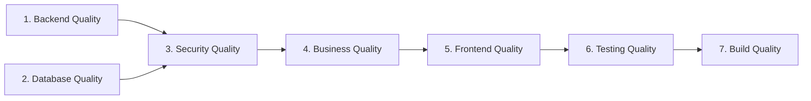

# Zaffe (زفّــة) — Global Definition of Done (DoD) (Release 1)

> **Mandatory Quality Gates & Acceptance Standards for Every Feature & Task**  
> **Status:** Living Standard | **Last Updated:** 2026-11-19 (`dev` `d88d381`) | **Target Markets:** Saudi Arabia & Egypt

---

## 1. Purpose & Core Standard

A feature or task is NOT complete simply because code has been written. A task is considered **DONE** and eligible for integration into the `dev` branch only when it satisfies all criteria across the seven quality dimensions below.

---

## 2. The Seven Dimensions of Done



---

### 2.1 Backend Quality
- **Architecture & Conventions:**
  - Adheres strictly to Laravel 13 MVC + Livewire 4 + Filament 5 layered structure.
  - Controllers remain thin and focused on HTTP orchestration; complex multi-step UI logic is handled in Livewire components or dedicated actions/services.
  - Strict typing enabled where appropriate (`declare(strict_types=1);` or typed properties/returns).
  - No duplicated business logic across controllers and Livewire components.
- **ORM & Database Queries:**
  - No N+1 query patterns introduced; eager loading (`with(...)`) used on relationships in list/view actions.
  - Atomic operations modifying multiple related tables use `DB::transaction(...)`.
  - Database access in customer dashboard is always isolated via `Auth::user()->invitations()`.
- **Error & Exception Handling:**
  - Exceptions are handled gracefully with user-friendly Arabic/English messages.
  - Unhandled raw exceptions or stack traces are never exposed to public users.
  - Failed email deliveries are logged with context and never crash user HTTP requests.

---

### 2.2 Database Quality
- **Schema Integrity:**
  - Foreign key constraints are defined with appropriate cascade or restrict rules (`onDelete('cascade')` or `onDelete('set null')`).
  - Columns have explicit nullability, default values, and appropriate data types.
  - Common query filters and search columns (`slug`, `user_id`, `status`, `phone`, `attendance_status`, `invite_token`, `qr_token`, `pass_code`) are properly indexed.
- **Migration Standards (Schema vs. Catalog Data Migrations — [AGENTS.md](../../AGENTS.md) Rule 12):**
  - **Schema migrations** must be reversible (`down()` properly reverses `up()`).
  - **Catalog / reference data migrations** (`invitation_templates`, `template_categories`, `platform_settings`) must NEVER live solely in `DatabaseSeeder.php`. They must be **idempotent and non-destructive** (guarded against empty `RefreshDatabase` test DBs, preserving existing admin `is_active` flags, explicitly `json_encode()`-ing JSON columns written via `DB::table()`, with non-destructive `down()` so live weddings keep valid `template_id` FKs).
  - All migrations must be compatible with both **SQLite 3** (local/testing) and **MySQL 8.4** (production target) while preserving existing user data.

---

### 2.3 Security Quality
- **Authentication & Authorization:**
  - Unauthenticated access to private resources is strictly prevented with middleware (`auth`).
  - Access to administrative resources (`/admin`) is gated by `User::canAccessPanel()` and all **8 explicit Laravel Policies** (`Invitation`, `InvitationTemplate`, `User`, `TemplateCategory`, `RsvpResponse`, `InvitationGuest`, `PlatformSetting`, `SubscriptionPlan`).
  - Insecure Direct Object References (IDOR) are prevented: customer queries scope via `Auth::user()->invitations()` and Livewire state carries `#[Locked]` (`$invitationId`, `$status`, `$guestId`, `$maxGuests`, `$maxChildren`, issued pass attributes).
  - Password reset tokens expire properly, are hashed in database, and are single-use.
- **Input Validation, HTTP Headers & Sanitization:**
  - All incoming request parameters and Livewire inputs are validated with strict Laravel rules.
  - CSV exports sanitize formula triggers (`=`, `+`, `-`, `@`, `\t`, `\r` after `ltrim`) via `App\Support\CsvSanitizer::cell()` with UTF-8 BOM.
  - `SecurityHeaders` middleware is preserved globally and strictly enforces `Referrer-Policy: no-referrer`, `X-Robots-Tag: noindex, nofollow`, and `Cache-Control: no-store, no-cache, must-revalidate, private` on `/pass/*` and personalized `/invitation/*?g=*` routes.
- **Upload & Media Safety:**
  - Uploaded files are validated for MIME type (`image/jpeg`, `image/png`, `image/webp`), extension, and size limits (max 5MB), with local storage cleanup on deletion.
- **Rate Limiting & Anti-Abuse:**
  - Rate limiting protects auth/password-reset (`throttle:6,1`), public RSVP submissions (10/min/IP/invitation), and personal QR passes `/pass/{qrToken}` (`throttle:60,1`).

---

### 2.4 Business Quality & Regional Requirements
- **Release 1 Free Launch Policy:**
  - All **14** active templates (`8` Saudi Signature Collection Vol. 1 + `6` baseline) and all editor customization features are completely free (`is_premium = false`).
  - No paywall blocks, subscription enforcement gates (`/admin/subscription-plans` returns `403`), or broken payment buttons.
- **Regional Localization & Saudi Directives ([SAUDI_MARKET_DECISIONS.md](../product/SAUDI_MARKET_DECISIONS.md)):**
  - Phone numbers support both Saudi Arabia (`+966`) and Egypt (`+20`) with E.164 normalization via `PhoneService`.
  - Event timezones (`Asia/Riyadh` / `Africa/Cairo`), Umm al-Qura Hijri conversion, and `latin`/`arabic_indic` digits are handled via `InvitationDateFormatter`.
  - **Template Cultural Rules:** SVG-only iconography via `<x-app-icon>` (zero Unicode emojis), zero external hotlinked images (self-hosted `.webp` only), photo-free luxury rendering support, user-tap audio open-gate, and exact PO-verified religious strings only.
- **Workflow Integrity:**
  - RSVP deadlines reject submissions after deadline; non-attending responses store `guest_count = 0` & `children_count = 0`; duplicate phone updates in-place without hijacking pre-invited (`is_self_registered = false`) guests.
  - Draft and archived invitations return `403` to non-owners/non-admins.
  - Isolated `F16` Part B (`/gate/{gateToken}`) remains off `dev` per [QR_FEATURE_ISOLATION_POLICY.md](../architecture/QR_FEATURE_ISOLATION_POLICY.md).

---

### 2.5 Frontend Quality
- **Responsive Layouts:**
  - Tested and functional across Mobile (375px–414px, WhatsApp WebView priority), Tablet (768px–1024px), and Desktop (1280px+).
  - Tested across all **14** wedding invitation themes.
- **Bilingual & Typography:**
  - Supports Arabic (`rtl`) and English (`ltr`) directions cleanly without physical-margin breakage.
  - Official typography loaded: `font-cairo`, `font-tajawal`, `font-amiri`, `font-playfair`.
- **UI States & Polish:**
  - Empty states, Livewire `wire:loading` feedback, `<bdi>` mixed-script isolation, and Alpine.js widgets (countdown, audio open-gate, share box).

---

### 2.6 Testing Quality
- **Automated Test Coverage:**
  - Every new feature or bug fix includes automated tests in `tests/Feature/` or `tests/Unit/` covering happy, negative, tampering, and (for catalog migrations) legacy-DB upgrade paths.
  - Full regression suite (**22** test files / **196+** tests running on **PHP `>= 8.4.1` with `ext-intl`**) must pass 100% green (`QrCheckInIsolationTest` inclusive).

---

### 2.7 Build & Static Quality
- **Automated Verification Suite (run on PHP `>= 8.4.1` + `ext-intl`):**
  ```powershell
  # 1. Composer & code style check
  composer validate --strict
  ./vendor/bin/pint --test

  # 2. Clear compiled views & run full test suite
  php artisan view:clear
  php artisan test

  # 3. Frontend asset compilation
  npm run build
  ```
- **Integrity Rule:** Never report a build, lint, or test as passing unless it was actually executed after final edits and exited with code `0`.
