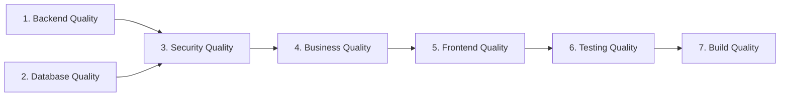

# Zaffe (زفّــة) — Global Definition of Done (DoD) (Release 1)

> **Mandatory Quality Gates & Acceptance Standards for Every Feature & Task**  
> **Status:** Officially Updated | **Date:** 2026-11-12 | **Target Markets:** Egypt & Saudi Arabia

---

## 1. Purpose & Core Standard

A feature or task is NOT complete simply because code has been written. A task is considered **DONE** and eligible for integration into the `dev` branch only when it satisfies all criteria across the seven quality dimensions below.

---

## 2. The Seven Dimensions of Done



---

### 2.1 Backend Quality
- **Architecture & Conventions:**
  - Adheres strictly to Laravel 13 MVC + Livewire 4 + Filament 5 layered structure.
  - Controllers remain thin and focused on HTTP orchestration; complex multi-step UI logic is handled in Livewire components or dedicated actions/services.
  - Strict typing enabled where appropriate (`declare(strict_types=1);` or typed properties/returns).
  - No duplicated business logic across controllers and Livewire components.
- **ORM & Database Queries:**
  - No N+1 query patterns introduced; eager loading (`with(...)`) used on relationships in list/view actions.
  - Atomic operations modifying multiple related tables use `DB::transaction(...)`.
  - Database access in customer dashboard is always isolated via `Auth::user()->invitations()`.
- **Error & Exception Handling:**
  - Exceptions are handled gracefully with user-friendly Arabic/English messages.
  - Unhandled raw exceptions or stack traces are never exposed to public users.
  - Failed email deliveries are logged with context and never crash user HTTP requests.

---

### 2.2 Database Quality
- **Schema Integrity:**
  - Foreign key constraints are defined with appropriate cascade or restrict rules (`onDelete('cascade')` or `onDelete('set null')`).
  - Columns have explicit nullability, default values, and appropriate data types.
  - Common query filters and search columns (`slug`, `user_id`, `status`, `phone`, `attendance_status`) are properly indexed.
- **Migration Standards:**
  - Migrations must be reversible (`down()` method properly reverses `up()`).
  - Migrations must be compatible with both **SQLite 3** (local/testing) and **MySQL 8.4** (production target).
  - Existing user and wedding data must be preserved.

---

### 2.3 Security Quality
- **Authentication & Authorization:**
  - Unauthenticated access to private resources is strictly prevented with middleware (`auth`).
  - Access to administrative resources (`/admin`) is gated by `User::canAccessPanel()` and role checks.
  - Insecure Direct Object References (IDOR) are prevented: IDs received from client requests or Livewire state are validated against `Auth::id()`.
  - Password reset tokens expire properly, are hashed in database, and are single-use.
- **Input Validation & Sanitization:**
  - All incoming request parameters and Livewire inputs are validated with strict Laravel rules.
  - CSV exports sanitize formula triggers (`=`, `+`, `-`, `@`) with a leading `'`, including inputs preceded by whitespace, tabs, or newlines.
- **Upload & Media Safety:**
  - Uploaded files are validated for MIME type (`image/jpeg`, `image/png`, `image/webp`), extension, and size limits (max 5MB).
  - Uploaded filenames are sanitized; files are stored using randomized hashes to prevent directory traversal.
- **Rate Limiting & Anti-Abuse:**
  - Rate limiting is applied to authentication attempts (6/min) and public RSVP submissions (10/min/IP).
  - Critical Livewire state properties carry the `#[Locked]` attribute.

---

### 2.4 Business Quality & Regional Requirements
- **Release 1 Free Launch Policy:**
  - All 6 templates and all editor customization features are completely free.
  - No paywall blocks, subscription enforcement gates, or broken payment buttons.
- **Regional Localization (Egypt & Saudi Arabia):**
  - Phone numbers support both Egypt (`+20`) and Saudi Arabia (`+966`) with standardized E.164 normalization.
  - Event timezones are explicitly configured per invitation (defaulting to `Africa/Cairo` or `Asia/Riyadh`).
  - Countdown timers and schedule displays calculate time based on the invitation's configured timezone.
- **Workflow Integrity:**
  - RSVP deadlines reject submissions after the deadline date.
  - Guest counts adhere to `max_guests_per_rsvp`.
  - Declining an RSVP strictly records `guest_count = 0`.
  - Duplicate RSVP phone numbers update existing records rather than inflating headcount.
  - Draft invitations are never visible to public visitors.

---

### 2.5 Frontend Quality
- **Responsive Layouts:**
  - Tested and functional across standard viewports: Mobile (375px–414px), Tablet (768px–1024px), and Desktop (1280px+).
  - Tested across all six wedding invitation themes.
- **Bilingual & Typography:**
  - Layouts support both Arabic (`rtl`) and English (`ltr`) directions without broken flex or grid alignments.
  - Official typography loaded and styled correctly: `font-cairo`, `font-tajawal`, `font-amiri`, `font-playfair`.
- **UI States & Polish:**
  - Empty states displayed when collections (invitations, guests, photos) are empty.
  - Loading states provided on Livewire asynchronous actions (`wire:loading`).
  - Form validation errors displayed with clear localized Arabic feedback.
  - Interactive widgets (countdown, audio player, share box) operate smoothly with Alpine.js.

---

### 2.6 Testing Quality
- **Automated Test Coverage:**
  - Every new feature or bug fix must include automated Feature tests in `tests/Feature/`.
  - Tests verify both the happy path and negative/tampering paths (e.g., unauthorized access, invalid inputs, edge cases).
  - Existing regression test suites (`AuditTest.php`, `WeddingPlatformTest.php`) must continue to pass 100% green.
- **Assertions:**
  - Assertions test database state (`assertDatabaseHas`, `assertDatabaseMissing`), HTTP status codes, and rendered view content.

---

### 2.7 Build & Static Quality
- **Automated Verification Suite:**
  Every task must verify cleanly with:
  ```powershell
  # 1. Composer validation
  composer validate --strict

  # 2. Automated test suite execution
  php artisan test

  # 3. Frontend asset compilation
  npm run build
  ```
- **Integrity Rule:** Never report a build or test as passing unless it was actually executed and exited with code 0.
