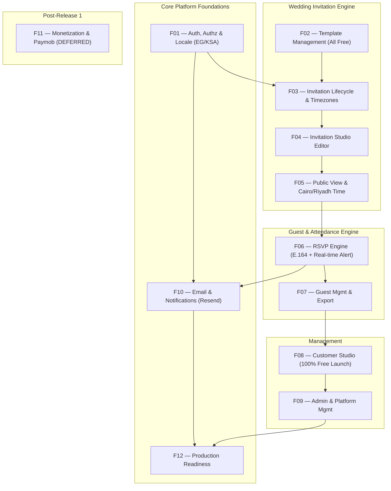

# Zaffe (زفّــة) — Feature Map & Domain Architecture Taxonomy (Release 1)

> **Comprehensive Mapping of SaaS Business Capabilities to Laravel Architecture**  
> **Status:** Officially Updated for Release 1 | **Date:** 2026-11-12 | **Target Markets:** Egypt & Saudi Arabia

---

## 1. Feature Map Overview

In accordance with official product directives ([docs/product/RELEASE_1_PRODUCT_DECISIONS.md](file:///e:/GithubProjects/Zaffe/docs/product/RELEASE_1_PRODUCT_DECISIONS.md)), Zaffe is organized into **11 Active Release 1 Feature Domains** and **1 Deferred Domain (F11)**:

---

## 2. Classification Legend

- `[ACTIVE - R1]`: Core feature domain required for Release 1 free launch.
- `[DEFERRED]`: Gated feature domain postponed until Post-Release 1.
- `[VERIFIED]`: Implemented in code and verified with passing automated tests.
- `[PARTIAL]`: Component structure exists, but core logic or integrations require implementation.
- `[IMPROVEMENT_NEEDED]`: Functional, but requires optimization, cleanup, or country-specific support.

---

## 3. Comprehensive Feature Domain Breakdown

### F01 — Authentication, Authorization & Localization `[ACTIVE - R1]`
- **Domain Mission:** User identity, secure session lifecycle, role-based authorization, Egypt (+20) and Saudi Arabia (+966) phone support, and bilingual Arabic RTL / English LTR support.
- **Components & Files:**
  - Controller: `app/Http/Controllers/AuthController.php`
  - Middleware: `app/Http/Middleware/SetLocale.php`
  - Models: `app/Models/User.php` (`role` enum: `'user'`, `'admin'`)
  - Views: `resources/views/auth/login.blade.php`, `register.blade.php`, `forgot-password.blade.php`, `reset-password.blade.php`
  - Routes: `routes/web.php:24-43`
  - Tests: `tests/Feature/AuditTest.php:29-44, 355-379`, `tests/Feature/WeddingPlatformTest.php:66-104`
- **Capability Audit:**
  - `[VERIFIED]` Registration (`POST /register`) with password confirmation and auto-login.
  - `[VERIFIED]` Login (`POST /login`) with session regeneration and remember-me.
  - `[VERIFIED]` Rate limiting (`throttle:6,1` with HTTP 429).
  - `[VERIFIED]` Role authorization (`User::canAccessPanel()` gates `/admin`).
  - `[VERIFIED]` Locale switching (`GET /lang/{locale}`) setting `session('locale')` with RTL/LTR directional support.
  - `[PARTIAL]` Password Reset Workflow: `sendResetLink` is a simulated placeholder. Requires real Laravel `Password::broker()`, token generation, notification dispatch, and reset form view.
  - `[IMPROVEMENT_NEEDED]` Country-aware phone input: Support Egypt (`+20`) and Saudi Arabia (`+966`) with E.164 normalization.

---

### F10 — Email & Notifications `[ACTIVE - R1]`
- **Domain Mission:** Transactional email infrastructure powered by **Resend** for password reset links, couple RSVP alerts, and guest confirmations.
- **Components & Files:**
  - Mail Config: `config/mail.php`
  - Mailer Integration: Resend via Laravel standard mail abstraction
  - Notification Classes: To be implemented in `app/Notifications/`
  - Queue Config: `config/queue.php` (lightweight `database` driver)
- **Capability Audit:**
  - `[PARTIAL]` Resend approved as provider. Currently `.env` uses `MAIL_MAILER=log`.
  - `[MISSING]` Password reset mailable/notification.
  - `[MISSING]` Couple notification on guest RSVP submission (`NewRsvpReceivedNotification`).
  - `[MISSING]` Guest confirmation mailable (`RsvpConfirmationNotification`).
  - `[MISSING]` Asynchronous queue delivery with error logging.

---

### F02 — Template Management & Discovery `[ACTIVE - R1]`
- **Domain Mission:** Presentation, filtering, and preview of all 6 luxury wedding themes — **100% free** in Release 1.
- **Components & Files:**
  - Models: `app/Models/TemplateCategory.php`, `app/Models/InvitationTemplate.php`
  - Controller: `app/Http/Controllers/HomeController.php:24-69`
  - Views: `resources/views/pages/templates.blade.php`, `preview-template.blade.php`
  - Templates: `resources/views/templates/` (`royal_gold`, `floral_romance`, `minimal_chic`, `islamic_elegance`, `emerald_night`, `classic_aristocrat`)
- **Capability Audit:**
  - `[VERIFIED]` All 6 templates rendered and verified by `AuditTest.php:320-340`.
  - `[VERIFIED]` Category filtering and search.
  - `[VERIFIED]` Interactive preview with mock data (`/templates/{slug}/preview`).
  - `[ACTIVE DIRECTIVE]` All templates are unlocked for all users. No premium gating in Release 1.
  - `[IMPROVEMENT_NEEDED]` Enforce inactive template rejection in catalog and creation wizard.

---

### F03 — Invitation Lifecycle & Publishing `[ACTIVE - R1]`
- **Domain Mission:** Invitation creation wizard, unique slug generation, draft state protection, event timezone tracking, and safe deletion.
- **Components & Files:**
  - Model: `app/Models/Invitation.php`
  - Controller: `app/Http/Controllers/DashboardController.php:38-131`
  - Livewire: `app/Livewire/InvitationEditor.php:218-228` (`togglePublish()`)
  - Migrations: `database/migrations/2026_01_01_000004_create_invitations_table.php`
- **Capability Audit:**
  - `[VERIFIED]` Creation wizard with unique slug generation and duplicate suffix incrementation.
  - `[VERIFIED]` Draft privacy protection (HTTP 403 unless owner or admin).
  - `[VERIFIED]` Real-time publishing toggle (`draft` vs `published`).
  - `[IMPROVEMENT_NEEDED]` Storage cleanup on deletion: Delete cover and gallery files from disk when an invitation is destroyed.
  - `[IMPROVEMENT_NEEDED]` Event timezone support: Add explicit `timezone` column (`Africa/Cairo` / `Asia/Riyadh`).

---

### F04 — Invitation Editor & Customization `[ACTIVE - R1]`
- **Domain Mission:** Real-time visual studio for couples to customize wedding details, colors, typography, agenda, dress code, and photos.
- **Components & Files:**
  - Livewire: `app/Livewire/InvitationEditor.php`
  - View: `resources/views/livewire/invitation-editor.blade.php`
  - Models: `app/Models/Invitation.php`, `app/Models/InvitationPhoto.php`, `app/Models/InvitationSection.php`
- **Capability Audit:**
  - `[VERIFIED]` Multi-tab editing, autosave, template switching, and gallery management.
  - `[VERIFIED]` IDOR protection via `getAuthorizedInvitation()` and `#[Locked]` state.
  - `[ACTIVE DIRECTIVE]` All customization features unlocked for all users in Release 1.
  - `[IMPROVEMENT_NEEDED]` Image optimization pipeline: Automatic WebP conversion and dimension capping (max 1600px width).
  - `[IMPROVEMENT_NEEDED]` Timezone configuration in event basics tab.

---

### F05 — Public Invitation Rendering `[ACTIVE - R1]`
- **Domain Mission:** Fast, responsive public wedding card delivery featuring event-specific timezones, background music, and WhatsApp sharing.
- **Components & Files:**
  - Controller: `app/Http/Controllers/InvitationController.php`
  - Views: `resources/views/templates/*.blade.php`
  - Partials: `resources/views/templates/partials/` (`countdown`, `music_player`, `share_box`, `timeline`, `gallery`, `dress_code`)
- **Capability Audit:**
  - `[VERIFIED]` Dynamic theme rendering across all 6 themes with shared modular section contract.
  - `[VERIFIED]` 1-click WhatsApp sharing with localized message and deep link.
  - `[IMPROVEMENT_NEEDED]` Timezone-aware countdown: Pin countdown calculations to the invitation's configured timezone (`Africa/Cairo` / `Asia/Riyadh`).
  - `[IMPROVEMENT_NEEDED]` View count optimization: Session-based deduplication to prevent database row-locking contention.
  - `[IMPROVEMENT_NEEDED]` Social meta tags: Dynamic OpenGraph tags for rich WhatsApp link previews.

---

### F06 — RSVP & Attendance Engine `[ACTIVE - R1]`
- **Domain Mission:** Interactive guest confirmation, companion tracking, deadline enforcement, phone deduplication, and couple notification alerts.
- **Components & Files:**
  - Livewire: `app/Livewire/RsvpForm.php`
  - Model: `app/Models/RsvpResponse.php`
  - View: `resources/views/livewire/rsvp-form.blade.php`
- **Capability Audit:**
  - `[VERIFIED]` Attendance statuses (`attending`, `declined`, `tentative`).
  - `[VERIFIED]` Deadline enforcement and guest count caps.
  - `[VERIFIED]` Declining attendance sets `guest_count = 0`.
  - `[VERIFIED]` Phone deduplication updates existing responses in-place.
  - `[VERIFIED]` Anti-abuse IP rate limiting (10/min).
  - `[IMPROVEMENT_NEEDED]` Country-aware phone formatting for Egypt (`+20`) and Saudi Arabia (`+966`) with E.164 normalization.
  - `[IMPROVEMENT_NEEDED]` Standardized dietary checkboxes (Vegetarian, Gluten-Free, Allergies).
  - `[IMPROVEMENT_NEEDED]` Dispatch real-time email notification (via F10) to the couple upon RSVP receipt.

---

### F07 — Guest Management & Export `[ACTIVE - R1]`
- **Domain Mission:** Customer Studio guest list analytics, searching, filtering, and Excel-ready CSV export with reinforced formula injection defense.
- **Components & Files:**
  - Controller: `app/Http/Controllers/DashboardController.php:133-212`
  - View: `resources/views/dashboard/guests.blade.php`
- **Capability Audit:**
  - `[VERIFIED]` RSVP overview metrics and paginated search.
  - `[VERIFIED]` Streamed CSV export with UTF-8 BOM.
  - `[VERIFIED]` Formula injection sanitization prefixing `=`, `+`, `-`, `@` with `'`.
  - `[IMPROVEMENT_NEEDED]` Enhanced sanitization regex catching formula triggers preceded by whitespace, tabs, or newlines.

---

### F08 — Customer Dashboard & Analytics `[ACTIVE - R1]`
- **Domain Mission:** Couple portal overview, invitation management, attendee analytics, and free launch communication.
- **Components & Files:**
  - Controller: `app/Http/Controllers/DashboardController.php:16-36, 214-247`
  - Views: `resources/views/dashboard/index.blade.php`, `resources/views/pages/pricing.blade.php`
- **Capability Audit:**
  - `[VERIFIED]` Real-time KPI metrics and invitation cards.
  - `[VERIFIED]` Profile update for name, email, phone, and password.
  - `[ACTIVE DIRECTIVE]` Update pricing page (`/pricing`) to communicate 100% free launch campaign; remove non-functional purchase buttons.
  - `[IMPROVEMENT_NEEDED]` Polished onboarding empty states for newly registered couples.

---

### F09 — Admin & Platform Management `[ACTIVE - R1]`
- **Domain Mission:** Filament v5 Super Admin backoffice for system oversight, template curation, and platform health.
- **Components & Files:**
  - Resources: `app/Filament/Resources/` (`Users`, `Invitations`, `InvitationTemplates`, `TemplateCategories`, `PlatformSettings`, `RsvpResponses`)
  - Widget: `app/Filament/Widgets/PlatformStatsOverview.php`
- **Capability Audit:**
  - `[VERIFIED]` Gated access for `role = 'admin'`.
  - `[VERIFIED]` Resource CRUD and platform overview stats.
  - `[ACTIVE DIRECTIVE]` Subscription and billing management excluded from Release 1 operational flows.
  - `[IMPROVEMENT_NEEDED]` Explicit Laravel Policies bound to Filament resources.

---

### F11 — Monetization & Subscription System `[DEFERRED — POST RELEASE 1]`
- **Domain Mission:** Commercial package tiers, Paymob payment gateway integration (Egypt & Saudi Arabia), and tier enforcement.
- **Release 1 Status:** **DEFERRED**.
- **Directives:** Zero payment gateway dependencies or checkout flows in Release 1. Existing schema preserved dormantly. Future integration documented for Paymob.

---

### F12 — Production Readiness & Performance `[ACTIVE - R1]`
- **Domain Mission:** MySQL 8.4 runtime validation, cloud/local storage privacy, lightweight queues, and security hardening.
- **Components & Files:**
  - Config: `config/database.php`, `config/filesystems.php`, `config/queue.php`, `config/cache.php`
- **Capability Audit:**
  - `[PARTIAL]` SQLite local/testing environment. MySQL 8.4 runtime test execution required.
  - `[ACTIVE DIRECTIVE]` Cost efficiency prioritized: Database queues and file/database caching used initially; Redis only when workload justifies it.
  - `[IMPROVEMENT_NEEDED]` Storage privacy: Prevent predictable public path access to unpublished draft photos.
