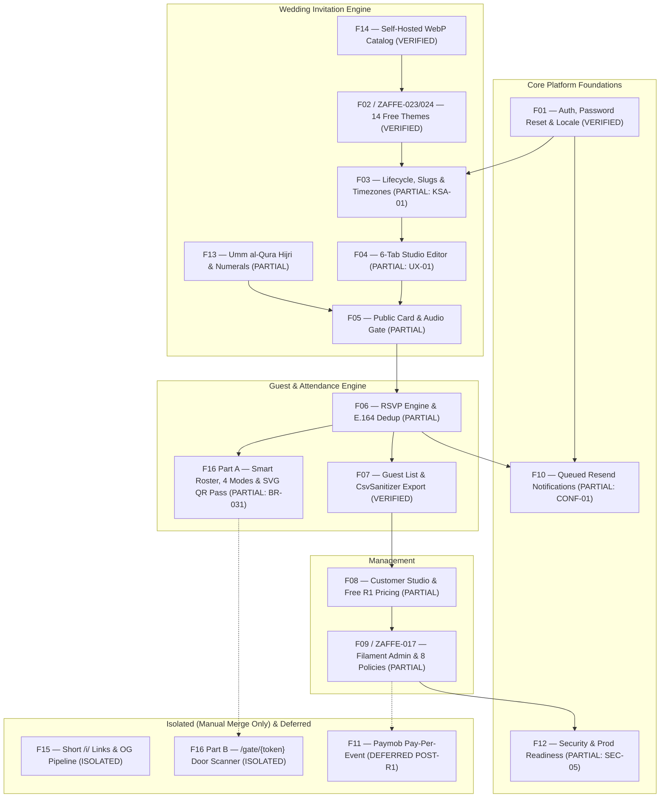

# Zaffe (زفّــة) — Feature Map & Domain Architecture Taxonomy (Release 1)

> **Comprehensive Mapping of SaaS Business Capabilities to Laravel Architecture**  
> **Status:** Living Architecture Map | **Last Updated:** 2026-11-19 (`dev` branch `d88d381`) | **Target Markets:** Saudi Arabia (First) & Egypt

---

## 1. Feature Map Overview

In accordance with official product directives ([RELEASE_1_PRODUCT_DECISIONS.md](../product/RELEASE_1_PRODUCT_DECISIONS.md) & [SAUDI_MARKET_DECISIONS.md](../product/SAUDI_MARKET_DECISIONS.md)), Zaffe tracks **14 Active Release 1 Feature Domains** (`F01`–`F10`, `F12`–`F14`, plus `F16` Part A), **2 Isolated / Owner-Manual Domains** (`F15`, `F16` Part B), and **1 Deferred Domain** (`F11`). *(For granular sub-feature classification across 34 items, see [project-discovery.md](../business/project-discovery.md) §5.)*

---

## 2. Classification Legend

- `[ACTIVE - R1]`: Feature domain enabled in `dev` for Release 1.
- `[ISOLATED — OWNER MANUAL ONLY]`: Implemented on a separate branch (`feature/ZAFFE-015-*` or `feature/ZAFFE-018-*`); never auto-merged into `dev`.
- `[DEFERRED]`: Postponed until Post-Release 1 (`F11`).
- `[VERIFIED]`: Implemented and verified in `dev` source code and automated PHPUnit tests.
- `[PARTIAL]`: Core functionality works in `dev`, with verified gaps documented below (and in [TECHNICAL_AUDIT.md](../architecture/TECHNICAL_AUDIT.md) §6).

---

## 3. Comprehensive Feature Domain Breakdown (`dev` `d88d381`)

### F01 — Authentication, Authorization & Localization `[ACTIVE - R1]`
- **Domain Mission:** User identity, password reset via Laravel Password Broker, `+20`/`+966` E.164 phone support (`PhoneService`), and Arabic/English locale switching.
- **Components & Files:**
  - Controller: `app/Http/Controllers/AuthController.php`
  - Service & Middleware: `app/Services/PhoneService.php`, `app/Http/Middleware/SetLocale.php`
  - Models: `app/Models/User.php` (`role`: `'user' | 'admin'`, `canAccessPanel()`)
  - Views & Lang: `resources/views/auth/{login,register,forgot-password,reset-password}.blade.php`, `lang/{ar,en}/admin.php` (417 keys)
  - Routes: `routes/web.php` (`login`, `register`, `forgot-password`, `reset-password/{token}`, `/logout`, `/lang/{locale}`)
  - Tests: `tests/Feature/AuthTest.php`, `tests/Feature/AuditTest.php`, `tests/Feature/WeddingPlatformTest.php`
- **Capability Audit:**
  - `[VERIFIED]` Registration, login, remember-me, session regeneration, logout, `throttle:6,1`, and `User::canAccessPanel()`.
  - `[VERIFIED]` Password reset broker + signed token form + queued `ResetPasswordNotification` *(minor UI email-enumeration signal remains in `AuthController.php:119-121`)*.
  - `[PARTIAL]` Localization coverage: Filament Admin has 100% AR/EN parity (417 keys); marketing/auth/dashboard use inline `$isEn` ternaries; `InvitationEditor`, `RsvpForm`, `invitation-show`, and `guest-pass` remain hardcoded Arabic.

---

### F10 — Email & Notifications `[ACTIVE - R1]`
- **Domain Mission:** Queued transactional email (`ShouldQueue`, `database` queue driver) via Resend for password resets, couple RSVP alerts, and guest confirmations.
- **Components & Files:**
  - Config: `config/mail.php` (`resend` SMTP & `resend_api`), `config/queue.php`
  - Notifications: `app/Notifications/{ResetPasswordNotification,NewRsvpNotification,RsvpConfirmationNotification}.php`
  - Tests: `tests/Feature/NotificationTest.php`, `tests/Feature/AuthTest.php`
- **Capability Audit:**
  - `[VERIFIED]` `ResetPasswordNotification`, `NewRsvpNotification` (`mail` + `database`), and `RsvpConfirmationNotification` (`mail`) queue cleanly.
  - `[PARTIAL]` Open config & payload gaps (`CONF-01`, `KSA-01`): `.env.example` empty `RESEND_API_KEY=` shadows `MAIL_PASSWORD`; `resend/resend-php` is not installed for `resend_api`; `config/mail.php` retains dead `encryption` key; `RsvpConfirmationNotification` fires even on `declined` with confirmation wording and omits `children_count` + QR pass URL; `NewRsvpNotification` omits `children_count` and has no customer in-app inbox UI.

---

### F02 & F14 — Template Management, Saudi Signature Collection & WebP Catalog `[ACTIVE - R1]`
- **Domain Mission:** Presentation, filtering, and preview of **14 active free wedding themes** (`8` Saudi Signature Collection — Vol. 1 ordered `1–8` via `ZAFFE-024`, `6` baseline ordered `9–14`) with self-hosted `.webp` thumbnails (**0 Unsplash URLs**).
- **Components & Files:**
  - Models & Support: `app/Models/{TemplateCategory,InvitationTemplate}.php`, `app/Support/TemplateStyleCatalog.php` (`resolveBladeView()` 14-view allowlist, `saudiSignatureSlugs()`)
  - Controller & Views: `app/Http/Controllers/HomeController.php`, `resources/views/pages/{templates,preview-template}.blade.php`
  - Assets & Data: `public/images/templates/*.webp` (14 files), `database/migrations/{2026_11_14_000002,2026_11_15_000001,2026_11_19_000001}*.php`, `database/seeders/DatabaseSeeder.php`
  - Templates: `resources/views/templates/` (`diriyah_heritage`, `rawashin_elegance`, `sadu_signature`, `taif_rose`, `palm_oasis`, `red_sea_pearl`, `desert_dusk`, `modern_monogram`, `royal_gold`, `floral_romance`, `minimal_chic`, `islamic_elegance`, `emerald_night`, `classic_aristocrat`)
  - Tests: `TemplateManagementTest.php`, `SaudiSignatureTemplateCollectionTest.php`, `AuditTest.php`
- **Capability Audit:**
  - `[VERIFIED]` All 14 templates unlocked free (`is_premium = false`), inactive category/template filtering (`availableForSelection()`), allowlist view fallback, self-hosted `.webp` previews (`F14`), and idempotent `ZAFFE-024` sort migration (`1–8` Vol. 1, `9–14` baseline).
  - `[PARTIAL]` `/pricing` & `/about` still display stale `"6 themes"` marketing copy (`UX-01`); `public/images/og-zaffe.jpg` is missing.

---

### F03 & F13 — Invitation Lifecycle, Publishing & Saudi Hijri Formatter `[ACTIVE - R1]`
- **Domain Mission:** Wizard creation, slug uniqueness, draft/archive privacy (`403`), event timezones, Umm al-Qura Hijri + Gregorian formatting, and local media cleanup.
- **Components & Files:**
  - Model, Services & Controllers: `Invitation.php`, `InvitationDateFormatter.php`, `DashboardController.php`, `InvitationController.php`
  - Migrations: `2026_01_01_000004`, `2026_11_13_000615_add_timezone_to_invitations_table.php`
  - Tests: `InvitationLifecycleTest.php`, `InvitationDateFormatterTest.php`, `PublicInvitationTest.php`
- **Capability Audit:**
  - `[VERIFIED]` Unique slug generator (`{groom}-and-{bride}` / `wedding-{random}`), draft & archive `403` guard, publish/draft toggle & `POST /archive` route, customer deletion cleanup, and `InvitationDateFormatter` Umm al-Qura + `latin`/`arabic_indic`.
  - `[PARTIAL]` `bride_name` remains `NOT NULL` and `required` across schema/controllers/editor/Filament (`KSA-01`); customers have no UI control for `archive`; `Invitation::deleting()` skips `http(s)://` media URLs on Admin delete (`DATA-01`); `Invitation::saving()` mode-vs-toggle edge case on `announcement` -> `rsvp_qr`.

---

### F04 — Visual Studio Editor & Customization `[ACTIVE - R1]`
- **Domain Mission:** Real-time 6-tab Livewire studio (`basics`, `content`, `design`, `media`, `templates`, `rsvp`) + Publish Share Modal for free customization.
- **Components & Files:**
  - Livewire & View: `app/Livewire/InvitationEditor.php`, `resources/views/livewire/invitation-editor.blade.php`
  - Models: `Invitation.php`, `InvitationPhoto.php`, `InvitationSection.php`
  - Tests: `InvitationEditorTest.php`, `AuditTest.php`
- **Capability Audit:**
  - `[VERIFIED]` `#[Locked]` `$invitationId` and `$status`, `getAuthorizedInvitation()`, autosave, timezone/digit/mode controls, on-the-fly template switching, `5MB` MIME-validated photo uploads with customer deletion cleanup, Publish Share Modal.
  - `[PARTIAL]` `timeline` & `dress_code` sections are boolean visibility toggles only (no item/attire editors); automated server-side image resizing/WebP compression (`PERF-02`) remains deferred Post-Release 1; `emerald_night` & `desert_dusk` ignore user palette overrides and `islamic_elegance` ignores `welcome_message` (`KSA-01`).

---

### F05 — Public Invitation Rendering & Mobile Audio Gate `[ACTIVE - R1]`
- **Domain Mission:** Fast, WhatsApp-WebView-friendly public wedding card delivery, session-deduplicated views, user-tap audio gate, and OpenGraph meta tags.
- **Components & Files:**
  - Controller & Views: `app/Http/Controllers/InvitationController.php`, `resources/views/pages/invitation-show.blade.php`, `resources/views/templates/*.blade.php`
  - Partials: `resources/views/templates/partials/` (`access_section`, `ceremony_stages`, `countdown`, `dress_code`, `gallery`, `music_player`, `share_box`, `timeline`)
  - Tests: `PublicInvitationTest.php`, `SaudiSignatureTemplateCollectionTest.php`
- **Capability Audit:**
  - `[VERIFIED]` 14 templates + zero-photo fallback, `Asia/Riyadh`/`Africa/Cairo` timezone target, interactive `music_player.blade.php` tap open-gate, `SecurityHeaders` (`no-referrer`/`noindex`/`no-store` on `?g=*`), session `viewed_invitation_{id}` deduplication.
  - `[PARTIAL]` `countdown.blade.php` ignores `arabic_indic` numerals; `timeline.blade.php:33` has invalid `--tw-before-bg`; `share_box.blade.php:30` uses unguarded clipboard call; template footers link to `/` instead of `/templates?ref=invite`.

---

### F06 — RSVP & Attendance Engine `[ACTIVE - R1]`
- **Domain Mission:** Interactive guest confirmation, adult/child quotas, deadline enforcement, E.164 phone deduplication, hijack protection, and queued notifications.
- **Components & Files:**
  - Livewire & View: `app/Livewire/RsvpForm.php`, `resources/views/livewire/rsvp-form.blade.php`
  - Model & Service: `app/Models/RsvpResponse.php`, `app/Services/PhoneService.php`
  - Tests: `RsvpEngineTest.php`, `AuditTest.php`, `NotificationTest.php`
- **Capability Audit:**
  - `[VERIFIED]` `attending`/`declined`/`tentative` statuses, deadline cutoff, non-attending zeroing (`guest_count = 0`, `children_count = 0`), `+20`/`+966` E.164 normalization & in-place phone update, `10/min/IP/invitation` rate limit, pre-invited hijack guard, `$passPreviouslyIssued` suppression on open re-submit, real-time `NewRsvpNotification` & `RsvpConfirmationNotification` dispatch.
  - `[PARTIAL]` `tentative` validation still requires `guest_count >= 1` despite storing `0`; `RsvpForm` UI remains Arabic-only; residual `"بطاقة دخول"` text exists in `rsvp-form.blade.php` / `access_section.blade.php`.

---

### F07 — Guest Management & Secure Export `[ACTIVE - R1]`
- **Domain Mission:** Customer Studio RSVP + pre-invited roster management, filtering, and UTF-8 BOM formula-safe CSV downloads.
- **Components & Files:**
  - Controller, Support & View: `DashboardController.php` (`guests()`, `exportGuestsCsv()`, `exportRosterCsv()`), `App\Support\CsvSanitizer`, `resources/views/dashboard/guests.blade.php`
  - Tests: `GuestManagementTest.php`, `SmartGuestAndQrCheckInTest.php`, `AuditTest.php`
- **Capability Audit:**
  - `[VERIFIED]` Paginated search/filter + streamlined exports using `CsvSanitizer::cell()` (`=`, `+`, `-`, `@`, `\t`, `\r` after `ltrim`) and UTF-8 BOM.

---

### F08 — Customer Dashboard, Studio KPIs & Marketing Pages `[ACTIVE - R1]`
- **Domain Mission:** Couple dashboard metrics, invitation index, profile management, and Free Release 1 landing/pricing/informational pages.
- **Components & Files:**
  - Controllers & Views: `DashboardController.php` (`index`, `invitations`, `profile`), `HomeController.php`, `views/dashboard/*`, `views/pages/{home,pricing,about,contact,faq}.blade.php`
  - Tests: `CustomerDashboardTest.php`, `ProductQaValidationTest.php`
- **Capability Audit:**
  - `[VERIFIED]` Scoped studio metrics, E.164 profile normalization & password update, free Release 1 pricing communication.
  - `[PARTIAL]` `DashboardController::index()` omits `children_count` (unlike `guests()`), mislabels `archived` as Draft, and leaks `"مشاهدة"`; `/dashboard/invitations` lacks Publish/Archive controls (Delete only); `/contact` form is Alpine simulation only (`UX-01`); `/pricing` & `/about` say "6 themes"; legacy duplicate `resources/views/layouts/` + `welcome.blade.php` + `<x-icon>` remain on disk.

---

### F09 — Admin & Platform Management (`ZAFFE-017` / `ZAFFE-020`) `[ACTIVE - R1]`
- **Domain Mission:** Filament v5 Super Admin backoffice (`/admin`) governing users, invitations, visual template styles, categories, RSVPs, guest passes, settings, and operations monitoring under explicit Policies.
- **Components & Files:**
  - Resources (`app/Filament/Resources/`): `Users`, `Invitations`, `InvitationTemplates` (`InvitationTemplateForm` 3-column visual editor, 14 presets, WCAG preview, locked `is_premium = false`), `TemplateCategories`, `RsvpResponses`, `InvitationGuests`, `PlatformSettings` (2-tab `PlatformSettingCatalog` workspace), plus disabled `SubscriptionPlans` (`403`)
  - Pages, Widget & CLI: `OperationsMonitor.php` (`/admin/operations-monitor`), `PlatformStatsOverview.php`, `CreateAdminUser.php` (`zaffe:create-admin`), `AdminPanelProvider.php`
  - Policies (`app/Policies/`): **8 Policies** (`Invitation`, `InvitationTemplate`, `User`, `TemplateCategory`, `RsvpResponse`, `InvitationGuest`, `PlatformSetting`, `SubscriptionPlan`)
  - Tests: `AdminManagementTest.php`, `AdminFeatureCoverageTest.php`, `ProductionReadinessTest.php`
- **Capability Audit:**
  - `[VERIFIED]` 7 active resources, 417-key AR/EN parity, 8 Policies, locked `SubscriptionPlanResource`, CLI admin provisioning, cache-invalidating `PlatformSetting`.
  - `[PARTIAL]` Confirmed open bugs (`SEC-05`, `SEC-06`, `DATA-01`, `DATA-02`): missing `SecurityHeaders` on `/admin/*`; unguarded bulk-delete on canonical `PlatformSetting` keys; Admin delete orphans `http(s)://` media URLs; `User::$fillable` omits `email_verified_at` & relative `avatar_url` fails `->url()`; `TemplateCategoryForm` lacks `->default(true)`; `ListRsvpResponses::exportCsv` ignores filters & omits `children_count`; `InvitationGuestResource` unlocalized badges & nav-sort `3` collision; `OperationsMonitor` lacks KPI #1 (`Wizard-Start`) & KPI #2 (`>= 10` guests).

---

### F12 — Security Hardening & Production Readiness `[ACTIVE - R1]`
- **Domain Mission:** HTTP security headers, composite query indexes, database queue readiness, runtime compatibility, and staging deployment verification.
- **Components & Files:**
  - Middleware & Config: `app/Http/Middleware/SecurityHeaders.php`, `bootstrap/app.php`, `config/{database,filesystems,queue,cache,mail}.php`, `database/migrations/2026_11_14_000001_add_performance_indexes.php`
  - Tests: `ProductionReadinessTest.php`, `AuditTest.php`
- **Capability Audit:**
  - `[VERIFIED]` Global web `SecurityHeaders` + strict `no-referrer`/`noindex`/`no-store` on `/pass/*` & `?g=*`, composite indexes, `/up` probe.
  - `[PARTIAL]` `SEC-05` (`/admin/*` missing `SecurityHeaders`), `CONF-01` (`composer.json` `^8.3` vs `composer.lock` `>= 8.4.1`, `ext-intl` mandatory, Resend config traps), MySQL 8.4 staging run pending.

---

### F16 (Part A) — Smart Guest Roster, 4 Modes & QR Pass Generation `[ACTIVE - R1 | Scope Conflict BR-031]`
- **Domain Mission:** Free pre-invited guest roster, bulk CSV/paste import, 4 invitation modes, `?g=` personalized links, and pure-PHP SVG QR passes `/pass/{qrToken}`.
- **Components & Files:**
  - Models, Services, Controllers & Livewire: `InvitationGuest.php`, `Invitation.php`, `InvitationGuestPolicy.php`, `QrCodeService.php`, `GuestPassController.php`, `GuestRosterManager.php`, `InvitationGuestResource`
  - Views: `resources/views/livewire/guest-roster-manager.blade.php`, `resources/views/pages/guest-pass.blade.php`, `resources/views/templates/partials/access_section.blade.php`
  - Tests: `QrCodeServiceTest.php`, `SmartGuestAndQrCheckInTest.php`, `QrCheckInIsolationTest.php`
- **Capability Audit:**
  - `[VERIFIED]` 4 modes (`rsvp_qr`, `rsvp_only`, `qr_only`, `announcement`), bulk CSV/paste import + formula-safe roster export, per-guest quotas & WA tracking, pure-PHP SVG `/pass/{qrToken}` (`throttle:60,1`).
  - `[PARTIAL]` **Governance conflict (`BR-031`):** Flagged as P0 scope concern in [ZAFFE_FINAL_QA_REPORT.md](../qa/reports/ZAFFE_FINAL_QA_REPORT.md) vs. approved active R1 scope in [QR_FEATURE_ISOLATION_POLICY.md](../architecture/QR_FEATURE_ISOLATION_POLICY.md) & [RELEASE_1_PRODUCT_DECISIONS.md](../product/RELEASE_1_PRODUCT_DECISIONS.md) — awaits PO sign-off; residual `"بطاقة دخول"` text cleanup + missing watermark footer on `guest-pass.blade.php`.

---

### Isolated Branches (NOT in `dev` — Owner Manual Merge Only)
- **`F16` (Part B) — QR Scanning & Gatekeeper Check-In (`origin/feature/ZAFFE-018-smart-guests-and-qr-checkin` `de01adc`):** `/gate/{gateToken}`, `GateScanner`, `InvitationGate`, `InvitationGatePolicy`, single-use `checked_in_at` lock. Isolated by [QR_FEATURE_ISOLATION_POLICY.md](../architecture/QR_FEATURE_ISOLATION_POLICY.md) (`invitation_gates` table & `checked_in_*` columns remain dormant in `dev`).
- **`F15` — Short URLs, Cached Dynamic OG Tags & Async WebP (`origin/feature/ZAFFE-015-short-urls-and-og-tags` `3e4eda0`):** Owner Manual Only per [GIT_WORKFLOW.md](GIT_WORKFLOW.md) §3.3.
- **`ZAFFE-017` Wizard Prototype (`feature/ZAFFE-017-create-invitation-wizard` `7091c47`):** Local-only, On Hold.

---

### F11 — Monetization & One-Time Pay-Per-Invitation Checkout `[DEFERRED — POST RELEASE 1]`
- **Domain Mission:** Future one-time pay-per-invitation checkout via **Paymob** (`SAR` / `EGP` dynamically via `PlatformSetting`) behind a feature flag ([RELEASE_1_PRODUCT_DECISIONS.md](../product/RELEASE_1_PRODUCT_DECISIONS.md), [SAUDI_MARKET_DECISIONS.md](../product/SAUDI_MARKET_DECISIONS.md) §8).
- **Current State:** `subscription_plans` & `user_subscriptions` schema dormant; `SubscriptionPlanResource::canAccess()` & `SubscriptionPlanPolicy` return `false` (`403`); zero payment code or checkout routes in `dev`. See [F11_DEFERRED_MONETIZATION_NOTE.md](briefs/F11_DEFERRED_MONETIZATION_NOTE.md).
