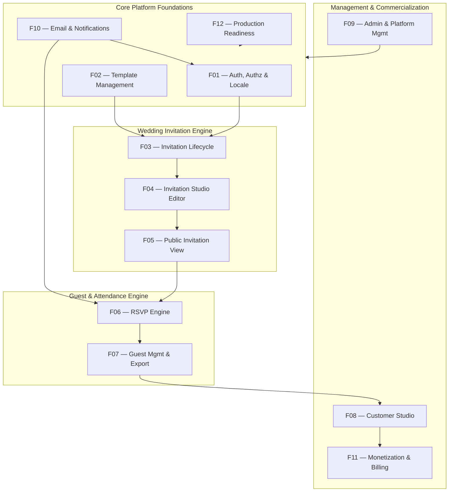

# Zaffe (زفّــة) — Feature Map & Domain Architecture Taxonomy

> **Comprehensive Mapping of SaaS Business Capabilities to Laravel Architecture**  
> **Status:** Current Baseline Audit | **Date:** 2026-11-12

---

## 1. Feature Map Overview

To avoid disjointed or monolithic development, the Zaffe backend and frontend are organized into **12 distinct business and architectural domains**:

---

## 2. Classification Legend

Every capability in the application is audited and classified into one of five states:
- `[VERIFIED]`: **Implemented and Verified** — Confirmed working in code and covered by passing automated tests.
- `[VALIDATION_NEEDED]`: **Implemented but Needs Validation** — Implemented in code, but requires edge-case verification or browser testing.
- `[PARTIAL]`: **Partially Implemented** — Component structure or UI exists, but core logic, notifications, or backend integrations are missing.
- `[MISSING]`: **Missing** — Planned domain capability with no functional backend or UI implementation.
- `[IMPROVEMENT_NEEDED]`: **Requires Improvement** — Functional, but contains known bottlenecks, technical debt, or optimization opportunities.

---

## 3. Comprehensive Feature Domain Breakdown

### F01 — Authentication, Authorization & Localization
- **Domain Mission:** User identity, secure session lifecycle, role-based authorization, and seamless Arabic RTL / English LTR multilingual switching.
- **Components & Files:**
  - Controller: `app/Http/Controllers/AuthController.php`
  - Middleware: `app/Http/Middleware/SetLocale.php`
  - Models: `app/Models/User.php` (`role` enum: `'user'`, `'admin'`)
  - Views: `resources/views/auth/login.blade.php`, `register.blade.php`, `forgot-password.blade.php`, `reset-password.blade.php`
  - Routes: `routes/web.php:24-43`
  - Tests: `tests/Feature/AuditTest.php:29-44, 355-379`, `tests/Feature/WeddingPlatformTest.php:66-104`
- **Capability Audit:**
  - `[VERIFIED]` User Registration (`POST /register`) with password confirmation and auto-login.
  - `[VERIFIED]` User Login (`POST /login`) with session regeneration and 'Remember Me'.
  - `[VERIFIED]` Authentication Throttling (`throttle:6,1` with HTTP 429 Too Many Requests).
  - `[VERIFIED]` Role-Based Panel Gate (`User::canAccessPanel()` blocks non-admins with HTTP 403).
  - `[VERIFIED]` Multilingual Locale Switching (`GET /lang/{locale}`) setting `session('locale')` with RTL/LTR directional support.
  - `[PARTIAL]` Password Reset Workflow: `AuthController::sendResetLink()` is a simulated response; Laravel `Password::broker()` and actual reset notification tokens are missing.

---

### F02 — Template Management & Discovery
- **Domain Mission:** Organization, presentation, filtering, and preview of luxury wedding invitation themes.
- **Components & Files:**
  - Models: `app/Models/TemplateCategory.php`, `app/Models/InvitationTemplate.php`
  - Controller: `app/Http/Controllers/HomeController.php:24-69` (`templates()`, `previewTemplate()`)
  - Admin Resource: `app/Filament/Resources/InvitationTemplates/`, `app/Filament/Resources/TemplateCategories/`
  - Views: `resources/views/pages/templates.blade.php`, `resources/views/pages/preview-template.blade.php`
  - Template Views: `resources/views/templates/` (`royal_gold`, `floral_romance`, `minimal_chic`, `islamic_elegance`, `emerald_night`, `classic_aristocrat`)
  - Tests: `tests/Feature/AuditTest.php:320-353`, `tests/Feature/WeddingPlatformTest.php:35-49`
- **Capability Audit:**
  - `[VERIFIED]` Template categorization into distinct aesthetic categories (`luxury`, `floral`, `minimal`, `islamic`, `classic`, `romantic`).
  - `[VERIFIED]` Search & filtering by category slug and Arabic/English keyword search.
  - `[VERIFIED]` Live interactive template preview with dynamic mock data (`/templates/{slug}/preview`).
  - `[VERIFIED]` Admin CRUD for categories, templates, default color schemes, and active statuses.
  - `[VALIDATION_NEEDED]` Template selection validation: Verify that deactivated templates (`is_active = false`) are strictly rejected during invitation creation and template switching.

---

### F03 — Invitation Lifecycle & Publishing
- **Domain Mission:** Management of invitation ownership, creation wizard, unique slug generation, draft state protection, and lifecycle transitions (`draft`, `published`, `archived`).
- **Components & Files:**
  - Model: `app/Models/Invitation.php`
  - Controller: `app/Http/Controllers/DashboardController.php:38-131` (`create()`, `store()`, `destroy()`)
  - Livewire: `app/Livewire/InvitationEditor.php:218-228` (`togglePublish()`)
  - Migrations: `database/migrations/2026_01_01_000004_create_invitations_table.php`
  - Views: `resources/views/dashboard/create.blade.php`, `resources/views/pages/unpublished.blade.php`
  - Tests: `tests/Feature/AuditTest.php:57-94, 146-166, 381-411, 454-465`, `tests/Feature/WeddingPlatformTest.php:106-129`
- **Capability Audit:**
  - `[VERIFIED]` Creation wizard with template selection and event basics.
  - `[VERIFIED]` Unique slug generation algorithm: Handles Arabic names via transliteration and appends sequential `-1`, `-2` suffixes upon collisions.
  - `[VERIFIED]` Draft privacy protection: Unpublished invitations return HTTP 403 to public visitors while allowing access to the verified owner and platform admins.
  - `[VERIFIED]` Real-time publishing toggle (`status` toggling between `'draft'` and `'published'`).
  - `[IMPROVEMENT_NEEDED]` Deletion cleanup: `DashboardController::destroy()` deletes database records but leaves cover images and gallery photos orphaned on storage.
  - `[IMPROVEMENT_NEEDED]` Archival lifecycle: The `'archived'` status exists in DB schema enum but has no exposed management workflow in UI.

---

### F04 — Invitation Editor & Customization
- **Domain Mission:** High-productivity Livewire visual studio enabling real-time wedding detail customization, responsive phone preview mockups, style overrides, and media management.
- **Components & Files:**
  - Livewire Component: `app/Livewire/InvitationEditor.php`
  - Blade View: `resources/views/livewire/invitation-editor.blade.php`
  - Models: `app/Models/Invitation.php`, `app/Models/InvitationPhoto.php`, `app/Models/InvitationSection.php`
  - Tests: `tests/Feature/AuditTest.php:46-55, 96-186, 256-318`
- **Capability Audit:**
  - `[VERIFIED]` Multi-tab navigation: Basics, Content, Design, Media, Sections, Share.
  - `[VERIFIED]` Autosave mechanism: Syncs form updates to database and recalculates styles.
  - `[VERIFIED]` Template switching: Allows couples to change themes dynamically while preserving customized event details.
  - `[VERIFIED]` IDOR Prevention: Locked component state (`#[Locked]`) and server-side authorization check (`getAuthorizedInvitation()`).
  - `[VERIFIED]` Media uploads & gallery management with 5MB validation and immediate storage deletion on gallery photo removal.
  - `[IMPROVEMENT_NEEDED]` Image optimization: Uploads are stored as raw high-resolution files without WebP conversion or dimension capping.
  - `[IMPROVEMENT_NEEDED]` Private draft media security: Draft images in `public/storage` are accessible if URLs are guessed.

---

### F05 — Public Invitation Rendering
- **Domain Mission:** Pixel-perfect delivery of luxury responsive wedding cards on mobile, tablet, and desktop viewports, complete with background music, countdowns, and social sharing.
- **Components & Files:**
  - Controller: `app/Http/Controllers/InvitationController.php` (`show()`)
  - Views: `resources/views/templates/*.blade.php` (6 themes)
  - Partials: `resources/views/templates/partials/` (`countdown`, `music_player`, `share_box`, `timeline`, `gallery`, `dress_code`)
  - Tests: `tests/Feature/AuditTest.php:320-340`, `tests/Feature/WeddingPlatformTest.php:57-65`
- **Capability Audit:**
  - `[VERIFIED]` Dynamic theme rendering based on selected template view and effective styles.
  - `[VERIFIED]` Real-time countdown timer powered by Alpine.js calculating time remaining until wedding moment.
  - `[VERIFIED]` Floating background music player with play/pause and looping audio.
  - `[VERIFIED]` Modular section contract: All 6 templates consistently support countdown, timeline, gallery, dress code, RSVP, and share box.
  - `[VERIFIED]` Native 1-click WhatsApp sharing with localized invite message and public deep link.
  - `[IMPROVEMENT_NEEDED]` Synchronous view count increment: `$invitation->increment('view_count')` runs on every HTTP request without throttling or queueing.
  - `[IMPROVEMENT_NEEDED]` Social Meta Tags: Dynamic OpenGraph (`og:image`, `og:title`, `og:description`) need optimization for WhatsApp chat previews.

---

### F06 — RSVP & Attendance Engine
- **Domain Mission:** Interactive guest confirmation, companion tracking, dietary notes, strict deadline enforcement, and anti-abuse safeguards.
- **Components & Files:**
  - Livewire Component: `app/Livewire/RsvpForm.php`
  - Model: `app/Models/RsvpResponse.php`
  - View: `resources/views/livewire/rsvp-form.blade.php`
  - Tests: `tests/Feature/AuditTest.php:188-254, 467-503`, `tests/Feature/WeddingPlatformTest.php:131-150`
- **Capability Audit:**
  - `[VERIFIED]` Attendance statuses: Attending (`attending`), Declining (`declined`), Tentative (`tentative`).
  - `[VERIFIED]` Deadline enforcement: Rejects RSVP submissions when `rsvp_deadline` is in the past.
  - `[VERIFIED]` Maximum guest limit: Enforces `max_guests_per_rsvp` configured per invitation.
  - `[VERIFIED]` Decline headcount coherence: Forcibly sets `guest_count = 0` when declining.
  - `[VERIFIED]` Duplicate phone deduplication: Updates existing guest response rather than creating inflated duplicate records.
  - `[VERIFIED]` Anti-abuse rate limiting: Enforces max 10 submissions per minute per IP address.
  - `[VALIDATION_NEEDED]` Standardized dietary preferences: Add pre-set dietary choices (Vegetarian, Gluten-Free, Vegan) alongside free-form notes.

---

### F07 — Guest Management & Export
- **Domain Mission:** Customer Studio guest list analytics, searching, filtering, and Excel-ready CSV export with formula injection defense.
- **Components & Files:**
  - Controller: `app/Http/Controllers/DashboardController.php:133-212` (`guests()`, `exportGuestsCsv()`)
  - View: `resources/views/dashboard/guests.blade.php`
  - Tests: `tests/Feature/AuditTest.php:412-453`, `tests/Feature/WeddingPlatformTest.php:151-165`
- **Capability Audit:**
  - `[VERIFIED]` RSVP overview metrics: Total RSVPs, attending count, total guests sum, declined count.
  - `[VERIFIED]` Guest search across name, phone number, and personal message.
  - `[VERIFIED]` Status filtering (`attending`, `declined`, `tentative`) with paginated results.
  - `[VERIFIED]` CSV export streaming with UTF-8 Byte Order Mark (`0xEF, 0xBB, 0xBF`) for Arabic Excel rendering.
  - `[VERIFIED]` CSV formula injection defense: Sanitizes `=`, `+`, `-`, `@` with a leading `'`.
  - `[IMPROVEMENT_NEEDED]` Leading whitespace formula injection defense: Extend sanitization to catch formula characters following tabs (`\t`), spaces, or carriage returns (`\r\n`).

---

### F08 — Customer Dashboard & Analytics
- **Domain Mission:** Couple portal overview, invitation management table, aggregate attendance statistics, and account profile editing.
- **Components & Files:**
  - Controller: `app/Http/Controllers/DashboardController.php:16-36, 214-247` (`index()`, `profile()`, `updateProfile()`)
  - Views: `resources/views/dashboard/index.blade.php`, `resources/views/dashboard/profile.blade.php`
  - Tests: `tests/Feature/WeddingPlatformTest.php:92-104`
- **Capability Audit:**
  - `[VERIFIED]` Real-time KPI cards: Total invitations, total RSVPs received, confirmed attendees, total views.
  - `[VERIFIED]` Invitation management cards: Quick links to editor, live preview, guest list, and WhatsApp sharing.
  - `[VERIFIED]` Profile settings: Update account name, email, phone, and password with current password verification.
  - `[IMPROVEMENT_NEEDED]` Empty state polish: Enhance UX for newly registered couples with guided next-step prompts.

---

### F09 — Admin & Platform Management
- **Domain Mission:** Filament v5 Super Admin backoffice for full system oversight, catalog curation, plan configuration, and platform metrics.
- **Components & Files:**
  - Provider: `app/Providers/Filament/AdminPanelProvider.php`
  - Resources: `app/Filament/Resources/` (`Users`, `Invitations`, `InvitationTemplates`, `TemplateCategories`, `SubscriptionPlans`, `PlatformSettings`, `RsvpResponses`)
  - Widget: `app/Filament/Widgets/PlatformStatsOverview.php`
  - Tests: `tests/Feature/AuditTest.php:29-44`
- **Capability Audit:**
  - `[VERIFIED]` Super admin panel gating via `User::canAccessPanel()`.
  - `[VERIFIED]` Resource CRUD for users, wedding invitations, template catalogs, categories, plans, and platform settings.
  - `[VERIFIED]` Platform analytics overview widget.
  - `[IMPROVEMENT_NEEDED]` Granular Laravel Policies: Explicit Filament resource policy bindings for fine-grained authorization.

---

### F10 — Email & Notifications
- **Domain Mission:** Transactional email infrastructure for account security, couple RSVP notifications, and guest confirmations.
- **Components & Files:**
  - Configuration: `config/mail.php`, `config/queue.php`
  - Controllers: `app/Http/Controllers/AuthController.php:90-101`
- **Capability Audit:**
  - `[MISSING]` Password reset mailable/notification.
  - `[MISSING]` Couple email alert when a guest submits an RSVP.
  - `[MISSING]` Guest RSVP confirmation email.
  - `[MISSING]` Production transactional email driver configuration (e.g., SMTP / SES / Resend) with queued delivery.

---

### F11 — Monetization & Subscription System
- **Domain Mission:** Commercial package tiers, payment gateway checkout, webhook handling, and tier entitlement enforcement.
- **Components & Files:**
  - Models: `app/Models/SubscriptionPlan.php`, `app/Models/UserSubscription.php`
  - Migrations: `database/migrations/2026_01_01_000008_create_subscription_plans_table.php`
  - Public Page: `resources/views/pages/pricing.blade.php`
- **Capability Audit:**
  - `[PARTIAL]` Database tables for subscription plans and user subscriptions exist.
  - `[PARTIAL]` Pricing page displays tiers (`Starter Free` vs `Royal Wedding Pro`).
  - `[MISSING]` Payment gateway checkout integration (Paymob, Fawry, Tap, or Stripe).
  - `[MISSING]` Webhook receiver and payment signature validation.
  - `[MISSING]` Plan entitlement enforcement gates (e.g., restricting premium templates or capping invitations for free tier).

---

### F12 — Production Readiness & Performance
- **Domain Mission:** MySQL 8.4 runtime compatibility, cloud file storage, background job processing, Redis caching, and security hardening.
- **Components & Files:**
  - Configuration: `config/database.php`, `config/filesystems.php`, `config/cache.php`, `config/queue.php`
  - Environment: `.env.example`
- **Capability Audit:**
  - `[PARTIAL]` SQLite runs locally; MySQL configuration exists in `config/database.php` but requires isolated runtime test verification.
  - `[IMPROVEMENT_NEEDED]` Cloud storage driver (S3/R2) configuration for stateless multi-server deployment.
  - `[IMPROVEMENT_NEEDED]` Redis queue and cache driver configuration for production workloads.
  - `[IMPROVEMENT_NEEDED]` Database indexing audit on foreign keys and search columns.

