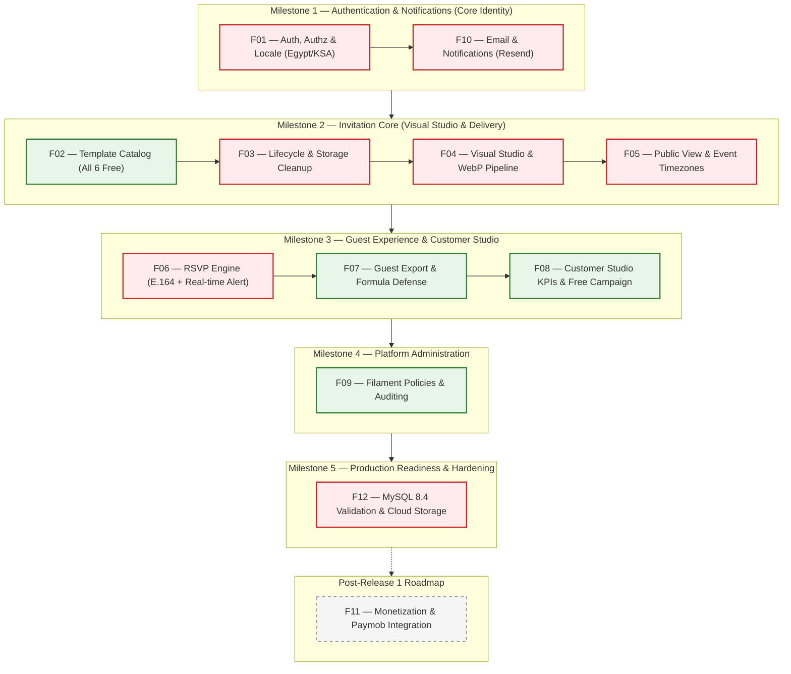

# Zaffe (زفّــة) — Master Engineering Implementation Roadmap (Release 1)

> **Strategic Architecture, Approved Milestones, Dependency Graph & Sequential Plan**  
> **Status:** Officially Approved by Product Owner | **Baseline:** `3060767` | **Target Markets:** Egypt & Saudi Arabia

---

## 1. Executive Summary & Strategy

Following the Product Owner's official directives ([docs/product/RELEASE_1_PRODUCT_DECISIONS.md](file:///e:/GithubProjects/Zaffe/docs/product/RELEASE_1_PRODUCT_DECISIONS.md)), this Master Roadmap governs the progressive, feature-based development of **Zaffe Release 1**.

### Core Strategic Mandates:
1. **100% Free Release 1 Launch:** Zero paid features, zero paywalls, zero subscription gating. All 6 templates and all customization features are completely free to maximize customer acquisition in Egypt and Saudi Arabia.
2. **F11 Deferred:** Monetization & Subscription System is **deferred to Post-Release 1**. Paymob is designated as the future payment gateway for Egypt (EGP/wallets) and Saudi Arabia (SAR/Mada).
3. **Approved Transactional Email:** **Resend** is the approved email provider, abstracted behind standard Laravel Mail & Notifications.
4. **Egypt & Saudi Arabia Localization:** Standardized E.164 phone support (+20 / +966) with country selectors, and invitation-specific timezones (`Africa/Cairo` / `Asia/Riyadh`).
5. **Strictly Sequential Development:** Unrelated features are never implemented in parallel. Each feature must pass all quality gates on its `feature/*` branch before integration into `dev` via Pull Request.
6. **Infrastructure Cost Efficiency:** Zero unnecessary paid infrastructure. Lightweight database queues and file/database caching are prioritized initially.

---

## 2. Approved Milestone & Dependency Graph

---

## 3. Approved Feature Execution Matrix

| Sequence | ID | Feature Domain | Release 1 Status | Priority | Complexity | Branch Name | Dependencies |
| :---: | :---: | :--- | :--- | :---: | :---: | :--- | :--- |
| **Step 1** | **F01** | Authentication, Authorization & Localization | **Active (Sprint 1)** | **P0** | Medium (M) | `feature/ZAFFE-001-auth` | Baseline |
| **Step 2** | **F10** | Email & Notifications (Resend) | **Active (Sprint 1)** | **P0** | Medium (M) | `feature/ZAFFE-010-notifications` | F01 |
| **Step 3** | **F02** | Template Management & Discovery | **Active (Sprint 2)** | **P1** | Small (S) | `feature/ZAFFE-002-template-management` | F01 |
| **Step 4** | **F03** | Invitation Lifecycle & Publishing | **Active (Sprint 2)** | **P0** | Medium (M) | `feature/ZAFFE-003-invitation-lifecycle` | F02 |
| **Step 5** | **F04** | Invitation Editor & Customization | **Active (Sprint 2)** | **P0** | Large (L) | `feature/ZAFFE-004-invitation-editor` | F03 |
| **Step 6** | **F05** | Public Invitation Rendering | **Active (Sprint 2)** | **P0** | Medium (M) | `feature/ZAFFE-005-public-invitation` | F04 |
| **Step 7** | **F06** | RSVP & Attendance Engine | **Active (Sprint 3)** | **P0** | Medium (M) | `feature/ZAFFE-006-rsvp-engine` | F05, F10 |
| **Step 8** | **F07** | Guest Management & Export | **Active (Sprint 3)** | **P1** | Small (S) | `feature/ZAFFE-007-guest-management` | F06 |
| **Step 9** | **F08** | Customer Dashboard & Analytics | **Active (Sprint 3)** | **P1** | Small (S) | `feature/ZAFFE-008-customer-dashboard` | F03, F07 |
| **Step 10** | **F09** | Admin & Platform Management | **Active (Sprint 4)** | **P1** | Medium (M) | `feature/ZAFFE-009-admin-management` | F01, F08 |
| **N/A** | **F11** | Monetization & Subscription System | **DEFERRED (Post-R1)**| **N/A** | Extra Large (XL) | `feature/ZAFFE-011-monetization` | Deferred |
| **Step 11** | **F12** | Production Readiness & Performance | **Active (Sprint 5)** | **P0** | Large (L) | `feature/ZAFFE-012-production-readiness` | F01-F10 |

---

## 4. Sequential Feature Implementation Plans

### Milestone 1 — Authentication & Notifications

#### Feature F01 — Authentication, Authorization & Localization
- **Branch:** `feature/ZAFFE-001-auth` | **Priority:** `P0` | **Complexity:** `M`
- **Scope:**
  - Implement actual Laravel `Password::broker()` workflow replacing the simulation placeholder.
  - Reset token generation, expiration enforcement, single-use invalidation.
  - Implement `showResetForm` view (`resources/views/auth/reset-password.blade.php`).
  - Implement `resetPassword` handler with strict password validation.
  - Add country-aware phone number support (Egypt `+20` and Saudi Arabia `+966`) with E.164 normalization.
  - Verify Arabic RTL and English LTR layouts on all auth screens.
- **Testing:** Comprehensive tests in `tests/Feature/AuthTest.php` asserting password reset dispatch (using fake notifications), invalid token rejection, and locale switching.

#### Feature F10 — Email & Notifications
- **Branch:** `feature/ZAFFE-010-notifications` | **Priority:** `P0` | **Complexity:** `M`
- **Scope:**
  - Integrate **Resend** via standard Laravel Mail / Notification channels.
  - Support environment variable configuration (`RESEND_API_KEY`, `MAIL_FROM_ADDRESS`, `MAIL_FROM_NAME`).
  - Create bilingual notification templates (Arabic & English) for:
    - Password Reset link.
    - Couple real-time notification on new RSVP submission.
    - Guest RSVP confirmation note.
  - Configure database queue worker for asynchronous mail delivery.
  - Error handling and delivery failure logging.

---

### Milestone 2 — Invitation Core

#### Feature F02 — Template Management & Discovery
- **Branch:** `feature/ZAFFE-002-template-management` | **Priority:** `P1` | **Complexity:** `S`
- **Scope:**
  - Verify and guarantee all 6 templates are 100% free and active.
  - Inactive template rejection in catalog and invitation creation.
  - Category filtering and search verification.

#### Feature F03 — Invitation Lifecycle & Publishing
- **Branch:** `feature/ZAFFE-003-invitation-lifecycle` | **Priority:** `P0` | **Complexity:** `M`
- **Scope:**
  - Add storage cleanup in `destroy()` to eliminate orphaned cover/gallery files on disk upon invitation deletion.
  - Ensure unlimited invitation creation for Release 1 free accounts.
  - Add timezone support field (`timezone` defaulting to `Africa/Cairo` or `Asia/Riyadh`).
  - Explicit unpublish action in customer dashboard.

#### Feature F04 — Invitation Editor & Customization
- **Branch:** `feature/ZAFFE-004-invitation-editor` | **Priority:** `P0` | **Complexity:** `L`
- **Scope:**
  - Unlock all design and template switching features without tier restrictions.
  - Implement image optimization pipeline (WebP conversion, max 1600px width).
  - Autosave debouncing to prevent server race conditions.
  - Timezone selector in Basics tab (`Africa/Cairo`, `Asia/Riyadh`).

#### Feature F05 — Public Invitation Rendering
- **Branch:** `feature/ZAFFE-005-public-invitation` | **Priority:** `P0` | **Complexity:** `M`
- **Scope:**
  - Timezone-aware Alpine.js countdown timer calculating against invitation's configured timezone.
  - WhatsApp share button with localized greeting and public deep link.
  - Dynamic OpenGraph social meta tags for WhatsApp chat card previews.
  - Session-based view count deduplication to prevent row lock contention.

---

### Milestone 3 — Guest Experience & Customer Studio

#### Feature F06 — RSVP & Attendance Engine
- **Branch:** `feature/ZAFFE-006-rsvp-engine` | **Priority:** `P0` | **Complexity:** `M`
- **Scope:**
  - Standardize `guest_count` wording: "Total attendees including yourself" (min 1 for attending, 0 for declined).
  - Country-aware phone input with Egypt (`+20`) and Saudi Arabia (`+966`) flags and E.164 normalization.
  - Standardized dietary checkboxes (Vegetarian, Gluten-Free, Allergies) + custom notes.
  - Dispatch real-time `NewRsvpReceivedNotification` (via F10) to couple upon submission.
  - Duplicate phone deduplication and anti-abuse rate limiting.

#### Feature F07 — Guest Management & Export
- **Branch:** `feature/ZAFFE-007-guest-management` | **Priority:** `P1` | **Complexity:** `S`
- **Scope:**
  - Enhanced CSV formula injection sanitization (protect against triggers preceded by whitespace, tabs, or newlines).
  - Search, filter, and pagination persistence.
  - UTF-8 BOM encoding for seamless Arabic Excel viewing.

#### Feature F08 — Customer Dashboard & Analytics
- **Branch:** `feature/ZAFFE-008-customer-dashboard` | **Priority:** `P1` | **Complexity:** `S`
- **Scope:**
  - Real-time KPI metrics (invitations, RSVPs, confirmed attendees, views).
  - Update pricing page (`/pricing`) to communicate 100% free launch campaign; remove non-functional purchase buttons.
  - Onboarding empty states for new couples.

---

### Milestone 4 — Platform Administration

#### Feature F09 — Admin & Platform Management
- **Branch:** `feature/ZAFFE-009-admin-management` | **Priority:** `P1` | **Complexity:** `M`
- **Scope:**
  - Bind explicit Laravel Policies to Filament v5 resources.
  - Platform metrics dashboard.
  - Audit logging for sensitive administrative actions.
  - Exclude billing and subscription management from active admin flows.

---

### Milestone 5 — Production Readiness & Performance

#### Feature F12 — Production Readiness & Performance
- **Branch:** `feature/ZAFFE-012-production-readiness` | **Priority:** `P0` | **Complexity:** `L`
- **Scope:**
  - Verify all migrations and test suites against an isolated MySQL 8.4 database.
  - Cloud storage configuration (S3 / Cloudflare R2) alongside local disk.
  - Private storage evaluation for draft media.
  - Database indexing audit on foreign keys and search columns.
  - Production security headers and deployment checklist.

---

### Post-Release 1 — Deferred Monetization

#### Feature F11 — Monetization & Subscription System (Paymob)
- **Status:** **DEFERRED — POST RELEASE 1**
- **Architecture Preparation:**
  - Integration target: Paymob (Egypt & Saudi Arabia).
  - Supported methods: Credit Card (Visa/MC), Wallets (Egypt), Mada & STC Pay (Saudi Arabia).
  - Execution deferred until customer acquisition milestones are achieved.
