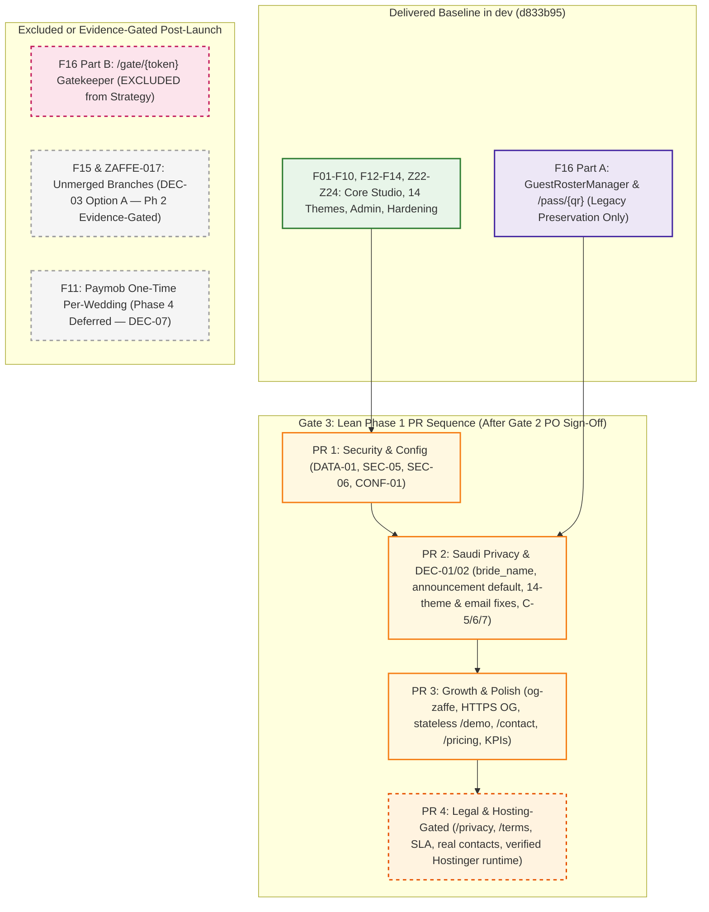

# Zaffe (زفّــة) — Master Engineering Implementation Roadmap (Release 1 / Phase 1)

> **Strategic Architecture, Reconciled Milestones, Lean Phase 1 PR Sequence & Actual `dev` Delivery State**  
> **Status:** Reconciled with `2026-11-21` PO Decisions (`Gate 2 Docs Review — Gate 3 Code Not Yet Authorized`) | **Last Synchronized:** 2026-11-21 (`dev` baseline `d833b95`) | **Target Markets:** Saudi Arabia (First) & Egypt

---

## 1. Executive Summary & Confirmed Governance

Following official Product Owner decisions recorded in [OPEN_QUESTIONS.md](../product/OPEN_QUESTIONS.md) (`DEC-01`–`DEC-07`) and BRD `v0.4` ([business-requirements-document.md](../business/business-requirements-document.md)):

1. **Free Release 1, No Subscriptions (`DEC-07`):** All `14` active templates (`8` Saudi Signature Vol. 1 `sort_order 1–8` + `6` baseline `9–14`) are unlocked. Paymob one-time per-invitation monetization (`Model A/B/C`) is deferred Post-Release 1 behind ZATCA/VAT legal review.
2. **View-First & Simple Optional RSVP (`DEC-01` & `DEC-02` Option B):** Newly created Phase 1 invitations start as view-only digital cards (`announcement`, `is_rsvp_enabled = false`) with a single **Enable RSVP / Disable RSVP** control (`rsvp_only` ↔ `announcement`). Bulk guest roster, CSV import, `?g=` UI, and QR Pass generation are **hidden** from new Phase 1 creations while **all existing legacy `InvitationGuest` records, `?g=` links, `rsvp_qr`/`qr_only` invitations, and `/pass/{qrToken}` pages stay 100% preserved**.
3. **Gatekeeper Permanently Excluded (`2026-11-21`):** `feature/ZAFFE-018-smart-guests-and-qr-checkin` (`/gate/{gateToken}`) is excluded from current product strategy ([QR_FEATURE_ISOLATION_POLICY.md](../architecture/QR_FEATURE_ISOLATION_POLICY.md)). `F15` & `ZAFFE-017` remain unmerged in Phase 1 (`DEC-03` Option A).
4. **Provisional Hosting Verification (`DEC-06`):** Prior to Gate 4 launch, Hostinger "Unlimited" shared web hosting (`PHP >= 8.4.1`, `ext-intl` CLI/web, MariaDB, sync-reset + cron queue fallback, EU residency PDPL impact, renewal pricing) must be verified — falling back cleanly to single-node Hostinger KVM 1/2 VPS only if shared checks fail. No purchase without PO authorization.
5. **Mandatory Delivery Rule:** **Business First, Code Second** (`Gate 1 Docs → Gate 2 PO Sign-Off → Gate 3 PRs 1–4 → Gate 4 Production Readiness`).

---

## 2. Phase 1 Architecture & Legacy Boundary Graph (`dev` `d833b95` → Phase 1 PRs)

---

## 3. Feature & Remediation Matrix (`2026-11-21`)

| Workstream | Scope / Features Covered | Status (`2026-11-21`) | Gate / Unblocker |
| :--- | :--- | :--- | :--- |
| **`F01`–`F10`, `F12`–`F14`, `Z22–24`** | Auth, Resend Mail, `14` WebP Themes, Studio Editor, Public Cards, RSVP, CSV Export, Filament Admin & Policies | **Merged in `dev` (`d833b95`)** | Gaps closed in PRs 1–4 |
| **`F16` Part A** | Smart Guest Roster, `rsvp_qr`/`qr_only`, `?g=`, `/pass/{qrToken}` | **Legacy Preservation Only (`DEC-01`/`02` Option B)** | Hidden on new P1 cards in PR 2; data/URLs untouched |
| **`F16` Part B (`ZAFFE-018`)** | QR Scanning & Gatekeeper Check-In (`/gate/{gateToken}`) | **Excluded from Strategy (`2026-11-21`)** | Never merge ([QR_FEATURE_ISOLATION_POLICY.md](../architecture/QR_FEATURE_ISOLATION_POLICY.md)) |
| **`F15` & `ZAFFE-017`** | Short `/i/` URLs, cover OG cropper, heavy wizard | **Unmerged (`DEC-03` Option A)** | Re-evaluate selectively in Ph 2 if metrics warrant |
| **`PR 1`** | `DATA-01` Admin/customer `http(s)` media purge, `SEC-05` `/admin/*` `SecurityHeaders`, `SEC-06` `PlatformSetting` lock, `CONF-01` `composer.json` `^8.4` + `.env.example`/mail fix | **Queued (Zero New Business Decisions)** | Gate 2 doc sign-off |
| **`PR 2`** | Nullable `bride_name` + zero orphans across `14` views/emails/dash; `DEC-01` Option B legacy guard; `DEC-02` Option B `announcement` default + binary toggle + `Invitation::booted()`/`InvitationEditor` QR-mode fixes + `"بطاقة دخول"` cleanup; `Asia/Riyadh`/`+966`; suppress `"Black Tie"` placeholders; `countdown` `arabic_indic`; 3 theme bugs + `share_box`; declined email copy + `NewRsvpNotification` emoji; HTML `max="20"`; *(+ optional `C-5`/`C-6`/`C-7` choices)* | **Queued (`DEC-01`/`02`/`04` Approved; `C-5`/`6`/`7` pending)** | Gate 2 sign-off + PO choice on `C-5`, `C-6`, `C-7` |
| **`PR 3`** | `public/images/og-zaffe.jpg`, absolute `https://` `og:image`, **stateless read-only Saudi `/demo` route**, remove fake `/contact` form keeping real WA/Email cards, truthful `/pricing`/`/about`/`/faq` copy (`DEC-04.4`, `DEC-07`), `?ref=invite` footer, `DashboardController::index()` `children_count`/`archived` fix, `OperationsMonitor` `KPI-01`/`02` (+ `KPI-03b`/`05` if approved), `DATA-02` minor polish | **Queued (`DEC-03`/`04`/`07` Approved; `KPI-03b`/`05` pending)** | Gate 2 sign-off + PO KPI confirmation |
| **`PR 4` & `Gate 4`** | Counsel-reviewed `/privacy` & `/terms`, form notices, privacy request workflow/SLA, verified real Saudi `PlatformSetting` contacts, production domain/Resend DNS, verified Hostinger PHP/MariaDB/cron/EU PDPL runtime, staging backup/restore + 4G LCP + real WhatsApp preview drills | **Gated (`DEC-05` & `DEC-06`)** | Saudi PDPL Counsel + Hostinger verification + PO Launch Sign-Off |
| **`F11` (Phase 4)** | One-time per-invitation Paymob checkout (`SAR`/`EGP`, `Model A/B/C`) | **Deferred (`DEC-07`)** | Real usage/cost data + ZATCA/VAT clearance |

---

## 4. Lean Technical Design Notes (`Why 4 Focused PRs`)

1. **Isolating Gate-4 Dependencies (`PR 4`) Instead of Blocking Core Engineering (`PRs 1–3`):** Separating security (`PR 1`), core Saudi/privacy/RSVP behavior (`PR 2`), and sharing/demo/KPIs (`PR 3`) from external legal copy, real phone/email secrets, and hosting verification (`PR 4`) avoids re-opening tested business code while waiting on Saudi PDPL counsel and Hostinger account checks.
2. **Stateless Read-Only Saudi Demo (`DEC-03`):** Rather than seeding fake mutable couples into production `users`/`invitations` tables (which pollute `OperationsMonitor` funnels and fail after wipes), serve `/demo` cleanly from a dedicated controller/read-only presenter backed by Saudi Signature `taif_rose` (or `diriyah_heritage`) sample data in `TemplateStyleCatalog`, so production homepage demo links never `404` and require zero cleanup.
3. **Sync Reset + Cron Queue Awareness (`DEC-06`):** Keep `database` queue compatibility cleanly isolated in config; if Hostinger Shared is finalized without Supervisor, `ResetPasswordNotification` can dispatch synchronously (instant user password recovery) while queued RSVP emails drain via a locked 1-minute `--stop-when-empty` cron job — verified on staging ([DEPLOYMENT_CHECKLIST.md](DEPLOYMENT_CHECKLIST.md)).
4. **Preventing Silent QR Regression (`DEC-02`):** Both `Invitation::booted()` (`app/Models/Invitation.php:38-41`) and `InvitationEditor::updatedIsRsvpEnabled()` (`app/Livewire/InvitationEditor.php:175-177`) currently map `MODE_ANNOUNCEMENT` → `MODE_RSVP_QR` on toggle ON. Updating both to transition `MODE_ANNOUNCEMENT` ↔ `MODE_RSVP_ONLY` while leaving legacy `rsvp_qr`/`qr_only` rows untouched eliminates QR leakage with minimal code diff.
