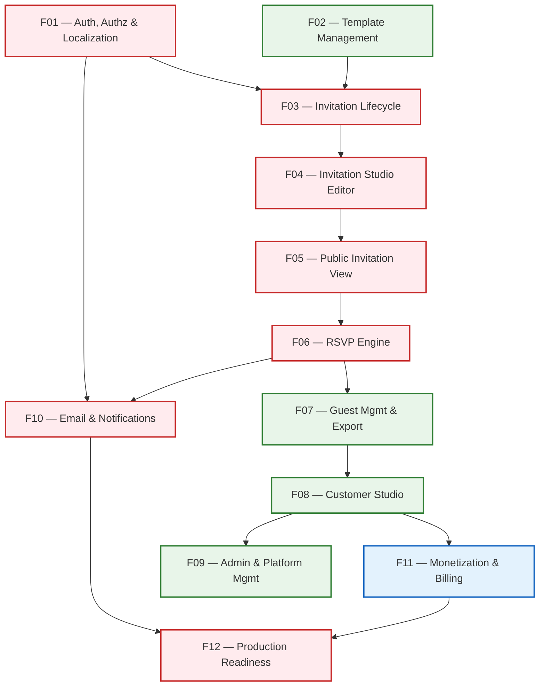

# Zaffe (زفّــة) — Master Engineering Implementation Roadmap

> **Strategic Architecture, Feature Inventory, Dependency Graph & Implementation Plan**  
> **Status:** Proposed for Approval | **Date:** 2026-11-12 | **Target Baseline:** `82c01ca`

---

## 1. Executive Summary & Strategy

The objective of this Master Roadmap is to transition Zaffe from its initial MVP into an enterprise-grade, commercially maintainable, and secure digital wedding invitation SaaS platform.

### Core Strategic Principles:
1. **Preserve Working Foundations:** Never discard or rewrite verified working code. Build on top of the 38 passing automated tests and 118 assertions.
2. **Disciplined Feature-Based Execution:** Implement strictly one feature domain at a time on its isolated branch (`feature/ZAFFE-XXX-*`) branched from `dev`.
3. **Rigorous Quality Gates:** Progress through Code-Level, Business-Level, Security, and Automated Testing Quality Gates before submitting Pull Requests to `dev`.
4. **Commercial Decoupling:** Keep the core free-tier MVP completely functional and deployable without being blocked by third-party payment gateway merchant approvals.

---

## 2. Feature Dependency Graph & Execution Sequence

---

## 3. Master Feature Matrix

| ID | Feature Name | Status | Priority | Complexity | Branch Name | Dependencies |
| :--- | :--- | :--- | :--- | :--- | :--- | :--- |
| **F01** | Authentication, Authorization & Localization | Partially Implemented | **P0** | Medium (M) | `feature/ZAFFE-001-auth` | Baseline |
| **F10** | Email & Notifications | Missing | **P0** | Medium (M) | `feature/ZAFFE-010-notifications` | F01 |
| **F02** | Template Management & Discovery | Implemented (Needs Validation) | **P1** | Small (S) | `feature/ZAFFE-002-template-management` | Baseline |
| **F03** | Invitation Lifecycle & Publishing | Requires Improvement | **P0** | Medium (M) | `feature/ZAFFE-003-invitation-lifecycle` | F01, F02 |
| **F04** | Invitation Editor & Customization | Requires Improvement | **P0** | Large (L) | `feature/ZAFFE-004-invitation-editor` | F03 |
| **F05** | Public Invitation Rendering | Requires Improvement | **P0** | Medium (M) | `feature/ZAFFE-005-public-invitation` | F04 |
| **F06** | RSVP & Attendance Engine | Implemented (Needs Validation) | **P0** | Medium (M) | `feature/ZAFFE-006-rsvp-engine` | F05 |
| **F07** | Guest Management & Export | Requires Improvement | **P1** | Small (S) | `feature/ZAFFE-007-guest-management` | F06 |
| **F08** | Customer Dashboard & Analytics | Requires Improvement | **P1** | Small (S) | `feature/ZAFFE-008-customer-dashboard` | F03, F07 |
| **F09** | Admin & Platform Management | Requires Improvement | **P1** | Medium (M) | `feature/ZAFFE-009-admin-management` | F01, F08 |
| **F11** | Monetization & Subscription System | Partially Implemented (Missing Logic) | **P1** | Extra Large (XL) | `feature/ZAFFE-011-monetization` | F08, Stakeholder Decision |
| **F12** | Production Readiness & Performance | Partially Implemented | **P0** | Large (L) | `feature/ZAFFE-012-production-readiness` | All features |

---

## 4. Detailed Feature Roadmaps & Implementation Tasks

---

### F01 — Authentication, Authorization & Localization
- **Branch:** `feature/ZAFFE-001-auth`
- **Priority:** `P0 (Critical)` | **Estimated Complexity:** `Medium (M)`
- **Business Value:** Enables secure user onboarding, identity isolation, password recovery, and bilingual Arabic/English adoption.
- **Current Status:** Registration, login, throttling, role checks, and locale switching are verified. Password reset link is currently a simulation placeholder (Finding SEC-01).
- **Technical Dependencies:** Laravel Auth scaffolding, Password Broker.
- **Database Impact:** None (Uses existing `users` and `password_reset_tokens` tables).
- **Security Risks:** Reusable reset tokens, brute force token guessing, session hijacking.
- **Implementation Tasks:**
  1. `F01.1`: Configure Laravel `Password::broker()` in `AuthController.php`.
  2. `F01.2`: Implement `showResetForm(Request $request, string $token)` and create `resources/views/auth/reset-password.blade.php`.
  3. `F01.3`: Implement `resetPassword(Request $request)` to validate password strength, update hash, and invalidate token.
  4. `F01.4`: Dispatch standard localized `ResetPasswordNotification`.
  5. `F01.5`: Verify Arabic RTL and English LTR alignment on all auth views.
- **Testing Strategy:** Feature tests in `tests/Feature/AuthTest.php` asserting valid token dispatch, expiration rejection, single-use invalidation, and password updates.
- **Business Acceptance Criteria:**
  - A user who forgets their password can request a reset email, receive a secure token, and set a new password.
  - Expired or manipulated tokens return clear error messages.
  - Language switcher transitions smoothly between Arabic RTL and English LTR.
- **Required External Decisions / Credentials:** None (Uses local log mailer for test verification).

---

### F10 — Email & Notifications
- **Branch:** `feature/ZAFFE-010-notifications`
- **Priority:** `P0 (Critical)` | **Estimated Complexity:** `Medium (M)`
- **Business Value:** Provides essential transactional communication: account recovery, real-time RSVP alerts to couples, and confirmation notices to guests.
- **Current Status:** Missing. Only placeholder log mailer is configured; no mailable or notification classes exist.
- **Technical Dependencies:** F01 (Auth).
- **Database Impact:** Creates `notifications` table migration for database notification channel support.
- **Security Risks:** Credential exposure in code, mail injection, unthrottled email spamming.
- **Implementation Tasks:**
  1. `F10.1`: Run `php artisan make:notifications-table` to support database and email notification channels.
  2. `F10.2`: Implement `ResetPasswordNotification` with bilingual Arabic/English templates.
  3. `F10.3`: Implement `NewRsvpReceivedNotification` dispatched to the couple upon guest RSVP submission.
  4. `F10.4`: Implement optional guest `RsvpConfirmationNotification` when email is provided.
  5. `F10.5`: Configure asynchronous queued notification delivery via `ShouldQueue`.
- **Testing Strategy:** Feature tests using `Notification::fake()` verifying notification dispatch and mailable content rendering.
- **Business Acceptance Criteria:**
  - Password reset emails are dispatched with valid signed links.
  - Couples receive an email notification when a new guest RSVPs.
  - Real credentials are never hardcoded and are read via environment variables.
- **Required External Decisions / Credentials:** Choice of transactional email service for production (Resend / AWS SES / Postmark).

---

### F02 — Template Management & Discovery
- **Branch:** `feature/ZAFFE-002-template-management`
- **Priority:** `P1 (High)` | **Estimated Complexity:** `Small (S)`
- **Business Value:** Showcases Zaffe's core product value through luxury wedding themes, helping prospects discover and preview designs.
- **Current Status:** Implemented and verified across all 6 themes. Requires validation of inactive template rejection.
- **Technical Dependencies:** Baseline.
- **Database Impact:** None.
- **Security Risks:** Potential view path traversal if template slugs are unvalidated.
- **Implementation Tasks:**
  1. `F02.1`: Validate that `InvitationController` and `HomeController::previewTemplate()` strictly check `is_active === true`.
  2. `F02.2`: Ensure inactive templates cannot be selected in the invitation creation wizard or editor template switcher.
  3. `F02.3`: Standardize metadata contract across all 6 themes (countdown, timeline, gallery, dress code, RSVP).
- **Testing Strategy:** Unit and feature tests verifying that inactive templates return 404 in preview and are rejected in creation endpoints.
- **Business Acceptance Criteria:**
  - Prospective users can search and preview all 6 active templates in Arabic and English.
  - Inactive templates are hidden from the catalog and cannot be selected.
- **Required External Decisions / Credentials:** None.

---

### F03 — Invitation Lifecycle & Publishing
- **Branch:** `feature/ZAFFE-003-invitation-lifecycle`
- **Priority:** `P0 (Critical)` | **Estimated Complexity:** `Medium (M)`
- **Business Value:** Core engine governing invitation creation, slug uniqueness, draft privacy, and safe deletion.
- **Current Status:** Implemented and verified, but deletion leaves orphaned storage files, and archival status is unmanaged.
- **Technical Dependencies:** F01, F02.
- **Database Impact:** None (Uses existing schema).
- **Security Risks:** Unauthorized deletion, draft content leaks, predictable slug collisions.
- **Implementation Tasks:**
  1. `F03.1`: Implement storage cleanup in `DashboardController::destroy()` to delete cover image and all gallery photos from disk upon invitation deletion.
  2. `F03.2`: Implement invitation archival workflow (`status = 'archived'`) in customer dashboard.
  3. `F03.3`: Enhance slug generator to handle Arabic diacritics and special characters gracefully.
  4. `F03.4`: Add explicit unpublish action from dashboard table view without opening the editor.
- **Testing Strategy:** Tests in `tests/Feature/InvitationLifecycleTest.php` asserting file deletion from storage, status transitions, and draft 403 enforcement.
- **Business Acceptance Criteria:**
  - Deleting an invitation removes all associated photos from disk.
  - Draft invitations are never accessible to the public.
  - Duplicate wedding titles generate distinct unique slugs.
- **Required External Decisions / Credentials:** None.

---

### F04 — Invitation Editor & Customization
- **Branch:** `feature/ZAFFE-004-invitation-editor`
- **Priority:** `P0 (Critical)` | **Estimated Complexity:** `Large (L)`
- **Business Value:** The core value proposition of Zaffe — a zero-code live studio where couples craft their digital invitations.
- **Current Status:** Fully functional Livewire editor with autosave, multi-tab editing, and photo uploads. Requires image compression and private draft asset evaluation.
- **Technical Dependencies:** F03.
- **Database Impact:** None.
- **Security Risks:** Predictable draft photo URLs in public storage, stale autosave state race conditions.
- **Implementation Tasks:**
  1. `F04.1`: Implement debounced autosave (`wire:model.live.debounce.500ms`) to optimize network requests.
  2. `F04.2`: Add image resizing and WebP compression on cover and gallery uploads (max 1600px width).
  3. `F04.3`: Implement section reordering and toggle persistence for timeline, dress code, and countdown.
  4. `F04.4`: Investigate and implement private storage routing or signed URLs for draft invitations if sensitive photos are involved.
  5. `F04.5`: Mobile responsiveness audit and touch optimization for smartphone screens.
- **Testing Strategy:** Livewire component tests verifying autosave, upload validation, photo deletion, and IDOR mutation locks.
- **Business Acceptance Criteria:**
  - Couples can edit details with instant phone preview updates.
  - Uploaded images are compressed to lightweight WebP files.
  - Unauthorized users cannot mutate another user's editor state.
- **Required External Decisions / Credentials:** None.

---

### F05 — Public Invitation Rendering
- **Branch:** `feature/ZAFFE-005-public-invitation`
- **Priority:** `P0 (Critical)` | **Estimated Complexity:** `Medium (M)`
- **Business Value:** The public face of Zaffe seen by hundreds of wedding guests per event. Must be fast, elegant, and interactive.
- **Current Status:** Verified working across all 6 templates. Requires asynchronous view count optimization and dynamic OpenGraph tags.
- **Technical Dependencies:** F04.
- **Database Impact:** None.
- **Security Risks:** Row locking on `invitations` table during viral WhatsApp traffic spikes (Finding PERF-01).
- **Implementation Tasks:**
  1. `F05.1`: Implement session-based view count deduplication (`session()->has('viewed_' . $id)`) to prevent row locking.
  2. `F05.2`: Implement dynamic OpenGraph meta tags (`og:title`, `og:image`, `og:description`) for rich WhatsApp link previews.
  3. `F05.3`: Validate countdown timer across timezones, pinning to wedding location timezone (Africa/Cairo).
  4. `F05.4`: Optimize audio player autoplay handling across iOS Safari and Chrome Android.
- **Testing Strategy:** HTTP response assertions, visual viewport testing, and OpenGraph tag verification tests.
- **Business Acceptance Criteria:**
  - WhatsApp share link displays bride & groom names, cover photo preview, and localized invite text.
  - Public invitation loads under 1.5 seconds on 4G mobile connections.
  - Countdown accurately reflects remaining time to wedding.
- **Required External Decisions / Credentials:** None.

---

### F06 — RSVP & Attendance Engine
- **Branch:** `feature/ZAFFE-006-rsvp-engine`
- **Priority:** `P0 (Critical)` | **Estimated Complexity:** `Medium (M)`
- **Business Value:** Automates the most stressful wedding logistical task: headcount tracking, banquet seating estimates, and dietary restrictions.
- **Current Status:** Implemented and verified with rate limiting, deadlines, and deduplication. Requires dietary option standardization and Egyptian phone format validation.
- **Technical Dependencies:** F05.
- **Database Impact:** None.
- **Security Risks:** Client-side tampering with companion limits, automated RSVP spamming.
- **Implementation Tasks:**
  1. `F06.1`: Standardize `guest_count` definition: Clearly label as "Total Attendees including yourself" (min 1 for attending, 0 for declined).
  2. `F06.2`: Add phone number formatting helper for Egyptian mobile numbers (`+201...`, `01...`).
  3. `F06.3`: Add standardized dietary requirement checkboxes (Vegetarian, Gluten-Free, Nut Allergy) alongside custom notes.
  4. `F06.4`: Dispatch `NewRsvpReceivedNotification` (via F10) upon successful submission.
- **Testing Strategy:** Feature tests in `tests/Feature/RsvpTest.php` covering boundary guest counts, deadline cut-offs, deduplication, and rate limiting.
- **Business Acceptance Criteria:**
  - Guests can confirm or decline in under 30 seconds on mobile.
  - Declining an RSVP strictly stores `guest_count = 0`.
  - Duplicate submissions from the same phone number update existing responses without inflating counts.
- **Required External Decisions / Credentials:** None.

---

### F07 — Guest Management & Export
- **Branch:** `feature/ZAFFE-007-guest-management`
- **Priority:** `P1 (High)` | **Estimated Complexity:** `Small (S)`
- **Business Value:** Gives couples and banquet coordinators instant access to real-time attendee lists and Excel exports.
- **Current Status:** Implemented and verified. Requires enhanced formula injection regex.
- **Technical Dependencies:** F06.
- **Database Impact:** None.
- **Security Risks:** CSV formula injection via hidden characters (Finding SEC-04).
- **Implementation Tasks:**
  1. `F07.1`: Extend CSV formula sanitization regex to catch dangerous characters (`=`, `+`, `-`, `@`) preceded by whitespace, tabs, or newlines.
  2. `F07.2`: Ensure query string parameters (search, filter, page) are preserved during pagination.
  3. `F07.3`: Add sort options (by submission date, guest count, or guest name).
- **Testing Strategy:** Feature tests asserting streamed CSV headers, UTF-8 BOM, and formula sanitization against advanced payloads.
- **Business Acceptance Criteria:**
  - Couples can export their guest list into an Excel file that opens cleanly in Arabic with zero formula execution risk.
  - Attendance metrics match exact database totals.
- **Required External Decisions / Credentials:** None.

---

### F08 — Customer Dashboard & Analytics
- **Branch:** `feature/ZAFFE-008-customer-dashboard`
- **Priority:** `P1 (High)` | **Estimated Complexity:** `Small (S)`
- **Business Value:** Central customer studio hub where couples monitor their wedding invitation status and metrics.
- **Current Status:** Implemented and verified. Requires empty state refinements.
- **Technical Dependencies:** F03, F07.
- **Database Impact:** None.
- **Security Risks:** IDOR access to analytics or invitations belonging to other users.
- **Implementation Tasks:**
  1. `F08.1`: Polish empty state views with onboarding guidance for new couples.
  2. `F08.2`: Add status filter tabs (All, Published, Draft, Archived) on the invitations table.
  3. `F08.3`: Add quick-copy public link with visual toast feedback.
- **Testing Strategy:** Feature tests verifying KPI calculation accuracy and strict user isolation.
- **Business Acceptance Criteria:**
  - Couples see accurate, real-time counts of invitations, attendees, and page views.
  - Unauthorized users cannot view another couple's dashboard data.
- **Required External Decisions / Credentials:** None.

---

### F09 — Admin & Platform Management
- **Branch:** `feature/ZAFFE-009-admin-management`
- **Priority:** `P1 (High)` | **Estimated Complexity:** `Medium (M)`
- **Business Value:** Operational backoffice for platform administrators to manage users, templates, plans, and system health.
- **Current Status:** Implemented and verified via Filament v5. Requires explicit policy bindings.
- **Technical Dependencies:** F01, F08.
- **Database Impact:** None.
- **Security Risks:** Privilege escalation, unauthorized admin access.
- **Implementation Tasks:**
  1. `F09.1`: Create explicit Laravel Policies (`UserPolicy`, `InvitationPolicy`, `TemplatePolicy`) bound to Filament resources.
  2. `F09.2`: Add audit logging for sensitive admin actions (e.g., user deletion, template deactivation).
  3. `F09.3`: Enhance Filament stats widget with weekly RSVP submission graphs.
- **Testing Strategy:** Feature tests in `tests/Feature/AdminTest.php` asserting that non-admins receive 403 on all `/admin` routes.
- **Business Acceptance Criteria:**
  - Only users with `role = 'admin'` can access the backoffice.
  - Admins can curate templates, manage categories, and monitor platform health.
- **Required External Decisions / Credentials:** None.

---

### F11 — Monetization & Subscription System
- **Branch:** `feature/ZAFFE-011-monetization`
- **Priority:** `P1 (High)` | **Estimated Complexity:** `Extra Large (XL)`
- **Business Value:** Generates commercial SaaS revenue through wedding package subscriptions.
- **Current Status:** Partially implemented (tables and pricing page exist; billing engine, gateway, and gates missing).
- **Technical Dependencies:** F08, Stakeholder Decision.
- **Database Impact:** Updates `user_subscriptions` and `subscription_plans` tables.
- **Security Risks:** Webhook forgery, unauthorized entitlement access, payment tampering.
- **Implementation Tasks:**
  1. `F11.1`: Author Business & Technical Proposal for Monetization (gateway selection, pricing tiers).
  2. `F11.2`: Implement plan entitlement checks in `InvitationEditor` and `DashboardController`:
     - Free tier: 1 invitation, standard templates, Zaffe watermark.
     - Pro tier: Unlimited invitations, premium templates (`islamic-elegance`, `emerald-night`), custom styles, no watermark.
  3. `F11.3`: Implement payment checkout integration once gateway is selected.
  4. `F11.4`: Implement webhook endpoint with cryptographic signature validation.
- **Testing Strategy:** Mock payment gateway tests, webhook verification tests, and entitlement gate tests.
- **Business Acceptance Criteria:**
  - Free users can use the platform within defined limits.
  - Pro features are gated with clear upgrade prompts.
  - Webhooks reliably activate subscriptions upon successful payment.
- **Required External Decisions / Credentials:** **Stakeholder Decision:** Payment gateway provider selection (Paymob / Fawry / Stripe).

---

### F12 — Production Readiness & Performance
- **Branch:** `feature/ZAFFE-012-production-readiness`
- **Priority:** `P0 (Critical)` | **Estimated Complexity:** `Large (L)`
- **Business Value:** Ensures platform stability, high concurrency resilience, data persistence, and security under live production conditions.
- **Current Status:** Development environment is SQLite; MySQL runtime validation and cloud storage are required.
- **Technical Dependencies:** All features.
- **Database Impact:** Database index additions for performance optimization.
- **Security Risks:** Environment variable exposure, session fixation, data loss.
- **Implementation Tasks:**
  1. `F12.1`: Validate migrations and automated tests against an isolated MySQL 8.4 database.
  2. `F12.2`: Configure S3/Cloudflare R2 driver for multi-server cloud media storage.
  3. `F12.3`: Configure Redis cache, sessions, and queue worker drivers.
  4. `F12.4`: Audit and optimize database indexes on foreign keys and search query columns.
  5. `F12.5`: Production deployment checklist and security headers configuration.
- **Testing Strategy:** Complete test suite execution against isolated MySQL database (`DB_CONNECTION=mysql_test`).
- **Business Acceptance Criteria:**
  - All migrations and tests run cleanly on MySQL 8.4 without schema errors.
  - Multi-server deployments can access shared media via cloud object storage.
  - The application responds under 200ms on cached endpoints.
- **Required External Decisions / Credentials:** Production database credentials and cloud storage bucket.

