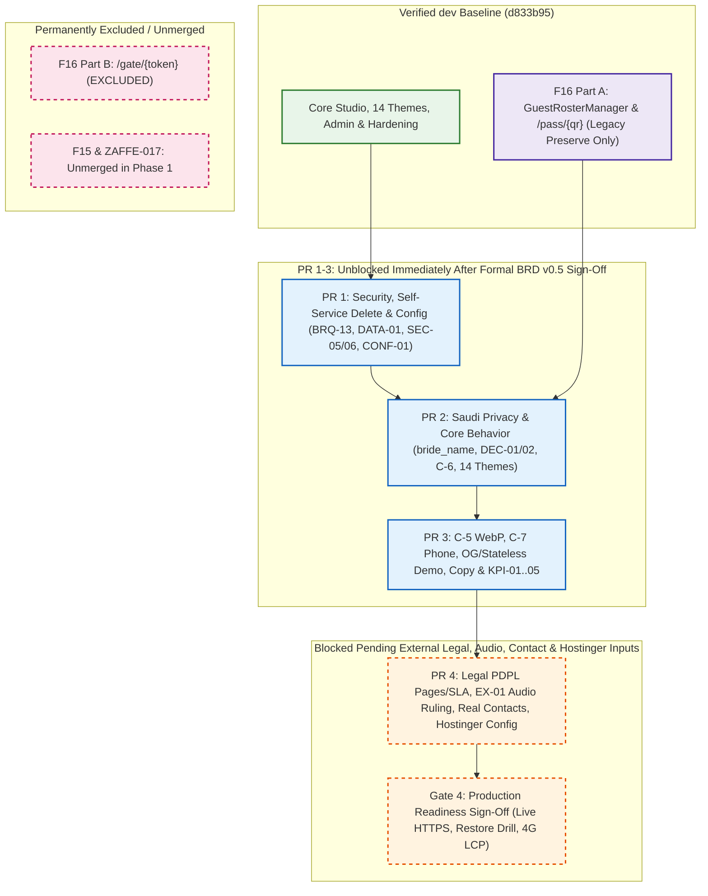

# Zaffe (زفّــة) — Master Engineering Implementation Roadmap (Release 1 / Phase 1)

> **Strategic Architecture, Balanced Phase 1 PR Plan, Legacy Preservation & External Release Gates**  
> **Status:** Implementation-Ready Sequence Prepared for Formal BRD Sign-Off (`No Code Changes Authorized Yet`) | **Last Synchronized:** 2026-11-21 (`dev` baseline `d833b95`)

---

## 1. Executive Summary & Confirmed Constraints

Synchronized with final PO approvals in [OPEN_QUESTIONS.md](../product/OPEN_QUESTIONS.md) and BRD `v0.5` ([business-requirements-document.md](../business/business-requirements-document.md)):

1. **Free Release 1 (`DEC-07`):** All `14` templates unlocked; Paymob deferred (`Model A/B/C` undecided); zero `"Free Forever"` or fake deadline copy.
2. **View-First & Simple Optional RSVP (`DEC-01` & `DEC-02` Option B):** New invitations default to `announcement` (`is_rsvp_enabled = false`) with binary **Enable/Disable RSVP** (`rsvp_only` ↔ `announcement`). Both `Invitation::booted()` and `InvitationEditor::updatedIsRsvpEnabled()` are updated to avoid QR-mode regression. `GuestRosterManager`, CSV import, quotas, and `?g=` UI stay hidden on new cards while legacy records/links/modes stay 100% intact.
3. **Resolved Policy Choices (`C-5`, `C-6`, `C-7`, KPIs):** New image uploads convert cleanly to `.webp` (`C-5` Option A) inside memory/dimension limits (`gd` WebP); external `music_url` hides on new creations (`C-6` Option A) with legacy public playback escalated (`EX-01`); international E.164 phone UI adds `Other Country` (`C-7` Option B) keeping `SA +966` default; `KPI-03b` and 3-stage `KPI-05a/b/c` enter `OperationsMonitor`.
4. **Excluded & Unmerged Branches:** `feature/ZAFFE-018` Gatekeeper `/gate/{gateToken}` is permanently excluded; `F15` & `ZAFFE-017` remain unmerged (`DEC-03` Option A).
5. **Clean Dependency Separation:** **PRs 1–3** unlock immediately upon formal PO BRD `v0.5` sign-off; **PR 4 & Gate 4** remain strictly isolated for external legal counsel (`DEC-05`, `EX-01`–`EX-03`), real Saudi contacts, and verified Hostinger compatibility/DNS inputs (`DEC-06`).

---

## 2. Phase 1 Delivery Architecture (`Gate 3` Unblocked vs. `Gate 4` External)

---

## 3. Balanced 4-PR Lean Engineering Sequence (`PR 1` – `PR 4`)

| PR | Scope & Exact Files / Modules Targeted | Unblocker / Dependency | Risk & Verification Focus |
| :---: | :--- | :--- | :--- |
| **`PR 1`** *(Sec/Delete/Config)* | - **`BRQ-13` / `DEC-05` Opt B — Self-Service Dashboard Deletion (`BR-002`, `BR-018`, `BR-037`):** Audit/harden existing confirmation modal on `/dashboard/invitations` (`resources/views/dashboard/invitations.blade.php:143-185`: clear permanent-loss warning for card, RSVPs, guests, media & shared links; CSRF + `DELETE`), wrap DB cascades (`invitation_sections`, `invitation_photos`, `rsvp_responses`, `invitation_guests`, `invitation_gates`) inside `DB::transaction()` in `DashboardController::destroy()` (`:141-155`), and move media purge **post-commit** (unified with `DATA-01`). - `DATA-01`: Fix `Invitation::deleting()` (`app/Models/Invitation.php:45-60`) for `http(s)://.../storage/...` & relative paths. - `SEC-05`: Attach `SecurityHeaders` in `AdminPanelProvider.php`. - `SEC-06`: Lock `PlatformSettingCatalog::keys()` delete/bulk-delete in `PlatformSettingPolicy.php` & `PlatformSettingsTable`. - `CONF-01`: Bump `composer.json` PHP to `^8.4`, fix `.env.example` `RESEND_API_KEY=` trap & `config/mail.php`. - `DATA-02` Admin: Add `email_verified_at` to `User::$fillable`, `UserForm` `avatar_url` validation, `TemplateCategoryForm` default active, `ListRsvpResponses` active filter + `children_count` CSV export, `InvitationGuestResource` `$navigationSort`. | Formal **BRD `v0.5`** sign-off | **Low risk.** Run expanded `InvitationLifecycleTest` (owner delete, unauth/IDOR rejection keeping DB + files intact, FK cascades, partial-failure safety, post-delete `404` on `/invitation/{slug}`, `?g=`, `/pass/{qr}`), `AuditTest`, `AdminManagementTest`, `AdminFeatureCoverageTest`, `ProductionReadinessTest`. |
| **`PR 2`** *(Core Studio, Privacy, Optional RSVP & Audio Gate)* | - `DEC-04.1`: Non-destructive `invitations.bride_name` nullable migration + validation (`DashboardController`, `InvitationEditor`, `InvitationForm`) + remove orphan `"و"`/`"وَ"`/`"&"` across all `14` views, titles, slugs, WhatsApp links, dashboard, passes, notifications. - `DEC-01` Opt B: Legacy-only guard in `dashboard/guests.blade.php:37` (keep roster/passes for rows or `rsvp_qr`/`qr_only`). - `DEC-02` Opt B: `MODE_ANNOUNCEMENT` (`is_rsvp_enabled=false`) defaults, binary Enable/Disable RSVP toggle, non-destructive RSVP off, fix **both** `Invitation::booted()` (`:38-41`) and `InvitationEditor::updatedIsRsvpEnabled()` (`:175-177`), clean `"بطاقة دخول"` → `"بطاقة الدعوة الشخصية"`, keep `rsvp_qr`/`qr_only` preserved. - **`C-6` Opt A:** Hide `music_url` input for new creations in `invitation-editor.blade.php` & guard new-card edits cleanly while preserving existing DB column & Admin visibility. - `Asia/Riyadh` defaults, `countdown.blade.php` `arabic_indic` fix, suppress `"Black Tie"` placeholders (`timeline`/`dress_code`), hide placeholder toggles in Editor, fix `emerald_night`, `desert_dusk`, `islamic_elegance`, `timeline.blade.php:33`, `share_box.blade.php:30`, `RsvpConfirmationNotification` declined text, `NewRsvpNotification` emoji, `max="20"`. | Formal **BRD `v0.5`** sign-off | **Medium risk (core editor & 14 views).** Run full **14-template render matrix** with `bride_name=null`/photo-free/overrides, `InvitationEditorTest`, `RsvpEngineTest`, `NotificationTest`, and legacy QR regression suite. |
| **`PR 3`** *(WebP Uploads, Int'l Phone, OG/Demo, Copy & KPIs)* | - **`C-5` Opt A (`ImageOptimizationService`):** Verified runtime uses bundled `gd` (`WebP/JPEG/PNG/GIF/AVIF`, `imagick=no`, `exif=no`, `memory_limit=128M`). Enforce MIME + `getimagesize()` dimension/pixel-budget pre-check (anti-OOM), resize (`max 1600px`) + alpha-safe `.webp` encode, **write-before-delete** in `InvitationEditor::updatedNewCoverPhoto()`, zero destructive batch migration of existing uploads. - **`C-7` Opt B (`PhoneService` + 3 Forms):** Fix `PhoneService::normalize()` fallthrough bug on `OTHER`, default `SA (+966)` + `EG (+20)` + `Other Country` (`OTHER`, `+[1-9]\d{7,14}`) on `/register`, `/dashboard/profile`, & `RsvpForm` (phone optional). - **`DEC-03` Opt A + `DEC-04.2/4.4/4.5` + `DEC-07`:** Add `public/images/og-zaffe.jpg`, absolute `https://` `og:image`, stateless read-only Saudi `/demo` controller route (zero DB seed pollution), remove fake `/contact` form keeping WA/Email cards, truthful non-forever/non-urgency `/pricing`, `/about`, `/faq`, `/`, fix `DashboardController::index()` `children_count` & `archived` badge. - **`KPI-01`, `02`, `03b`, `05a/b/c`:** Add `/templates?ref=invite` footer + aggregate session visit counter (`KPI-05a`), nullable `users.signup_source` (`KPI-05b/c`), `KPI-03b` state-accurate active-RSVP avg (`OperationsMonitor`), & `KPI-01` start tracking. | Formal **BRD `v0.5`** sign-off | **Medium risk (`gd`/pixel limits + attribution).** Run real-image JPEG/PNG-to-WebP quality & decompression-bomb tests, `PhoneServiceTest`, stateless `/demo` `200`, `og:image` absolute URL checks, KPI state transition & attribution tests, and Pint. |
| **`PR 4`** *(Legal/PDPL, Legacy Audio, Contacts & Hostinger)* | - Publish legal-reviewed `/privacy` & `/terms`, registration/RSVP privacy notices, & documented deletion request SLA (`DEC-05`). - Implement legal/PO ruling on `EX-01` (legacy external `music_url` public playback gating/pausing if required, keeping DB column intact). - Idempotent migration ([AGENTS.md](../../AGENTS.md) Rule 12) setting real verified Saudi support email & WhatsApp in `PlatformSetting`. - Finalize verified Hostinger runtime/mail/queue parity (`sync` reset + cron `queue:work --stop-when-empty --max-time=50`, OR KVM VPS Supervisor) + [DEPLOYMENT_CHECKLIST.md](DEPLOYMENT_CHECKLIST.md). | **External Inputs:** Legal counsel (`DEC-05`, `EX-01`–`03`), real Saudi contacts, verified Hostinger plan & Resend DNS (`DEC-06`) | **Blocked until external clearances.** Validate full suite against target MariaDB/PHP `>= 8.4.1`, staging backup restore drill, 4G LCP `< 2.5s`, and **live HTTPS WhatsApp preview verification**. |

---

## 4. Technical Design Verification Notes *(Verified Against Code & Local PHP Runtime)*

1. **`C-5` Runtime & Safety Guard (`gd` Verified):** Local PHP executes bundled GD (`WebP`, `JPEG`, `PNG`, `GIF`, `AVIF`) with `imagick = no`, `exif = no`, and `memory_limit = 128M`. Therefore:
   - `ImageOptimizationService` must **not** call `exif_read_data()` blindly without `function_exists('exif_read_data')`.
   - Must call `getimagesize($tmpPath)` **before** `imagecreatefromjpeg`/`png` to compute `width * height * 4` estimated RGBA bytes and reject images exceeding safe decode budget cleanly with a friendly validation message (avoiding fatal PHP `Allowed memory size exhausted` errors).
   - Must fix `InvitationEditor.php:195-198` ordering (`store/convert new WebP BEFORE calling $this->deleteStorageFile($invitation->cover_photo)`) so encoding failure never wipes an existing couple photo.
2. **`C-7` `PhoneService` International Bug (`app/Services/PhoneService.php:53-80`):** Currently, passing any unknown country code with a valid number missing `+` falls through to `return '+20' . $digits;`. Fixing `OTHER` handling to require international format (`+` or `00` prefix normalized to `+[1-9]\d{7,14}`) guarantees reliable E.164 normalization without breaking existing `+20` / `+966` users.
3. **`DEC-02` Dual Bug Prevention:** Updating **both** `Invitation::booted()` (`app/Models/Invitation.php:38-41`) and `InvitationEditor::updatedIsRsvpEnabled()` (`app/Livewire/InvitationEditor.php:175-177`) eliminates silent `announcement` → `rsvp_qr` coercion across both UI and direct model saves.
4. **Customer Self-Service Deletion Partial-Failure Bug (`app/Http/Controllers/DashboardController.php:145-151`):** `DashboardController::destroy()` currently deletes storage files **before** `$invitation->delete()` without a database transaction, so a DB failure permanently deletes customer photos while the invitation stays alive. `PR 1` fixes this by executing deletion + FK cascades inside `DB::transaction()` and purging `cover_photo`/`gallery` media post-commit alongside `DATA-01` (`Invitation::deleting()`).
