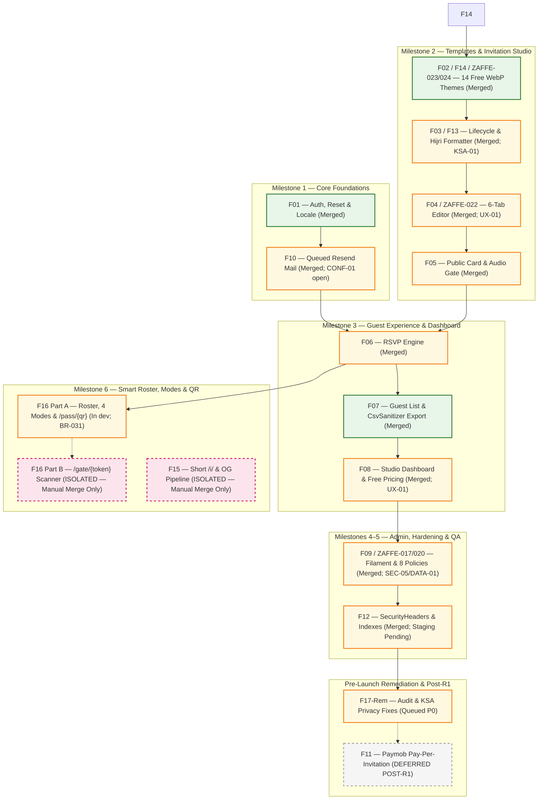

# Zaffe (زفّــة) — Master Engineering Implementation Roadmap (Release 1)

> **Strategic Architecture, Approved Milestones, Dependency Graph & Actual `dev` Delivery State**  
> **Status:** Living Release Roadmap | **Last Synchronized:** 2026-11-19 (`dev` branch `d88d381`) | **Target Markets:** Saudi Arabia (First) & Egypt

---

## 1. Executive Summary & Strategy

Following the Product Owner's official directives ([RELEASE_1_PRODUCT_DECISIONS.md](../product/RELEASE_1_PRODUCT_DECISIONS.md) & [SAUDI_MARKET_DECISIONS.md](../product/SAUDI_MARKET_DECISIONS.md)), this Master Roadmap reflects both the original Release 1 milestone structure and verified delivery state on `dev` (`d88d381`):

### Core Strategic Mandates:
1. **100% Free Release 1 Launch:** Zero paid features, zero paywalls, zero subscription gating. All **14** templates (`8` Saudi Signature Collection Vol. 1 `sort_order 1–8` + `6` baseline `9–14`) and customization features are free.
2. **F11 Deferred:** Monetization is **deferred Post-Release 1**. Commercial direction is **one-time pay-per-invitation** via **Paymob** (`SAR` & `EGP` dynamically via `PlatformSetting`), **not** recurring subscriptions.
3. **Approved Transactional Email:** **Resend** is approved via standard Laravel Mail & Notifications (`ShouldQueue` + `database` queue).
4. **Saudi-First & Egypt Localization:** E.164 phone normalization (`+966` / `+20`), invitation timezones (`Asia/Riyadh` / `Africa/Cairo`), Umm al-Qura Hijri + configurable numerals, self-hosted `.webp` catalog thumbnails, SVG-only `<x-app-icon>` templates.
5. **Isolated / Manual-Merge Governance:** Restricted branches (`F16` Part B `/gate/{gateToken}`, `F15` short `/i/` + OG pipeline, held `ZAFFE-017` wizard) require explicit Product Owner manual merge approval ([QR_FEATURE_ISOLATION_POLICY.md](../architecture/QR_FEATURE_ISOLATION_POLICY.md)).

---

## 2. Release 1 Milestone & Dependency Graph (`dev` `d88d381`)

---

## 3. Feature Execution & Integration Matrix (`2026-11-19`)

| Sequence | ID | Feature Domain | Current Status (`dev` `d88d381`) | Priority | Complexity | Primary Branch / Evidence | Dependencies / Notes |
| :---: | :---: | :--- | :--- | :---: | :---: | :--- | :--- |
| **Done** | **F01** | Authentication, Password Reset & Localization | **Merged in `dev`** *(minor UI enumeration & AR/EN card pass remain)* | **P0** | M | `feature/ZAFFE-001-auth` | Baseline |
| **Done** | **F10** | Email & Notifications (Resend + DB Queue) | **Merged in `dev`** *(open `CONF-01` & `declined` wording fix)* | **P0** | M | `feature/ZAFFE-010-notifications` | F01 |
| **Done** | **F02/F14** | 14 Free Templates (`ZAFFE-023`/`024`) & Local WebP | **Merged in `dev`** *(stale "6 themes" copy on `/pricing` & `/about`)* | **P1** | M | `ZAFFE-002/014/023/024` | Catalog migration `2026_11_19_000001` |
| **Done** | **F03/F13** | Lifecycle, Slugs, Timezones & Umm al-Qura Hijri | **Merged in `dev`** *(`bride_name` schema `KSA-01` & archive UI open)* | **P0** | M | `ZAFFE-003`, `ZAFFE-013` | F02 |
| **Done** | **F04/Z22** | 6-Tab Studio Editor & Design System | **Merged in `dev`** *(`timeline`/`dress_code` toggle-only; WebP upload Post-R1)* | **P0** | L | `ZAFFE-004`, `ZAFFE-022` | F03 |
| **Done** | **F05** | Public Rendering, Audio Gate & Session Dedup | **Merged in `dev`** *(`countdown` `arabic_indic` & 3 template tweaks open)* | **P0** | M | `feature/ZAFFE-005-public-invitation` | F04 |
| **Done** | **F06** | RSVP Engine, E.164 & Quotas | **Merged in `dev`** *(`tentative` count nuance; AR-only UI)* | **P0** | M | `feature/ZAFFE-006-rsvp-engine` | F05, F10 |
| **Done** | **F07** | Guest List & Formula-Safe CSV Export | **Merged in `dev`** | **P1** | S | `feature/ZAFFE-007-guest-management` | F06 |
| **Done** | **F08** | Customer Studio Dashboard & Free Pricing Page | **Merged in `dev`** *(fake `/contact` form & `/dashboard` `children_count` open)* | **P1** | S | `feature/ZAFFE-008-customer-dashboard` | F03, F07 |
| **Done** | **F09/Z17/Z20** | Filament v5 Super Admin, 8 Policies & `OperationsMonitor` | **Merged in `dev`** *(open `SEC-05`, `SEC-06`, `DATA-01`, `DATA-02`)* | **P1** | M | `ZAFFE-009/016/017/020` | F01, F08 |
| **Done** | **F12** | HTTP `SecurityHeaders`, Composite Indexes & Ops Docs | **Merged in `dev`** *(staging MySQL 8.4 + `ext-intl` verification pending)* | **P0** | L | `feature/ZAFFE-012-production-readiness` | F01–F10 |
| **Done*** | **F16-A** | Smart Guest Roster, 4 Modes, `?g=` & `/pass/{qrToken}` | **Active in `dev`** *(unresolved `BR-031` PO confirmation)* | **P0/P1** | L | `chore/ZAFFE-019-isolate-qr-checkin-from-dev` | F06 |
| **Isolated** | **F16-B** | QR Scanning & Gatekeeper Check-In (`/gate/{gateToken}`) | **Built — Isolated (PO Manual Merge Only)** | **P0/P1** | M | `origin/feature/ZAFFE-018-smart-guests-and-qr-checkin` | Requires PO review |
| **Isolated** | **F15** | Short `/i/{code}` URLs, OG Image Pipeline & Async WebP | **Built — Isolated (PO Manual Merge Only)** | **P0** | S | `origin/feature/ZAFFE-015-short-urls-and-og-tags` | Requires PO review |
| **Next P0** | **F17-Rem** | Pre-Launch Audit, Security & KSA Privacy Remediation | **Open / Queued (`2026-11-19`)** | **P0** | S–M | Future `bugfix/*` off `dev` | Clears [TECHNICAL_AUDIT.md](../architecture/TECHNICAL_AUDIT.md) §6 |
| **Deferred** | **F11** | One-Time Pay-Per-Invitation Checkout (`Paymob`) | **DEFERRED — Post-Release 1** | **P3** | XL | Schema dormant / Resource `403` | Post-PMF approval |

---

## 4. Feature Implementation & Remediation Reality Check

### Milestones 1–5 (`F01`–`F10`, `F12`–`F14`, `ZAFFE-016`/`017`/`020`/`022`/`023`/`024`) — Shipped Summary
- **F01 / F10 (`Auth` & `Notifications`):** Implemented `Password::broker()`, `reset-password.blade.php`, `ResetPasswordNotification`, `NewRsvpNotification` (`mail` + `database`), and `RsvpConfirmationNotification` (`ShouldQueue`, `database` queue). *Open cleanup:* `CONF-01` mail config / `.env.example` `RESEND_API_KEY=` trap and `declined` confirmation copy.
- **F02 / F14 (`14` Free Templates):** Implemented 14 self-hosted `.webp` templates (0 Unsplash), `TemplateStyleCatalog::bladeViews()` allowlist, idempotent `ZAFFE-024` `sort_order 1–8` migration, and locked `is_premium = false`.
- **F03 / F04 / F05 / F13 (`Lifecycle, Editor & Public Card`):** Implemented unique slug generation, `timezone`, Umm al-Qura `InvitationDateFormatter`, 6-tab `InvitationEditor` (`#[Locked]` `$invitationId`/`$status`), 5MB uploads with customer cleanup, audio user-tap gate, session view deduplication, and Publish Share Modal. **Note:** Automated server-side **WebP conversion on user uploads** (`PERF-02`) and dedicated **content editors for `timeline` & `dress_code`** were **not** shipped in F04 and remain open in `F17-Rem` / Post-R1.
- **F06 / F07 / F08 (`RSVP, Roster & Studio`):** Implemented `RsvpForm` (`attending`/`declined`/`tentative`, E.164 `+20`/`+966`, hijack guard, 10/min throttle), `CsvSanitizer::cell()` + UTF-8 BOM, free `/pricing` page.
- **F09 (`Super Admin`):** Implemented 7 active Filament resources (with 3-column structured `InvitationTemplateForm` visual editor + 2-tab `PlatformSettingResource`), `PlatformStatsOverview`, `OperationsMonitor`, **8 explicit Policies**, and locked `SubscriptionPlanResource` (`403`). **Note:** Dedicated admin **audit-log persistence** table was not implemented; access is enforced via Policies (`UserPolicy` blocks self-delete & last-admin delete).
- **F12 (`Production Readiness`):** Implemented global web `SecurityHeaders` + `/pass/*`/`?g=*` privacy headers and composite query indexes (`2026_11_14_000001`). Staging validation on **MySQL 8.4 + PHP `>= 8.4.1` + `ext-intl`** remains required prior to production cutover.

---

### Milestone 6 — Smart Guest List, Modes & QR Passes (`F16`)
- **Active in `dev` (`F16` Part A):**
  - Four invitation modes (`rsvp_qr`, `rsvp_only`, `qr_only`, `announcement`) synchronized with `is_rsvp_enabled`.
  - Pre-invited guest roster (`GuestRosterManager`) with bulk CSV/line import, adult/child quotas, categories, and `CsvSanitizer` CSV export.
  - Personalized `?g={invite_token}` links, pure-PHP ISO/IEC 18004 SVG QR passes (`/pass/{qrToken}`), and per-guest WhatsApp invite/reminder tracking.
  - Filament Admin integration (`InvitationGuestResource`, `InvitationForm`, `InvitationsTable`, `PlatformStatsOverview`). *(Pending PO confirmation of `BR-031` conflict flagged in `ZAFFE_FINAL_QA_REPORT.md`.)*
- **Isolated on `feature/ZAFFE-018-smart-guests-and-qr-checkin` (`F16` Part B — Owner Manual Only):**
  - Zero-app multi-gate browser Gatekeeper Portal (`/gate/{gateToken}`, `GateScanner`, `InvitationGate`, `BarcodeDetector` camera scanning, manual `pass_code` check-in, and atomic single-use `checked_in_at` check-in lock). Governed by [QR_FEATURE_ISOLATION_POLICY.md](../architecture/QR_FEATURE_ISOLATION_POLICY.md).

---

### Post-Release 1 — Deferred Monetization (`F11`)
- **Status:** **DEFERRED — POST RELEASE 1** (gated behind future feature flag).
- **Architecture Direction:** **One-time pay-per-invitation** via **Paymob** supporting **Saudi Arabia** (`SAR`, Mada, Apple Pay, Visa/MC) and **Egypt** (`EGP`, Visa/MC, InstaPay/Wallets/Fawry), priced dynamically via `PlatformSetting` ([SAUDI_MARKET_DECISIONS.md](../product/SAUDI_MARKET_DECISIONS.md) §8, [F11_DEFERRED_MONETIZATION_NOTE.md](briefs/F11_DEFERRED_MONETIZATION_NOTE.md)).
