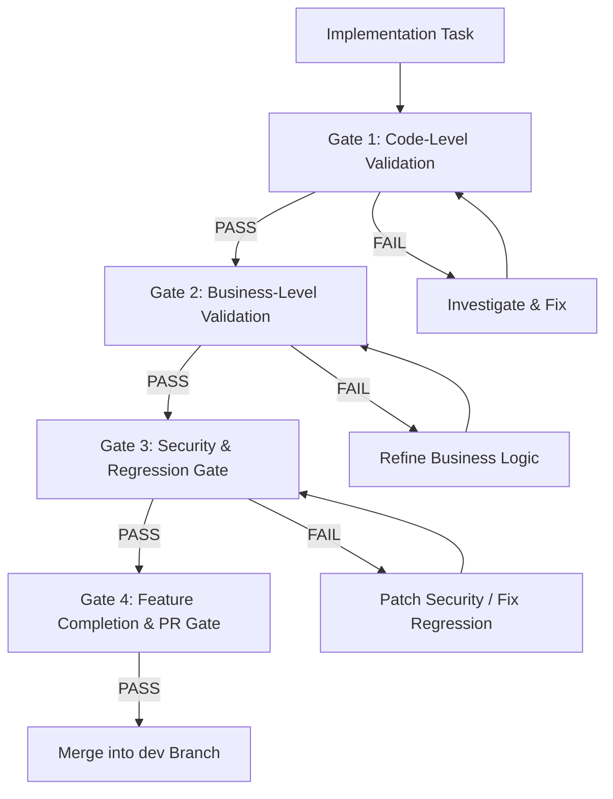

# Zaffe (زفّــة) — Quality Gates & Verification Protocol

> **Enforceable Checkpoints and Criteria for Task Progression and Feature Completion**  
> **Status:** Active & Enforced | **Last Updated:** 2026-11-19 (`dev` `d88d381`) | **Standard Reference:** [DEFINITION_OF_DONE.md](DEFINITION_OF_DONE.md)

---

## 1. Quality Gate Architecture

To prevent regressions, ensure architectural consistency, and guarantee security, every development task must pass through four sequential quality gates before being integrated into `dev`:



---

## 2. Gate Status Definitions & Transition Rules

Every task and feature is assigned one of three statuses at each evaluation stage:

| Status | Definition | Transition Rule |
| :--- | :--- | :--- |
| **`PASS`** | The task has satisfied 100% of the gate's criteria with documented evidence and passing tests. | May proceed to the next gate or task. |
| **`FAIL`** | The task has one or more unresolved bugs, failing tests, unhandled exceptions, or unmet criteria. | **Work stops on subsequent tasks.** The issue must be investigated, resolved, and re-tested immediately. |
| **`BLOCKED`** | The task cannot proceed due to a missing stakeholder decision, external API credential, or upstream dependency. | Explicitly report the blocking factor, document the open question, and await input or switch to an unblocked feature. |

### Golden Rules:
1. **Never mark an untested task as `PASS`:** Every `PASS` requires verifiable execution output.
2. **Zero Tolerance for Critical/High Defects:** Never proceed to the next task while the current task has unresolved critical or high-priority failures.
3. **Re-Test After Every Fix:** Whenever a fix is applied, all previously passing tests relevant to the changed scope must be re-executed to prevent secondary regressions.

---

## 3. The Four Sequential Quality Gates

### Gate 1: Code-Level Validation
- **Trigger:** Immediately upon completing an implementation task.
- **Criteria:**
  - [ ] Strict types and correct Laravel / Livewire / Filament conventions followed.
  - [ ] Input validation rules implemented and verified for all incoming parameters.
  - [ ] Eloquent relationships correctly mapped with foreign keys, cascades, and composite indexes.
  - [ ] No N+1 query loops introduced; eager loading (`with(...)`) verified.
  - [ ] Database transactions (`DB::transaction`) wrap all multi-table mutations.
  - [ ] Catalog/reference updates (`invitation_templates`, `template_categories`, `platform_settings`) include an idempotent non-destructive data migration + legacy-upgrade test ([AGENTS.md](../../AGENTS.md) Rule 12).
  - [ ] Code formatted with Laravel Pint & Composer valid: `./vendor/bin/pint --test` and `composer validate --strict`.

### Gate 2: Business-Level Validation
- **Trigger:** Once code-level validation passes.
- **Criteria:**
  - [ ] User journey matches the Feature Brief and acceptance criteria.
  - [ ] All documented business rules are enforced (RSVP deadlines, quotas, slug uniqueness, Hijri/numerals, photo-free luxury, SVG `<x-app-icon>` with 0 Unicode emojis, 0 external CDN hotlinks).
  - [ ] Negative test cases (invalid dates, out-of-bounds guest counts, pre-invited phone hijack attempts, expired deadlines) are gracefully rejected.
  - [ ] Data persists accurately across page refreshes and component re-mounts.
  - [ ] UI renders cleanly in RTL/LTR across applicable localized surfaces.

### Gate 3: Security & Regression Gate
- **Trigger:** Before considering an implementation point finished.
- **Criteria:**
  - [ ] Authorization enforced: User cannot inspect, modify, or delete another user's invitations or guest lists (IDOR check via `Auth::user()->invitations()`), and all **8 Laravel Policies** protect Admin/domain models.
  - [ ] Non-admin users are strictly blocked (`403`) from Filament `/admin` and `/admin/subscription-plans` returns `403`.
  - [ ] Client-side state in Livewire is protected with `#[Locked]` attributes.
  - [ ] `CsvSanitizer::cell()` + UTF-8 BOM protect CSV exports; `SecurityHeaders` emits `no-referrer`/`noindex`/`no-store` on `/pass/*` and `?g=*`.
  - [ ] File uploads are validated for MIME type, extension, and file size (`<= 5MB`).
  - [ ] Rate limits prevent brute-force or flooding abuse (`6/min` auth, `10/min` RSVP, `60/min` `/pass/*`).
  - [ ] Full regression suite runs cleanly on **PHP `>= 8.4.1` with `ext-intl`**, including `QrCheckInIsolationTest`: `php artisan view:clear && php artisan test`.

### Gate 4: Feature Completion & PR Integration Gate
- **Trigger:** When all implementation points for a feature branch are completed.
- **Criteria:**
  - [ ] All subtasks are marked `PASS` and [DEFINITION_OF_DONE.md](DEFINITION_OF_DONE.md) satisfied.
  - [ ] No open critical or high-priority defects remain.
  - [ ] Full verification suite passes:
    ```powershell
    ./vendor/bin/pint --test
    composer validate --strict
    php artisan view:clear
    php artisan test
    npm run build
    ```
  - [ ] Conventional Commit created on the feature branch.
  - [ ] Pull Request summary prepared for integration into `dev`.

> [!CAUTION]
> **Gate 4 Restricted Branch Exception (`OWNER ONLY` Manual Merge):**  
> Passing Gates 1–4 does **NOT** authorize agent or automated merging for restricted branches (`feature/ZAFFE-018-smart-guests-and-qr-checkin` [`F16` Part B Gatekeeper Check-In], `feature/ZAFFE-015-short-urls-and-og-tags`, or held `feature/ZAFFE-017-create-invitation-wizard`). Only the Product Owner may review and manually merge those PRs per [GIT_WORKFLOW.md](GIT_WORKFLOW.md) §3.3 and [QR_FEATURE_ISOLATION_POLICY.md](../architecture/QR_FEATURE_ISOLATION_POLICY.md).

