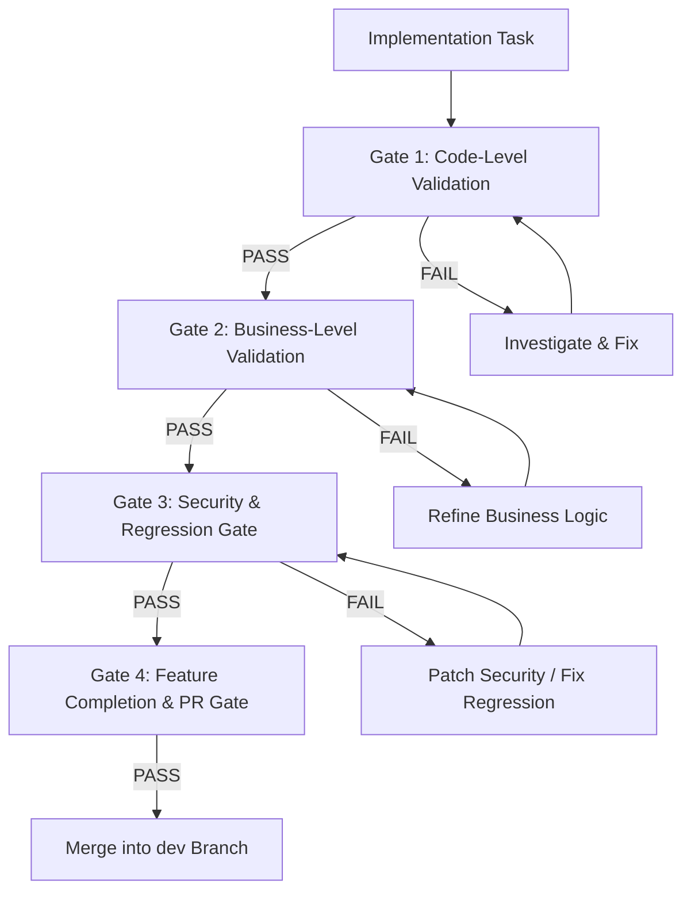

# Zaffe (زفّــة) — Quality Gates & Verification Protocol

> **Enforceable Checkpoints and Criteria for Task Progression and Feature Completion**  
> **Status:** Active & Enforced | **Date:** 2026-11-12

---

## 1. Quality Gate Architecture

To prevent regressions, ensure architectural consistency, and guarantee security, every development task must pass through four sequential quality gates before being integrated into `dev`:



---

## 2. Gate Status Definitions & Transition Rules

Every task and feature is assigned one of three statuses at each evaluation stage:

| Status | Definition | Transition Rule |
| :--- | :--- | :--- |
| **`PASS`** | The task has satisfied 100% of the gate's criteria with documented evidence and passing tests. | May proceed to the next gate or task. |
| **`FAIL`** | The task has one or more unresolved bugs, failing tests, unhandled exceptions, or unmet criteria. | **Work stops on subsequent tasks.** The issue must be investigated, resolved, and re-tested immediately. |
| **`BLOCKED`** | The task cannot proceed due to a missing stakeholder decision, external API credential, or upstream dependency. | Explicitly report the blocking factor, document the open question, and await input or switch to an unblocked feature. |

### Golden Rules:
1. **Never mark an untested task as `PASS`:** Every `PASS` requires verifiable execution output.
2. **Zero Tolerance for Critical/High Defects:** Never proceed to the next task while the current task has unresolved critical or high-priority failures.
3. **Re-Test After Every Fix:** Whenever a fix is applied, all previously passing tests relevant to the changed scope must be re-executed to prevent secondary regressions.

---

## 3. The Four Sequential Quality Gates

### Gate 1: Code-Level Validation
- **Trigger:** Immediately upon completing an implementation task.
- **Criteria:**
  - [ ] Strict types and correct Laravel / Livewire conventions followed.
  - [ ] Input validation rules implemented and verified for all incoming parameters.
  - [ ] Eloquent relationships correctly mapped with appropriate foreign keys and cascading.
  - [ ] No N+1 query loops introduced; eager loading (`with(...)`) verified.
  - [ ] Database transactions (`DB::transaction`) wrap all multi-table mutations.
  - [ ] Code formatted with Laravel Pint: `./vendor/bin/pint --test`.

### Gate 2: Business-Level Validation
- **Trigger:** Once code-level validation passes.
- **Criteria:**
  - [ ] The user journey matches the Feature Brief and acceptance criteria.
  - [ ] All documented business rules are strictly enforced (e.g., RSVP deadlines, guest limits, slug uniqueness).
  - [ ] Negative test cases (invalid dates, out-of-bounds guest counts, expired deadlines) are gracefully rejected.
  - [ ] Data persists accurately in the database across page refreshes and component re-mounts.
  - [ ] Multilingual text renders cleanly in both Arabic (`ar`) and English (`en`).

### Gate 3: Security & Regression Gate
- **Trigger:** Before considering an implementation point finished.
- **Criteria:**
  - [ ] Authorization enforced: User cannot inspect, modify, or delete another user's invitations or guest lists (IDOR check).
  - [ ] Non-admin users are strictly blocked from Filament admin resources.
  - [ ] Client-side state in Livewire is protected with `#[Locked]` attributes.
  - [ ] File uploads are validated for MIME type, extension, and file size (max 5MB).
  - [ ] Rate limits prevent brute-force or flooding abuse.
  - [ ] Full regression suite runs: `php artisan test` passes with zero failures.

### Gate 4: Feature Completion & PR Integration Gate
- **Trigger:** When all implementation points for a feature branch are completed.
- **Criteria:**
  - [ ] All subtasks are marked `PASS`.
  - [ ] No open critical or high-priority defects remain.
  - [ ] Full test suite execution passes:
    ```powershell
    php artisan test
    ```
  - [ ] Frontend build succeeds:
    ```powershell
    npm run build
    ```
  - [ ] Conventional Commit created on the feature branch.
  - [ ] Pull Request summary prepared for integration into `dev`.

