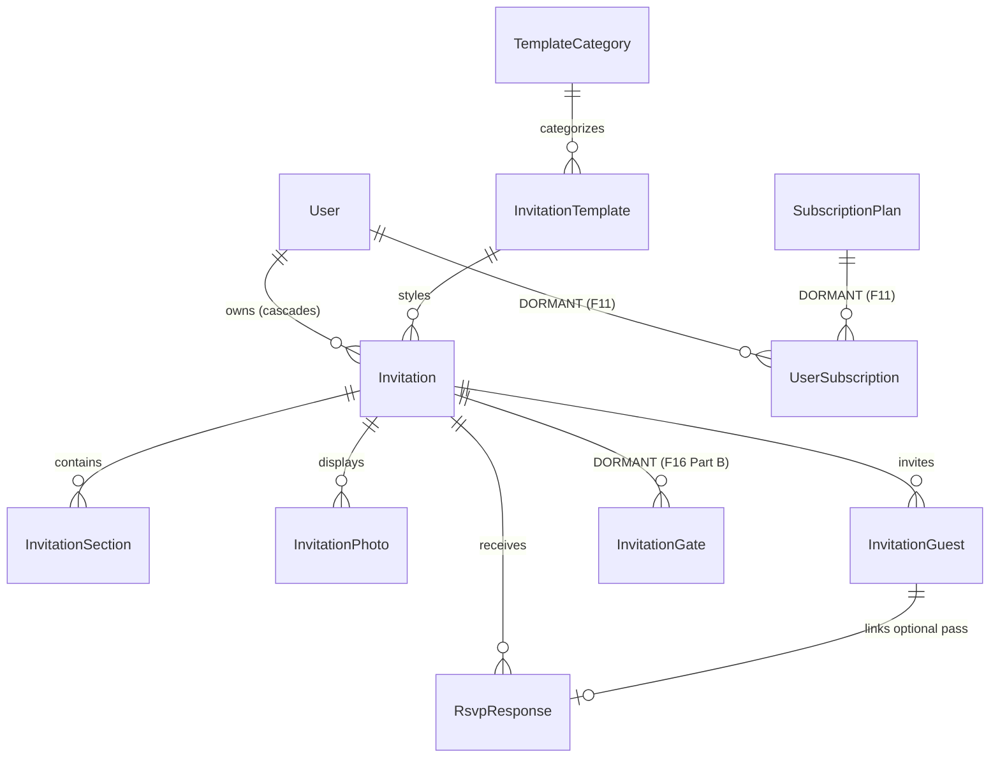
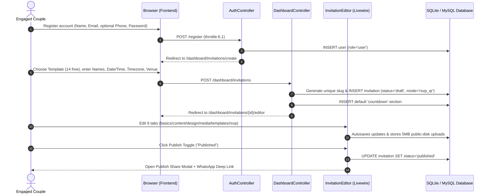
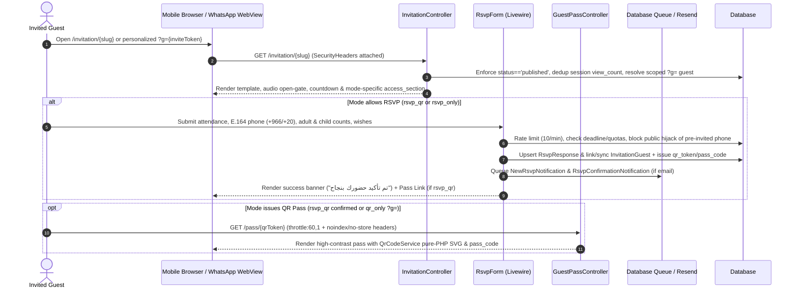

# Zaffe (زفّــة) — Business & Product Overview

> **Single Source of Truth for Business Logic, Domain Concepts, and Product Requirements**  
> **Status:** Living Business Reference | **Last Updated:** 2026-11-19 (`dev` branch `d88d381`)  
> **Classification Legend:**
> - `[VERIFIED]`: Confirmed directly from source code, database migrations, controllers, or tests.
> - `[INFERRED]`: Strongly supported by implementation context and domain conventions.
> - `[UNKNOWN]`: Requires explicit confirmation from stakeholders/product owner.

---

## 1. Product Overview & Purpose

### 1.1 What is Zaffe? `[VERIFIED]`
**Zaffe (زفّــة)** — derived from the traditional Arabic wedding march and celebration — is a specialized Software-as-a-Service (SaaS) platform built primarily for **Saudi Arabia (KSA First)** and **Egypt (MENA)**. It enables engaged couples and families to create, customize, publish, and distribute interactive digital wedding invitations with smart guest rosters, automated RSVP confirmation tracking, live Umm al-Qura Hijri & Gregorian countdowns, user-tap background music, interactive Google Maps location links, optional photo albums, and pure-PHP personal QR passes.

### 1.2 The Problem It Solves `[VERIFIED]`
1. **High Cost & Slowness of Physical Cards:** Traditional paper wedding invitations in KSA and Egypt are expensive to print, slow to distribute across cities, and prone to logistical delays.
2. **Inflexibility:** If a wedding date, hall, or timing changes, printed cards cannot be updated. Digital invitations on Zaffe update instantaneously.
3. **Chaotic RSVP & Attendance Management:** Families historically tracked attendees via disorganized phone calls, paper notebooks, or scattered WhatsApp messages. Couples struggled to give banquet caterers and hotel venues accurate adult and child headcount estimates.
4. **Poor Digital Experience:** Static image designs (PDFs or JPEGs) cannot play background audio safely inside WhatsApp WebView, calculate timezone-aware countdowns, enforce per-invitee adult/child quotas, generate pure-PHP QR passes, or provide direct map navigation.

### 1.3 Value Proposition `[VERIFIED]`
- **Culturally Tailored Luxury Designs:** Curated Arabic typography (`Amiri`, `Cairo`, `Tajawal`, `Playfair Display`) across **14 active free themes** (`sort_order 1–8`: Saudi Signature Collection — Vol. 1 `diriyah-heritage`, `rawashin-elegance`, `sadu-signature`, `taif-rose`, `palm-oasis`, `red-sea-pearl`, `desert-dusk`, `modern-monogram`; `sort_order 9–14`: 6 baseline themes `royal_gold`, `floral_romance`, `minimal_chic`, `islamic_elegance`, `emerald_night`, `classic_aristocrat`; see [ZAFFE_023_SAUDI_SIGNATURE_COLLECTION.md](../ui/ZAFFE_023_SAUDI_SIGNATURE_COLLECTION.md)). All 14 templates render cleanly with zero uploaded photos; the 8 Saudi Signature views also guard empty `bride_name` safely while `dev` schema/forms currently still enforce required `bride_name`.
- **Zero-Code Real-Time Studio:** Six-tab Livewire `InvitationEditor` (`basics`, `content`, `design`, `media`, `templates`, `rsvp`) with Publish Share Modal, device previews, and instant autosave.
- **Frictionless WhatsApp Distribution:** Dedicated `4:5` (`1080×1350` PNG) theme-matched Share Card Hub (`/dashboard/invitations/{id}/share`), formal RSVP-aware WhatsApp messages (`Invitation::getWhatsAppShareUrl()`), per-guest personalized `?g={inviteToken}` links, and pure-PHP QR passes (`/pass/{qrToken}`).
- **Controlled & Capped RSVP Management:** Couples manage named pre-invited guest rosters with adult/child quotas, bulk CSV/text imports, E.164 `+966`/`+20` normalization, deadline checks, and formula-safe UTF-8 BOM CSV exports.
- **100% Free Release 1 Commercial Model:** All 14 templates and editor features are unlocked (`is_premium = false`) during Release 1 (`SubscriptionPlanResource` returns `403`). Post-R1 monetization direction is **one-time pay-per-invitation** via Paymob (`SAR`/`EGP`).

---

## 2. Target Audience & User Personas

### 2.1 Primary & Isolated System Actors `[VERIFIED]`

| Actor | System Identification | Primary Objectives & Verified Permissions |
| :--- | :--- | :--- |
| **Public Marketing Visitor** | Unauthenticated lead (`web`) | Browses `/`, filters `/templates` (14 free templates), tests `/templates/{slug}/preview`, reads `/pricing`, `/about`, `/contact`, `/faq`, switches UI locale (`/lang/{locale}`). *(Note: `/contact` form is UI-only Alpine simulation.)* |
| **Invited Guest (Public & Personalized `?g=`)** | Unauthenticated visitor on `/invitation/{slug}` (`?g={inviteToken}` optional) | Views published wedding card (`draft`/`archived` blocked `403`), unlocks audio gate, opens Google Maps link, submits/updates RSVP within quota/deadline (`10/min/IP`), views personal SVG QR pass at `/pass/{qrToken}` (`throttle:60,1`). |
| **Engaged Couple / Customer** | `User` with `role = 'user'` (`auth`) | Registers/logs in/resets password, creates invitations via wizard, customizes 6-tab `InvitationEditor`, manages `GuestRosterManager` & bulk CSV imports, reviews RSVPs, exports UTF-8 BOM CSVs, updates profile. Scoped strictly to `Auth::user()->invitations()`. |
| **Platform Super Admin** | `User` with `role = 'admin'` (`canAccessPanel()`) | Accesses Filament v5 `/admin` across **7 active resources** + `PlatformStatsOverview` + `OperationsMonitor` (`/admin/operations-monitor`), previews drafts/passes, and operates under **8 Laravel Policies**. (`SubscriptionPlanResource` disabled `403` in R1.) |
| **System / Queue Worker** | `ShouldQueue` jobs (`database` queue driver) + Artisan CLI | Delivers queued notifications (`ResetPasswordNotification`, `NewRsvpNotification`, `RsvpConfirmationNotification`); provisions admins via `php artisan zaffe:create-admin`. |
| **Venue Gatekeeper / Usher** *(Isolated)* | **NOT ACTIVE in `dev`** (`/gate/{gateToken}`) | `GateScanner`, `InvitationGate`, and `checked_in_*` runtime workflows are isolated on `feature/ZAFFE-018-smart-guests-and-qr-checkin` pending explicit PO manual merge ([QR_FEATURE_ISOLATION_POLICY.md](../architecture/QR_FEATURE_ISOLATION_POLICY.md)). |

### 2.2 Secondary / Downstream Stakeholders `[INFERRED]`
- **Wedding Planners & Family Coordinators:** May operate an account for multiple events (`max` invitations unrestricted in Release 1).
- **Venue Caterers & Hospitality Teams:** Consume confirmed adult & child totals (`CsvSanitizer`-safe Excel CSV exports).

---

## 3. Business Domain & Terminology

### 3.1 Domain Vocabulary `[VERIFIED]`
- **Zaffe (زفّة):** Traditional celebratory Arabic wedding procession; core brand identity.
- **Invitation (دعوة زفاف):** Core digital event entity containing metadata, timezone (`Asia/Riyadh` | `Africa/Cairo`), access mode, styles, and public slug.
- **Invitation Mode (`invitation_mode`):** Controls access behavior across `rsvp_qr`, `rsvp_only`, `qr_only`, and `announcement` (synchronized with `is_rsvp_enabled` on model save).
- **Template (قالب التصميم):** Visual layout in `TemplateStyleCatalog` (14 active views in allowlist).
- **Guest Roster Entry (`InvitationGuest`):** Pre-invited or self-registered guest row holding quotas (`max_adults`, `max_children`), unique `invite_token` (`?g=`), unique `qr_token` (`/pass/{qrToken}`), and 6-char `pass_code`.
- **RSVP (`RsvpResponse`):** Guest confirmation (`attending`, `declined`, `tentative`), `guest_count`, `children_count`, `dietary_notes`, and wishes.
- **RSVP Deadline (`rsvp_deadline`):** Inclusive cutoff date (`now()->startOfDay()->gt($rsvp_deadline)` rejects submissions).

---

## 4. Core Business Entities & Relationships

### 4.1 Detailed Entity Directory `[VERIFIED]`

1. **`User` (`users`):** Account identity (`name`, `email`, `phone`, `password`, `role`: `'user' | 'admin'`, `avatar_url`, `email_verified_at`). Only `role === 'admin'` enters `/admin`. *(Known bug: `email_verified_at` missing from `$fillable`.)*
2. **`TemplateCategory` (`template_categories`):** Six aesthetic categories (`luxury`, `floral`, `minimal`, `islamic`, `classic`, `romantic`).
3. **`InvitationTemplate` (`invitation_templates`):** Fourteen active free themes (`is_premium = false` enforced across catalog migration & Filament visual form), validated `view_name`, self-hosted `.webp` thumbnail (`public/images/templates/`), `default_styles` JSON, `sort_order`.
4. **`Invitation` (`invitations`):** Core wedding record (`user_id`, `template_id`, `title`, `slug`, `groom_name`, `bride_name` *[schema `NOT NULL`]*, `wedding_date`, `wedding_time`, `timezone`, venue fields, `welcome_message`, `invitation_message`, `cover_photo`, `music_url`, `custom_styles` JSON, `status` [`draft` | `published` | `archived`], `invitation_mode`, `is_rsvp_enabled`, `rsvp_deadline`, `max_guests_per_rsvp`, `view_count`).
5. **`InvitationSection` (`invitation_sections`):** Modular toggles (`countdown`, `timeline`, `gallery`, `dress_code`, `is_enabled`, `content` JSON).
6. **`InvitationPhoto` (`invitation_photos`):** Uploaded gallery images (`image_path`, `caption`, `is_cover`, `sort_order`). *(Known gap `DATA-01`: Admin `Invitation::deleting` skips `http(s)://` URLs.)*
7. **`InvitationGuest` (`invitation_guests`):** Smart guest roster (`invitation_id`, `name`, `phone`, `category` [`general`, `vip`, `family_groom`, `family_bride`, `kids`], `max_adults`, `max_children`, `invite_token`, `qr_token`, `pass_code`, `rsvp_status`, `confirmed_adults`, `confirmed_children`, `rsvp_response_id`, `is_self_registered`, `invited_at`, `reminded_at`, `notes`). Dormant Part B columns: `checked_in_at`, `checked_in_count`, `checked_in_by_gate_id`.
8. **`RsvpResponse` (`rsvp_responses`):** Guest attendance responses (`invitation_id`, `invitation_guest_id`, `guest_name`, `phone`, `email`, `attendance_status`, `guest_count`, `children_count`, `message`, `dietary_notes`, `ip_address`).
9. **`PlatformSetting` (`platform_settings`):** Cached bilingual settings configured via `PlatformSettingCatalog` (consumed by public layouts, SEO defaults, `/contact` details, and `OperationsMonitor`).
10. **Dormant Tables (`F11` & `F16` Part B):** `subscription_plans`, `user_subscriptions`, and `invitation_gates` exist in schema without active customer/admin runtime usage in `dev`.

---

## 5. Comprehensive Feature Inventory & Status Matrix

For deep `file:line` reverse-engineering evidence and all 34 sub-features, see [project-discovery.md](../business/project-discovery.md) §5.

| Feature Module | Business Purpose | Target User | Verification Status (`dev` `d88d381`) | Implementation File Reference |
| :--- | :--- | :--- | :--- | :--- |
| **Public Marketing, Pricing & Catalog (`F02`)** | Showcase value, filter 14 free templates, interactive bilingual previews, free R1 messaging | Public / Leads | **Partially Implemented** *(stale "6 themes" copy on `/pricing` & `/about`; missing `og-zaffe.jpg`)* | `HomeController.php`, `pages/home.blade.php`, `templates.blade.php`, `preview-template.blade.php` |
| **Public Contact Page** | Visitor inquiry submission on `/contact` | Public / Leads | **Not Implemented (Placeholder)** *(client-side Alpine success only; no backend write/mail)* | `resources/views/pages/contact.blade.php:87` |
| **Authentication & Password Reset (`F01`)** | Register, login (`throttle:6,1`), password reset via `Password::broker()` & `ResetPasswordNotification` | Couples / Admins | **Fully Implemented** *(minor UI email-enumeration signal in `AuthController.php:119-121`)* | `AuthController.php`, `ResetPasswordNotification.php`, `views/auth/` |
| **Localization & Bilingual UI (`F01`)** | Arabic RTL default, `/lang/{locale}` switcher, 417-key Admin AR/EN parity | All Users | **Partially Implemented** *(Marketing/Dashboard use inline `$isEn`; Editor, RSVP & cards hardcoded Arabic)* | `SetLocale.php`, `routes/web.php:41-47`, `lang/{ar,en}/admin.php` |
| **Saudi Hijri Date & Digit Formatting (`ZAFFE-022`/`023`)** | Umm al-Qura Hijri conversion, timezone target, `latin` vs. `arabic_indic` digits | Guests / Couples | **Partially Implemented** *(countdown partial ignores `arabic_indic`)* | `InvitationDateFormatter.php`, `templates/partials/countdown.blade.php` |
| **Customer Studio & Creation Wizard (`F03`, `F08`, `ZAFFE-035`)** | Studio KPIs, invitation list, slug generation, wizard creation, and WhatsApp Share Card Hub (`/dashboard/invitations/{id}/share`) | Couples | **Active (`ZAFFE-035` Share Card Hub added)** *(Dashboard omits `children_count`, mislabels `archived`; `bride_name` optional)* | `DashboardController.php`, `InvitationShareCardService.php`, `views/dashboard/` |
| **6-Tab Livewire Visual Studio Editor (`F04`)** | Edit `basics`, `content`, `design`, `media`, `templates`, `rsvp` + Publish modal + 5MB upload/delete | Couples | **Partially Implemented** *(`timeline`/`dress_code` toggle-only; `emerald_night`/`desert_dusk` ignore palette overrides; `islamic_elegance` ignores welcome)* | `InvitationEditor.php`, `views/livewire/invitation-editor.blade.php` |
| **Public Invitation Card & Audio Gate (`F05`)** | Render selected template of 14, enforce `403` on drafts/archived, WhatsApp audio open-gate, dedup views | Guests / Owner | **Partially Implemented** *(footers link `/` instead of `?ref=invite`; `timeline.blade.php:33` CSS var typo; unguarded clipboard in `share_box`)* | `InvitationController.php`, `views/templates/*.blade.php`, `partials/` |
| **RSVP Engine & Deduplication (`F06`)** | Captures attending/declined/tentative, adult/child counts, E.164 phone dedup, `?g=` quota & hijack guard | Guests | **Partially Implemented** *(`tentative` enforces count `>= 1` while storing `0`; minor UX nuances)* | `RsvpForm.php`, `PhoneService.php`, `views/livewire/rsvp-form.blade.php` |
| **Smart Guest Roster, 4 Modes & QR Passes (`F16` Part A)** | 4 invitation modes, bulk CSV/text import, `?g=` links, SVG `/pass/{qrToken}` (`throttle:60,1`) | Couples / Guests | **Partially Implemented** *(scope conflict `BR-031` with `ZAFFE_FINAL_QA_REPORT.md`; `"بطاقة دخول"` text cleanup; no pass footer)* | `GuestRosterManager.php`, `GuestPassController.php`, `QrCodeService.php`, `InvitationGuest.php` |
| **Venue Gatekeeper Check-In (`F16` Part B)** | `/gate/{gateToken}`, camera QR + `pass_code` scan, atomic check-in | Couples / Ushers | **Isolated — Owner Manual Merge Only** | `origin/feature/ZAFFE-018-smart-guests-and-qr-checkin` ([QR_FEATURE_ISOLATION_POLICY.md](../architecture/QR_FEATURE_ISOLATION_POLICY.md)) |
| **Queued Transactional Emails (`F10`)** | Password reset, new RSVP couple alert (`mail`+`database`), guest confirmation | System / Users | **Partially Implemented** *(Resend `.env`/config quirks `CONF-01`; confirmation fires on `declined` & lacks QR link/`children_count`)* | `NewRsvpNotification.php`, `RsvpConfirmationNotification.php`, `config/mail.php` |
| **Guest List & Formula-Safe CSV Export (`F07`)** | Search/filter RSVPs & roster, UTF-8 BOM + `CsvSanitizer::cell()` export | Couples | **Fully Implemented** | `DashboardController::guests()`, `exportGuestsCsv()`, `exportRosterCsv()`, `CsvSanitizer.php` |
| **Super Admin Panel (`F09`, `ZAFFE-017`)** | 7 active Filament resources, 8 Policies, visual template editor, `OperationsMonitor` (`/admin/operations-monitor`) | Super Admin | **Partially Implemented** *(open bugs `SEC-05`, `SEC-06`, `DATA-01`, `DATA-02`, KPI #1/#2 instrumentation)* | `app/Filament/*`, `app/Policies/*`, `CreateAdminUser.php` |
| **Monetization & Paymob Checkout (`F11`)** | Post-R1 one-time pay-per-invitation (`SAR`/`EGP`) behind feature flag | Couples | **Planned / Deferred** *(schema dormant; `SubscriptionPlanResource` returns `403`)* | `SubscriptionPlan.php`, `SubscriptionPlanResource.php`, `F11_DEFERRED_MONETIZATION_NOTE.md` |

---

## 6. End-to-End User Journeys & Workflows

### 6.1 Couple Onboarding & Invitation Publishing Journey `[VERIFIED]`

### 6.2 Guest RSVP, `?g=` Quota & QR Pass Journey `[VERIFIED]`

---

## 7. Business Rules, Constraints & Validations `[VERIFIED]`

All `36` formally extracted business rules (`BR-001`–`BR-036`) with confidence classifications and `file:line` evidence live canonically in [project-discovery.md](../business/project-discovery.md) §9. Key verified invariants:

1. **Slug & Access Control:** Slugs use `{groom_name}-and-{bride_name}` with sequential conflict suffix or `wedding-{random}` fallback. Any `status !== 'published'` (`draft` or `archived`) returns **HTTP 403 Forbidden** (`pages.unpublished`) to unauthenticated visitors or non-owning couples (`InvitationController::show()`, `GuestPassController::show()`).
2. **Scoped Ownership & 8 Model Policies:** Customer routes and Livewire mutations scope strictly via `Auth::user()->invitations()` or `getAuthorizedInvitation()`, backed by `#[Locked]` Livewire properties and 8 explicit Policies (`Invitation`, `InvitationTemplate`, `User`, `TemplateCategory`, `RsvpResponse`, `InvitationGuest`, `PlatformSetting`, `SubscriptionPlan`).
3. **RSVP Integrity & Anti-Hijack Protection (`RsvpForm::submit()`):**
   - Rejects submissions when `allowsRsvp()` is false, invitation is unpublished, or `rsvp_deadline` has passed (`now()->startOfDay()->gt($rsvp_deadline)`).
   - Non-attending responses (`attendance_status !== 'attending'`, including `declined` and `tentative`) store `guest_count = 0` and `children_count = 0`.
   - Enforces `+20`/`+966` E.164 normalization via `PhoneService`, in-place phone deduplication, per-guest/invitation caps, `10/min/IP/invitation` rate limiting, and blocks unauthenticated open submissions from hijacking pre-invited (`is_self_registered = false`) guests or viewing previously issued bearer QR pass URLs (`$passPreviouslyIssued`).
4. **Invitation Mode Synchronization (`Invitation::saving()`):** Mode changes synchronize `is_rsvp_enabled`, forcing `announcement` when RSVP toggles off on a non-`qr_only` invitation.
5. **CSV Security:** All customer and Admin CSV exports sanitize cells via `CsvSanitizer::cell()` (running `ltrim` before checking `=`, `+`, `-`, `@`, `\t`, `\r`) and emit UTF-8 BOM.

---

## 8. Handled Edge Cases & Known Gaps `[VERIFIED]`

- **Template Resilience & Photo-Free Privacy:** Deleting gallery photos removes local `public` files in customer workflows; all 14 templates render without broken images when zero photos exist; the 8 Saudi Signature views safely fall back when `bride_name` is empty, while schema/validation fixes remain pending (`KSA-01`).
- **Media Deletion Asymmetry (`DATA-01`):** `Invitation::deleting()` skips `http(s)://` URLs written by `InvitationEditor`, causing orphaned files on Filament Admin deletion.
- **Open Implementation Gaps:** Full list documented in [TECHNICAL_AUDIT.md](../architecture/TECHNICAL_AUDIT.md) §6 and [project-discovery.md](../business/project-discovery.md) §11.

---

## 9. Clarified Commercial Direction & Remaining Open Questions

- **Resolved Monetization & Release 1 Policy:** Release 1 is intentionally **100% Free** across all 14 templates (`SubscriptionPlanResource` locked `403`). Post-Release 1 monetization (`F11`, behind a feature flag) uses **one-time pay-per-invitation** via **Paymob** (`SAR` & `EGP` in `PlatformSetting`), not subscriptions ([RELEASE_1_PRODUCT_DECISIONS.md](RELEASE_1_PRODUCT_DECISIONS.md), [SAUDI_MARKET_DECISIONS.md](SAUDI_MARKET_DECISIONS.md) §8).
- **Remaining Unresolved Decisions:** Active governance (`F16` Part A scope conflict `BR-031`, unmerged branches), schema (`bride_name` nullability), PDPL legal/retention policies, localization depth, and infrastructure/Paymob unlock details are tracked in [OPEN_QUESTIONS.md](OPEN_QUESTIONS.md).

