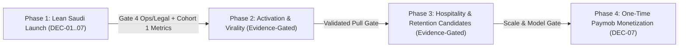

# Zaffe (زفّــة) — Product Strategy & Evidence-Gated Roadmap (v2.2)

> **Status:** `v2.2 — Synchronized with Confirmed PO Decisions (DEC-01..04 & DEC-07 Approved; DEC-05 Legal/Ops Pending; DEC-06 Provisional) — Pending Final Doc Sign-Off`  
> **Last Verified Date:** 2026-11-21  
> **Authoritative Code Baseline:** `dev` branch (`d833b95`)  
> **Governance & Companion Docs:** [OPEN_QUESTIONS.md](../OPEN_QUESTIONS.md) (`DEC-01` – `DEC-07`) · [business-requirements-document.md](../../business/business-requirements-document.md) (`v0.4`) · [DOCUMENTATION_GUIDELINES.md](../../DOCUMENTATION_GUIDELINES.md)

> [!IMPORTANT]
> **Execution Discipline (`Business First, Code Second`).** Optimization goal: **successfully launch Zaffe in Saudi Arabia, attract real couples, achieve strong creation & sharing rates, and build a trusted luxury wedding brand** — NOT maximize feature count. Decisions `DEC-01`–`DEC-04` and `DEC-07` are **PO Approved**. Gate 3 implementation begins only after final PO sign-off on these reconciled docs; Gate 4 production deployment requires a separate readiness & legal sign-off.

---

## 1. Confirmed Product Vision & Strategic Anchor (`2026-11-21`)

Zaffe is a **premium, Arabic-first digital wedding invitation platform**, **not** an event operations, guest admission, venue check-in, or physical attendance management product.
- **Core Journey:** **Choose a Design → Customize → Preview → Publish → Share** *(optional simple RSVP disabled by default per `DEC-02` Option B)*.
- **Confirmed Exclusions:** Physical guest admission, Gatekeeper (`/gate/{gateToken}`), venue check-in, QR scanning, venue door operations, recurring subscriptions, native apps, and manual custom design services are **excluded**.
- **Confirmed Commercial Guardrails (`DEC-07`):** Release 1 is completely **free**. Future monetization direction remains **one-time payment per invitation** via Paymob (`SAR`/`EGP`, no subscriptions), while choosing between `Model A`, `Model B`, or `Model C` is **deferred** until real usage and cost data arrive. Pricing pages must communicate honestly (`Release 1 is free; future pricing is not yet determined` — **NO "Free Forever" promise AND no misleading limited-time urgency or invented deadlines**).
- **Legacy Protection (`DEC-01` Option B):** All existing users, invitations, `InvitationGuest` records, `?g=` links, `rsvp_qr`/`qr_only` modes, `/pass/{qrToken}` passes, and entitlements remain preserved cleanly.

---

## 2. Competitive Reality & Saudi Market Positioning

*Hayhom facts are code/web-verified in [COMPETITIVE_ANALYSIS_HAYHOM.md](COMPETITIVE_ANALYSIS_HAYHOM.md); broader Saudi market observations are market hypotheses to test with Cohort 1 couples.*

1. **Pole A — Event-Ops & Door-Control Suites (`Hayhom`, `Mazoom`, `Da3wa Online`, `Arheb`, `Kart`, `MyInvite`):** Heavy guest-quota/WABA/app/door-scanner workflows starting around `185+ SAR` with `<72h` lockouts — intimidating and over-engineered for most weddings.
2. **Pole B — Static Graphic Tools & Freelancers (`Canva`, `InShot`, Instagram/Salla designers):** Static images/videos with no live Google Maps links, no Umm al-Qura Hijri/Gregorian countdowns, no audio tap-gate, no post-send updates, and no optional RSVP.

**Confirmed Saudi Positioning:**
> **Own the uncrowded middle between heavy Event-Ops apps and static Canva files:** *"Saudi Arabia's luxury digital wedding invitation studio — choose a couture Saudi template, customize it with family privacy in mind, preview it, share it effortlessly on WhatsApp, update details anytime, and optionally toggle simple RSVP — free for Release 1, with zero apps and zero event-ops bloat."*

---

## 3. Final Proposed Phase 1 Scope *(Approved Decisions vs. Unresolved Dependencies)*

Phase 1 maintains launch discipline across four clear categories, explicitly distinguishing **PO-Approved Work** from **Unresolved Policy / Legal / Operational Dependencies**:

### 3.1 Approved Phase 1 Delivery *(Unblocked Upon Gate 2 Doc Sign-Off)*

- **Security, Media Hygiene & Config Foundations (`PR 1`):**
  - `DATA-01`: Fix `Invitation::deleting()` to purge both local paths and app-hosted `http(s)://.../storage/...` files on customer & Filament Admin deletes.
  - `SEC-05` & `SEC-06`: Apply `SecurityHeaders` to `/admin/*` (`AdminPanelProvider`) and prevent deletion/bulk-deletion of canonical `PlatformSettingCatalog` keys.
  - `CONF-01`: Fix `composer.json` PHP constraint (`^8.4`), `.env.example` `RESEND_API_KEY=` shadow trap, dead `mail.php` key, and queue config parity.
- **View-First Core, Legacy-Only Roster & Saudi Cultural Polish (`PR 2` — `DEC-01`, `DEC-02`, `DEC-04`):**
  - `DEC-01` Option B: Hide `GuestRosterManager`, CSV import, quotas, and `?g=` UI for newly created Phase 1 invitations (`guests.blade.php` shows calm RSVP summary & CSV export only); keep full backward compatibility for existing guest rows and `rsvp_qr`/`qr_only` invitations (`/pass/{qrToken}` preserved, `"بطاقة دخول"` → `"بطاقة الدعوة الشخصية"`).
  - `DEC-02` Option B: New invitations default to view-only `announcement` (`is_rsvp_enabled = false`); single **Enable RSVP / Disable RSVP** toggle (`rsvp_only` ↔ `announcement`); disabling RSVP hides guest form without destroying collected RSVPs; zero QR passes generated for new cards; remove QR promotion; **fix both `Invitation::booted()` and `InvitationEditor::updatedIsRsvpEnabled()`** so enabling RSVP maps to `MODE_RSVP_ONLY`, never `MODE_RSVP_QR`.
  - `DEC-04.1` & `DEC-04.3` & `DEC-04.5`: Nullable non-destructive `invitations.bride_name` migration + validation + zero orphan `"و"`/`"وَ"`/`"&"` across all `14` templates, notifications, dashboard, WhatsApp copy, and passes; Saudi defaults (`Asia/Riyadh`, `+966`); `arabic_indic` countdown fix; suppress unedited `timeline`/`dress_code` `"Black Tie"` placeholders & hide incomplete toggles while preserving genuine saved customer content and Saudi `ceremonyStages()`; fix `emerald_night`, `desert_dusk`, `islamic_elegance`, `timeline.blade.php:33`, `share_box.blade.php:30`, `RsvpConfirmationNotification` declined wording, `NewRsvpNotification` emoji cleanup, and HTML `max="20"`.
- **WhatsApp Sharing, Stateless Demo, Honest Copy & Dashboard Metrics (`PR 3` — `DEC-03`, `DEC-04`, `DEC-06`, `DEC-07`):**
  - `DEC-03` Option A: Add `public/images/og-zaffe.jpg`, guarantee valid absolute `https://` `og:image`/`twitter:image` without private metadata leakage, build a **stateless, production-safe Saudi Signature demo** (independent of `local`/`testing` seeder `/invitation/ahmed-and-sarah`), leave `F15` & `ZAFFE-017` unmerged.
  - `DEC-04.2` & `DEC-04.4` & `DEC-07`: Remove simulated Alpine `/contact` form keeping real `PlatformSetting` WhatsApp/Email cards; sync honest `faq.blade.php` & `/pricing` & `/about` copy (`14` themes, Arabic-first P1 cards, zero QR hype, Release 1 free & future pricing undetermined with zero `"Free Forever"` or fake urgency); fix `DashboardController::index()` `children_count` & `archived` badge; minor `DATA-02` cleanup; add subtle `?ref=invite` footer link + `OperationsMonitor` `KPI-01` & `KPI-02`.

### 3.2 Unresolved Policy, Legal & Operational Dependencies *(Must Resolve Explicitly)*

| Dependency | Gate | What Remains Open |
| :--- | :---: | :--- |
| **`C-5` User Upload WebP (`SAUDI_MARKET_DECISIONS` §4)** | Before PR 2 | PO to approve minimal ~50-LOC synchronous GD `.webp` resize/convert on upload **OR** grant an explicit Phase 1 waiver for couple uploads while all `14` templates stay `.webp`. |
| **`C-6` Audio `music_url` (`SAUDI_MARKET_DECISIONS` §6)** | Before PR 2 | PO to choose hiding `music_url` on new Phase 1 creations (preserving existing) **OR** adding owner copyright attestation **OR** supplying cleared audio files. |
| **`C-7` `International` Phone UI Selector** | Before PR 2 | PO to confirm `SA (+966)` + `EG (+20)` UI only vs. adding generic `International` option. |
| **`DEC-06` Supplementary KPIs & Sponsor** | Before PR 3 | PO to confirm adding `KPI-03b` & `KPI-05` ([OPEN_QUESTIONS.md](../OPEN_QUESTIONS.md) §2.2) and confirm Sponsor name/title. |
| **`DEC-05` Saudi PDPL Legal Gate & `PR 4`** | Before PR 4 / Gate 4 | Independent Saudi PDPL counsel review of `/privacy`, `/terms`, **proposed 30-day guest/RSVP PII retention preference** (auto-delete stays **OFF** until finalized), cross-border EU/Resend transfers, privacy request SLA & verification process, and whether automated retention is required pre-launch. |
| **`DEC-06` Real Contacts, Domain & Hostinger Verification** | Before PR 4 / Gate 4 | Real Saudi support email & WhatsApp/phone, confirmed domain & Resend DNS, verified Hostinger Unlimited vs. KVM 1/2 VPS check (**no purchase without PO approval**), named ops owner & launch schedule. |

---

## 4. Minimum Reliable Production Architecture (`DEC-06` Provisional Assessment)

Aligned with the PO's goal of **low fixed cost and zero premature complexity**:
- **Primary Candidate Under Evaluation:** Hostinger **"Unlimited" shared website-hosting plan (12-month promo)** — **pending verification, NOT confirmed/purchased**.
  - Must verify before commitment: web + CLI **`PHP >= 8.4.1`** (`symfony/http-foundation v8.1.11` requires `8.4.1+`), CLI **`ext-intl`**, exact MariaDB compatibility/limits, cron minimum interval + `flock` for `--stop-when-empty` `database` queue workers *(paired with synchronous password reset delivery, since shared hosting blocks Supervisor)*, `.env`/storage symlink security, independent off-site backup & restore test, **actual 12-month renewal pricing**, and **EU datacenter PDPL cross-border transfer clearance** (Hostinger has no KSA datacenter).
- **Minimum Viable Fallback:** Only if shared hosting fails any hard Laravel 13 check (PHP `8.4.1`, `ext-intl`, MariaDB DDL, or cron queue reliability), fall back to a single **Hostinger KVM 1/2 VPS** (PHP 8.4+/8.5 + MySQL 8.4 + Supervisor). **Never** add Redis clusters, S3/R2, or Kubernetes in Phase 1.
- **CDN & Email:** Cloudflare Free edge caching (serving `.webp`/Vite assets closer to Riyadh/Jeddah for WhatsApp WebView LCP `< 2.5s`) + **Resend Free Tier** (`3,000/mo`) over verified DNS (`SPF`/`DKIM`/`DMARC`).

---

## 5. Evidence-Gated Multi-Phase Roadmap *(Phases 2–4 Remain Proposals Triggered Only by Evidence)*

- **Phase 2 Candidates *(Triggered only by Cohort 1 metrics)*:** True dynamic couple OG image cards + short `/i/` links (`F15` selective evolution), async WebP pipeline (`if >15% uploads & LCP > 2.5s`), guided onboarding patterns (`ZAFFE-017`, `if KPI-01 drop-off`), curated licensed zaffa/audio library, and full English (`en`) public cards/editor (`BRQ-36`).
- **Phase 3 Candidates *(Triggered only by verified customer pull)*:** Dual Men/Women hall views, Multi-Event suites (`Milka/Henna/Wedding`), Family Co-Hosts, moderated Wishes Wall & Thank-You Card, **optional named `?g=` greeting revival (no QR)**, Saudi Signature Vol. 2, light Planner workspace, and **automated post-event PDPL retention execution** (post-counsel policy + transition window).
- **Phase 4 (`F11` Deferred — `DEC-07`):** One-time Paymob per-invitation checkout (`SAR`/`EGP`, evaluating `Model A vs B vs C` strictly on real Phase 1–2 usage & unit costs, with ZATCA/VAT legal review and an explicit grandfathering/transition policy).

---

## 6. Concise Acquisition & Growth Focus (`Phase 1`)

1. **Product-Led WhatsApp Loop:** Verified public HTTPS `og:image` previews + tasteful `/templates?ref=invite` card footer.
2. **Short-Form Arabic Video (`TikTok`, `Snapchat`, `Reels`):** Highlight couture Saudi templates, Umm al-Qura Hijri conversion, optional `bride_name` privacy, and easy link sharing — zero QR/Event-Ops positioning.
3. **Zero-Login Live Previews & SEO:** Production-safe Saudi demo (`/demo`) and interactive `/templates/{slug}/preview`.
4. **Targeted Partner Seeding:** Direct walkthroughs with boutique Saudi wedding stylists and planners once Gate 4 passes.

---

## 7. Major Assumptions to Test With First 50–100 Saudi Couples

`A-1` Interactive web card vs. static Canva/PDF (`KPI-02`); `A-2` Optional `bride_name` & photo-free adoption; `A-3` View-first `announcement` default vs. opt-in RSVP usage; `A-4` Couple preference for personal WhatsApp links vs. automated blasts; `A-5` `?ref=invite` footer discovery; `A-6` Mobile-first studio creation behavior; `A-7` Post-wedding one-time willingness-to-pay (`Model A vs B/C`).

---

## 8. Product Decision Log (`PDL-001` – `PDL-018`)

| ID | Date | Decision Summary | Status (`2026-11-21`) |
| :--- | :---: | :--- | :--- |
| **PDL-001** | `2026-11-15` | Release 1 100% Free; no subscriptions; `"Free Forever"` explicitly rejected | **PO APPROVED (`DEC-07`)** |
| **PDL-002** | `2026-11-15` | Exclude venue staffing, custom design agency, SMS/WABA blasts | **PO APPROVED** |
| **PDL-003–004** | `2026-11-15` | Pure-PHP `QrCodeService` & `F16` Part A passes in `dev` | **LEGACY PRESERVATION ONLY (`DEC-01`/`02`)** |
| **PDL-005** | `2026-11-15` | Gatekeeper Portal (`/gate/{token}` on `feature/ZAFFE-018`) | **EXCLUDED FROM STRATEGY** |
| **PDL-006 / 008** | `2026-11-15` | Early `F16` Part A/B Hayhom parity framing | **SUPERSEDED (`DEC-01`/`02`)** |
| **PDL-007 / 009** | `2026-11-19` | Saudi Signature Vol. 1 (`sort_order 1–8`) & Paymob deferred behind PO sign-off | **SHIPPED / APPROVED** |
| **PDL-010–011** | `2026-11-21` | Design-led Saudi vision, legacy data preservation, lean quality-first Phase 1 | **PO APPROVED** |
| **PDL-012** | `2026-11-21` | `DEC-01` **Option B** (Legacy-Only Roster visibility; `?g=` & `/pass/` preserved) | **PO APPROVED (`DEC-01`)** |
| **PDL-013** | `2026-11-21` | `DEC-02` **Option B** (RSVP Disabled by Default / `announcement`; binary toggle; non-destructive off; fix `booted()` & `Editor`; zero QR promotion) | **PO APPROVED (`DEC-02`)** |
| **PDL-014** | `2026-11-21` | `DEC-03` **Option A** (Targeted OG/HTTPS fixes, `og-zaffe.jpg`, prod-safe Saudi demo; do NOT merge `F15` or `ZAFFE-017`) | **PO APPROVED (`DEC-03`)** |
| **PDL-015** | `2026-11-21` | `DEC-04.1`–`4.5` (`bride_name` optional, `/contact` direct channels, suppress `"Black Tie"` placeholders, Arabic-first P1 cards, accurate dashboard counts, defer archive UI/suspension) | **PO APPROVED (`DEC-04`)** |
| **PDL-016** | `2026-11-21` | `DEC-05`: Conditional Full Public Launch, self-service invite delete + privacy request process, proposed 30-day guest PII retention *(auto-delete OFF)* | **BUSINESS DIRECTION APPROVED; LEGAL & OPS PENDING** |
| **PDL-017** | `2026-11-21` | `DEC-06`: Hostinger Unlimited assessment (vs KVM fallback), real contacts, Resend DNS, candidate `KPI-03b`/`KPI-05` | **PROVISIONAL / PENDING OPS & PO CONFIRMATION** |
| **PDL-018** | `2026-11-21` | Unresolved deviations `C-5` (WebP upload), `C-6` (`music_url`), `C-7` (`International` phone UI) | **PENDING PO SELECTION** |
