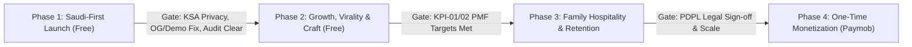

# Zaffe (زفّــة) — Product Strategy & Phased Growth Roadmap (v2.0)

> **Status:** `Proposed / Pending Product Owner Approval` *(Reconciled with Product Owner Strategic Vision of `2026-11-20`)*  
> **Last Verified Date:** 2026-11-20  
> **Authoritative Code Baseline:** `dev` branch (`d833b95`)  
> **Governance:** [DOCUMENTATION_GUIDELINES.md](../../DOCUMENTATION_GUIDELINES.md) · [business-requirements-document.md](../../business/business-requirements-document.md) · [OPEN_QUESTIONS.md](../OPEN_QUESTIONS.md)

> [!IMPORTANT]
> **How to read this document.** This v2.0 strategy replaces the `2026-11-15` Hayhom/QR-access-control strategy with a **Saudi-first, design-led digital wedding invitation platform** strategy grounded in verified `dev` codebase evidence (`d833b95`) and the Product Owner's `2026-11-20` directives. **All roadmap phases, feature dispositions, positioning claims, and KPI targets marked `Proposed` are recommendations pending formal Product Owner approval** before any code changes occur.

---

## 1. Strategic Realignment & Confirmed Product Owner Guardrails (`2026-11-20`)

### 1.1 Confirmed Product Owner Directives (`Locked Policy Anchor`)
1. **Design-Led Core Focus (Release 1 / Phase 1):** Focus on creating, customizing, publishing, and sharing beautiful, culturally appropriate digital wedding invitations.
2. **Simple, Optional RSVP:** RSVP must be straightforward and strictly optional for couples who only want an invitation card.
3. **Zero Creation Friction:** Advanced guest management must never complicate the primary invitation creation journey.
4. **Preserve Legacy Guest Roster & Personalized Links (`?g=`):** Do not delete existing `GuestRosterManager` and `?g=` personalized link capabilities blindly; evaluate them carefully for progressive disclosure or later-phase positioning.
5. **No QR Pass Promotion at Launch:** QR Passes (`/pass/{qrToken}`) must **not** be promoted as part of the primary Phase 1 launch experience.
6. **Venue Operations Permanently Excluded:** QR scanning, Gatekeeper (`/gate/{gateToken}`), physical door check-in, and venue attendance operations are **excluded from the current product strategy**.
7. **Free Phase 1 Launch:** Release 1 / Phase 1 remains **100% free** (`SubscriptionPlanResource` locked at `403`, zero paywalls).
8. **Market Priority:** **Saudi Arabia (KSA)** is the primary target market, followed by **Egypt**.
9. **Data & Backward-Compatibility Protection:** Existing user accounts, invitations, guest records, and links must be protected.
10. **Future Monetization Model:** Future monetization must follow **one-time payment per invitation/wedding** (Paymob `SAR`/`EGP`), never recurring subscriptions.

### 1.2 Why the `2026-11-15` Strategy Needed Correction
The previous `2026-11-15` strategy positioned Zaffe primarily as a *"zero-app Hayhom challenger for QR entry control and gatekeeper scanning."* Verified codebase inspection shows why that thesis misaligns with both the Product Owner's vision and what makes Zaffe genuinely win in Saudi Arabia:

| Strategic Dimension | Earlier `2026-11-15` Thesis *(Superseded)* | Realigned `2026-11-20` Thesis *(Proposed)* |
| :--- | :--- | :--- |
| **Core Identity** | Smart Guest Access & QR Check-In Platform | **Design-Led Digital Wedding Invitation Studio** |
| **Primary Hero Hook** | QR passes + isolated venue door scanning | **Couture Saudi aesthetics, instant mobile creation, effortless WhatsApp sharing, family privacy, optional simple RSVP** |
| **Default New Card Flow** | `rsvp_qr` (auto-issuing QR passes + heavy roster UI) | **Simple Invitation + Optional RSVP** (no QR passes promoted; heavy tools hidden/progressively disclosed) |
| **Primary Competitor Wedge** | Undercut Hayhom's paid gatekeepers | **Beat static PDFs/Canva on elegance & utility while beating event-ops apps on simplicity & $0 entry** |
| **Venue Gatekeeper (`F16` Part B)** | Queued as `P0/P1` next merge (`RICE 459.0`) | **Excluded from current strategy** |

---

## 2. Current Product Position Assessment (`dev` `d833b95` — Code-Verified)

### 2.1 Honest Product Diagnosis `[VERIFIED]`
Zaffe sits on a **high-craft engineering foundation** (`Laravel 13`, `Livewire 4`, `Tailwind CSS v4`, `Filament v5`, `196` passing PHPUnit tests / `2,230` assertions on PHP 8.5 + `ext-intl`) and owns an exceptional aesthetic asset in the **8 Saudi Signature Collection — Vol. 1** themes (`ZAFFE-023` / `ZAFFE-024`, self-hosted `.webp` thumbnails, zero external CDN hotlinks, SVG `<x-app-icon>`).

However, the current `dev` codebase suffers from an **identity split and last-mile KSA polish deficit**:
- **Product identity skews toward QR passes:** New invitations default to `rsvp_qr` (`database/migrations/2026_11_15_100001:13-14`, `Invitation::effectiveMode()`, `InvitationEditor.php:60`); the Editor's `rsvp` tab leads with QR Pass mode and CTA `"إدارة قائمة المدعوين وبطاقات QR"` (`invitation-editor.blade.php:425,463`); `home.blade.php`, `pricing.blade.php`, and `about.blade.php` promote QR Passes; `/dashboard/invitations/{id}/guests` puts `<livewire:guest-roster-manager>` above the simple RSVP responses table (`dashboard/guests.blade.php:37-40`); and four views still display `"بطاقة دخول"` ("entry pass") copy (`guest-pass.blade.php:1,8`, `invitation-show.blade.php:33`, `access_section.blade.php:50`, `rsvp-form.blade.php:38,43`).
- **WhatsApp sharing — our #1 acquisition channel — is fragile today:** `public/images/og-zaffe.jpg` does not exist on disk (`base.blade.php:22,28`), and `invitation-show.blade.php:3` passes relative thumbnail paths (`/images/templates/*.webp`) to `:og-image` instead of absolute URLs.
- **Production homepage demo 404s:** `home.blade.php:37,150,558` links `"عاين دعوة حية مباشرة"` to `/invitation/ahmed-and-sarah`, which `DatabaseSeeder.php:386,421` seeds **only in `local`/`testing`** — yielding an HTTP `404` on production and showing an Egyptian Cairo card rather than a Saudi Signature showcase.
- **Saudi-first defaults & privacy promises remain unfinished:** `bride_name` is still `NOT NULL` in DB and `required` in wizard/editor/Admin forms (`DashboardController.php:76`, `InvitationEditor.php:307`, `InvitationForm.php:47`), while only the 8 Saudi Signature templates guard empty `bride_name`; `timezone` defaults to `Africa/Cairo` (`DashboardController.php:117`, `InvitationEditor.php:43`, `InvitationForm.php:59`); `PlatformSettingCatalog.php:39,45` defaults support numbers to `+20 100 000 0000`; and `countdown.blade.php` ignores `arabic_indic` digits.
- **Credibility & audit blockers remain open:** Simulated Alpine-only `/contact` form (`contact.blade.php:87`), stale `"6 themes"` copy (`pricing.blade.php`, `about.blade.php`), placeholder-only `timeline`/`dress_code` toggles, Admin media orphan bug (`DATA-01`), missing `/admin/*` `SecurityHeaders` (`SEC-05`), canonical `PlatformSetting` bulk-delete gap (`SEC-06`), `composer.json` `^8.3` vs `>= 8.4.1` lockfile mismatch (`CONF-01`), and absent PDPL privacy notice / retention policy (`BRQ-39`).

### 2.2 Strengths, Weaknesses, Gaps & Opportunities (`dev` `d833b95`)

| Dimension | Verified Findings & Strategic Implications |
| :--- | :--- |
| **Strengths** `[VERIFIED]` | 1. **14 Active Free Themes (`8` Saudi Signature Vol. 1 + `6` Baseline):** Self-hosted `.webp` thumbnails (`public/images/templates/`), photo-free luxury rendering, zero external hotlinks. 2. **Saudi Cultural Infrastructure:** Umm al-Qura Hijri conversion (`InvitationDateFormatter`), dual timezones (`Asia/Riyadh`, `Africa/Cairo`), E.164 `+966`/`+20` validation (`PhoneService`), user-tap zaffa audio open-gate (`music_player.blade.php`), `<x-app-icon>` SVGs. 3. **Fast Browser Creation & Live Studio:** 6-tab autosaving `InvitationEditor`, instant publish/unpublish, 1-click WhatsApp share URLs, zero `72h` edit lockouts. 4. **Security & Admin Foundation:** `#[Locked]` Livewire props, ownership scoping (`Auth::user()->invitations()`), `CsvSanitizer::cell()` + UTF-8 BOM, `403` draft isolation, `SecurityHeaders`, Filament v5 (`7` resources + `OperationsMonitor` + `8` Policies), `196` passing tests. |
| **Weaknesses** `[VERIFIED]` | 1. **Misaligned QR Framing:** `rsvp_qr` default, QR marketing copy, `"بطاقة دخول"` wording, and heavy roster above RSVPs distract from core card creation. 2. **Broken Demo & Fragile OG Previews:** Missing `og-zaffe.jpg`, relative OG thumbnail URLs, production `404` on `/invitation/ahmed-and-sarah`. 3. **Unfinished KSA Privacy & Regional Defaults:** Required `bride_name`, `Africa/Cairo` / `+20` fallbacks, broken `arabic_indic` countdown, Egypt/EGP listed before KSA/SAR on `/pricing`. 4. **Trust & Polish Defects:** Fake `/contact` form, stale `"6 themes"` text, `timeline`/`dress_code` rendering hardcoded placeholders (`"Black Tie / Formal Evening"`), `emerald_night`/`desert_dusk` ignoring custom colors, `islamic_elegance` ignoring `welcome_message`, `RsvpConfirmationNotification` sending `"confirmed"` on declines, Arabic-only Editor/RSVP/public cards. |
| **Critical Gaps** `[VERIFIED]` | 1. **PDPL & Trust Surfaces:** No Privacy Policy or Terms pages, no post-event retention schedule or self-service deletion workflow (`BRQ-39`). 2. **Growth & Funnel Telemetry:** No `Create/Wizard-Start` tracking (`KPI-01`), no `>= 10` shared views instrumentation (`KPI-02`), and template footers link to `/` instead of `/templates?ref=invite`. 3. **Media & Audio Completeness:** Uploaded photos (`<= 5MB`) lack server-side WebP resizing/compression (`PERF-02`), and audio relies on pasting raw external `.mp3` URLs rather than a curated royalty-free library. 4. **Security/Data Hygiene:** `DATA-01`, `SEC-05`, `SEC-06`, `DATA-02`, `CONF-01` ([TECHNICAL_AUDIT.md](../../architecture/TECHNICAL_AUDIT.md) §6). |
| **Opportunities** | 1. **Own the Saudi Design-First Space:** Combine Canva-level beauty + WhatsApp web interactivity (maps, Hijri, audio gate, instant edits, optional RSVP) with `$0` entry and zero event-ops bloat. 2. **Guest-to-Couple Viral Flywheel:** Every shared wedding reaches ~100–250 guests on WhatsApp; a tasteful attribution footer + working OG card turns every wedding into an acquisition channel. 3. **Saudi Cultural Specialization:** Optional `bride_name` / family kunya phrasing, dual Men's/Women's venue blocks (Phase 3), and multi-event `Milka + Wedding` suites. 4. **Uncontested Egypt Secondary Growth:** Same lightweight web product serves Cairo/Alexandria `Katb Kitab` & hotel weddings with zero physical ops overhead. |

---

## 3. Saudi Market Landscape & Recommended Positioning (`Proposed`)

### 3.1 The Two Crowded Poles in Saudi Arabia
*Classification: Hayhom details are `[VERIFIED]` ([COMPETITIVE_ANALYSIS_HAYHOM.md](COMPETITIVE_ANALYSIS_HAYHOM.md)); broader market observations reflect web research (`2026-11-20`) and should be validated via early customer interviews (`[HYPOTHESIS]`).*

1. **Pole A — Event-Ops & Door-Control Platforms (`Hayhom`, `Mazoom`, `Da3wa Online`, `Arheb`, `Kart`, `MyInvite`):**
   - Built around paid WhatsApp Business API / SMS bulk blasting, per-guest quotas (`25–500+`), mandatory native app onboarding (`Hayhom`), QR door scanning, and physical gatekeepers (`Hayhom`: `185–10,950 SAR`; `72h` edit lock; `10%–100%` cancellation/postponement penalties).
   - **Why couples hesitate:** High upfront cost, complex contact-list setup, app/OTP friction, and rigid modification rules — overkill for couples who want to send a gracious invitation from their own WhatsApp.
2. **Pole B — Static Graphic Templates & Freelance Designers (`Canva`, `InShot`, Instagram/Salla designers):**
   - Easy visual starting point or cheap static JPEG/MP4 card, shared manually via WhatsApp.
   - **Why couples get frustrated:** Dead static images cannot launch Google Maps pins, show live countdowns, switch between Hijri and Gregorian cleanly, play an interactive tap-to-open zaffa, collect optional RSVPs, or reflect last-minute time/hall changes without re-exporting and re-sending files.

### 3.2 Recommended Positioning (`Proposed / Pending PO Approval`)
**Reject competing on Door Check-In (`Pole A`) or Static Files (`Pole B`). Claim the Blue-Ocean Middle:**

> **"Zaffe (زفّــة) — Saudi Arabia's Design-Led Digital Wedding Invitation Studio: Luxury Saudi wedding cards you customize on your phone in minutes, share cleanly on your own WhatsApp, update anytime, and pair with simple optional RSVP — 100% free to start, with zero apps and zero event-ops complexity."**

**Three Core Competitive Pillars (`Proposed`):**
1. **Couture Saudi Craft & Privacy:** Heritage-led Saudi Signature designs, photo-free elegance, true optional `bride_name` / family honorifics, Umm al-Qura Hijri + configurable Arabic-Indic/Latin digits, formal-simple Arabic (`الفصحى البسيطة`).
2. **Effortless Creation & Living WhatsApp Experience:** Mobile-ready in under 3 minutes; opens instantaneously in WhatsApp WebView with a tactile audio seal, Google Maps venue pin, live countdown, and instant post-publish edits (no `72h` lockout).
3. **Simple, Optional Guest Coordination:** Clean ON/OFF RSVP toggle with headcount summary and Excel/CSV export — zero forced guest-roster spreadsheets or QR pass hurdles to publish.

---

## 4. Proposed 4-Phase Product Roadmap (`Proposed / Pending PO Approval`)

### Phase 1 — Saudi-First Market Launch (`100% Free — Core Studio, Sharing & Simple Optional RSVP`)
* **Business Objective:** Ship a trustworthy, culturally authentic, effortlessly simple wedding invitation platform ready for public Saudi acquisition (with full Egypt compatibility) at `$0` paywall and `$0` operational bloat.
* **What Ships in Phase 1 (`Proposed`):**
  1. **Streamlined Primary Journey:**
     - Default new invitations to **`Asia/Riyadh`**, **`+966`**, and **`rsvp_only`** *(or PO choice under `DEC-02`)* with a **simple binary RSVP ON/OFF toggle** (`rsvp_only` ↔ `announcement`) in the Editor.
     - **Zero QR Pass Promotion:** Remove QR Pass / Gatekeeper claims from `/`, `/pricing`, `/about`, and primary Editor tabs; hide `rsvp_qr`/`qr_only` from new-creation UI while keeping existing `rsvp_qr`/`qr_only` invitations, `/pass/{qrToken}`, and legacy `"بطاقة الدعوة الشخصية"` copy intact (`DEC-01`, `DEC-02`).
     - **Re-order `/dashboard/invitations/{id}/guests`:** Show Simple Submitted RSVP Stats + Response Table + CSV Export first; place `GuestRosterManager` behind progressive disclosure (`DEC-01`).
  2. **True Saudi Cultural & Privacy Compliance:**
     - Nullable `invitations.bride_name` across DB migration, validation (`DashboardController`, `InvitationEditor`, Filament `InvitationForm`), all 14 templates (suppressing orphan `"و"` / `"&"`), WhatsApp share messages, dashboard cards, passes, and email subjects (`G-01`, `G-19`).
     - Fix `countdown.blade.php` `arabic_indic` numeral rendering (`G-10`).
     - Fix `emerald_night` & `desert_dusk` custom palette overrides, `islamic_elegance` `welcome_message`, `timeline.blade.php` CSS hairline, and `share_box.blade.php` clipboard fallback.
     - Re-order `/pricing` copy (`14` free templates, Saudi `0 SAR / EGP` framing) and `/about` (`14` themes).
  3. **WhatsApp Sharing & Demo Credibility:**
     - Production-safe Saudi Signature showcase invitation accessible from homepage `"عاين دعوة حية مباشرة"` (fixing production `404` on `/invitation/ahmed-and-sarah`).
     - Create `public/images/og-zaffe.jpg` fallback and force **absolute URLs** in `og:image` / `twitter:image` (`invitation-show.blade.php:3`).
     - Add tasteful `?ref=invite` attribution on template footers (`G-14` / `BRQ-46`).
  4. **Trust, Security & Admin Readiness:**
     - Close audit blockers: `DATA-01` (Admin delete media purge), `SEC-05` (`/admin/*` `SecurityHeaders`), `SEC-06` (canonical `PlatformSetting` bulk-delete lock), `DATA-02` (Filament form/export bugs), `CONF-01` (`composer.json` `^8.4`, Resend `.env.example`/config cleanup).
     - Wire `/contact` to real DB/email persistence + Filament `ContactMessageResource` (or remove fake form if PO prefers direct WhatsApp/Email), and replace `+20 100 000 0000` placeholders with real `PlatformSetting` values.
     - Publish Arabic/English `/privacy` and `/terms` baseline notices (`BRQ-39`, subject to legal sign-off before commercial launch).
     - Fix `DashboardController::index()` (`children_count`, `archived` badge) and add couple `archive` button; disable or hide empty placeholder `timeline`/`dress_code` output unless edited (or ship simple lightweight editors per `DEC-04`); fix `RsvpConfirmationNotification` declined wording; instrument `KPI-01` & `KPI-02` in `OperationsMonitor`.
* **Dependencies:** PO sign-off on `DEC-01`–`DEC-06`; legal review of `/privacy` & PDPL obligations; production hosting (`PHP >= 8.4.1`, `ext-intl`, `MySQL 8.4`, Supervisor queue worker, verified Resend domain).
* **Phase 1 Exit / Release Gate:** `100%` passing test suite (including legacy migration & `bride_name` nullable tests), Pint clean, `npm run build` clean, MySQL 8.4 staging verification, live WhatsApp WebView OG/LCP smoke test (`< 2.5s`), zero fake UI forms or 404 demo links.

### Phase 2 — Organic Growth, WhatsApp Virality & Cultural Customization Depth (`100% Free`)
* **Business Objective:** Accelerate organic customer acquisition (`KPI-02`) and creative delight once Phase 1 proves wizard-to-publish activation.
* **Proposed Scope:**
  - **Rich WhatsApp Link Virality (Selective Port of `F15`):** Short `/i/{code}` invitation URLs, auto-generated `OgImageService` invitation preview cards (couple names, Hijri date, theme styling), and async GD WebP upload resizing/compression (`PERF-02`, solving 5MB raw mobile uploads for WhatsApp WebView LCP).
  - **Country-First Guided Wizard & Arabic Date Picker (Selective Port of `ZAFFE-017`):** Adopt `CountryDefaultsService` (`SA` / `EG` cultural copy presets) and `arabic-date-picker` cleanly onto the `ZAFFE-022` Atelier design system.
  - **Curated Licensed Ceremonial Audio Library:** Built-in cleared Zaffe, Duff, Oud, and Nasheed tracks selectable inside Editor without pasting external `.mp3` links ([SAUDI_MARKET_DECISIONS.md](../SAUDI_MARKET_DECISIONS.md) §6).
  - **Saudi Signature Collection — Vol. 2 & Custom Section Editors:** Expand design catalog (e.g., Asiri Qatt, AlUla Sandstone, Winter Majlis) + full rich `timeline` & `dress_code` builders if deferred from Phase 1.
  - **Full Bilingual Public Cards & Editor (`BRQ-36`):** Complete `lang/ar` & `lang/en` parity across `InvitationEditor`, `RsvpForm`, and public cards (beating Hayhom's `850 SAR` bilingual paywall).
  - **Optional Named Guest Links (`?g=`, No QR Framing):** Surface personalized WhatsApp guest invitations cleanly as an optional advanced tool for hosts who want pre-filled family greetings.
* **Admin Controls Required:** Filament Audio Track CRUD (`AudioTrackResource`), `?ref=invite` referral analytics on `OperationsMonitor`, and WebP storage/queue health metrics.
* **Release Gate:** Phase 1 KPI-01 activation stable; staging queue/GD memory tests pass; copyright clearance documented for every bundled audio track.

### Phase 3 — Saudi Family Hospitality, Multi-Event & Retention (`Free Core`)
* **Business Objective:** Deepen Saudi cultural fit for complex family weddings, boost retention across wedding planning cycles, and create natural value anchors for future monetization.
* **Proposed Scope:**
  - **Dual-Hall Support (Men's Majlis & Women's Ballroom / قاعة الرجال و قاعة النساء):** Separate venue names, addresses, Google Maps links, and timings on one invitation.
  - **Multi-Event Wedding Suites (`F19`):** Linked sub-events (`Milka / كتب كتاب`, `Henna / الغمرة`, `Wedding / الزفاف`) under a unified wedding slug.
  - **Delegated Family Co-Hosts (`F18`):** Bride-side / Groom-side scoped co-host links (`bilateral privacy` so families manage their own guests without exposing private lists to the other side).
  - **Moderated Guest Wishes Wall & Post-Wedding Thank-You Card (`F21`):** Hosts approve guest blessings for display and send a post-wedding digital thank-you card.
  - **Light Wedding Planner Workspace:** Single planner dashboard managing multiple client drafts (no white-label agency overhead in Phase 3).
  - **Automated PDPL Post-Event Archival & Self-Service Deletion (`BRQ-39`):** Scheduled post-wedding PII anonymization/purge and couple/guest self-service deletion requests.
* **Admin Controls Required:** PDPL deletion request queue & retention threshold settings in `PlatformSetting`, co-host abuse/revocation visibility, multi-event moderation.
* **Release Gate:** PDPL legal counsel audit sign-off for automated retention/deletion; cross-family privacy isolation security tests.

### Phase 4 — Value-Aligned One-Time Monetization (`F11` via Paymob — Feature-Flagged)
* **Business Objective:** Generate sustainable revenue through **one-time per-wedding payments** (`SAR` & `EGP`, zero recurring subscriptions) without choking free acquisition.
* **Proposed Commercial Architecture (`Proposed / Pending PO Approval`):**
  - **Free Forever Tier (Acquisition Engine):** Create, customize, publish, share via WhatsApp, and collect basic optional RSVPs using core themes (`0 SAR / EGP`) — preserving Zaffe's viral flywheel!
  - **One-Time Per-Wedding Premium Upgrade (`Paymob` SAR: Mada, Apple Pay, STC Pay, Visa/MC; EGP: Visa/MC, InstaPay, Mobile Wallets, Fawry):** Unlocks curated premium/signature collections (`Vol. 2+`), multi-event suites (`Milka + Wedding`), delegated family co-hosts, custom-branded OG share cards, or expanded media/audio perks — stored as a **one-time per-invitation entitlement** (`invitations` / `wedding_orders`), replacing the dormant recurring `subscription_plans` schema (`G-16`).
  - **Grandfathering Rule:** All invitations created in Phases 1–3 remain free permanently.
* **Admin Controls Required:** Dynamic `SAR`/`EGP` price keys in `PlatformSetting`, feature flag toggle, Filament `OrderResource` / refund & invoice tracking (replacing dormant `SubscriptionPlanResource`).
* **Release Gate:** Commercial/legal pricing sign-off, ZATCA e-invoicing / VAT compliance check (KSA), Paymob sandbox & HMAC webhook audit, and explicit PO go-live approval.

### 4.1 Capabilities Explicitly Excluded from Current Product Strategy (`Confirmed PO Direction`)
- **QR Scanning, Gatekeeper Portal (`/gate/{gateToken}`), & `feature/ZAFFE-018-smart-guests-and-qr-checkin` merge:** Permanently excluded from current roadmap; branch remains archived on `origin` untouched.
- **Physical Door Check-In Staffing & Hardware:** Excluded.
- **Manual Human Design Studio & Outbound Call-Center Concierge:** Excluded (protects SaaS scalability and margins).
- **Recurring Monthly/Annual Subscriptions:** Excluded.
- **Native iOS/Android Apps:** Excluded in favor of zero-install mobile web + WhatsApp WebView experience.

---

## 5. Existing Feature Disposition Matrix (`Proposed / Pending PO Approval`)

| Existing `dev` Feature | File / Surface | Proposed Phase 1 Disposition | Rationale & Backward-Compatibility Safeguard |
| :--- | :--- | :--- | :--- |
| **8 Saudi Signature + 6 Baseline Templates** | `resources/views/templates/` | **Emphasize & Polish** | Core moat; fix `bride_name` orphan connectors in 6 baseline views, `countdown` numerals, and 3 customization bugs. |
| **Live Studio Editor (6 Tabs)** | `InvitationEditor.php` | **Simplify & Emphasize** | Default to `Asia/Riyadh`, simplify `rsvp` tab to RSVP ON/OFF toggle; fix/guard `timeline` & `dress_code` placeholders. |
| **1-Click WhatsApp Share & Maps** | `Invitation.php`, `share_box.blade.php` | **Emphasize & Harden** | Fix `og-zaffe.jpg`, use absolute `og:image` URLs, guard clipboard fallback, append `?ref=invite` on footers. |
| **Audio Open-Gate (`شاشة فتح الدعوة`)** | `music_player.blade.php` | **Emphasize (Phase 1) → Expand (Phase 2)** | Keep zero-autoplay open-gate in Phase 1; add licensed audio library in Phase 2. |
| **Simple RSVP (`rsvp_only`) & CSV Export** | `RsvpForm.php`, `DashboardController` | **Simplify & Emphasize** | Clean optional RSVP without generating QR passes; reorder `guests.blade.php` to put RSVP list first; fix declined email copy. |
| **Guest Roster & `?g=` Personalized Links** | `GuestRosterManager.php`, `?g=` | **Progressively Disclose (`DEC-01`)** | Do **not** delete; move into secondary tab/accordion below RSVP list in Phase 1 and elevate as optional feature in Phase 2–3. |
| **QR Pass Generation (`rsvp_qr`, `qr_only`, `/pass/{qrToken}`)** | `GuestPassController`, `QrCodeService` | **Hide from New Creation UI; Preserve Legacy** | Remove from marketing copy & new invitation mode choices; **keep `/pass/{qrToken}` & DB columns active** for existing records (`DEC-02`), changing `"بطاقة دخول"` → `"بطاقة الدعوة"`. |
| **Gatekeeper Door Check-In (`F16` Part B)** | `feature/ZAFFE-018`, `invitation_gates` | **Excluded from Strategy** | Never merge `feature/ZAFFE-018`; keep dormant DB columns untouched (`no destructive drops`). |
| **Unmerged `F15` (`/i/`, `OgImageService`, WebP)** | `origin/feature/ZAFFE-015` | **Defer to Phase 2 (Selective Port)** | Do not blind-merge pre-`ZAFFE-022` branch; pull minimal OG absolute-URL fix into Phase 1 and port full pipeline cleanly in Phase 2 (`DEC-03`). |
| **Unmerged `ZAFFE-017` Wizard** | `feature/ZAFFE-017` (local) | **Defer Patterns to Phase 2** | Port `CountryDefaultsService` SA-first idea & `arabic-date-picker` cleanly onto Atelier UI in Phase 2 (`DEC-03`). |
| **Dormant Subscriptions (`F11`)** | `SubscriptionPlanResource` (`403`) | **Defer to Phase 4 (Re-architect)** | Keep `403` in Phases 1–3; replace recurring model with one-time per-wedding Paymob model in Phase 4. |

---

## 6. Proposed Acquisition & Organic Growth Strategy (`Saudi-First, Egypt-Second`)

1. **Engine 1 — Built-In Viral Guest-to-Couple Loop (`$0 CAC`, Phase 1–2):**
   - Every published invitation displays a refined, non-intrusive footer (`"صُممت عبر منصة زفّــة"`) linking to `/templates?ref=invite` (tracked in `OperationsMonitor`).
   - *Illustrative Modeling Hypothesis (NOT observed baseline — requires Phase 1 instrumentation):* If `100` active Saudi weddings reach `~150` unique guests each (`15,000` mobile views inside active marriage circles), a `1%–2%` conversion of engaged guests/sisters/planners yields `150–300` new accounts at zero ad spend — *contingent on fixing WhatsApp OG cards and mobile demo links first*.
2. **Engine 2 — Visual-First Short-Form Video (`TikTok`, `Snapchat`, `Instagram Reels`):**
   - Saudi wedding planning happens heavily on **TikTok**, **Snapchat**, and **Instagram**. Lead with 15–25 second visual transformations: *"صمّم دعوة زواجك السعودية بـ ٣ دقائق مجاناً — وشاركها بالواتساب بدون صور أو تطبيقات"* showcasing Diriyah, Taif Rose, Rawashin, Sadu, Hijri date accuracy, and optional bride-name privacy.
3. **Engine 3 — Boutique Wedding Coordinator & Stylist Seeding (`منسقات الحفلات` in Riyadh, Jeddah, Khobar):**
   - Give 15–20 boutique planners, henna/kosha stylists, and calligraphy/print vendors instant sample decks (zero commission complexity in Phase 1). Coordinators happily recommend a free, polished digital option for Save-the-Date / family WhatsApp cards.
4. **Engine 4 — High-Intent Arabic SEO & Instant Try-Before-Signup:**
   - Target Saudi search queries: `"تصميم دعوة زواج الكترونية مجانية"`, `"دعوة زواج واتساب فخمة"`, `"بطاقة دعوة زواج بدون اسم العروس"`, `"دعوة زواج بالتاريخ الهجري"`. Let visitors preview all 14 themes + live Saudi demo without signup walls.
5. **Engine 5 — Egypt Secondary Growth Wedge (Low-Touch):**
   - Serve Cairo/Alexandria `Katb Kitab` & hotel receptions via Instagram Reels and wedding photographers using baseline templates + bilingual AR/EN expansion in Phase 2.

---

## 7. Measurable Success Metrics & Instrumentation Plan (`Proposed`)

*Note: Numeric targets below are **`Proposed — Pending Product Owner Confirmation`** (`DEC-06`).*

| Metric | Canonical Definition | Current `dev` Instrumentation (`OperationsMonitor.php`) | Proposed Launch Target *(Pending PO)* |
| :--- | :--- | :--- | :--- |
| **North Star** | Weekly Active Shared Weddings (`published` invitations receiving `>= 10` session-dedup views in trailing 7 days) | Not instrumented | Validate upward trend post-launch |
| **`KPI-01` Activation** | `Wizard / Create-Start -> Published Rate` | Proxy only (`activated_couples / total_couples`) | `>= 45%` within 7 days of signup |
| **`KPI-02` Distribution** | `Published -> Shared-with-10+-Views/RSVPs Rate` | Not instrumented (`G-14`) | `>= 60%` of published cards |
| **`KPI-03` Engagement** | `Avg RSVPs per RSVP-Enabled Published Invitation` *(excludes `announcement`-only cards from denominator)* | Distorted (`total_rsvps / all published`) | `>= 15` responses (where RSVP ON) |
| **Viral Loop CTR** | Registrations / creations attributed via `/templates?ref=invite` | Not instrumented (`route('home')` only) | `>= 15%` of Phase 2 signups |
| **Time-to-First-Publish** | Median minutes from `user.created_at` to first `published_at` | Not tracked (`published_at` missing) | `<= 10 minutes` |
| **`KPI-04` Performance** | Mobile LCP in WhatsApp WebView over simulated 4G | Not measured | `< 2.5 seconds` |

---

## 8. Product Decision Log (`PDL-001` – `PDL-015`)

> Entries `PDL-001`–`PDL-009` are preserved from the `2026-11-15`/`2026-11-19` log with explicit reconciliation notes. Entries `PDL-010`–`PDL-015` record the `2026-11-20` realignment.

| ID | Date | Decision / Proposal | Status & Reconciliation Note |
| :--- | :---: | :--- | :--- |
| **PDL-001** | `2026-11-15` | Release 1 remains `100%` Free with zero paywalls or Paymob code | **CONFIRMED** (`2026-11-20` PO Item 7) |
| **PDL-002** | `2026-11-15` | Reject uniformed physical gatekeepers & manual design studio | **CONFIRMED** (`2026-11-20` PO Vision) |
| **PDL-003** | `2026-11-15` | Pure-PHP SVG QR (`QrCodeService`) without external dependencies | **SHIPPED IN `dev`** *(Preserve internally for legacy passes; do not promote in Phase 1)* |
| **PDL-004** | `2026-11-15` | Zero-PII opaque `qr_token` inside QR payloads | **SHIPPED IN `dev`** *(Preserved for data security)* |
| **PDL-005** | `2026-11-15` | Browser Gatekeeper Portal (`/gate/{token}`) camera + manual scan | **EXCLUDED FROM STRATEGY** *(Superseded by `2026-11-20` PO Item 6; remains isolated on `feature/ZAFFE-018`)* |
| **PDL-006** | `2026-11-15` | Prioritize `F16` (`ZAFFE-018`) to match Hayhom QR moat | **SUPERSEDED / RE-SCOPED** *(Part A in `dev` must be de-emphasized per PO Items 3–5; `DEC-01`/`DEC-02` pending)* |
| **PDL-007** | `2026-11-15` | Keep WABA, SMS, Paymob (`F11`), and `bride_name` DB changes gated behind PO sign-off | **CONFIRMED** (`bride_name` nullable fix proposed for Phase 1 under `DEC-04`) |
| **PDL-008** | `2026-11-17` | Isolate `F16` Part B on `feature/ZAFFE-018`, keep Part A active in `dev` | **RECONCILED** *(Part B permanently excluded; Part A requires progressive disclosure / hiding QR promotion under `DEC-01`/`DEC-02`)* |
| **PDL-009** | `2026-11-19` | Ship Saudi Signature Collection — Vol. 1 (`sort_order 1–8`) via idempotent migration `ZAFFE-024` | **SHIPPED IN `dev`** *(Core Phase 1 centerpiece)* |
| **PDL-010** | `2026-11-20` | Realign Zaffe identity to a design-led Saudi wedding invitation studio; exclude QR scanning & Gatekeeper operations | **CONFIRMED BY PO (`2026-11-20`)** |
| **PDL-011** | `2026-11-20` | Do not promote QR Passes in Phase 1; keep RSVP simple & optional; preserve existing guest records & links | **CONFIRMED BY PO (`2026-11-20`)** |
| **PDL-012** | `2026-11-20` | Adopt 4-phase roadmap (Phase 1 Launch → Phase 2 Virality/Craft → Phase 3 Hospitality/Retention → Phase 4 One-Time Monetization) | **`Proposed / Pending PO Approval`** |
| **PDL-013** | `2026-11-20` | Default new invitations to `rsvp_only` (or `announcement`) with simple RSVP ON/OFF toggle; hide `rsvp_qr`/`qr_only` from new-creation UI while preserving legacy links | **`Proposed / Pending PO Approval` (`DEC-02`)** |
| **PDL-014** | `2026-11-20` | Progressively disclose `GuestRosterManager` + `?g=` below simple RSVP log in Phase 1 (`DEC-01`) | **`Proposed / Pending PO Approval` (`DEC-01`)** |
| **PDL-015** | `2026-11-20` | Make `bride_name` nullable + fix production demo 404 + absolute OG URLs + `?ref=invite` viral footer + audit blockers (`DATA-01`, `SEC-05/06`, `CONF-01`) before Phase 1 launch | **`Proposed / Pending PO Approval` (`DEC-04`)** |
