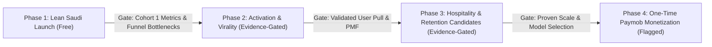

# Zaffe (زفّــة) — Product Strategy & Evidence-Gated Roadmap (v2.1)

> **Status:** `Proposed v2.1 — Pending Product Owner Approval` *(Refined Decision Review of `2026-11-20`)*  
> **Last Verified Date:** 2026-11-20  
> **Authoritative Code Baseline:** `dev` branch (`d833b95`)  
> **Companion Decision Pack:** [OPEN_QUESTIONS.md](../OPEN_QUESTIONS.md) (`DEC-01` – `DEC-07`) · [business-requirements-document.md](../../business/business-requirements-document.md) (`v0.3`) · [DOCUMENTATION_GUIDELINES.md](../../DOCUMENTATION_GUIDELINES.md)

> [!IMPORTANT]
> **Strategic Discipline Rule.** This strategy optimizes strictly for **winning Saudi adoption, maximizing invitation creation and WhatsApp sharing, and establishing a defensible luxury wedding brand** — not maximizing feature count. Nothing marked **`Proposed`** or **`Evidence-Gated Candidate`** is approved or authorized for implementation until the Product Owner signs off on `DEC-01`–`DEC-07` and the BRD.

---

## 1. Confirmed Strategic Anchor (`2026-11-20`)

Zaffe is a **premium digital wedding invitation platform**, not an event-operations or door-admission platform.
- **Core Value:** Beautiful Saudi-appropriate themes, ultra-simple creation and customization, mobile-first invitation experience, effortless publishing and WhatsApp sharing, Saudi cultural sensitivity and family privacy, and simple optional RSVP.
- **Confirmed Exclusions:** Physical guest admission, Gatekeeper (`/gate/{gateToken}`), venue check-in, QR scanning, and venue attendance operations are **excluded** from the current product strategy.
- **Confirmed Commercial Guardrails:** Release 1 remains **free** *(note: "Free Core Forever" is NOT approved; see `DEC-07`)*. Future monetization direction is **one-time payment per invitation via Paymob, without recurring subscriptions**.
- **Legacy Protection:** Existing user data, invitations, guest records, and links must be preserved cleanly.

---

## 2. Competitive Reality & Recommended Saudi Positioning (`Proposed`)

*Facts on Hayhom are code/web-verified in [COMPETITIVE_ANALYSIS_HAYHOM.md](COMPETITIVE_ANALYSIS_HAYHOM.md); broader Saudi market observations come from public research (`2026-11-20`) and represent strategic hypotheses to validate with early Saudi couples.*

1. **Pole A — Event-Ops & Door-Control Platforms (`Hayhom`, `Mazoom`, `Da3wa Online`, `Arheb`, `Kart`, `MyInvite`):** Sell bulk WABA/SMS messaging, guest quotas, native app onboarding, and QR door scanning (`Hayhom`: `185–10,950 SAR`, `<72h` modification lockouts). Over-engineered and intimidating for couples who simply want to send a refined WhatsApp wedding card.
2. **Pole B — Static Graphic Tools & Freelancers (`Canva`, `InShot`, Instagram/Salla designers):** Simple visual cards/videos, but static dead-end files with no live Google Maps button, no Hijri/Gregorian countdown, no tap-to-play zaffa audio, no post-send updates, and no optional RSVP.

**Recommended Positioning (`Proposed / Pending PO Approval`):**
> **Own the uncrowded middle between heavy Event-Ops apps and static Canva files:** *"Saudi Arabia's luxury digital wedding invitation studio — create a culturally authentic, mobile-first invitation in minutes, share it cleanly from your own WhatsApp, update details anytime, and toggle simple RSVP on or off — free for Release 1, with zero apps and zero event-ops clutter."*

---

## 3. Refined Phase 1 Launch Scope (`Quality Over Feature Quantity`)

To launch fast with zero distracting bloat and zero genuine security/privacy/trust gaps, Phase 1 is organized into **4 strict prioritization buckets**:

### 3.1 Bucket 1 — Mandatory Launch Blockers *(Must Ship Before Public Saudi Launch)*
*Why this category:* Any item here compromises security, Saudi privacy promises, production stability, legal readiness, or basic honesty.

| Item | Ref | Justification |
| :--- | :---: | :--- |
| **Admin delete media cleanup (`Invitation::deleting`)** | `DATA-01` | Prevents orphaned personal photos remaining on disk after Admin deletes an invitation. |
| **`SecurityHeaders` on `/admin/*` + Canonical `PlatformSetting` bulk-delete lock** | `SEC-05`, `SEC-06` | Closes clickjacking/MIME exposure on `/admin` and prevents accidental wiping of live site branding/contacts. |
| **Runtime & Resend mail config cleanup (`^8.4`, `.env.example`, `config/mail.php`)** | `CONF-01` | Prevents production PHP runtime errors and silent password-reset/RSVP email failures. |
| **Optional `bride_name` DB/validation + zero orphan `"و"`/`"&"` across 14 views, WhatsApp, dashboard, pass, emails** | `G-01`, `G-19`, `DEC-04` | Fulfills a core already-approved Saudi privacy directive (`SAUDI_MARKET_DECISIONS.md` §2) so omitting `bride_name` never fails or produces broken grammar. |
| **Production-safe Saudi Signature demo + `og-zaffe.jpg` + absolute `og:image` URLs** | `G-17`, `DEC-03` | Eliminates HTTP `404` on the homepage `"View Live Invitation"` CTA and fixes broken relative Open Graph images on WhatsApp sharing. |
| **Remove fake `/contact` Alpine form (keep real WhatsApp + Email cards) + set real Saudi `PlatformSetting` contacts** | `G-08`, `DEC-04` | Eliminates a misleading UI form that silently discards user messages (`UX-01`), without adding unnecessary DB/admin overhead. |
| **Phase 1 Privacy Essentials: `/privacy`, `/terms`, signup/RSVP privacy notice, working deletion request workflow/SLA** | `G-02`, `DEC-05` | Launch-necessary PDPL hygiene; full public commercial launch requires Legal Counsel review (`DEC-05` contrasts Beta vs. Commercial). |
| **De-promote QR Passes + simplify RSVP (`DEC-01`/`DEC-02`) + fix `Invitation::booted()`** | `G-18` | Aligns product identity with PO vision: hides QR passes/heavy roster from new Phase 1 creations while preserving legacy data and fixing `"بطاقة دخول"` wording. |

### 3.2 Bucket 2 — Core Product Experience *(Essential Saudi Card Polish & Accuracy)*
*Why this category:* Directly determines whether a Saudi couple trusts the card enough to send it to 150 relatives.

| Item | Ref | Justification |
| :--- | :---: | :--- |
| **Saudi regional defaults (`Asia/Riyadh`, `+966`, `/pricing` SAR/14-theme copy without "Free Forever")** | `G-09`, `DEC-04`, `DEC-07` | Matches Saudi primary market expectations and fixes stale `"6 themes"` copy while preserving future monetization flexibility. |
| **Suppress unedited `timeline` & `dress_code` `"Black Tie"` placeholders + hide placeholder toggles in Editor** | `G-11`, `DEC-04` | Prevents embarrassing English placeholder text on Saudi cards without building premature custom JSON editors (Saudi Signature themes already render `ceremonyStages()`). |
| **Fix `countdown.blade.php` `arabic_indic` numerals + 3 template bugs + `share_box` clipboard fallback** | `G-10`, `KSA-01` | Honors approved Hijri/numeral settings (`SAUDI_MARKET_DECISIONS.md` §3) and fixes `emerald_night`, `desert_dusk`, `islamic_elegance`, and `timeline.blade.php:33`. |
| **Fix `RsvpConfirmationNotification` declined copy + `DashboardController::index()` `children_count` & `archived` badge + `faq.blade.php` copy sync** | `DATA-02`, `UX-01` | Stops telling declined guests `"your attendance is confirmed"`, fixes dashboard headcount inaccuracies, and removes over-claimed `"full English"` FAQ wording. |

### 3.3 Bucket 3 — Growth Essentials *(Minimum Necessary for Organic Acquisition & Measurement)*
*Why this category:* You cannot scale or evaluate Phase 1 without reliable WhatsApp previews, a working viral footer link, and basic funnel visibility.

| Item | Ref | Justification |
| :--- | :---: | :--- |
| **Tasteful `?ref=invite` footer link (`/templates?ref=invite`)** | `BRQ-46`, `G-14` | Zero-cost attribution turning guest curiosity into measurable template-gallery visits. |
| **Clean `OperationsMonitor` KPI instrumentation (`KPI-01` start/publish, `KPI-02` `>=10` views, `KPI-03b` RSVP-enabled avg, `?ref=invite`)** | `BRQ-43` | Replaces proxy/distorted metrics so Phase 2 priorities rest on observed funnel truth rather than guesses. |

### 3.4 Bucket 4 — Post-Launch Improvements *(Safely Deferred Until Data Justifies)*
*Why deferred:* None of these block a Saudi couple from crafting, publishing, and sharing a stunning card in Phase 1; deferring them cuts weeks of engineering risk.
- Unmerged `F15` (`/i/` short URLs, cover-photo `OgImageService`, async GD WebP upload resizing) & `ZAFFE-017` multi-step wizard (`DEC-03`).
- Full English (`en`) translation of `InvitationEditor`, `RsvpForm`, and public cards (`G-12`, `DEC-04`).
- Couple dashboard `archive` button, custom `timeline`/`dress_code` JSON editors, `users.is_suspended` (`BR-032`), Admin `ListRsvpResponses` filter-aware export + minor Filament form fixes (`DATA-02` can be grouped neatly into Phase 1 or immediate post-launch patch), and automated cron PII retention jobs (`DEC-05`).

---

## 4. Minimum Reliable Phase 1 Production Architecture (`DEC-06`)

To avoid premature S3/Redis/Kubernetes complexity while delivering high reliability for Saudi mobile traffic:
- **Compute & Runtime:** Single managed VPS (`2 vCPU / 4 GB RAM`), Nginx + **PHP `8.4.1+` / `8.5`** with **`ext-intl`** (mandatory for Filament `Number::format()` & Umm al-Qura `IntlDateFormatter`), `pdo_mysql`, `gd`, `fileinfo`.
- **Database & Backups:** **MySQL 8.4** with daily automated off-site encrypted `mysqldump` + pre-deploy snapshots.
- **Queue & Cache:** Laravel `database` queue driver (`2` Supervisor workers) + `database`/`file` cache (NO Redis yet).
- **Media & CDN Edge:** Local `storage/app/public` backed up daily, fronted by **Cloudflare Free** (HTTPS/HSTS + Riyadh/Jeddah edge caching for self-hosted `.webp`/Vite assets, directly boosting mobile WhatsApp WebView LCP).
- **Mail & Monitoring:** **Resend Free Tier** (`3,000/mo`, SPF/DKIM/DMARC verified), external `/up` uptime monitor, and Filament `OperationsMonitor`.

---

## 5. Refined Evidence-Gated Multi-Phase Roadmap (`Proposed / Pending PO Approval`)

### Phase 2 — Growth, Activation & Viral Optimization *(Evidence-Gated — NOT Automatic Commitments)*
Focuses strictly on lifting creation completion, sharing rate, and guest-to-couple conversion based on Phase 1 data:

| Candidate Initiative | Evidence Trigger Required to Authorize |
| :--- | :--- |
| **True Dynamic Couple OG Cards & Short `/i/` Links (`F15` Evolution)** | Phase 1 sharing rate (`KPI-02`) lags OR qualitative feedback shows generic template thumbnails/long Arabic slugs hurt WhatsApp clicks. |
| **Async WebP Upload Compression (`PERF-02`)** | Real uploaded cover/gallery usage proves common (>15% of invitations) AND drives mobile LCP above `2.5s`. |
| **Guided Onboarding Simplification (`ZAFFE-017` Patterns)** | `KPI-01` shows drop-off between registration and first publish caused by form friction or calendar confusion. |
| **Curated Licensed Zaffe/Audio Library** | Hosts enable audio frequently or request built-in tracks because pasting raw `.mp3` URLs fails. |
| **Full English (`en`) Public Cards & Editor (`BRQ-36`)** | Measurable `/lang/en` switching or direct requests from bilingual/expat weddings in Riyadh/Jeddah/Cairo. |

### Phase 3 — Saudi Hospitality & Retention Candidates *(Evidence-Gated Pool Only)*
None of the following are committed until real Saudi customer interviews, support tickets, or cohort behavior validate willingness to use (and potentially pay for) them:

| Candidate Feature | Customer Research / Usage Signal Required to Promote |
| :--- | :--- |
| **Men's & Women's Dual-Hall Support** | Repeated support/interview requests from Saudi couples putting two hall addresses/maps inside `venue_address` or `invitation_message`. |
| **Multi-Event Wedding Suites (`Milka / Henna / Wedding`)** | High incidence of couples creating `2+` separate invitations for the same wedding cycle. |
| **Delegated Family Co-Hosts (`F18`)** | Requests from mothers/siblings/bride-vs-groom sides to manage separate guest lists or RSVP summaries privately. |
| **Moderated Guest Wishes Wall & Thank-You Card** | Strong usage of RSVP `message` field + post-wedding requests to export/share congratulations or thank guests. |
| **Optional Named Guest Personalization (`?g=` Revival, No QR)** | Couples actively asking to send named WhatsApp greetings (`"أهلاً د. فلان"`) once core creation is thriving. |
| **Saudi Signature Vol. 2 / New Theme Packs** | Template concentration >70% on top 2–3 themes or planner requests for regional styles (e.g., Asiri, AlUla, minimalist modern). |
| **Light Wedding Planner Workspace** | Organic signups from coordinators (`منسقات الحفلات`) managing `>= 3` client invitations under one account. |

### Phase 4 — One-Time Monetization (`F11` via Paymob — Evidence-Gated)
- Activated only after Phase 1–2 prove repeatable organic creation/sharing and unit costs are observed.
- Evaluates **Model A (Pay-at-Publish)** vs. **Model B (Free Core + One-Time Upgrade)** vs. **Model C (Free Basic Announcement + One-Time Royal Suite)** under `DEC-07` — strictly **one-time per wedding (`SAR`/`EGP`), zero subscriptions**, gated behind ZATCA/VAT legal clearance.

---

## 6. Concise Acquisition & Growth Strategy (`Phase 1`)

1. **Product-Led Guest-to-Couple Loop:** Reliable WhatsApp Open Graph previews + subtle `?ref=invite` footer link on every card so delighted guests discover Zaffe effortlessly.
2. **Short-Form Visual Storytelling (`TikTok`, `Snapchat`, `Instagram Reels`):** 15–25s Arabic vertical clips demonstrating Saudi Signature elegance, Umm al-Qura Hijri conversion, optional bride-name privacy, and instant mobile edits — zero mention of QR/door ops.
3. **Seeded Coordinator & Stylist Circle (`10–20` Riyadh/Jeddah/Cairo Partners):** Personal WhatsApp walkthroughs inviting boutique planners and bridal stylists to adopt Zaffe for clients' digital cards.
4. **High-Intent Arabic SEO + Zero-Login Live Preview:** Optimize `/templates` and `/templates/{slug}/preview` around high-intent Saudi wedding invitation queries with instant try-before-register previews.

---

## 7. Major Assumptions Requiring Customer Validation (`First 50–100 Saudi Couples`)

| # | Assumption | How to Validate in Cohort 1 | Impact if Disproven |
| :---: | :--- | :--- | :--- |
| **A-1** | Saudi couples value interactive web microsites enough to replace static Canva/PDF cards. | Track `KPI-02` (`>=10` views/card) & post-publish survey. | Strengthen downloadable summary card / image export in Phase 2. |
| **A-2** | Omitting `bride_name` & photo-free templates directly unlocks conservative family adoption. | Measure `%` of invitations omitting `bride_name` or photos. | Adjust default form framing & kunya helper hints. |
| **A-3** | Simple ON/OFF RSVP meets 80%+ of Phase 1 coordination needs without named guest lists (`?g=`). | Support logs & churn/feedback from RSVP-enabled hosts. | Prioritize named `?g=` links (`F16-A` revival) in Phase 2/3. |
| **A-4** | Couples prefer WhatsApp direct links over automated system-sent WhatsApp blasts. | Measure actual WhatsApp share clicks & completion rates. | Re-evaluate paid WABA dispatch add-ons post-PMF. |
| **A-5** | Guests click a subtle footer link to create their own wedding cards (`?ref=invite`). | Instrument `?ref=invite` -> registration conversion in Cohort 1. | Invest more in TikTok/SEO/partnerships rather than relying on viral loop. |
| **A-6** | Most Saudi couples start creation on mobile browsers rather than desktop. | Observe mobile vs. desktop studio sessions & `KPI-01`. | Prioritize mobile editor ergonomics over desktop features. |
| **A-7** | Couples will pay a one-time fee (`Model A` vs `B/C`) once value is proven. | Post-wedding willingness-to-pay interviews before Phase 4. | Selects between Pay-at-Publish and Upgrade-to-Royal models (`DEC-07`). |

---

## 8. Product Decision Log (`PDL-001` – `PDL-016`)

*(Entries `PDL-001`–`PDL-009` preserved from `2026-11-15`/`2026-11-19` log with reconciliation status; `PDL-010`–`PDL-016` record the `2026-11-20` realignment.)*

| ID | Date | Decision / Proposal | Status |
| :--- | :---: | :--- | :--- |
| **PDL-001** | `2026-11-15` | Release 1 remains `100%` Free *(Free Core Forever NOT approved)* | **CONFIRMED (R1 Only)** |
| **PDL-002** | `2026-11-15` | Reject physical gatekeeper staffing & human custom design agency | **CONFIRMED** |
| **PDL-003–004** | `2026-11-15` | Pure-PHP zero-PII `QrCodeService` | **SHIPPED IN `dev`** *(Legacy preservation only)* |
| **PDL-005** | `2026-11-15` | Gatekeeper Portal (`/gate/{token}`) | **EXCLUDED FROM STRATEGY (`2026-11-20`)** |
| **PDL-006 / 008** | `2026-11-15` | `F16` Part A/B Hayhom QR parity strategy | **SUPERSEDED / RECONCILED** (`DEC-01`, `DEC-02`) |
| **PDL-007** | `2026-11-15` | Gate WABA, SMS, Paymob (`F11`), `bride_name` DB changes behind PO sign-off | **CONFIRMED** |
| **PDL-009** | `2026-11-19` | Saudi Signature Collection Vol. 1 (`sort_order 1–8`) | **SHIPPED IN `dev`** |
| **PDL-010–011** | `2026-11-20` | Design-led Saudi studio identity; no QR promotion; Gatekeeper excluded; legacy data protected | **CONFIRMED BY PO (`2026-11-20`)** |
| **PDL-012** | `2026-11-20` | Lean 4-bucket Phase 1 launch + evidence-gated Phases 2–4 | **`Proposed / Pending PO Approval`** |
| **PDL-013** | `2026-11-20` | `DEC-01`: Endorse PO Option B (Legacy-only Guest Roster visibility) | **`Proposed / Pending PO Approval`** |
| **PDL-014** | `2026-11-20` | `DEC-02`: Binary RSVP ON/OFF toggle (`rsvp_only` vs `announcement`) + `Invitation::booted()` fix | **`Proposed / Pending PO Approval`** |
| **PDL-015** | `2026-11-20` | `DEC-03` & `DEC-04`: Surgical OG/demo fixes; remove fake `/contact` form; suppress unedited `timeline`/`dress_code` placeholders; fix `bride_name` & `arabic_indic` | **`Proposed / Pending PO Approval`** |
| **PDL-016** | `2026-11-20` | `DEC-05`–`DEC-07`: Phase 1 PDPL basics + Beta vs Commercial distinction; unapproved retention left open; lean single-VPS stack; Release-1-only free copy guardrail | **`Proposed / Pending PO Approval`** |
