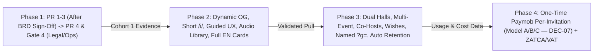

# Zaffe (زفّــة) — Product Strategy & Evidence-Gated Roadmap (v2.3)

> **Status:** `v2.3 — Consolidated With Final PO Decisions (DEC-01..04, DEC-07, C-5..C-7, KPI-03b, KPI-05 Approved) — Ready for Formal BRD Sign-Off`  
> **Last Verified Date:** 2026-11-21  
> **Authoritative Code Baseline:** `dev` branch (`d833b95`)  
> **Governance & Companion Docs:** [OPEN_QUESTIONS.md](../OPEN_QUESTIONS.md) · [business-requirements-document.md](../../business/business-requirements-document.md) (`v0.5`) · [MASTER_ROADMAP.md](../../engineering/MASTER_ROADMAP.md) · [DOCUMENTATION_GUIDELINES.md](../../DOCUMENTATION_GUIDELINES.md)

> [!IMPORTANT]
> **Gate 2 Discipline (`Business First, Code Second`):** Decisions `DEC-01`–`DEC-04`, `DEC-07`, `C-5`–`C-7`, `KPI-03b`, and `KPI-05` are explicitly **PO Approved**. Application engineering (`Gate 3`: `PR 1`–`PR 3`) waits for formal sign-off on the consolidated BRD (`v0.5`) & canonical docs; `PR 4` and production launch stay gated on legal (`DEC-05`, `EX-01`) and operational/hosting clearances (`DEC-06`, `Gate 4`).

---

## 1. Confirmed Strategic Anchor (`2026-11-21`)

Zaffe is a **premium, Arabic-first digital wedding invitation platform**, **not** an event operations, guest admission, venue check-in, or physical attendance management product.
- **Core Loop:** **Choose a Design → Customize → Preview → Publish → Share** *(optional simple RSVP disabled by default per `DEC-02` Option B)*.
- **Confirmed Exclusions:** Physical admission, Gatekeeper (`/gate/{gateToken}`), venue check-in, QR scanning, subscriptions, native apps, and custom design agency work.
- **Commercial Policy (`DEC-07`):** Release 1 is completely free (`$0`, no paywalls, all `14` themes). Future monetization remains **one-time payment per invitation**, with final model (`A/B/C`) intentionally undecided until usage and cost data exist (**NO `"Free Forever"`, NO fake urgency/deadlines, NO retroactive charges without a separate transition policy**).
- **Data Preservation:** Existing users, invitations, legacy QR modes/passes, `?g=` links, `rsvp_responses`, `music_url` metadata, and non-WebP uploaded photos remain protected (`BRQ` §10.1).

---

## 2. Competitive Reality & Saudi Market Positioning

1. **Pole A — Event-Ops & Door Suites (`Hayhom`, `Mazoom`, etc.):** Heavy WABA/SMS/scanner flows starting around `185+ SAR` with `<72h` lockouts ([COMPETITIVE_ANALYSIS_HAYHOM.md](COMPETITIVE_ANALYSIS_HAYHOM.md)).
2. **Pole B — Static Design Files (`Canva`, `InShot`):** Static images/videos with zero Google Maps navigation, zero Umm al-Qura Hijri/Gregorian countdowns, zero live post-send edits, and zero optional RSVP.
3. **Zaffe Position:** Luxury Saudi wedding designs + effortless link sharing + optional simple RSVP + cultural family privacy (`bride_name` optional, photo-free themes, view-first `announcement` default), built cleanly for mobile WhatsApp WebViews.

---

## 3. Final Proposed Phase 1 Scope *(Unblocked Code Work vs. External Pre-Launch Gates)*

### 3.1 Approved Phase 1 Delivery *(Authorized Upon Formal BRD `v0.5` Sign-Off — PRs 1–3)*

- **`PR 1` Security, Self-Service Deletion & Config (`Zero Business Risk`):** **`BRQ-13` / `DEC-05` Self-Service Dashboard Invitation Deletion (`BR-002`, `BR-018`, `BR-037`)** (harden `/dashboard/invitations` confirmation modal, wrap `DashboardController::destroy()` in `DB::transaction()` + post-commit media cleanup unified with `DATA-01`, and test authorized delete, IDOR rejection, FK cascades, partial failures & post-delete `404`), `DATA-01` Admin delete media cleanup, `SEC-05` `/admin/*` `SecurityHeaders`, `SEC-06` canonical `PlatformSetting` delete lock, `CONF-01` PHP `^8.4` & `.env.example`/mail cleanup, and critical `DATA-02` Admin table/CSV export hardening.
- **`PR 2` Core Saudi Studio, Optional RSVP (`DEC-01`/`02`) & Audio Gate (`C-6`):**
  - Nullable non-destructive `bride_name` + zero orphan connectors across all `14` themes, emails, dashboard, WhatsApp share text, and passes (`DEC-04.1`).
  - `DEC-01` Option B legacy-only `GuestRosterManager` guard (`/guests` shows calm RSVP summary & CSV export only on new cards; legacy rows/links/`/pass/{qrToken}` untouched).
  - `DEC-02` Option B view-first `announcement` default (`is_rsvp_enabled = false`), simple binary **Enable/Disable RSVP** (`rsvp_only` ↔ `announcement`), non-destructive off, fix **both** `Invitation::booted()` & `InvitationEditor::updatedIsRsvpEnabled()`, clean `"بطاقة دخول"` → `"بطاقة الدعوة الشخصية"`, zero QR promotion.
  - **`C-6` Option A:** Hide external `music_url` input on newly created Phase 1 invitations while preserving stored legacy DB metadata cleanly without autoplay.
  - Saudi defaults (`Asia/Riyadh`), `arabic_indic` countdown fix, suppress `"Black Tie"` placeholders (`DEC-04.3`), `emerald_night`/`desert_dusk`/`islamic_elegance`/`timeline.blade.php:33`/`share_box.blade.php:30`/email fixes.
- **`PR 3` WebP Uploads (`C-5`), Int'l Phone (`C-7`), WhatsApp/Demo (`DEC-03`), Honest Copy & KPIs:**
  - **`C-5` Option A (`ImageOptimizationService`):** Convert new customer cover & gallery uploads to optimized `.webp` using verified `gd` WebP support with MIME/size/pixel-budget memory guards, graceful failure recovery (**write-before-delete**), zero batch alteration of historical photos, and real-image tests.
  - **`C-7` Option B (`PhoneService` + 3 Forms):** Fix `PhoneService` fallback bug, default to `SA (+966)`, offer `EG (+20)` & `Other Country` international E.164 across `/register`, `/dashboard/profile`, and `RsvpForm` while keeping phone optional.
  - **`DEC-03` Option A + `DEC-04.2/4.4/4.5` + `DEC-07`:** `public/images/og-zaffe.jpg`, absolute `https://` `og:image`, **stateless production-safe Saudi `/demo` route**, remove fake `/contact` form keeping real WA/Email cards, truthful non-forever/non-urgency `/pricing`/`/about`/`/faq` (`14` themes, Arabic-first P1 cards), fix dashboard `children_count`/`archived` badge.
  - **Approved Metrics (`KPI-01`–`KPI-05`):** Implement `/templates?ref=invite` footer + **`KPI-05a/b/c`** privacy-safe 3-stage attribution, **`KPI-03b`** state-accurate RSVP-enabled average alongside preserved `KPI-03`, and `KPI-01`/`KPI-02` inside `OperationsMonitor`.

### 3.2 Pre-Launch External Blockers *(Must Clear Before `PR 4` & `Gate 4` Public Launch)*

| Gate | Requirement Pending External Input / Clearance | Reference |
| :---: | :--- | :--- |
| **`DEC-05`** | Saudi PDPL Counsel sign-off on `/privacy`, `/terms`, **proposed 30-day guest/RSVP PII retention preference** *(auto-delete OFF)*, privacy request SLA & verification owner | [OPEN_QUESTIONS.md](../OPEN_QUESTIONS.md) §3.2 (`EX-02`, `EX-03`) |
| **`C-6` / `EX-01`** | Legal & PO ruling on whether pre-existing invitations containing external `music_url` may remain publicly playable or must be gated/paused | [OPEN_QUESTIONS.md](../OPEN_QUESTIONS.md) §3.2 (`EX-01`) |
| **`DEC-06`** | Verified Hostinger compatibility (`PHP >= 8.4.1`, `ext-intl`, **`gd` WebP + `memory_limit`**, MariaDB, cron/sync queue, EU residency, renewal quote) OR KVM 1/2 VPS approval; **no purchase without authorization** | [OPEN_QUESTIONS.md](../OPEN_QUESTIONS.md) §4 |
| **`DEC-06`** | Real Saudi support email & WhatsApp/phone, confirmed domain & Resend DNS, named ops owner, confirmed Sponsor, budget & launch date, staging & live HTTPS preview checks | [OPEN_QUESTIONS.md](../OPEN_QUESTIONS.md) §5 |

---

## 4. Minimum Reliable Architecture (`DEC-06` Provisional)

Candidate under verification: **Hostinger 12-month "Unlimited" shared plan** (not purchased, not a VPS). Prior to authorization, ops verification must confirm web & CLI `PHP >= 8.4.1`, CLI `ext-intl`, **`gd` with `WebP Support` and sufficient `memory_limit` for `C-5` image conversion**, MariaDB migration compatibility, `sync` password reset + 1-min locked cron queue worker reliability, EU datacenter PDPL disclosure (`EX-03`), external encrypted backup restoration, and renewal pricing — keeping **Hostinger KVM 1/2 VPS** as the clean single-node fallback if shared hosting fails any requirement, with zero Redis clusters, S3, or Kubernetes.

---

## 5. Evidence-Gated Multi-Phase Roadmap *(Phases 2–4 Deferred)*

---

## 6. Growth Loop & Validation Cohort

1. **WhatsApp Link Trust + `/templates?ref=invite` Attribution (`KPI-05a/b/c`).**
2. **Short-Form Arabic Video + Partner Planners (`TikTok`, `Snapchat`, `Reels`).**
3. **Cohort 1 Learning (`First 50–100 Saudi Couples`):** Test interactive microsite value (`KPI-02`), optional `bride_name` & photo-free adoption, `announcement` vs. opt-in `rsvp_only` demand (`KPI-03b`), `?ref=invite` signup conversion (`KPI-05b/c`), and post-wedding one-time willingness-to-pay (`DEC-07` `Model A vs B/C`).

---

## 7. Product Decision Log (`PDL-001` – `PDL-021`)

| ID | Date | Decision Summary | Status (`2026-11-21`) |
| :--- | :---: | :--- | :--- |
| **PDL-001–002** | `2026-11-15` | Release 1 Free (no `"Free Forever"`, no fake urgency); exclude venue staffing, custom design agency, SMS/WABA blasts | **PO APPROVED (`DEC-07`)** |
| **PDL-003–005** | `2026-11-15` | Pure-PHP QR service (`Legacy Preservation Only`); Gatekeeper `/gate/{token}` (`EXCLUDED FROM STRATEGY`) | **PO APPROVED** |
| **PDL-009–015** | `2026-11-19`–`21` | `14` free `.webp` themes; `DEC-01` Option B (`Legacy Roster`); `DEC-02` Option B (`announcement` default + `booted()`/`Editor` fixes); `DEC-03` Option A (HTTPS OG/stateless Saudi demo, `F15`/`ZAFFE-017` unmerged); `DEC-04.1`–`4.5` | **PO APPROVED** |
| **PDL-016** | `2026-11-21` | `DEC-05`: Conditional Full Public Saudi Launch, self-service invite delete + privacy request SLA, 30-day proposed guest PII preference *(auto-delete OFF)* | **BUSINESS DIRECTION APPROVED; LEGAL PENDING** |
| **PDL-017** | `2026-11-21` | `DEC-06`: Candidate Hostinger Unlimited evaluation (no purchase), real contacts, domain/Resend | **PARTIALLY APPROVED / OPS PENDING** |
| **PDL-018** | `2026-11-21` | **`C-5` Option A** (new uploads → `.webp` with memory/failure guards; historical media untouched) | **PO APPROVED** |
| **PDL-019** | `2026-11-21` | **`C-6` Option A** (hide `music_url` on new P1 cards; preserve DB metadata; **`EX-01` legacy playback escalated**) | **PO APPROVED (`EX-01` ESCALATED)** |
| **PDL-020** | `2026-11-21` | **`C-7` Option B** (`SA +966` default, `EG +20`, `Other Country` international E.164; phone optional) | **PO APPROVED** |
| **PDL-021** | `2026-11-21` | **`KPI-03b`** & **`KPI-05` (`KPI-05a` visits / `KPI-05b` signups / `KPI-05c` referred publishes)** | **PO APPROVED (`DEC-06`)** |
